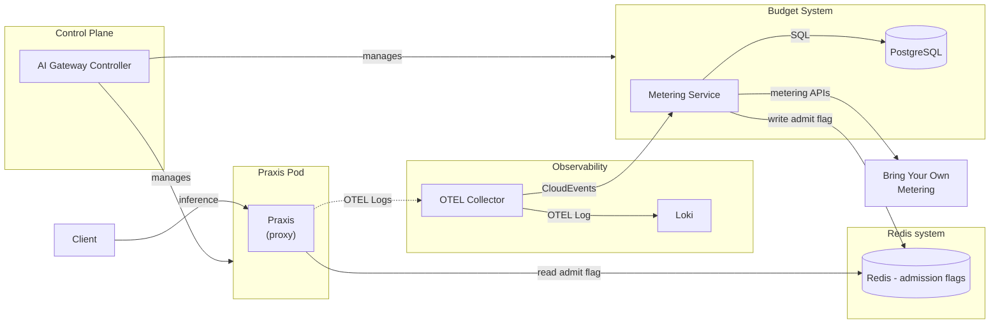
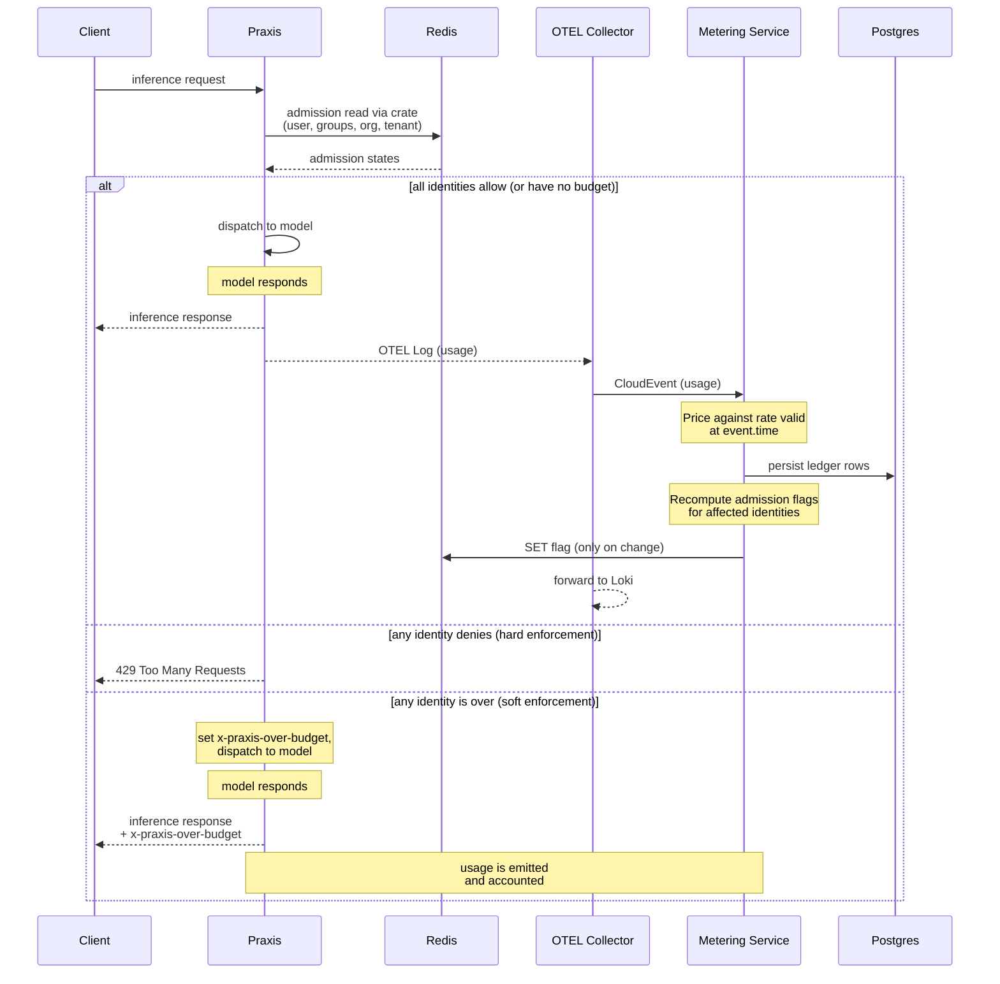
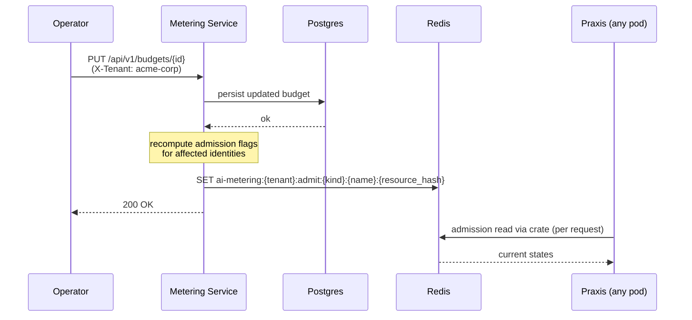
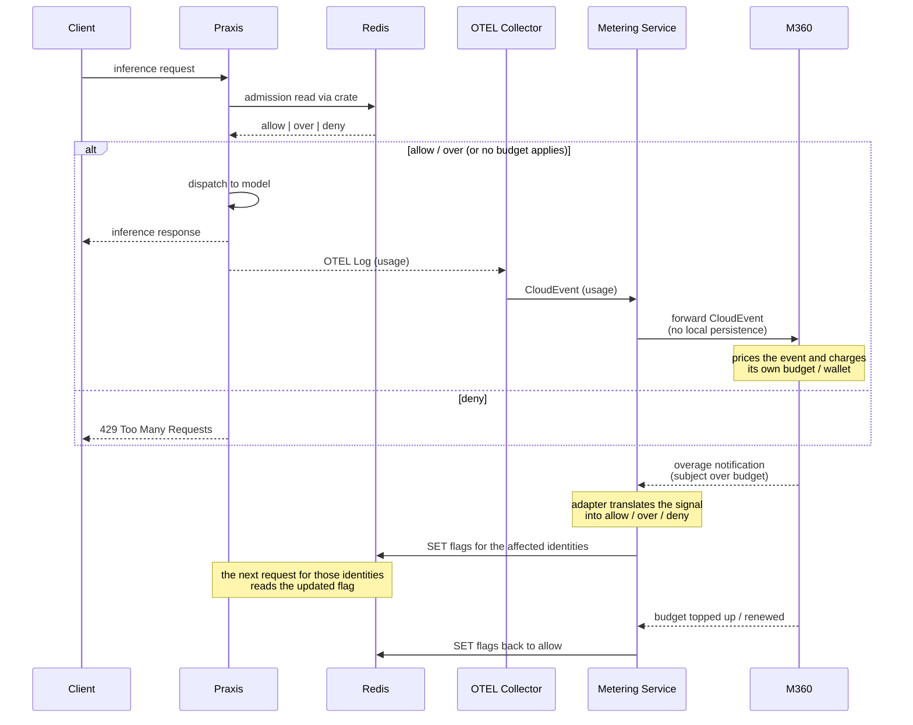
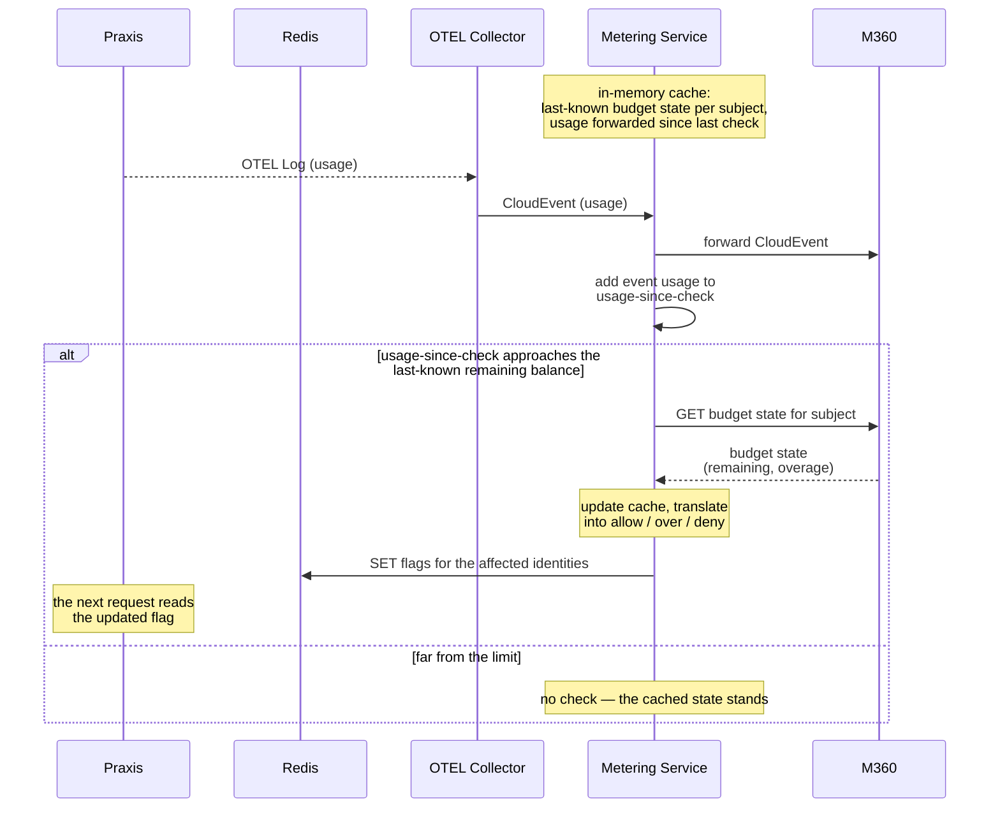

# Open Data Hub - AI Gateway Tokenomics and Metering Service

<!-- copy and paste this template to start authoring your own ADR -->
<!-- for the Status of new ADRs, please use Approved, since it will be approved by the time it is merged -->
<!-- remove this comment block too -->

|                |            |
| -------------- | ---------- |
| Date           | insert date |
| Scope          | |
| Status         | Approved |
| Authors        | Marius Danciu, Aslak Knutsen, Daniele Zonca |
| Supersedes     | N/A |
| Superseded by: | N/A |
| Tickets        | |
| Other docs:    | none |

## What

This document proposes a new usage metering solution that is part of the RHOAI product. It allows customers to configure and manage costs and attribution and also visualize usage in the UI dashboards.

## Why

Usage metering and budget enforcement is a major feature of AI Gateway and a very frequent topic raised by customers.

## Goals

* Define the architecture for the Metering Service
* Define the Metering Service APIs
* Define the contract between Praxis and the Metering Service for looking up the budget and quota status of a request's identity. Praxis asks with the identity it already resolved and receives an admission state; it does not evaluate policies, compute cost, or read counters itself.
* Deliver that lookup as a crate the Metering Service publishes, so Praxis depends on the lookup API and not on how or where the status is stored.
* Define end-to-end flows
* Define the high-level integration with third-party solutions like M360 or OpenMeter, but the actual integration details may be subject to different ADRs in later phases
* This is meant to be a usage metering solution as part of MaaS that works out of the box without bringing in new dependencies (such as Kafka) that customers need to install and manage. Customers don't need to perform extra installation steps in order to have usage metering and budget quota enforcement enabled.
* Budget quota enforcement is intentionally kept as a separate concept from rate limiting. Rate limiting is a QoS topic that for now remains managed in MaaSSubscription at control plane level and applied by Praxis at data plane level.
* Budget cost is abstracted away and referred to in this document as Budget Units (BU).

## Non-Goals

* This is not a billing service. We do not intend to manage aspects like:
    * multi currency
    * invoices
    * billing cycles
    * auditability and disputes
* This is not a generic competing solution for M360 or OpenMeter
* Usage for other resource types apart from tokens, e.g., GPUs. However, the design is flexible so we can address other types of resources in the future.
* The Metering Service storage does not represent the SoR for usage metering. The document will address this separation in the next sections.
* Pacing (spend-rate policies such as daily sub-limits derived from a monthly budget). The architecture supports it in the Metering Service without changes to Praxis or the object model, but it is out of scope for the initial implementation.
* Overage fallback levels (`group`, `organization`, `tenant`). The initial implementation supports only `soft` overage — charging the same budget past its limit. Fallback levels require resolving which fallback budget applies from group and organization membership that is only known at request time, which significantly complicates policy resolution, accounting, and flag computation. The flag schema and the admission contract are designed so fallback levels could be added later without changes to Praxis.
* Multiple tenants per gateway. The initial implementation supports one tenant per gateway. Multi-tenant gateways may be considered in later releases.
* Distributed tokenomics across multiple clusters. This ADR assumes a single-cluster deployment. Federated budget enforcement, cross-cluster balance synchronization, and multi-cluster usage aggregation are not addressed.

## How


### Architecture



Notes:
- The Praxis pod runs Praxis and the OTEL Collector; no budget component runs alongside the proxy.
- Praxis is the PEP (Policy Enforcement Point), and its entire budget input is an admission flag maintained in Redis by the Metering Service. Policy resolution, rate matching, cost computation, balance updates, and period renewal all happen in the Metering Service.
- Praxis reads that flag through a crate published by the Metering Service. The crate owns the Redis key layout, value encoding, and key escaping, so no Praxis code names a key, and a layout change does not require a Praxis release.
- Redis/Valkey holds the admission flags Praxis reads, plus the balance counters the Metering Service derives those flags from. The Metering Service is the only writer; Praxis holds a read-only credential. Configuration objects (policies, rates, budget definitions) are never stored in Redis.
- Accounting is asynchronous: Praxis emits a usage event after the response, and the Metering Service prices and persists it. Enforcement therefore reflects state as of the last accounted event rather than the current request (see [Admission Contract](#admission-contract)).
- To limit the number of dependencies, this proposal does not assume the existence of a pub/sub system such as Kafka. However, adding one later can be considered as a mechanism to control back pressure and provide ordering for deduplication. The OTEL Collector could also be a candidate for deduplication, but this ADR does not prescribe an OTEL Collector design. We assume that an existing OTEL Collector is used and that it is at least capable of receiving the usage events and propagating them to both the SoR as OTEL logs and to the Metering Service as CloudEvents.

#### Inference Flow (admission and accounting)



#### Configuration Update Flow

This section describes how control plane settings reach the data plane.



##### Admission State Propagation

The admission flag is derived state. The Metering Service computes it from the durable ledger and configuration, and writes it to Redis. No component in the Praxis pod fetches or caches budget configuration.

Each gateway serves exactly one tenant and may have multiple Praxis pods. Because the flags live in Redis, every Praxis replica reads the same state without any coordination between pods.

The Metering Service republishes the full flag set for its tenants on startup and after any Redis reconnection. This is required because an empty Redis and a tenant with no budgets are indistinguishable to a reader — both return absent keys. Without the republish, a flushed Redis would quietly mean "unlimited" until each identity happened to produce usage again.

##### How state flows

1. An operator creates or updates a rate, budget, or policy via the Metering Service REST API, or a usage event arrives and changes consumption
2. The Metering Service persists the change and recomputes the admission flag for every identity object affected by it
3. The Metering Service writes the recomputed flags to Redis. Praxis observes them on its next request; it holds no local state to invalidate

On startup, Praxis needs no budget initialization at all. It reads flags per request and treats absent keys as "no budget applies".

##### What lives where

| Store | Data | Role |
|---|---|---|
| Redis | Admission flags, balance counters | Flags read by Praxis at admission and the balances the Metering Service derives them from. Written only by the Metering Service |
| Metering Service | Policies, rates, budgets, rate history, consumption | Authoritative source for all budget state. Serves the management and metering APIs and owns the accounting loop |
| Postgres | Definitions, usage ledger, rate history | Durable store behind the Metering Service (or the provider's own store in federated mode) |

##### Consumption data

Consumption data is the only accounting input. Praxis emits an OTEL Log after each response, the OTEL Collector transforms it into a CloudEvent, and the Metering Service prices it, persists it to the durable backend, and updates the admission flags (see [Consumption Emission](#consumption-emission)). Because the same pass prices, persists, and derives the flag, the ledger and the admission state cannot disagree.

##### Failure Modes

| Scenario | Behavior |
|---|---|
| Redis unavailable | Praxis cannot read flags and applies its configured fail-open or fail-closed behavior (see [Open Questions](#open-questions)). Accounting is unaffected — the Metering Service keeps ingesting. On reconnect it republishes the full flag set, including after a data loss |
| Metering Service unavailable | Flags freeze at their last values and usage events buffer in the collector. A prolonged outage can both admit traffic that should now be denied and deny traffic whose budget was since topped up. State converges when the service recovers and republishes |
| Usage event lost | Balance and flags under-count that request until reconciliation rebuilds them from the ledger. Enforcement is wrong in the permissive direction until then |


#### Multi-Tenancy

The Metering Service is a single shared instance serving all tenants (soft multi-tenancy). All data is tenant-scoped and every management API request must carry the `X-Tenant` header to identify which tenant's budgets, rates, or policies are being managed.

At the gateway level, each gateway serves exactly one tenant. The Praxis read credential is scoped to that tenant: it can read only `ai-metering:{tenant}:admit:*` and nothing else. Because Praxis never writes budget state, the data-plane identity is read-only, which makes cross-tenant tampering a configuration error rather than an exploitable path.

| Component | Tenancy model |
|---|---|
| Metering Service (central) | Single instance, soft multi-tenancy. All API calls scoped by `X-Tenant` header |
| Gateway (Praxis) | One tenant per gateway. Holds a read-only Redis credential limited to that tenant's `ai-metering:{tenant}:admit:*` keys |
| Redis | Keys namespaced by tenant ID, with per-tenant ACLs scoping which keys each credential may touch |
| Postgres | All tables include a tenant ID column |


### Budget object model

The budget domain is modeled with three objects: **Rate**, **Budget**, and **BudgetPolicy**.

#### Rate

Defines BU costs per usage unit for a given resource. Resource matching and cost keys are flexible key-value maps — new usage categories (images, tool calls, video seconds) require no schema change.

| Field | Type | Description |
|---|---|---|
| `name` | string | Unique identifier for this rate table |
| `items` | list | One or more rate items (see below) |

Each **RateItem** contains:

| Field | Type | Description |
|---|---|---|
| `resource` | map | Resource matching keys (e.g., `model`, `provider`, `region`). An item matches when every one of its keys equals the event's corresponding key; keys left out are unconstrained, and an empty map matches every resource |
| `costs` | map | BU per usage unit (e.g., `input_tokens: 3`, `output_tokens: 15`, `cache_read_tokens: 1`) |

The resource and cost keys are dynamically set. Admins can provide any key-value pairs here. However, for end-to-end consistency the cost fields emitted by Praxis in the OTEL logs are shown in the [Consumption Emission](#consumption-emission) section.

#### Budget

Pure capacity definition — how much BU and when it resets. No subject, no enforcement, no rates.

| Field | Type | Description |
|---|---|---|
| `name` | string | Unique identifier for this budget |
| `limit` | integer | BU capacity for each period |
| `period.start` | timestamp | UTC anchor for period calculation |
| `period.duration` | duration | Fixed period length (e.g., `P1M`, `P3M`, `P7D`) |
| `renewal` | one of | Reset behavior at period boundary |

**Renewal** variants:

| Variant | Fields | Description |
|---|---|---|
| `drain` | — | Use it or lose it; balance resets to `limit` each period |
| `rollover` | `max_carry` (optional) | Unused BU carry forward, optionally capped |

#### BudgetPolicy

Binds one or more subjects to a budget with a rate table and optional overage behavior. A policy can list multiple subjects — all share the same budget, rate, and overage configuration. When per-subject customization is needed (different rates or overage behavior), create separate policies.

| Field | Type | Description |
|---|---|---|
| `budget_ref` | string | References a Budget by name |
| `rate_ref` | string | References a Rate by name — controls BU pricing for all subjects in this policy |
| `subjects` | list | One or more subjects (see below) |
| `subjects[].kind` | one of | `user`, `group`, `organization`, or `tenant` |
| `subjects[].name` | string | Identity of the subject |
| `overage` | optional | Overage behavior when the budget is exhausted. Only `soft` is supported in the initial implementation (see below) |
| `deduct_overage` | optional, boolean | If true, any overage from the previous period is deducted from the next period's balance at renewal. Defaults to false |

If `overage` is absent, enforcement is **hard** — requests are rejected with 429 when the budget is exceeded.

**Overage** variant:

| Variant | Fields | Description |
|---|---|---|
| `soft` | `rate_ref` (optional) | Continue charging this budget past the limit, optionally at a different rate. Injects `x-praxis-over-budget: true` header upstream |

Fallback overage levels — charging a group-, organization-, or tenant-level budget once the subject's own is exhausted — are not supported in the initial implementation (see Non-Goals). Resolving which fallback budget applies depends on group and organization membership that is only known at request time, which makes policy resolution and accounting significantly more complex for a benefit that soft overage already covers in the common case.


#### Budget Units (BU) as the Accounting Abstraction

Budget Units are an important simplification from actual currency and reinforce the claim that this is not a billing system. Customers can attribute actual currency amounts per BU if necessary, but again this is not the SoR.

A budget becomes straightforward:

- Budget limit: 100,000 BU per 30-day period
- Each model has a BU rate table (potentially different per tenant/group)
- Consumption = tokens used * BU rate for that token type and model
- Remaining = limit - total consumption in BU


### Separation of Concerns: Rate Limiting vs Budget Enforcement

Rate limiting and budget enforcement answer fundamentally different questions:

| Concern | Question | Protects | Example |
|---|---|---|---|
| Rate limiting | Too fast? | Infrastructure from overload | 100 req/s max |
| Budget enforcement | Too much total? | Cost control | 1000 USD/month cap |


Rate limiting belongs in the proxy regardless of tokenomics — it protects backend model servers from burst traffic. Budget enforcement is a business concern that belongs in the budget system.

OpenMeter, for comparison, handles entitlements (budget/quota enforcement) but not rate limiting. These are separate systems in practice.


### BU Cost Computation

The BU cost for a request is computed by matching usage keys against the rate table's cost keys:

```
cost_bu = sum(usage[key] * rate.costs[key]) for all keys in rate.costs
```

Both `usage` and `rate.costs` are dynamic key-value maps. For the initial token-based implementation, the well-known cost keys are:

| Key | Meaning |
|---|---|
| `input_tokens` | Input tokens (excluding cache reads and writes) |
| `output_tokens` | Output tokens (excluding reasoning) |
| `cache_read_tokens` | Input tokens served from cache |
| `cache_write_tokens` | Input tokens written to cache |
| `reasoning_tokens` | Output tokens used for reasoning |

For example, with the `standard` rate from the sample config (`input_tokens: 3, output_tokens: 15, cache_read_tokens: 1, cache_write_tokens: 4, reasoning_tokens: 15`):

```
cost_bu = 312 * 3 + 87 * 15 + 20 * 1 + 5 * 4 + 30 * 15 = 2711 BU
```

New cost keys (e.g., `image_count`, `tool_calls`, `video_seconds`) can be added to rate tables without schema changes — the formula applies generically to any keys present in both the usage data and the rate table.

**Guards:**

- **Negative values.** Usage counts and rate costs must be non-negative integers. A negative token count or a negative rate would add units back to a budget, effectively crediting the subject for making requests. The Metering Service must reject usage events with negative counts and reject rate table entries with negative costs at validation time. The computed per-event `cost_bu` is always >= 0. Note: the **balance counter** in Redis can and will go negative — that is overage, not an error. How negative balances are handled at renewal depends on the budget's renewal type and the policy's `deduct_overage` setting (see [Overage Tracking and Period Carry-Forward](#overage-tracking-and-period-carry-forward)).
- **Overflow.** The per-charge `bu_cost` column (in `usage_charges`) is a `bigint` (signed 64-bit, max ~9.2 × 10¹⁸). A single event cannot realistically overflow this — even 1 billion tokens at a rate of 1 billion BU per token produces 10¹⁸, which fits. However, the Metering Service should check for arithmetic overflow during cost computation and reject the event with an error rather than silently wrapping. Balance counters in Redis (also 64-bit signed integers) have the same range; cumulative spend across a budget's lifetime could approach the limit only with extreme rate values, in which case the operator should use smaller BU weights.

Different subjects can have different rate tables assigned via their BudgetPolicy `rate_ref`. The same model costs different subjects different BU amounts. This makes the rate table a unified pricing and discount mechanism — no secondary discount logic is needed.

#### Token Limits via Unit-Cost Rate Tables

The same cost computation formula naturally supports raw token limits — no additional concepts are required. A rate table where every cost key has a weight of 1 turns the BU cost into a plain token count:

```yaml
rates:
  - name: token-counting
    items:
      - resource: {}   # empty map: the catch-all — every dimension unconstrained
        costs:
          input_tokens: 1
          output_tokens: 1
          cache_read_tokens: 1
          cache_write_tokens: 1
          reasoning_tokens: 1
```

With this rate table, the formula `sum(usage[key] * rate.costs[key])` reduces to `sum(usage[key] * 1)` = total tokens consumed. A Budget with `limit: 1000000` and a BudgetPolicy referencing `rate_ref: token-counting` enforces a 1,000,000 token cap.

A subject can have **two policies**: one referencing a weighted rate table (e.g., `standard`) against a BU budget for cost control, and one referencing a unit-cost rate table (e.g., `token-counting`) against a token budget for capacity control. The Metering Service charges both and folds both into the same (identity, resource) admission flag using the most restrictive outcome, so Praxis does not need to know that two budgets exist.

This means that token limits as defined in MaaSSubscription today can be expressed entirely within the existing budget object model — the same balances, flag-based admission, and period renewal logic apply without modification.

#### Relationship to MaaSSubscription

A MaaSSubscription binds multiple subjects (users and groups) to multiple models with a shared token limit. The budget object model can express the same semantics — and more flexibly — using its existing primitives:

- **Multiple models** are covered by the rate table's `items` list, which can contain entries for any number of models. An item with an empty resource map matches every resource, and keys left out of an item's map leave that dimension unconstrained.
- **Multiple subjects sharing a budget** are expressed directly in a single BudgetPolicy's `subjects` list. All subjects in the policy share the same budget, rate, and overage configuration — analogous to a Kubernetes RoleBinding listing multiple subjects for the same role.
- **Token limits** are expressed via unit-cost rate tables as described above.

The key advantage over MaaSSubscription is per-subject flexibility. When subjects need different rates or overage behavior against the same budget, separate BudgetPolicy objects are created — each with its own `rate_ref`. Alice can be on the `standard` rate while Bob is on the `discounted` rate, both drawing from the same shared budget pool. Subjects can also have individual BU budgets alongside shared token budgets. MaaSSubscription cannot express these distinctions.

> **Note:** The example above uses an empty resource map to apply the same token counting across all models. Resource matching is subset-based: a rate item matches an event when every key in the item's resource map equals the corresponding event resource key — keys absent from the item are unconstrained, and an empty map is the catch-all. Among matching items, the one with the most keys (the tightest constraint set) prices the event; ties keep the first item. There are deliberately no wildcard values: `*` would be redundant with key absence, and rate validation rejects it.


### Admission Contract

#### The Problem

Praxis needs an admission decision inside the request path, but that decision depends on policy resolution, rate matching, and cost computation — exactly the logic the budget system owns. The contract has to answer the question without moving that logic into the proxy, and without making inference depend on the Metering Service's availability.

#### The Contract

The only synchronous interface between Praxis and the Metering Service is the admission read, exposed by a crate the Metering Service publishes. Praxis passes a typed identity and receives an admission state; the crate owns the storage layout, value encoding, and key escaping, so Praxis contains no key names and a layout change does not reach it. Usage flows the other way, as events.

The crate models one admission flag per (identity object, resource) pair, aggregated across the budgets whose policies list that identity object as a subject:

| Object | Value | Written by | Read by |
|---|---|---|---|
| `(user, resource)` | `allow` \| `over` \| `deny` | Metering Service | Praxis, through the crate |
| `(group, resource)` | `allow` \| `over` \| `deny` | Metering Service | Praxis, through the crate |
| `(organization, resource)` | `allow` \| `over` \| `deny` | Metering Service | Praxis, through the crate |
| `(tenant, resource)` | `allow` \| `over` \| `deny` | Metering Service | Praxis, through the crate |

The resource is identified by a deterministic hash of its key-value pairs (model, provider, and any future dimensions). This ensures that a user with separate budgets for different models is only blocked for the models whose budgets are exhausted, not all models.

The hash is computed from the resource exactly as Praxis resolved it, and that makes the read/write pairing an explicit contract: the map Praxis passes to the crate at admission must be the same map it emits in the usage event — the write side hashes the event's resource, the read side hashes the request's, and any divergence reads as an absent flag and fails open. Rate tables never contribute to the hash: a rate item's resource map is a matcher (a subset constraint), so an item `{model: opus-4.6}` governs events carrying `{model: opus-4.6, provider: anthropic}` while the flag key uses the event's full map. For the same reason the emitted map must be stable — the same model emitted with different dimensions fragments flags across hashes, and exhaustion under one variant does not deny requests carrying another. Praxis therefore resolves one canonical resource map per model.

There is one flag per (identity object, resource) pair, not one per user. That matters because group and organization membership is only known at request time: the Metering Service never has to enumerate members, and Praxis already holds the memberships it needs for routing and authorization.

Each flag covers exactly one identity level: the user flag aggregates the budgets whose policies name that user as a subject, the group flag the policies naming that group, and so on. A flag does not fold in budgets attached at other identity levels — combining the levels is the reader's job, described next.

Per request, Praxis:

1. Resolves the identity it already resolves for routing and authorization (user, groups, organization, tenant)
2. Calls the crate with that identity and the requested resource; the crate computes the resource hash, reads every identity level's flag in one bulk read (user, each group, organization, tenant), and folds them **most restrictive**: `deny` beats `over` beats `allow`
3. Acts on the result: `deny` → reject, `over` → forward with `x-praxis-over-budget: true`, `allow` → forward normally
4. If all flags are absent, no budget applies — the request is forwarded normally

The most-restrictive fold mirrors accounting: every applicable budget — attached at any identity level — is charged for the event, so every level's flag describes a budget the request actually draws from. A healthy user-level budget does not exempt a request from an exhausted group or tenant budget it also charges.

Absent state is not a failed read: absence means no budget applies at that identity level, and the fold simply ignores it. An error or timeout from the crate is what the operator's fail-open or fail-closed policy governs.

That is the entire contract. Praxis performs no policy resolution, no rate lookup, no cost computation, and no balance arithmetic, and it never writes to Redis. The state is the outcome of policy resolution, not the state of a single budget: `over` is written only for policies configured with soft overage; hard enforcement writes `deny`.

#### Overshoot

Because accounting is asynchronous, a flag reflects the state as of the last accounted event. Between the moment a budget is exhausted and the moment the Metering Service processes the event that exhausted it, further requests are admitted. The width of that window is the usage-event pipeline latency — collector batch interval plus processing — not the duration of a single request.

The same window applies to first contact: a flag for an (identity object, resource) pair that has never been written reads as "no budget applies", so the first request carrying it is admitted regardless of budget state — and the accounting pass for that very event writes the flag, closing the window for every later request.

This is accepted deliberately: the metering plane is a cost-control mechanism, not a hard security boundary, and the engineering margin is expressed as an accepted overshoot per budget rather than as a synchronous guarantee. Three things bound it:

- The usage-event pipeline is tuned to keep the lag small.
- Overage is recorded in the ledger, so overspend is visible and can be carried into the next period.
- A `deny` flag stops further admission as soon as it is written.

#### What This Solves

**Latency.** One local-cluster Redis read, with no budget logic in the proxy.

**Availability.** Praxis depends on Redis for a single read. A Metering Service outage delays flag changes but does not affect admission.

**Fleet coherence.** Every Praxis replica reads the same flags, so scaling the gateway adds readers, not writers, and each replica keeps no budget state.

**Single writer.** All budget state has one owner, so balances and flags cannot drift apart.

**Cost stays private.** The contract carries facts and a state, never prices. The Metering Service can change how it rates usage — tiers, volume discounts, provider-specific pricing — without Praxis or the flag schema changing.

#### What Praxis Needs to Know

| Concern | Praxis responsibility |
|---|---|
| Who | Resolve user, groups, organization, and tenant from the request (already done for routing and authorization) |
| Admission | Call the admission crate with those identities and the requested resource; the crate reads every identity level's flag and returns the most restrictive outcome (deny > over > allow) |
| Enforcement | `deny` → 429; `over` → forward with `x-praxis-over-budget: true`; `allow` → forward |
| Usage emission | Emit an OTEL Log with identity, resource, usage, and request id after the response — carrying the same identity and resource map that were passed to the admission crate, since the flags are keyed by their hashes |
| Flag read failure | Apply the configured fail-open or fail-closed behavior |

Everything else — BU rates, balances, policies, flag aggregation, overage, renewal, reconciliation, pacing — lives in the budget system.


### Identity Resolution

The `identity` object contains the full context needed for both admission and policy matching: user, groups, organization, and tenant. Praxis is responsible for resolving it, and it serves two purposes — selecting the admission flags Praxis reads, and carrying attribution into the usage event.

| Field | Source | Description |
|---|---|---|
| `user` | Authentication token / headers | The authenticated user identity |
| `groups` | SelfTokenReview or OIDC token claims | Groups the user belongs to. Only known at request time — not available at policy creation time |
| `organization` | SelfTokenReview or OIDC token claims | Organization the user belongs to. Only known at request time |
| `tenant` | Gateway configuration | The tenant served by this gateway. Fixed per gateway — not resolved per request |

Identity resolution happens entirely within Praxis. Praxis passes the resolved identities to the admission read, and the Metering Service receives the same identities inside the usage event; neither component performs authentication or identity lookup on the other's behalf. The read set is the identity set combined with the requested resource: one flag per (user, resource), (group, resource), (organization, resource), and (tenant, resource) carried by the request.

The fact that group and organization membership is only known at request time has implications for policy validation and ambiguity resolution (see [Validation Rules](#validation-rules)).


### Admission and Accounting Flow

The budget flow has two phases: admission before dispatch (Praxis, via the flag) and accounting after completion (Metering Service, from the usage event). Policy resolution happens once, inside the Metering Service, during accounting.

#### Policy Resolution

When a usage event arrives, the Metering Service resolves the budgets it charges through the following chain:

1. **Identity → BudgetPolicies.** Match the subject's identity (user, groups, organization, tenant) against all policies' `subjects` lists. A user may match multiple policies — directly by name, via group/org membership, or via tenant. Every applicable budget is charged once; there is no precedence between identity levels. When two policies that share a budget both match, the `(usage_id, budget_ref)` idempotency marker collapses them into a single charge — the oldest of the policies prices the event, deterministically — and a warning is emitted at ingest when their computed costs differ (see [Validation Rules](#validation-rules)). The resulting admission states are folded most restrictively.

2. **BudgetPolicy → Rate.** Each matched policy carries a `rate_ref`. The Metering Service looks up the corresponding Rate.

3. **Resource → RateItem.** The event's resource keys (e.g., `model: "claude-sonnet-5-5"`, `provider: "anthropic"`) are matched against the Rate's `items` to find the applicable RateItem — the matching item with the most keys wins (an absent key is an unconstrained dimension; an empty resource map is the catch-all).

4. **RateItem × Usage → BU cost.** The cost is computed as `sum(usage[key] * rateItem.costs[key])` for all keys present in the rate item's costs map.

5. **BudgetPolicy → Budget → balance.** The policy's `budget_ref` identifies the Budget whose balance is charged. The Metering Service then recomputes the admission flag for every identity object the charge touches, so the flag reflects the new balance.

All five steps are internal to the Metering Service. None of them happen in Praxis, and none of them happen before the request is admitted.

A single event may resolve to multiple policies pointing to different budgets (e.g., a BU budget and a token budget). Each budget is charged independently, and each affected (identity, resource) flag is recomputed independently.

#### Phase 1: Admission (before dispatch)

Praxis resolves the request's identities and reads their flags. A `deny` from any identity rejects the request with 429; an `over` from any identity admits it with `x-praxis-over-budget: true`; otherwise it is admitted silently. Nothing is reserved, no tokens are estimated, and Praxis writes no state.

#### Phase 2: Accounting (after the response)

Praxis emits an OTEL Log with the actual usage. The OTEL Collector transforms it into a CloudEvent and delivers it to the Metering Service. The Metering Service:

1. Prices the event against the rate version that was valid at `event.time`, so a rate change between the request and its ingestion cannot change what the request cost
2. Appends the ledger rows for the request: one `usage` row for the event, plus one `usage_charges` row per budget charged
3. Updates the balance for each charged budget
4. Recomputes the admission flag for every identity object the charge touches, and writes the flags that changed

Steps 2–4 are idempotent on the CloudEvent `id`, so a retried delivery cannot charge twice.

Flags and ledger come out of the same accounting pass, so they cannot disagree. The Metering Service writes to Redis only when a balance or a flag changes (accounting, renewal, reconciliation).

**Flag write ordering.** If two accounting passes for the same identity finish out of order (whether within a single pod or across multiple pods), an older result could overwrite a newer one — for example, an older `allow` replacing a newer `deny`. This is acceptable because the balance counter is always correct (`DECRBY` in Redis is atomic), and the next event accounted for that budget will re-derive the flag from the current balance and correct it. The window where a flag is temporarily wrong is bounded by the same pipeline latency the overshoot model already accepts (see [Overshoot](#overshoot)) and is self-correcting — no external ordering, Lua scripts, or distributed locks are required.

#### Why No Reservation System

This design intentionally avoids a reservation-based model (pre-decrementing an estimated cost before dispatch). The `max_completion_tokens` parameter is unreliable — clients may omit it, set it arbitrarily high, or the actual usage may diverge significantly from the estimate. A reservation system built on unreliable estimates introduces complexity (holds, settlements, releases, orphaned hold cleanup) without delivering accurate budget enforcement.

Instead, the system reads a precomputed admission flag before dispatch and accounts the actual cost after the response. Overage is detected and tracked after the fact rather than prevented beforehand; the width of the resulting overshoot window is described in [Overshoot](#overshoot).

When the flag is `over`, Praxis sets `x-praxis-over-budget` on the upstream request so the backend and caller can see that the budget has been exceeded.

#### Overage Tracking and Period Carry-Forward

When accounting drives a balance negative, the Metering Service keeps ingesting normally. The next recompute turns the affected (identity, resource) flag to `deny` (hard enforcement) or `over` (soft enforcement), so subsequent admissions respond accordingly. The Metering Service tracks the cumulative overage for each budget from the usage ledger.

At period renewal, the Metering Service resets the balance to the budget limit. If the BudgetPolicy has `deduct_overage` enabled, the Metering Service subtracts the previous period's overage from the new balance:

```
new_balance = limit - previous_period_overage   (if deduct_overage is true)
new_balance = limit                              (if deduct_overage is false or absent)
```

This ensures that overspend in one period is not silently forgiven — it reduces the next period's capacity. The `deduct_overage` field is optional on BudgetPolicy and defaults to false (overage is not carried forward).

#### Edge Cases

| Scenario | Behavior |
|---|---|
| Redis unavailable at admission | Praxis cannot read flags and applies the configured fail-open or fail-closed behavior. Accounting is unaffected; flags are recomputed and republished on recovery |
| Metering Service unavailable when a CloudEvent arrives | The collector retries delivery. Usage, balances, and flags are delayed together rather than split across two writers, so no state is correct while its counterpart is stale |
| Requests admitted between exhaustion and accounting | This is the accepted overshoot window. It is bounded by usage-event pipeline latency and recorded as overage in the ledger |
| CloudEvent lost entirely | The balance, the flag, and the ledger all under-count the same request, so they stay mutually consistent. Reconciliation from the event pipeline's audit copy (Loki) can recover it |

#### Event Deduplication

The OTEL Collector may retry delivery of a CloudEvent if it does not receive a timely acknowledgement from the Metering Service (e.g., network timeout, pod restart). Without deduplication, a retried event would be charged twice and counted twice in reports and overage.

The Metering Service uses the CloudEvent `id` field as an idempotency key. The ledger is normalized into two tables: `usage` holds the event-level facts, 1:1 with the CloudEvent, with a unique constraint on `(tenant_id, event_id)`; `usage_charges` holds one row per budget charged, with a unique constraint on `(usage_id, budget_ref)`. On receipt:

1. Insert the `usage` row for the event with `ON CONFLICT DO NOTHING`; if it already exists (redelivery), fetch its `id` so each charge can be deduplicated individually
2. For each matched budget, insert its `usage_charges` row with `ON CONFLICT DO NOTHING`, immediately before that budget's balance decrement
3. If zero rows were inserted — this budget was already charged for the event. Skip the ledger row and the balance decrement. The charge's admission keys still join the flag fold when the budget was decremented in this same pass (an overlapping policy sharing the budget), so every identity object touched keeps its flag current. A redelivery — nothing decremented in this pass — writes no flags, and the first delivery's writes stand
4. If one row was inserted — the charge is persisted and its accounting is applied exactly once

The per-charge marker is what makes redelivery safe at fine grain: an event that was partially settled (the process died mid-accounting) completes its remaining budgets on retry without double-charging the settled ones.

Deduplication protects the balances and flags as well as the ledger, because all three are updated in the same pass.

### Storage Architecture: Redis + Postgres

Redis and Postgres serve different roles in the budget system:

| Layer | Store | Purpose |
|---|---|---|
| Admission (Praxis, read-only) | Redis | Precomputed admission flags, keyed by identity object |
| Accounting state | Redis | Balance counters, from which the Metering Service derives the flags |
| Durable (default backend) | Postgres | Definitions, rate history, usage ledger, reconciliation |

Redis holds only what the admission path needs, in a form that requires no budget logic to interpret. Configuration objects (policies, rates, budget definitions) are never stored there; they live in the durable backend behind the Metering Service.

Postgres is the default durable backend because it is already supported and operated in RHOAI. For the usage ledger workload (append-only writes, time-range aggregation queries), Postgres is adequate at single-cluster scale — LLM inference throughput bounds the event rate to a level well within Postgres capabilities. Table partitioning by time range and BRIN indexes on timestamp columns keep query performance acceptable as the ledger grows.

However, if usage volume or analytical query complexity outgrows Postgres, a columnar store such as ClickHouse would be a natural successor for the usage ledger — it offers superior compression, faster aggregation over high-cardinality dimensions, and built-in time-series partitioning. The Metering Service implementation must abstract the storage layer behind an interface so that the durable backend can be replaced without affecting the rest of the system (admission flags, Redis balances, API contracts).

When the Metering Service integrates with an external platform such as M360 or OpenMeter (see [Bring Your Own Metering](#bring-your-own-metering)), the external system is the durable store — the Metering Service persists nothing locally in that mode. Praxis is unaffected: it reads the same flags from Redis no matter which provider produced them.

Consumption data reaches the Metering Service via the OTEL pipeline. See the [Storage Schema](#storage-schema) section for details on the Postgres and Redis schemas.

Redis operations:

- **Admit (Praxis, per request):** the admission crate reads the state for the request's identities. Read-only; Praxis has no write permission.
- **Account (Metering Service, per event):** `DECRBY {tenant}:balance:{budget_id} <actual_bu_cost>` followed by `SET` on the flags that changed. The balance may go negative (overage).
- **Renew (Metering Service, per period):** `SET {tenant}:balance:{budget_id} <new_balance>` — set balance to `limit`, or to `limit - previous_overage` when `deduct_overage` is enabled on the policy.
- **Reconcile (Metering Service, on demand):** recompute balances from the ledger and republish the affected flags. Safe to run at any time because the Metering Service is the only writer of balances and flags.


### Pacing

Budget systems are accumulators — they track total spend against a cap but have no opinion about the shape of consumption over time. A tenant with a 30-day budget and a 100 req/s rate limit could exhaust their entire monthly budget in minutes if each request is expensive.

Pacing sits between rate limiting and budget enforcement:

| Concern | Question | Example |
|---|---|---|
| Rate limiting | Too fast? | 100 req/s max |
| **Pacing** | **Too much too soon?** | **No more than 10,000 BU/day from a 100,000 BU/month budget** |
| Budget enforcement | Too much total? | 100,000 BU/month cap |

Pacing is a policy decision that varies by use case: batch processing may want to burst, customer-facing apps need steady availability. The Metering Service is the natural place to enforce spend-rate policies — it can derive daily or hourly sub-limits from the period budget and fold them into the admission flag. Pacing stays entirely out of Praxis.

Pacing is out of scope for the initial implementation, but the architecture supports it without changes to Praxis or the object model.


### Validation Rules

#### At policy creation time

| Rule | Description |
|---|---|
| No conflicting rate for the same budget | A subject must not appear in multiple policies that reference the same `budget_ref` with different `rate_ref` values. Since multiple policies for the same budget share a single balance counter, the system cannot determine which rate to use for cost computation. This is validated across all policies for the cases provable at write time: literally shared subject entries, and tenant-level subjects (which match every identity in the tenant and therefore overlap every other policy in it). Cross-level overlaps (a user and a group they belong to) depend on request-time membership and cannot be validated here; ingest detects them and warns when the computed costs differ |
| `budget_ref` must resolve | Must reference an existing Budget |
| `rate_ref` must resolve | Must reference an existing Rate |
| Overage `rate_ref` must resolve | If present, must reference an existing Rate |

#### At accounting time

These rules are evaluated by the Metering Service when it resolves the budgets charged for a usage event. Praxis never evaluates them, which is why they can change without touching the data plane.

| Rule | Description |
|---|---|
| All applicable budgets charge | Every policy whose subject matches the event's identity — at user, group, organization, or tenant level — contributes a charge. There is no precedence between levels: the request draws from all applicable budgets, and admission is the most restrictive outcome across them. Two policies that share a budget collapse to a single charge (the oldest policy prices it); differing computed costs for the same budget trigger an ingest warning |
| Ambiguous group/organization membership | A user in multiple groups or organizations that have policies is charged by all of them, and admission is the most restrictive outcome. Overlapping coverage is normal under charge-all semantics, not an ambiguity to resolve. Group and organization membership is only known at request time (i.e. via SelfTokenReview or from the OIDC token claims) and cannot be validated at policy creation time |


### API: REST

The Metering Service exposes a REST API for managing rates, budgets, and budget policies. All endpoints require the `X-Tenant` header.

> **Note:** The exact request and response payloads will be defined in a separate API specification document.

#### Rates

| Method | Endpoint | Description |
|---|---|---|
| `GET` | `/api/v1/rates` | List all rates |
| `GET` | `/api/v1/rates/{id}` | Get a rate by name |
| `POST` | `/api/v1/rates` | Create a rate |
| `PUT` | `/api/v1/rates/{id}` | Update a rate |
| `DELETE` | `/api/v1/rates/{id}` | Delete a rate |

#### Budgets

| Method | Endpoint | Description |
|---|---|---|
| `GET` | `/api/v1/budgets` | List all budgets |
| `GET` | `/api/v1/budgets/{id}` | Get a budget by name |
| `POST` | `/api/v1/budgets` | Create a budget |
| `PUT` | `/api/v1/budgets/{id}` | Update a budget |
| `DELETE` | `/api/v1/budgets/{id}` | Delete a budget |

#### Budget Policies

| Method | Endpoint | Description |
|---|---|---|
| `GET` | `/api/v1/budget_policies` | List all policies |
| `GET` | `/api/v1/budget_policies/{id}` | Get a policy by ID |
| `POST` | `/api/v1/budget_policies` | Create a policy |
| `PUT` | `/api/v1/budget_policies/{id}` | Update a policy |
| `DELETE` | `/api/v1/budget_policies/{id}` | Delete a policy |

#### Catalog Rates

The catalog is the global pricing library — a table of resource rates (`resource_rates_catalog`) populated by an external process (a pricing-catalog import from a source such as the LiteLLM pricing file, run at service startup). It is read-only over REST: a catalog entry is a template a tenant's rate items are **copied** from, not a live reference. The copy keeps the entry's id as provenance (`catalog_rate_ref`) so it can be refreshed later, and it is a snapshot — later catalog changes never reprice existing rates.

| Method | Endpoint | Description |
|---|---|---|
| `GET` | `/api/v1/catalog-rates` | List the catalog, paginated, with `provider` (exact) and `model` (prefix) filters |
| `GET` | `/api/v1/catalog-rates/{id}` | Get one catalog entry |

A rate item carrying only a `catalog_rate_ref` is filled from the catalog entry at rate creation and update: its `resource` and `costs` (integer BU) are copied verbatim, and an unresolvable ref is rejected. The catalog is public and global: any authenticated caller may read it, no authorization beyond authentication applies, and the `X-Tenant` header does not scope the rows.

Catalog entries are shaped exactly like rate items: a `resource` map of any dimensions (model, provider, modality, ...) plus integer-BU `costs`. Two consequences follow. The same model can carry different rates for different modalities as distinct entries. And every dimension present in an entry's resource becomes a required match key in the copied item (subset matching), so an entry must only carry the dimensions the events actually carry — an entry pinning `modality: "realtime"` only matches events that also carry it.

#### Usage Query

```
GET /api/v1/usage
```

Returns aggregated usage data with flexible grouping and time bucketing. All results are scoped by the `X-Tenant` header.

**Query parameters:**

| Param | Type | Description |
|---|---|---|
| `range` | string | Time window: `24h`, `7d`, `30d`, `90d`, `180d`, `365d`, `mtd` (month-to-date), `qtd`, `ytd`, `custom`. Default: `7d` |
| `from` | string | Start date (`YYYY-MM-DD`), required when `range=custom` |
| `to` | string | End date (`YYYY-MM-DD`, inclusive), required when `range=custom` |
| `group_by` | string | Comma-separated dimensions to group by: `model`, `provider`, `region`, `user`, `group`, `org`, `budget`. Omit for flat totals. `budget` groups by the budgets events were charged to (from the per-charge ledger): each group shows the events charged to that budget, with `bu_cost` being that budget's charges. An event charging two budgets counts once in each group, so budget groups overlap — unlike the per-event dimensions, which partition. Events that resolved no charges appear in an empty `budget` group: the unmetered-traffic view |
| `granularity` | string | Time bucketing: `total`, `hour`, `day`, `week`, `month`. Default: `total` |
| `user` | string | Filter by user |
| `group` | string | Filter by group |
| `org` | string | Filter by organization |
| `model` | string | Filter by model |
| `provider` | string | Filter by provider |
| `budget` | string | Filter by budget id: the result aggregates the events charged to that budget, with `bu_cost` being the budget's charges |
| `order_by` | string | Sort groups by an aggregate metric (`bu_cost` or `requests`) instead of the group keys — with `limit`, the top-N leaderboard (top consumers, top models). Group keys remain the tiebreaker, so pages stay stable. With a time granularity the bucket leads: the series stays chronological (oldest to newest) and the metric ranks the groups within each bucket |
| `direction` | string | Sort direction for `order_by`: `asc` or `desc` (default `desc`) |
| `region` | string | Filter by region. Reserved for future. |
| `cluster` | string | Filter by cluster. Reserved for future.|

The `group_by` dimensions correspond to the dynamic resource keys in the rate tables. New dimensions (e.g., `tool`, `capability`) work without API changes since resource keys are stored as JSONB.

**Response structure:**

```json
{
  "range": { "from": "...", "to": "..." },
  "granularity": "total | hour | day | week | month",
  "group_by": ["..."],
  "total": 0,
  "data": [
    {
      "bucket": "...",
      "dimensions": { "key": "value" },
      "requests": 0,
      "usage": { "cost_key": 0 },
      "bu_cost": 0
    }
  ]
}
```

| Field | Description |
|---|---|
| `bucket` | Present only when `granularity` is not `total`. Format depends on granularity: ISO timestamp for `hour`, date for `day`, etc. |
| `dimensions` | Contains only the fields specified in `group_by`. Empty map when `group_by` is omitted |
| `requests` | Number of requests in this bucket/group |
| `usage` | Dynamic map of aggregated usage values. Keys match the cost keys defined in the rate tables (e.g., `input_tokens`, `output_tokens`, `cache_read_tokens`, `cache_write_tokens`, `reasoning_tokens`). The keys present depend on what the rate tables define — new cost keys appear automatically |
| `bu_cost` | Total BU cost for this bucket/group |
| `total` | The number of groups the query produced, before the limit truncated the rows — `len(data) < total` means the response is a truncated view; page (offset) or raise `limit` to see the rest |

The `data` array is always returned, even when it contains a single element.

**Example 1 — Tenant-wide totals for the current month:**

```
GET /api/v1/usage?range=mtd
```

```json
{
  "range": { "from": "2026-11-01", "to": "2026-11-17" },
  "granularity": "total",
  "group_by": [],
  "data": [
    {
      "dimensions": {},
      "requests": 1842,
      "usage": {
        "input_tokens": 612000,
        "output_tokens": 234000,
        "cache_read_tokens": 85000,
        "cache_write_tokens": 12000,
        "reasoning_tokens": 41000
      },
      "bu_cost": 310500
    }
  ]
}
```

**Example 2 — Usage grouped by model and provider for a specific user:**

```
GET /api/v1/usage?group_by=model,provider&range=30d&user=alice
```

```json
{
  "range": { "from": "2026-10-18", "to": "2026-11-17" },
  "granularity": "total",
  "group_by": ["model", "provider"],
  "data": [
    {
      "dimensions": { "model": "claude-sonnet-5-5", "provider": "anthropic" },
      "requests": 142,
      "usage": {
        "input_tokens": 48200,
        "output_tokens": 18500,
        "cache_read_tokens": 6800,
        "cache_write_tokens": 1200,
        "reasoning_tokens": 4300
      },
      "bu_cost": 24500
    },
    {
      "dimensions": { "model": "granite-3.3-8b", "provider": "ibm" },
      "requests": 55,
      "usage": {
        "input_tokens": 18400,
        "output_tokens": 9800
      },
      "bu_cost": 8700
    }
  ]
}
```

**Example 3 — Daily breakdown by model for the last 3 days:**

```
GET /api/v1/usage?group_by=model&granularity=day&range=custom&from=2026-11-14&to=2026-11-17
```

```json
{
  "range": { "from": "2026-11-14", "to": "2026-11-17" },
  "granularity": "day",
  "group_by": ["model"],
  "data": [
    {
      "bucket": "2026-11-14",
      "dimensions": { "model": "claude-sonnet-5-5" },
      "requests": 23,
      "usage": {
        "input_tokens": 8100,
        "output_tokens": 3200,
        "cache_read_tokens": 1100,
        "cache_write_tokens": 200,
        "reasoning_tokens": 800
      },
      "bu_cost": 4200
    },
    {
      "bucket": "2026-11-14",
      "dimensions": { "model": "granite-3.3-8b" },
      "requests": 12,
      "usage": {
        "input_tokens": 4100,
        "output_tokens": 2200
      },
      "bu_cost": 1900
    },
    {
      "bucket": "2026-11-15",
      "dimensions": { "model": "claude-sonnet-5-5" },
      "requests": 31,
      "usage": {
        "input_tokens": 11200,
        "output_tokens": 4100,
        "cache_read_tokens": 1500,
        "cache_write_tokens": 300,
        "reasoning_tokens": 900
      },
      "bu_cost": 5600
    }
  ]
}
```

**Example 4 — Hourly usage for a specific organization, no grouping (timeline):**

```
GET /api/v1/usage?granularity=hour&range=24h&org=research
```

```json
{
  "range": { "from": "2026-11-16", "to": "2026-11-17" },
  "granularity": "hour",
  "group_by": [],
  "data": [
    {
      "bucket": "2026-11-16T00:00:00Z",
      "dimensions": {},
      "requests": 12,
      "usage": {
        "input_tokens": 4200,
        "output_tokens": 1800,
        "cache_read_tokens": 600,
        "cache_write_tokens": 100,
        "reasoning_tokens": 300
      },
      "bu_cost": 2100
    },
    {
      "bucket": "2026-11-16T01:00:00Z",
      "dimensions": {},
      "requests": 8,
      "usage": {
        "input_tokens": 2800,
        "output_tokens": 1200,
        "cache_read_tokens": 400,
        "cache_write_tokens": 50,
        "reasoning_tokens": 200
      },
      "bu_cost": 1400
    }
  ]
}
```

**Example 5 — Monthly usage per user (top consumers report):**

```
GET /api/v1/usage?group_by=user&granularity=month&range=90d
```

```json
{
  "range": { "from": "2026-08-19", "to": "2026-11-17" },
  "granularity": "month",
  "group_by": ["user"],
  "data": [
    {
      "bucket": "2026-09",
      "dimensions": { "user": "alice" },
      "requests": 320,
      "usage": {
        "input_tokens": 105000,
        "output_tokens": 42000,
        "cache_read_tokens": 15000,
        "cache_write_tokens": 3000,
        "reasoning_tokens": 8000
      },
      "bu_cost": 54200
    },
    {
      "bucket": "2026-09",
      "dimensions": { "user": "bob" },
      "requests": 180,
      "usage": {
        "input_tokens": 62000,
        "output_tokens": 28000,
        "cache_read_tokens": 8000,
        "cache_write_tokens": 1500,
        "reasoning_tokens": 5000
      },
      "bu_cost": 32800
    }
  ]
}
```

#### Personal Usage

```
GET /api/v1/usage/me
```

A self-scoped view of the authenticated caller's own usage. Accepts the same `range`, `from`, `to`, `group_by`, and `granularity` parameters as the main usage query, but automatically filters to the caller's identity — no `user` or admin RBAC required. Identity fields (`user`, `group`, `org`) are not allowed in `group_by` — this endpoint returns only the caller's own data and does not expose other users' usage.

This provides a clean separation: `GET /api/v1/usage` is the admin/reporting API (tenant-scoped, requires RBAC), while `GET /api/v1/usage/me` is the end-user API (self-scoped, available to any authenticated user). Authentication happens in MaaS before the request reaches the Metering Service; `/usage` performs a SAR check on the `usage` resource, `/usage/me` performs no authorization at all (see [Authentication and Authorization](#authentication-and-authorization)).

```
GET /api/v1/usage/me?range=mtd&group_by=model
```

```json
{
  "range": { "from": "2026-11-01", "to": "2026-11-17" },
  "granularity": "total",
  "group_by": ["model"],
  "data": [
    {
      "dimensions": { "model": "claude-sonnet-5-5" },
      "requests": 87,
      "usage": {
        "input_tokens": 28400,
        "output_tokens": 11200,
        "cache_read_tokens": 4100,
        "cache_write_tokens": 800,
        "reasoning_tokens": 2600
      },
      "bu_cost": 15300
    }
  ]
}
```


All these objects are scoped per tenant, identified in the request via the `X-Tenant` header. They are scoped per tenant and not per AI Gateway organization, since the tenant admin manages costs, not the organization admin. This is a simplification choice that may be relaxed later. However, as described in the previous sections, budget policies can be created per organization.

A tenant admin automatically has the RBAC permissions to manage these objects. From an RBAC point of view we need three separate virtual resources:
- rates
- budgets
- budget-policy 
The api group for these resources is `metering.aigateway.opendatahub.io`


### API: Admission Read

The data-plane contract is a single read operation, provided by a crate the Metering Service publishes and Praxis links. Praxis passes an identity and receives the admission state; it never names a Redis key.

#### The crate

| Aspect | Contract |
|---|---|
| Ownership | Published and versioned by the Metering Service; linked by Praxis |
| Direction | Read-only. There is no API that writes, expires, or deletes budget state |
| Input | A typed identity: user, groups, organization, tenant |
| Output | `allow`, `over`, or `deny`, plus a distinct error for a failed read |
| Absent state | An identity with no budget reads as `allow`, never as an error |
| Layout | Key names, value encoding, and escaping are internal. A compatible release may change them without a Praxis change |
| Escaping | The crate builds keys from the identity and resource hash, so a name containing a separator or wildcard cannot address another identity's state |
| Platforms | Redis and Valkey |

#### State the crate models

The crate reads one admission flag per (identity object, resource) pair, aggregated across the budgets whose policies list that identity object as a subject:

| Object | Value | Written by | Read by |
|---|---|---|---|
| `(user, resource)` | `allow` \| `over` \| `deny` | Metering Service | Praxis, through the crate |
| `(group, resource)` | `allow` \| `over` \| `deny` | Metering Service | Praxis, through the crate |
| `(organization, resource)` | `allow` \| `over` \| `deny` | Metering Service | Praxis, through the crate |
| `(tenant, resource)` | `allow` \| `over` \| `deny` | Metering Service | Praxis, through the crate |

Three rules make this safe to read without any budget knowledge:

- **One flag per (identity object, resource).** Each flag aggregates the budgets whose policies list that identity object as a subject, using the most restrictive outcome. If a user has a BU budget and a token budget that both cover the same resource, both fold into the single user flag. Praxis never learns how many budgets exist.
- **Most-restrictive at read time.** The crate reads every identity dimension's flag — user, each group, organization, tenant — in one bulk read and folds them: `deny` beats `over` beats `allow`. Every level's flag describes a budget the request charges, so no level can be ignored.
- **Derived, never patched.** The Metering Service recomputes a flag from the ledger and configuration on every accounting pass and overwrites it in place. A stale `deny` cannot outlive the debt that produced it, because the next pass rewrites it.

The balance counters the Metering Service derives flags from are internal to it and are not part of this contract; see [Storage Schema](#storage-schema).

#### Reading the state

Praxis calls the crate once per request with the identity it resolved and the requested resource. The crate computes the resource hash, builds one key per identity object, and fetches them all in a single bulk read:

| Key | When present in the key set |
|---|---|
| `ai-metering:{tenant}:admit:user:{name}:{resource_hash}` | When the identity carries a user |
| `ai-metering:{tenant}:admit:group:{name}:{resource_hash}` | Once per group the identity carries |
| `ai-metering:{tenant}:admit:organization:{name}:{resource_hash}` | When the identity carries an organization |
| `ai-metering:{tenant}:admit:tenant:{name}:{resource_hash}` | Always |

The crate folds every present flag most restrictively (`deny` beats `over` beats `allow`); an absent key contributes nothing, and if no key is present no budget applies. Praxis acts on the result:

| Flag value | Praxis action |
|---|---|
| `deny` | Return `429 Too Many Requests`; the request is not forwarded |
| `over` | Forward with `x-praxis-over-budget: true` |
| `allow` | Forward normally |
| All absent | No budget applies; forward normally |

A user may belong to multiple groups, so several group flags can be present; they join the same most-restrictive fold. This matches the accounting-time rule where ambiguous group membership results in the most restrictive outcome being applied.

#### Why most-restrictive across all identity levels

Accounting charges every policy that matches the identity: a request from alice draws from her user-level budgets, her groups' budgets, her organization's budget, and the tenant budget simultaneously. Because the request charges all of them, the admission decision must consider all of them — a healthy user-level budget does not exempt a request from an exhausted group or tenant budget it also charges. Reading one flag per level and folding most restrictively is the exact mirror of how the event was charged, and it reuses the single `deny > over > allow` rule that governs every other fold in the system: the per-level aggregation at write time, the charge fold at ingest, and the renewal recompute.

#### Why group, organization, and tenant flags exist

Policies can attach budgets at any identity level, and every level's budget charges the requests that match it — so every level needs its own flag. The group flag is not a substitute for the user flag; it is the state of the group's own budgets.

These flags also govern users with no user-level flag. The Metering Service discovers users from usage events; it does not maintain a user directory. A user whose first request has not yet been accounted has no user-level flag, but their requests still charge group, organization, and tenant budgets — and the flag at that level governs them once it exists. The flag for an (identity object, resource) pair is written by the first accounted event that matches it: a request from a member of a never-seen group is admitted (the flag is absent), and the accounting pass for that very event writes the group flag, so every subsequent request from any member of the group is governed. The exposure is that group's requests within one usage-event pipeline window — the same overshoot model as exhaustion detection (see [Overshoot](#overshoot)). A tenant-wide budget that is exhausted (`deny`) therefore denies a brand-new user requesting a resource the tenant has already used: the events that drained the budget wrote the tenant flag, and every request in the tenant reads it.

| Level | Purpose |
|---|---|
| `user` | State of the budgets attached to this user by user-level policies — written by the first accounted event matching such a policy; a user with no user-level policy never has a user flag and is governed through their other levels |
| `group` | State of the budgets attached to this group by group-level policies — governs every member, including users with no user flag |
| `organization` | State of the organization's budgets — governs every member |
| `tenant` | Covers every user in the tenant, including those never seen before |

This keeps the flag set sparse — the Metering Service only writes flags at the levels where policies exist — while every request is governed by every budget it charges, from the first accounted event for its (identity object, resource) pairs onward.

#### Why not per-budget flags

A per-budget flag would force Praxis to learn which budgets exist for a request, which is exactly the policy resolution this contract keeps out of the proxy. Aggregating per (identity object, resource) keeps the read set bounded and independent of how budgets are configured — Praxis only needs to know the identity dimensions and the requested resource.

### Consumption Emission

After a model responds, Praxis emits an OTEL Log record containing the resource identification and the actual usage. The OTEL Collector forwards it as a CloudEvent to the Metering Service, which prices it, persists it, and updates the admission flags. This is the only accounting path: the record that is persisted is the record that was priced.

Two properties matter for correctness:

- **Facts, not prices.** The event carries what happened — identity, resource keys, usage counters, request id, timestamp — and never a cost. Pricing is the Metering Service's business, so rate changes, volume discounts, and provider-specific pricing never leak into the Praxis contract or force a change to the flag schema.
- **Priced at event time, not ingest time.** The Metering Service keeps a history of rate versions and prices each event against the version valid at `event.time`. An event that arrives late — after a rate change, or after its period closed — is still charged at the rate that applied when the request ran.

The OTEL Log record carries the following attributes:

```json
{
  "Timestamp": "2026-11-16T14:32:05.123Z",
  "SeverityText": "INFO",
  "Body": "inference_usage",
  "Attributes": {
    "request_id": "req-abc123",
    "identity.user": "alice",
    "identity.groups": ["engineering", "ml-team"],
    "identity.organization": "research",
    "identity.tenant": "acme-corp",
    "resource.model": "claude-sonnet-5-5",
    "resource.provider": "anthropic",
    "resource.region": "us-east-1",
    "usage.input_tokens": 312,
    "usage.output_tokens": 87,
    "usage.cache_read_tokens": 20,
    "usage.cache_write_tokens": 5,
    "usage.reasoning_tokens": 30
  },
  "Resource": {
    "service.name": "praxis",
    "service.instance.id": "praxis-pod-abc-0",
    "k8s.namespace.name": "ai-gateway"
  }
}
```

| Field | Description |
|---|---|
| `request_id` | Unique request identifier for correlation |
| `identity.*` | Full identity context of the request |
| `resource.*` | Dynamic resource keys matching rate table entries (e.g., `model`, `provider`, `region`). The set of keys depends on how the rate tables are configured |
| `usage.*` | Dynamic usage keys matching the cost keys in rate tables (e.g., `input_tokens`, `output_tokens`, `cache_read_tokens`, `cache_write_tokens`, `reasoning_tokens`). New cost keys appear automatically when added to rate tables |

The `resource.*` fields are matched against rate table entries to find the applicable rate. The `usage.*` fields are multiplied by the corresponding cost keys to compute BU cost:

```
cost_bu = sum(usage[key] * rate.costs[key]) for all keys in rate.costs
```

This OTEL Log record is also forwarded to Loki for observability.

#### CloudEvent

The OTEL Collector transforms the Log record into a CloudEvent and sends it to the Metering Service via HTTP. The CloudEvent follows the [CloudEvents v1.0 specification](https://cloudevents.io/):

```json
{
  "specversion": "1.0",
  "id": "evt-7f3a2b1c-4d5e-6f78-9a0b-1c2d3e4f5678",
  "source": "praxis/praxis-pod-abc-0",
  "type": "io.opendatahub.aigateway.usage.v1",
  "time": "2026-11-16T14:32:05.123Z",
  "datacontenttype": "application/json",
  "data": {
    "request_id": "req-abc123",
    "identity": {
      "user": "alice",
      "groups": ["engineering", "ml-team"],
      "organization": "research",
      "tenant": "acme-corp"
    },
    "resource": {
      "model": "claude-sonnet-5-5",
      "provider": "anthropic",
      "region": "us-east-1"
    },
    "usage": {
      "input_tokens": 312,
      "output_tokens": 87,
      "cache_read_tokens": 20,
      "cache_write_tokens": 5,
      "reasoning_tokens": 30
    }
  }
}
```

| Field | Description |
|---|---|
| `specversion` | CloudEvents specification version |
| `id` | Unique event identifier (for deduplication) |
| `source` | Originating Praxis instance |
| `type` | Event type — `io.opendatahub.aigateway.usage.v1` |
| `time` | Timestamp of the inference completion |
| `data.request_id` | Unique request identifier for correlation |
| `data.identity` | Full identity context from the OTEL Log |
| `data.resource` | Dynamic resource keys matching rate table entries |
| `data.usage` | Dynamic usage keys matching rate table cost keys |

In `embedded` mode, the Metering Service processes the CloudEvent, resolves the applicable budgets from the identity, computes the BU cost, and persists the event to the `usage` table in Postgres. In `federated` mode it forwards the event to the external platform instead (see [Federated Flow](#federated-flow-example-m360)). The identity context (groups, organization, tenant) is stored for group-level and org-level reporting; the user field is included only when user identity collection is enabled (see [PII in Identity Fields](#pii-in-identity-fields)). The usage records are also used to compute cumulative overage per budget for period carry-forward (see [Overage Tracking and Period Carry-Forward](#overage-tracking-and-period-carry-forward)). Metering data is exposed via the metering APIs for external systems (Bring Your Own Metering).

### Storage Schema

> **Note:** The schemas below are subject to change as the implementation evolves. They are included in this ADR for exemplification purposes and to illustrate the data model — the actual column names, types, and constraints will be finalized during implementation.

#### Postgres

Postgres is the durable backend and the authoritative source of truth in `embedded` mode. In `federated` mode it is not used: all definitions and the usage ledger remain in the external platform, and the Metering Service treats the durable backend as a pluggable layer behind Redis.

All tables include a `tenant_id` column for multi-tenancy. Dynamic fields (resource keys, cost keys, usage values) are stored as JSONB. Reference fields, timestamps, and scalar values are separate columns.

##### `rates`

| Column | Type | Description |
|---|---|---|
| `id` | uuid | Primary key |
| `tenant_id` | text | Tenant scope |
| `name` | text | Unique rate table name (within tenant) |
| `items` | jsonb | Array of rate items, each with `resource` (dynamic key-value map) and `costs` (dynamic key-value map) |
| `created_at` | timestamptz | Creation timestamp |
| `updated_at` | timestamptz | Last update timestamp |

> **Note:** `rates` holds the current definition. The Metering Service also retains prior versions (for example a `rate_versions` table) so a usage event can be priced against the version valid at `event.time` — see [Consumption Emission](#consumption-emission). The public API stays simple: rates are mutable, and history is an internal accounting concern.

##### `budgets`

| Column | Type | Description |
|---|---|---|
| `id` | uuid | Primary key |
| `tenant_id` | text | Tenant scope |
| `name` | text | Unique budget name (within tenant) |
| `limit` | bigint | BU capacity per period |
| `period_start` | timestamptz | UTC anchor for period calculation |
| `period_duration` | text | ISO 8601 duration (e.g., `P1M`, `P7D`) |
| `renewal_type` | text | `drain` or `rollover` |
| `max_carry` | bigint | Maximum rollover BU (null for drain) |
| `created_at` | timestamptz | Creation timestamp |
| `updated_at` | timestamptz | Last update timestamp |

##### `budget_policies`

| Column | Type | Description |
|---|---|---|
| `id` | uuid | Primary key |
| `tenant_id` | text | Tenant scope |
| `budget_ref` | text | References a budget by name |
| `rate_ref` | text | References a rate by name |
| `subjects` | jsonb | Array of subjects, each with `kind` and `name` (e.g., `[{"kind": "user", "name": "alice"}, {"kind": "user", "name": "bob"}]`) |
| `overage` | jsonb | Overage configuration — `soft` with optional rate_ref (null for hard enforcement) |
| `deduct_overage` | boolean | Whether to deduct previous period overage from next period balance. Default false |
| `created_at` | timestamptz | Creation timestamp |
| `updated_at` | timestamptz | Last update timestamp |

##### `usage`

Append-only ledger of usage records, one row per CloudEvent — the event-level facts (identity, resource, usage) are stored exactly once, no matter how many budgets the event is charged to. This is the durable record that feeds reporting, overage tracking, and the metering APIs. Rows are never updated or deleted. The Metering Service computes cumulative overage per budget from this ledger (joined with `usage_charges`) for period carry-forward.

**User identity is optional.** The `identity` column stores group, organization, and tenant context — these are needed for group-level and org-level budget tracking and reporting. The `user` field within the identity JSONB is configurable and can be disabled by the operator. When disabled, the Metering Service still consumes the user identity from the CloudEvent at processing time for policy resolution and flag computation, but does not persist it in the usage table. This minimizes PII in the durable store while preserving per-user budget enforcement (which operates through Redis flags, not the usage table).

When user identity collection is enabled, the usage table supports per-user usage reporting. When disabled, per-user reporting can be derived from Loki (which retains the full OTEL Log with identity) or the external billing system in federated mode.

| Column | Type | Description |
|---|---|---|
| `id` | bigserial | Primary key; referenced by `usage_charges.usage_id` |
| `tenant_id` | text | Tenant scope |
| `event_id` | text | CloudEvent `id` — idempotency key. Unique constraint on `(tenant_id, event_id)` prevents duplicate processing of a delivered event |
| `request_id` | text | Request identifier for correlation |
| `timestamp` | timestamptz | When the request completed |
| `identity` | jsonb | Identity context. Always includes `groups`, `organization`, and `tenant`. The `user` field is included only when user identity collection is enabled (e.g., `{"user": "alice", "groups": ["engineering", "ml-team"], "organization": "research", "tenant": "acme-corp"}` or `{"groups": ["engineering"], "organization": "research", "tenant": "acme-corp"}` when disabled) |
| `resource` | jsonb | Dynamic resource keys (e.g., `{"model": "claude-sonnet-5-5", "provider": "anthropic"}`) |
| `usage` | jsonb | Dynamic usage keys (e.g., `{"input_tokens": 312, "output_tokens": 87, "cache_read_tokens": 20}`) |

##### `usage_charges`

The per-charge facts of the ledger: one row per budget charged per event. A single inference request charged to multiple budgets (e.g., a BU budget and a token budget) produces one `usage` row and two `usage_charges` rows with different `budget_ref` and `bu_cost` values. The unique constraint on `(usage_id, budget_ref)` is the per-charge idempotency marker: it is inserted immediately before the budget's balance decrement, so a redelivered event never charges the same budget twice, and a partially settled event completes its remaining budgets on retry.

| Column | Type | Description |
|---|---|---|
| `id` | bigserial | Primary key |
| `usage_id` | bigint | References `usage(id)` with `ON DELETE CASCADE` — the event the charge belongs to |
| `budget_ref` | text | Which budget was charged |
| `bu_cost` | bigint | Computed BU cost charged to this budget |

Usage queries aggregate over events: requests count `usage` rows (not charge rows), usage maps are summed once per event, and `bu_cost` is additive across an event's charges. Per-budget views (overage tracking, renewal, per-budget reporting) aggregate `usage_charges` directly.

> **Note:** The usage query API supports multiple granularities (hour, day, week, month). Initially, all queries are served directly from the usage ledger (`usage` joined with `usage_charges`) using `date_trunc` and appropriate indexes. Pre-aggregated rollup tables (e.g., hourly or daily) can be added later if query performance requires it. This is an implementation and optimization detail that does not affect the API contract.


#### Redis/Valkey

Redis holds derived state only. Configuration objects (policies, rates, budget definitions) are not stored there — they live behind the Metering Service. All keys carry the `ai-metering:` prefix — it namespaces the Metering Service's keys within a potentially shared Redis, so they can never collide with (or be addressed by) other components using the same instance. Within that prefix, keys are further namespaced by tenant ID and protected by per-tenant ACLs.

The layout below is owned by the admission crate. It is documented here for operators; it is not a contract Praxis depends on, and it can change in a compatible crate release.

| Key pattern | Type | Description |
|---|---|---|
| `ai-metering:{tenant}:admit:{kind}:{name}:{resource_hash}` | string | Admission state (`allow` / `over` / `deny`) for one (identity, resource) pair, aggregated across every budget that applies to it. Read by Praxis through the crate; written only by the Metering Service |
| `ai-metering:{tenant}:balance:{budget_id}` | integer | Current BU balance for a budget. Decremented by the Metering Service during accounting and reset on period renewal. Not read by Praxis |
| `ai-metering:{tenant}:resource:{resource_hash}` | string | Reverse mapping from resource hash to its canonical JSON (e.g., `{"model":"claude-opus","provider":"anthropic"}`). Written by the Metering Service for operator debugging. Not read by Praxis |

The `{resource_hash}` is a deterministic hash of the resource identity — the set of key-value pairs (model, provider, and any future dimensions) that identify the resource being requested. The crate defines the canonical form: resource keys are sorted lexicographically, serialized to a stable byte sequence, and hashed (e.g., SHA-256 truncated to 64 bits / 16 hex characters). Both the Rust crate (read side) and the Go Metering Service (write side) must produce the same hash from the same inputs.

The critical path is `ai-metering:*:admit:*`: Praxis reads it on every request and touches nothing else in Redis. Balances and resource reverse mappings are internal to the Metering Service — balances exist so flags can be recomputed cheaply from a counter rather than by re-aggregating the ledger on every event, and the reverse mapping exists so operators can inspect which resource a hash refers to.

#### Example: Redis state for a multi-model, multi-user scenario

**Setup:**

- Tenant: `acme-corp`
- Two models: `claude-sonnet-5-5` (provider: `anthropic`) and `granite-3.3-8b` (provider: `ibm`)
- User `alice` is in group `data-science`, org `research`, tenant `acme-corp`
- BudgetPolicy P1: `alice` → `budget-premium` (rate covering `claude-sonnet-5-5`) — budget exhausted
- BudgetPolicy P2: `alice` → `budget-open` (rate covering `granite-3.3-8b`) — budget has capacity
- BudgetPolicy P3: tenant `acme-corp` → `budget-tenant-wide` (rate covering all models) — budget has capacity, soft overage

**Resource hashes** (SHA-256 truncated to 16 hex chars):

| Resource | Canonical form | Hash |
|---|---|---|
| `{"model": "claude-sonnet-5-5", "provider": "anthropic"}` | `model=claude-sonnet-5-5\|provider=anthropic` | `e4a1b7c3d9f20816` |
| `{"model": "granite-3.3-8b", "provider": "ibm"}` | `model=granite-3.3-8b\|provider=ibm` | `7f2d08e5a3c914b6` |

**Admission flags** (`ai-metering:*:admit:*` — read by Praxis):

```
# Alice's per-resource user flags (her user-level policies only; the tenant flag below is separate)
ai-metering:acme-corp:admit:user:alice:e4a1b7c3d9f20816              → "deny"    # claude-sonnet-5-5: budget-premium exhausted (hard enforcement)
ai-metering:acme-corp:admit:user:alice:7f2d08e5a3c914b6              → "allow"   # granite-3.3-8b: budget-open has capacity

# Group flags (no group-level policy in this example, so absent — the fold ignores them)

# Tenant-wide flags (budget-tenant-wide covers all models, soft overage)
ai-metering:acme-corp:admit:tenant:acme-corp:e4a1b7c3d9f20816        → "over"    # tenant soft overage for claude-sonnet-5-5
ai-metering:acme-corp:admit:tenant:acme-corp:7f2d08e5a3c914b6        → "over"    # tenant soft overage for granite-3.3-8b
```

**Balances** (`ai-metering:*:balance:*` — internal to Metering Service):

```
ai-metering:acme-corp:balance:budget-premium              → -3200     # exhausted, 3200 BU over
ai-metering:acme-corp:balance:budget-open                 → 47000    # 47k BU remaining
ai-metering:acme-corp:balance:budget-tenant-wide          → -1500    # exhausted, 1500 BU over (soft)
```

**Resource reverse mappings** (`ai-metering:*:resource:*` — operator debugging):

```
ai-metering:acme-corp:resource:e4a1b7c3d9f20816          → '{"model":"claude-sonnet-5-5","provider":"anthropic"}'
ai-metering:acme-corp:resource:7f2d08e5a3c914b6          → '{"model":"granite-3.3-8b","provider":"ibm"}'
```

**What happens when Alice requests `claude-sonnet-5-5`:**

The crate computes `resource_hash = e4a1b7c3d9f20816` and reads all of alice's identity flags in one bulk get:

```
MGET ai-metering:acme-corp:admit:user:alice:e4a1b7c3d9f20816       → "deny"
     ai-metering:acme-corp:admit:tenant:acme-corp:e4a1b7c3d9f20816 → "over"
```

Fold most restrictively: `deny` beats `over` → **deny**. Request is rejected with 429. Alice's requests charge both `budget-premium` and `budget-tenant-wide`; the exhausted hard-enforced budget denies the request even though the tenant budget's soft overage would admit it.

**What happens when Alice requests `granite-3.3-8b`:**

```
MGET ai-metering:acme-corp:admit:user:alice:7f2d08e5a3c914b6       → "allow"
     ai-metering:acme-corp:admit:tenant:acme-corp:7f2d08e5a3c914b6 → "over"
```

Fold most restrictively → **over**. Request is forwarded with `x-praxis-over-budget: true`. Alice's own budget has capacity, but her requests also charge the tenant-wide budget, which is in soft overage — so the request is admitted and the over-budget signal is set.

**What happens when Bob (no personal policy, member of `data-science` group) requests `claude-sonnet-5-5`:**

The crate computes `resource_hash = e4a1b7c3d9f20816` and reads bob's identity flags in one bulk get:

```
MGET ai-metering:acme-corp:admit:user:bob:e4a1b7c3d9f20816              → (nil)
     ai-metering:acme-corp:admit:group:data-science:e4a1b7c3d9f20816    → (nil)
     ai-metering:acme-corp:admit:organization:research:e4a1b7c3d9f20816 → (nil)
     ai-metering:acme-corp:admit:tenant:acme-corp:e4a1b7c3d9f20816      → "over"
```

Only the tenant flag is present → **over**. Request is forwarded with `x-praxis-over-budget: true`. Bob has no user-level flag (the Metering Service has not accounted a usage event for him yet), but his requests still charge the tenant-wide budget — the tenant flag governs him from his first request.

**Note:** The low-level schema details are intentionally omitted from this document as they tend to change as the design and implementation evolve, risking this information becoming outdated. For this reason we aim to cover only the high-level aspects here.


### Bring Your Own Metering

The Metering Service is designed as a self-contained solution that works out of the box. Customers who already operate an external metering or billing platform — OpenMeter, Monetize360, or a custom one — can place it behind the same admission contract.

#### One contract, two provider modes

The admission contract is identical in both modes: Praxis reads flags, the Metering Service is the only writer, and the OTEL pipeline is the only accounting input. What changes is where budget definitions and rating come from.

| | `embedded` (default) | `federated` |
|---|---|---|
| Rates | defined in the Metering Service API | defined in the external platform; the Metering Service holds no rate tables |
| Budgets and limits | defined in the Metering Service API | defined in the external platform; the Metering Service holds no budget definitions |
| Rating | Metering Service applies its rate tables | external platform rates |
| Ledger | Postgres | external platform only — the Metering Service persists nothing locally |
| Flag computation | derived from the local ledger and balances | derived solely from the platform's overage and budget-state signals |
| Overage notification | not applicable (Metering Service computes overage locally) | required — external platform must expose an API for overage state |
| Admission flags in Redis | yes | yes |

Praxis, the flag schema, and the OTEL pipeline are identical in both modes. That is the point: adding a metering backend is a Metering Service deployment choice, not a data-plane change.

#### Why a single integration point

Handing the customer's platform the raw CloudEvents from the collector would deliver the usage, but every integration would then re-implement delivery, retries, deduplication, schema translation, and tenant binding. Keeping the Metering Service as the egress point means those are solved once, and the flag Praxis reads is produced by whoever owns the budget — so enforcement and reporting cannot disagree.

The collector also forwards the OTEL Log to Loki. The CloudEvent is the canonical record of what was charged; the Loki copy exists so a lost or disputed event can be reconstructed and reconciled.

#### Mixed-spend budgets

An `embedded` budget only knows about inference spend, because inference usage events are its only input. A budget that also covers spend the gateway cannot observe — VMs, GPUs, other platform services — must be owned by a `federated` provider that reports the aggregate remaining balance. The Metering Service mirrors that number into the flag rather than arbitrating spend it cannot see.

#### Pass-through accounting (federated mode)

In `federated` mode the Metering Service keeps no local state: no rate tables, no budget definitions, no balance counters, and no usage ledger — Postgres is not used. All configuration and all accounting remain in the external platform. The Metering Service reduces to an adapter with three responsibilities:

| Responsibility | Description |
|---|---|
| Usage forwarding | Receive CloudEvents from the OTEL pipeline and forward them to the external platform, idempotently on the CloudEvent `id` where the platform supports it |
| Signal translation | Consume the platform's overage and budget-state notifications and translate them into `allow` / `over` / `deny` |
| Flag ownership | Write the admission flags to Redis — the only budget state the Metering Service holds |

The responsibility split between the Metering Service and the external platform:

| Concern | Owner |
|---|---|
| Admission flags in Redis (`allow` / `over` / `deny`) | Metering Service |
| Usage event forwarding | Metering Service → external platform |
| Budget definitions, limits, and periodic management | External platform |
| Pricing (USD or any currency), cost attribution, invoicing | External platform |
| Contract and wallet management | External platform |
| Usage ledger and reporting | External platform |
| Overage / budget-state notification | External platform → Metering Service |

**Overage notification requirement.** The external billing platform must expose an API — webhook, event stream, or polling endpoint — that the Metering Service can consume to learn when a subject enters overage, and when a budget is topped up or renewed, from the platform's perspective. The Metering Service uses these signals to update admission flags. Without this callback, the Metering Service has no visibility into budget state at all — in this mode it holds no independent accounting to fall back on.

The specific API contract (endpoint shape, authentication, payload format) varies by platform and is not prescribed here. The Metering Service must implement an adapter per supported platform. The adapter translates the platform's overage signal into the internal flag state (`allow` / `over` / `deny`) and writes it to Redis through the same code path used by embedded accounting.

#### Federated Flow (example: M360)

The diagram below shows the end-to-end interaction in `federated` mode. The Metering Service holds no budget state of its own: it forwards usage to M360, and admission flags change only when M360 reports a change in budget state.



Notes on when flags change:

- **Flags follow M360's notifications only.** The Metering Service has no local accounting to fall back on, so enforcement lag for every budget is M360's own event processing plus its notification latency. This is inherent to the mode: the Metering Service mirrors budget state it cannot compute.
- **Overshoot.** The window between a budget being exhausted in M360 and the `deny` flag being written includes M360's processing, so it is wider than in embedded mode. The overshoot model (see [Overshoot](#overshoot)) still applies, with the external platform's latency folded into the accepted window.
- **Recovery.** A top-up or period renewal reported by M360 flips the affected flags back to `allow` through the same adapter path. If notifications are lost, polling the platform's budget state (where supported) serves as the reconciliation fallback, mirroring the republish-on-reconnect behavior of embedded mode.
- The flag write path is shared with embedded accounting, so single-writer ownership and the most-restrictive read contract (see [API: Admission Read](#api-admission-read)) apply unchanged. Deduplication applies to forwarding rather than to a local ledger: the Metering Service must not re-send an event the platform already accepted.

##### Pull variant (on-demand budget state)

When the external platform does not offer push notifications, the Metering Service checks a budget-state endpoint on demand. Usage forwarding is identical to the push flow — only the direction of the overage signal changes: instead of M360 calling out, the Metering Service asks. Two trigger strategies, typically combined:

- **Fixed interval.** A background loop checks every subject in the poll set every N seconds. Simple and predictable, but it spends the same API budget on idle subjects as on busy ones, and freshness is bounded by the interval regardless of consumption.
- **Event-driven re-check (adaptive).** The Metering Service caches the last-known budget state per subject — in memory, a cache rather than durable state — and tracks the usage it has forwarded since that check. When a new CloudEvent arrives and the usage accumulated since the last check brings the subject close to its last-known remaining balance, it re-queries the platform before the next requests are admitted against a stale `allow`. Far from the limit, the cached state stands and no call is made.



Notes on the on-demand variant:

- **Load proportional to risk.** API calls concentrate on subjects whose budgets are actually close to exhaustion — exactly the checks that can change an admission flag. A subject far from its limit generates no platform calls however much traffic it produces, and an idle subject generates none at all.
- **Units.** How "close to the limit" is measured depends on what the platform reports. If the budget-state response includes remaining balance and consumption in the platform's own units, usage-since-check is tracked in the same terms. If it reports only a remaining balance, a conservative token-volume heuristic can trigger the re-check — an approximation is acceptable here, because the re-check itself returns the authoritative answer.
- **Deny stickiness.** An event-driven check only fires when traffic flows. A denied subject produces no events, so nothing would ever re-check it: a top-up or period renewal would leave the `deny` flag in place indefinitely. This is why the strategies combine — the adaptive check handles exhaustion (the direction events push toward), and a slow background poll (or push, where available) remains the recovery path for top-ups and renewals. The adaptive check replaces the hot loop, not the safety net.
- **Startup and recovery.** The cache is ephemeral and starts empty: admission is permissive for unseen identities until their first events arrive and the first check completes, mirroring the embedded-mode behavior of republishing state after recovery. A lost cache degrades to permissiveness, never to false denial.
- **Failover both ways.** Pulling is the reconciliation fallback when push exists (a missed webhook is corrected on the next check), and push — where later added — replaces the checking loop without touching the adapter's translation or the Redis write path.

#### Integration patterns

| Pattern | Description |
|---|---|
| Push (webhook/event) | The Metering Service forwards consumption events to an external system's ingestion endpoint (e.g., OpenMeter's event API or M360's usage API) as they are persisted |
| Pull (metering API) | The external system queries the Metering Service's metering APIs to retrieve consumption data on its own schedule |
| Backend replacement | The external system is the durable store — this is `federated` mode. All definitions, budgets, and the usage ledger live in the external platform; the Metering Service persists nothing locally. Redis remains the operational store — Praxis and the OTEL pipeline are unaffected |

#### What the external system receives

The Metering Service can expose usage data: request ID, identity (user, groups, organization, tenant), resource keys (model, provider, region), usage keys (token counts), BU cost, and timestamp. The external system can then apply its own pricing, aggregation, and billing logic.

#### What the external system does not control

Budget enforcement decisions (allow/deny) remain with the Metering Service. The external system is a consumer of usage data, and in `federated` mode a supplier of budget state, but never a writer of admission flags. If a customer wants the external system to influence budget limits, that is expressed through the provider's budget definitions, which the Metering Service mirrors into Redis — not by writing flags directly.

> **Note:** The specific integration details for each external platform (API mappings, authentication, retry policies) will be addressed in separate ADRs as those integrations are prioritized.


### Authentication and Authorization

End-user authentication happens in MaaS, before any request reaches the Metering Service. MaaS validates both OIDC and OpenShift tokens; the Metering Service never handles user credentials and carries no OIDC issuer configuration of its own. The Metering Service is responsible for three things:

1. **Authenticating its direct, in-cluster callers.** Every caller authenticates with a Kubernetes ServiceAccount and a projected token (bound, with audience and expiry), validated through the TokenReview API.
2. **Authorizing operations via Kubernetes RBAC.** SubjectAccessReview (SAR) against virtual resources in the `metering.aigateway.opendatahub.io` API group.
3. **Trusting forwarded identity — but only from authenticated callers.** Praxis proxies the metering REST endpoints and forwards the authenticated user's identity with each request. That assertion is trusted because the caller has been authenticated — the same rule the CloudEvent tenant binding applies (see [CloudEvent Tenant Binding](#cloudevent-tenant-binding)).

The Metering Service is never exposed outside the cluster. User requests reach it only through Praxis, which proxies every metering endpoint except the CloudEvent ingestion endpoint (`/events`), which the OTEL Collector calls directly. Network policy admits exactly two clients: the OTEL Collector and Praxis. There is no path to a metering endpoint that bypasses authentication.

#### Virtual resources

| Resource | Verbs | Grants |
|---|---|---|
| `rates` | `get`, `list`, `create`, `update`, `delete` | Manage rate tables |
| `budgets` | `get`, `list`, `create`, `update`, `delete` | Manage budgets |
| `budget-policy` | `get`, `list`, `create`, `update`, `delete` | Manage budget policies |
| `usage` | `get` | Tenant-wide usage queries (`GET /api/v1/usage`) |
| `usage-ingest` | `create` | Submit usage CloudEvents to the ingestion endpoint |

The AI Gateway Controller creates the appropriate RoleBindings when it provisions a gateway. Tenant admins hold the management resources (`rates`, `budgets`, `budget-policy`) and `usage` by default.

#### Authorization per endpoint

| Endpoint | Direct caller | Authentication | Authorization |
|---|---|---|---|
| `/events` | OTEL Collector | Collector ServiceAccount (TokenReview) | SAR: `create` on `usage-ingest` |
| `/api/v1/rates[/{id}]` | Praxis (proxied user request) | Praxis ServiceAccount; user identity forwarded by Praxis | SAR on `rates`, scoped by `X-Tenant` |
| `/api/v1/catalog-rates[/{id}]` | Praxis (proxied user request) | Praxis ServiceAccount; user identity forwarded by Praxis | None — the catalog is public and global; any authenticated caller may read it |
| `/api/v1/budgets[/{id}]` | Praxis (proxied user request) | Praxis ServiceAccount; user identity forwarded by Praxis | SAR on `budgets`, scoped by `X-Tenant` |
| `/api/v1/budget_policies[/{id}]` | Praxis (proxied user request) | Praxis ServiceAccount; user identity forwarded by Praxis | SAR on `budget-policy`, scoped by `X-Tenant` |
| `GET /api/v1/usage` | Praxis (proxied user request) | Praxis ServiceAccount; user identity forwarded by Praxis | SAR: `get` on `usage`, scoped by `X-Tenant` |
| `GET /api/v1/usage/me` | Praxis (proxied user request) | Praxis ServiceAccount; user identity forwarded by Praxis | None — self-scoped, any authenticated user |

#### CloudEvent ingestion

CloudEvents are emitted only by the OTEL Collector, in-cluster. The collector runs with a ServiceAccount bound to the `usage-ingest` role (`create` verb), and the Metering Service authenticates it via TokenReview before accepting events. Because each gateway — and its collector — serves exactly one tenant, the collector's ServiceAccount maps to exactly one tenant; the Metering Service derives the event's tenant from that binding and rejects any event whose payload disagrees (see [CloudEvent Tenant Binding](#cloudevent-tenant-binding)).

#### `/usage/me`: authentication only

`GET /api/v1/usage/me` requires no authorization — it is self-scoped. The user identity comes from the assertion Praxis forwards (authenticated by MaaS upstream), and the query filters to that user automatically. Two rules keep that safe without a SAR:

- **The tenant is not self-attested.** `X-Tenant` arrives set by Praxis, which serves exactly one tenant — the same per-gateway binding that governs CloudEvent ingestion. A user cannot direct the query at another tenant.
- **Identity dimensions are rejected in `group_by`.** The endpoint returns only the caller's own data and cannot expose other users' usage (see [Personal Usage](#personal-usage)).

`/usage/me` returns data only when user identity collection is enabled. When disabled, the usage table holds no per-user rows and per-user reporting falls back to Loki (see [PII in Identity Fields](#pii-in-identity-fields)).

### Observability

The budget system produces observability data at multiple levels:

#### OTEL Logs (via Praxis)

Praxis emits an OTEL Log record after each inference response containing full identity, resource, and token usage. These logs are forwarded to Loki for observability and to the Metering Service (as CloudEvents) for durable persistence. See [Consumption Emission](#consumption-emission) for the exact log structure.

#### Metrics

The Metering Service exposes Prometheus metrics for monitoring. The admission path is a Redis read by Praxis, so all budget instrumentation lives in the Metering Service:

| Metric | Source | Description |
|---|---|---|
| Admission state distribution | Metering Service | Count of identity objects in each state (`allow` / `over` / `deny`), per tenant |
| Budget utilization | Metering Service | Current balance as a percentage of the budget limit, per budget |
| Overage amount | Metering Service | Cumulative BU overage per budget in the current period |
| Accepted overshoot | Metering Service | BU charged after a budget was exhausted but before its flag was written |
| Flag recompute latency | Metering Service | Histogram of recomputing and writing admission flags after an accounting pass |
| Usage event lag | Metering Service | Difference between `event.time` and ingest time, per tenant |
| CloudEvent ingestion | Metering Service | Counter and latency of CloudEvent processing |

#### Alerts

The Metering Service does not include a built-in alert management system. All metrics are exposed as standard Prometheus metrics, and alerting is handled by the operator's existing Prometheus/Alertmanager infrastructure. The recommended approach is to define PrometheusRule resources (or equivalent alerting rules) based on the metrics above. The table below lists recommended alert conditions as a starting point — operators can adjust thresholds and add custom rules to fit their environment:

| Condition | Severity | Description |
|---|---|---|
| Budget utilization > 80% | Warning | Tenant approaching budget limit |
| Budget utilization > 95% | Critical | Tenant near exhaustion |
| Overage exceeds threshold | Warning | Budget overage growing — may indicate runaway consumption or misconfigured rates |
| Flag staleness | Warning | Admission flags have not been recomputed within the expected interval — the Metering Service is stalled or has lost Redis |
| Ambiguous pricing | Warning | Two policies sharing a budget resolved for the same identity with different computed costs — the oldest policy priced the event; align their rate_refs |

#### UI Dashboards

The RHOAI UI can query the Metering Service metering APIs to display:

- Consumption over time (BU spent per period, per tenant/user/group)
- Budget utilization (remaining vs limit, with trend projection)
- Top consumers (users or models by BU consumption)
- Overage history (when and how often budgets were exceeded)


## Open Questions

| # | Question | Context |
|---|---|---|
| 1 | **Fail-open or fail-closed default?** | When Praxis cannot read the flags (Redis unreachable or slow), should it admit the request or reject it? Praxis cannot distinguish "no budget configured" from "flags unavailable", so this is a genuine policy choice: fail-open risks unbounded spend during an outage, fail-closed turns a metering outage into an inference outage. Treating the metering plane as cost control rather than a security boundary argues for fail-open plus alerting |
| 2 | **Accepted overshoot per budget** | Accounting is asynchronous, so requests admitted between exhaustion and the flag write are charged but not prevented. How much overshoot is acceptable, and how should it be surfaced — alert threshold, a budget-level tolerance, or only the `x-praxis-over-budget` signal? |
| 3 | **Redis persistence strategy** | Flags are derived and recoverable by recompute, but balances are not: rebuilding them requires replaying the ledger. Should balance counters survive a Redis restart via AOF, or is recompute-from-Postgres acceptable? |
| 4 | **Flag staleness budget** | If the Metering Service stalls or loses Redis, flags freeze at their last values and admission keeps serving them. How long is stale-but-serving acceptable, and should Praxis treat an unexpectedly old flag as unknown rather than authoritative? |
| 5 | **BudgetPolicy ↔ MaaSSubscription relationship** | Should a BudgetPolicy reference a MaaSSubscription? Currently, policies bind a subject to a budget and rate, but there is no explicit link to the subscription that governs the subject's access. A reference could enable subscription-scoped budget enforcement and usage visibility per subscription, but it introduces a dependency on the control plane's subscription model |


## Alternatives

### Adopt OpenMeter or another open-source metering solution

Solutions like OpenMeter provide entitlement management, usage metering, and billing integrations. However, adopting a third-party solution introduces several concerns:

- **Dependency footprint.** OpenMeter requires Kafka, ClickHouse, and its own control plane. Customers would need to install and maintain these additional components. The goal of this design is an end-to-end solution that works out of the box without requiring customers to manage extra infrastructure.
- **Feature surface.** Third-party solutions come with their own UIs, APIs, and features (billing integrations, plan management, invoicing) that overlap with or conflict with the RHOAI product experience. Hiding or removing these features requires forking the upstream project, which leads to ongoing maintenance debt as the upstream evolves.
- **Integration cost.** Adapting an external solution to fit the admission contract, the OTEL-based consumption pipeline, and the multi-tenancy model would require significant glue code — potentially more effort than building the focused subset of functionality we actually need.

OpenMeter's entitlement model (feature-based access with boolean/metered/static grants) informed parts of this design, particularly the entitlement and access model. The Metering Service can expose metering data via APIs for customers who want to integrate with OpenMeter or similar solutions downstream (Bring Your Own Metering), without requiring them as runtime dependencies.

### Synchronous budget checks against the Metering Service

Praxis could call the Metering Service on every request and use its response as the admission decision. Rejected because:

- **Latency.** Every inference request would depend on a round trip to the service; under load or during degradation, that surfaces as inference latency or failures.
- **Availability coupling.** A service outage would block all inference, making budget enforcement a single point of failure for the gateway.
- **Contention.** With multiple Praxis replicas calling independently, the service becomes a hotspot for balance operations.

Reading a precomputed flag from Redis keeps the admission path to a single read, leaves rating private to the Metering Service, and keeps the service off the request path.

### Redis-only or Postgres-only storage

- **Redis-only:** Provides the required latency but lacks durability guarantees. A Redis restart or eviction loses balance state and usage history. Rebuilding from scratch is not feasible without an authoritative ledger.
- **Postgres-only:** Provides durability but puts a database round trip in every admission decision, and aggregation over the ledger under inference load would bottleneck on row-level locks.

The hybrid approach uses each store for what it does best: Redis for the admission read and the derived counters, Postgres for the ledger, definitions, and reconciliation.


## Security and Privacy Considerations

### In-Cluster Communication

All communication between components happens exclusively within the Kubernetes cluster network over TLS:

- **Praxis → Redis** (read admission flags) — in-cluster only, read-only credential
- **Metering Service → Redis** (balance and flag writes) — in-cluster only
- **OTEL Collector → Metering Service** (CloudEvent ingestion) — in-cluster only, never exposed publicly

Praxis makes no localhost calls and has no budget component beside it; the only new dependency in its request path is a Redis read.

### Service-to-Service Authentication

Calls to the Metering Service authenticate with Kubernetes ServiceAccounts and projected ServiceAccount tokens (bound tokens with audience and expiry), validated by the receiving component through the Kubernetes TokenReview API. Redis uses its own ACL credentials instead of Kubernetes identity, described below.

Authorization is enforced via RBAC on the virtual resources defined in [Authentication and Authorization](#authentication-and-authorization): `usage-ingest` (CloudEvent submission, held by the OTEL Collector's ServiceAccount), `rates`, `budgets`, `budget-policy`, and `usage`. The AI Gateway Controller creates the appropriate RoleBindings when it provisions a gateway.

Redis credentials are per tenant and per role: the gateway's ServiceAccount gets a read-only user scoped to `ai-metering:{tenant}:admit:*`, and only the Metering Service gets a user that can write balances and flags.

### CloudEvent Tenant Binding

Ingestion must not trust `data.identity.tenant` from the payload. The Metering Service derives the tenant from the authenticated sender — the ServiceAccount maps to exactly one gateway and therefore one tenant — and rejects any event whose payload tenant disagrees with that binding. Without this, a compromised gateway could charge usage to another tenant and corrupt its reports and overage.

### Tenant Isolation

All management API requests require the `X-Tenant` header. The Metering Service validates that the caller has RBAC permissions for the specified tenant's resources. A missing or unauthorized `X-Tenant` header results in a 403 response.

`GET /api/v1/usage/me` is the exception: it performs no authorization, so `X-Tenant` is not SAR-validated there. It is trusted because it arrives through the Praxis proxy, which serves exactly one tenant (see [Authentication and Authorization](#authentication-and-authorization)).

At the data plane level, tenant isolation is enforced by Redis ACLs rather than by key naming alone: each gateway's credential can only touch its own `ai-metering:{tenant}:admit:*` keys, and the pattern is fixed per credential rather than supplied by the request. A compromised Praxis pod therefore cannot read or alter another tenant's admission state.

### PII in Identity Fields

Identity data (user names, group names, organization names, tenant IDs) flows through the system at processing time but is deliberately not persisted in the usage table (see [Storage Schema](#storage-schema)). It does appear in other stores:

| Store | Where identity appears | Retention concern |
|---|---|---|
| Postgres (`usage` table) | `identity` JSONB column always includes groups, organization, and tenant. The `user` field is configurable — when user identity collection is disabled, usernames are not persisted. The `event_id` links back to the OTEL Log in Loki for full audit recovery | When user identity is enabled, data retention policies for the `usage` table should align with the organization's privacy requirements. When disabled, the usage table contains no PII beyond group and organization names |
| Postgres (`budget_policies` table) | Subject names in the `subjects` JSONB column (e.g., `{"kind": "user", "name": "alice"}`) | Policy definitions are operator-managed configuration, not usage data. Retention follows the policy lifecycle |
| Redis (key names) | Admission flag keys embed identity names: `ai-metering:{tenant}:admit:user:alice:{hash}`, `ai-metering:{tenant}:admit:group:data-science:{hash}` | Key names persist in Redis snapshots (RDB/AOF), diagnostic output (`KEYS`, `SCAN`, `MONITOR`), and slow-log entries. Operators should treat Redis key names as identity data |
| OTEL Log / CloudEvent | `identity` object in the event payload | Forwarded to Loki and the Metering Service. Loki retention policies apply. This is the authoritative record of who made each request |

Operators should ensure that Redis persistence files (RDB snapshots, AOF logs) are protected with the same access controls as identity data. Redis diagnostic commands (`KEYS`, `SCAN`, `MONITOR`) expose key names and should be restricted to authorized operators. If the organization requires that identity names not persist outside the Metering Service, the key layout could be changed to use hashed identity names (similar to the resource hash), at the cost of debuggability — this is an implementation decision, not an architectural one.

### Redis Data Security

Redis holds admission flags and balance counters. Key names embed identity information (user names, group names) as described above. It does not store configuration objects or usage records. Configure TLS for in-transit encryption, per-tenant credentials, read-only access for gateways, write access only for the Metering Service, and network policies that admit just those two clients.

Hashing identity names in key segments (similar to the resource hash) is an alternative that would remove plaintext identity data from Redis. However, it has drawbacks: opaque keys make operator debugging significantly harder (`SCAN` output becomes unreadable without a reverse lookup), incident response requires an additional mapping step to identify affected users, and both the crate and the Metering Service must agree on the hash function for identity names in addition to the resource hash. The default design uses plaintext identity names for operational clarity and relies on Redis ACLs, TLS, and network policies for data protection.

## Implementation notes

We recommend that the Metering Service be implemented in Go. Go is the primary language for the Kubernetes ecosystem and the RHOAI control plane, which simplifies build tooling, dependency management, and operational familiarity. The Metering Service is an event-driven accounting service — not a latency-critical data-plane component — so Go's runtime overhead is acceptable. The admission crate remains in Rust because Praxis is a Rust proxy and links the crate directly. The crate owns the Redis key layout and read path; the Metering Service owns the write path. Both must agree on the key schema, which the crate's types define as the single source of truth.

## Risks

| Risk | Likelihood | Impact | Mitigation |
|---|---|---|---|
| **Redis data loss** — Redis restart or crash loses balance counters and admission flags | Medium | High | The Metering Service republishes the full flag set on reconnect, so admission recovers without waiting for new usage; balances are rebuilt by replaying the ledger. Enforcement is permissive between the loss and the republish, which is why Redis persistence still matters |
| **Usage event loss** — a CloudEvent never reaches the Metering Service (e.g., OTEL pipeline failure) | Low | Medium | The balance, flag, and ledger under-count together, so they stay consistent with each other; the missing usage can be recovered from the OTEL Log copy in Loki |
| **Flag staleness** — the Metering Service stalls or loses Redis, so admission keeps serving the last flags written | Medium | Medium | Alert on flag recompute age and usage-event lag. Bound the acceptable staleness (see Open Questions) rather than assuming flags are always current |
| **Accepted overshoot** — requests admitted between a budget's exhaustion and the flag write are charged but not prevented | Medium | Low | Bounded by usage-event pipeline latency and recorded as overage; `deduct_overage` carries the debt into the next period. Tune the pipeline and alert on overshoot above the accepted threshold |
| **Metering Service as a single writer** — an outage freezes flags for every tenant | Medium | Low | Admission continues from the last-known flags; usage buffers in the collector and is priced on recovery. The blast radius is stale enforcement, not lost traffic |
| **Crate release coupling** — Praxis cannot adopt a storage-layout change, or pick up a fix in the read path, without a new release of the crate it links | Low | Medium | Semver with a compatibility window; the crate is tested against Redis and Valkey in its own CI before Praxis bumps it, and its read API is small enough to stay stable |


## Stakeholder Impacts

| Group                         | Key Contacts         | Date       | Impacted? |
| ----------------------------- | -------------------- | ---------- | --------- |
| Tokenomics                    |   Marius Danciu      |            |     Y     |
| Praxis                        |   Shane Utt          |            |     Y     |
| Dashboard                     |   Andrew Ballantine  |            |     Y     |
| MaaS                          |   Jamie Land         |            |    TBD    |


## References


## Reviews

| Reviewed by                   | Date       | Notes |
| ----------------------------- | ---------  | ------|
|                               |            |       |
