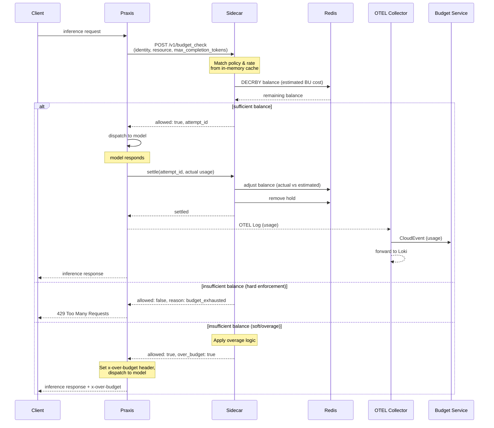
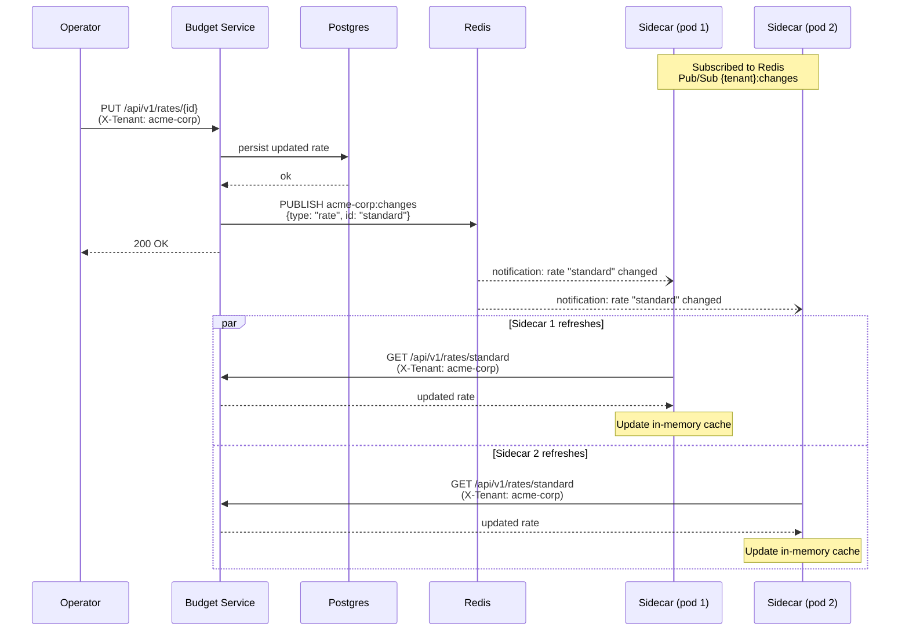

# Open Data Hub - AI Gateway Tokenomics and Budget Service

<!-- copy and paste this template to start authoring your own ADR -->
<!-- for the Status of new ADRs, please use Approved, since it will be approved by the time it is merged -->
<!-- remove this comment block too -->

|                |            |
| -------------- | ---------- |
| Date           | insert date |
| Scope          | |
| Status         | Approved |
| Authors        | Marius Danciu |
| Supersedes     | N/A |
| Superseded by: | N/A |
| Tickets        | |
| Other docs:    | none |

## What

This document proposes a new usage metering solution that is part of the RHOAI product. It allows customers to configure and manage costs and attribution and also visualize usage in the UI dashboards.

## Why

Usage metering and budget enforcement is a major feature of AI Gateway and a very frequent topic raised by customers.

## Goals

* Define the architecture for the Budget Service
* Define the Budget Service APIs
* Define end-to-end flows
* Define the high-level integration with third-party solutions like M360 or OpenMeter, but the actual integration details may be subject to different ADRs in later phases
* This is meant to be a usage metering solution as part of MaaS that works out of the box without bringing in new dependencies (such as Kafka) that customers need to install and manage. Customers don't need to perform extra installation steps in order to have usage metering and budget quota enforcement enabled.
* Budget quota enforcement is intentionally kept as a separate concept from rate limiting. Rate limiting is a QoS topic that for now remains managed in MaaSSubscription at control plane level and applied by Praxis at data plane level.
* Budget cost is abstracted away and referred to in this document as Budget Units (BU).

## Non-Goals

* This is not a billing service. We do not intend to manage aspects like:
    * multi currency
    * invoices
    * billing cycles
    * auditability and disputes
* This is not a generic competing solution for M360 or OpenMeter
* Usage for other resource types apart from tokens, e.g. GPUs. However, the design is flexible so we can address other types of resources in the future.
* The Budget Service storage does not represent the SoR for usage metering. The document will address this separation in the next sections.
* Pacing (spend-rate policies such as daily sub-limits derived from a monthly budget). The architecture supports it in the sidecar without changes to Praxis or the object model, but it is out of scope for the initial implementation.
* Multiple tenants per gateway. The initial implementation supports one tenant per gateway. Multi-tenant gateways may be considered in later releases.

## How


### Architecture


Notes:
- In the Praxis POD, AIGC also brings in the BSC (Budget Sidecar Container)
- Praxis filter remains a PEP (Policy Enforcement Point). All budget calculations happen in the budgeting system (sidecar container and/or budget service)
- Redis/Valkey is used for atomic balance counters, holds, and change notification Pub/Sub. The Budget Service publishes change notifications to Redis when configuration objects are updated; sidecars subscribe and fetch the changed objects from the Budget Service REST API. Configuration objects (policies, rates, budget definitions) are cached in the sidecar's memory, not stored in Redis.

#### Inference Flow (budget check)



#### Configuration Update Flow



#### Budget Service ↔ Sidecar Sync

The sidecar fetches configuration objects (policies, rates, budget definitions) from the Budget Service REST API and caches them in memory. Redis is used only for balances, holds, and lightweight change notifications — not for storing configuration objects.

Each gateway serves exactly one tenant and may have multiple Praxis pods. All sidecars for the same tenant share Redis balance counters, which makes Redis the natural coordination point for multi-replica consistency.

##### How state flows

1. An operator creates or updates a rate, budget, or policy via the Budget Service REST API
2. The Budget Service persists the change to the durable backend (Postgres by default) and publishes a change notification to Redis (e.g., via Pub/Sub: `{tenant}:changes` channel with the object type and ID)
3. Each sidecar subscribes to its tenant's change notifications. On receiving a notification, it fetches the updated object from the Budget Service REST API and refreshes its in-memory cache

On startup, the sidecar calls the Budget Service REST API to fetch all policies, rates, and budgets for its tenant and subscribes to Redis change notifications.

##### What lives where

| Store | Data | Role |
|---|---|---|
| Sidecar (in-memory) | Policies, rates, budget definitions | Cached configuration for admission decisions. Refreshed from the Budget Service API on startup and on change notifications |
| Redis | Balances, holds, change notifications | Atomic counters for the hot path and lightweight Pub/Sub for cache invalidation |
| Budget Service (API) | Policies, rates, budget definitions, consumption | Authoritative source served from the durable backend. Sidecars fetch from here |

##### Consumption data

The sidecar does not report consumption back to the Budget Service. Consumption data reaches the Budget Service through the OTEL pipeline: Praxis emits an OTEL Log after each response, the OTEL Collector transforms it into a CloudEvent, and the Budget Service persists it to the durable backend (see [Consumption Emission](#consumption-emission)).

##### Failure Modes

| Scenario | Behavior |
|---|---|
| Redis unavailable | Sidecar serves decisions from its in-memory cache. Change notifications are missed — the sidecar continues with stale config until Redis recovers. Holds and reservations are unavailable — sidecar applies fail-open or fail-closed per operator configuration |
| Budget Service unavailable | Sidecar continues with its in-memory cache and Redis balances. Config changes are delayed until the Budget Service recovers. Consumption data continues to flow via the OTEL pipeline independently |
| Sidecar restarts | Sidecar fetches its tenant's full state from the Budget Service REST API and subscribes to Redis change notifications |


#### Multi-Tenancy

The Budget Service is a single shared instance serving all tenants (soft multi-tenancy). All data is tenant-scoped and every management API request must carry the `X-Tenant` header to identify which tenant's budgets, rates, or policies are being managed.

At the gateway level, each gateway serves exactly one tenant. The sidecar running in the gateway pod inherits this tenant scope — it fetches only that tenant's configuration from the Budget Service API and reads only that tenant's Redis keys. This simplifies the sidecar's local state and avoids cross-tenant data leakage.

| Component | Tenancy model |
|---|---|
| Budget Service (central) | Single instance, soft multi-tenancy. All API calls scoped by `X-Tenant` header |
| Gateway + Sidecar | One tenant per gateway. Sidecar receives only that tenant's budget state |
| Redis | Keys namespaced by tenant ID |
| Postgres | All tables include a tenant ID column |


### Budget object model

The budget domain is modeled with three objects: **Rate**, **Budget**, and **BudgetPolicy**.

#### Rate

Defines BU costs per usage unit for a given resource. Resource matching and cost keys are flexible key-value maps — new usage categories (images, tool calls, video seconds) require no schema change.

| Field | Type | Description |
|---|---|---|
| `name` | string | Unique identifier for this rate table |
| `items` | list | One or more rate items (see below) |

Each **RateItem** contains:

| Field | Type | Description |
|---|---|---|
| `resource` | map | Resource matching keys (e.g. `model`, `provider`, `region`) |
| `costs` | map | BU per usage unit (e.g. `input: 3`, `output: 15`, `cache_read: 1`) |

The resource and cost keys are dynamically set. Admins can provide any key-value pairs here. However, for end-to-end reasons the cost fields emitted by Praxis in the OTEL logs are shown in the [Consumption Emission](#consumption-emission) section.

#### Budget

Pure capacity definition — how much BU and when it resets. No subject, no enforcement, no rates.

| Field | Type | Description |
|---|---|---|
| `name` | string | Unique identifier for this budget |
| `limit` | integer | BU capacity for each period |
| `period.start` | timestamp | UTC anchor for period calculation |
| `period.duration` | duration | Fixed period length (e.g. `P1M`, `P3M`, `P7D`) |
| `renewal` | one of | Reset behavior at period boundary |

**Renewal** variants:

| Variant | Fields | Description |
|---|---|---|
| `drain` | — | Use it or lose it; balance resets to `limit` each period |
| `rollover` | `max_carry` (optional) | Unused BU carry forward, optionally capped |

#### BudgetPolicy

Binds a subject to a budget with a rate table and optional overage behavior.

| Field | Type | Description |
|---|---|---|
| `budget_ref` | string | References a Budget by name |
| `rate_ref` | string | References a Rate by name — controls BU pricing for this subject |
| `subject.kind` | one of | `user`, `group`, `organization`, or `tenant` |
| `subject.name` | string | Identity of the subject |
| `overage` | optional, one of | Behavior when the budget is exhausted (see below) |

If `overage` is absent, enforcement is **hard** — requests are rejected with 429 when the budget is exceeded.

**Overage** variants:

| Variant | Fields | Description |
|---|---|---|
| `soft` | `rate_ref` (optional) | Continue charging this budget past the limit, optionally at a different rate. Injects `x-over-budget: true` header upstream |
| `group` | `rate_ref` (optional) | Fall back to the group-level budget, optionally at a different rate |
| `organization` | `rate_ref` (optional) | Fall back to the organization-level budget, optionally at a different rate |
| `tenant` | `rate_ref` (optional) | Fall back to the tenant-level budget, optionally at a different rate |

**Ambiguity warning:** A user can belong to multiple groups and organizations. When overage is set to `group` or `organization`, the system may find multiple matching policies at that level. Since group and organization membership is only known at request time (via SelfTokenReview), this ambiguity cannot be validated at policy creation time. At request time, if multiple policies match, the sidecar applies the most restrictive one and emits a warning event so the operator can resolve it by creating a direct user policy.


#### Budget Units (BU) as the Accounting Abstraction

Budget Units are an important simplification from actual currency and reinforce the claim that this is not a billing system. Customers can attribute actual currency amounts per BU if necessary, but again this is not the SoR.

A budget becomes straightforward:

- Budget limit: 100,000 BU per 30-day period
- Each model has a BU rate table (potentially different per tenant/group)
- Consumption = tokens used * BU rate for that token type and model
- Remaining = limit - total consumption in BU


### Separation of Concerns: Rate Limiting vs Budget Enforcement

Rate limiting and budget enforcement answer fundamentally different questions:

| Concern | Question | Protects | Example |
|---|---|---|---|
| Rate limiting | Too fast? | Infrastructure from overload | 100 req/s max |
| Budget enforcement | Too much total? | Cost control | 1000 USD/month cap |


Rate limiting belongs in the proxy regardless of tokenomics — it protects backend model servers from burst traffic. Budget enforcement is a business concern that belongs in the external budget system.

OpenMeter, for comparison, handles entitlements (budget/quota enforcement) but not rate limiting. These are separate systems in practice.


### BU Cost Computation

The BU cost for a request is computed by matching usage keys against the rate table:

```
cost_bu = sum(usage[key] * rate[key]) for all keys in usage
```

Token usage is normalized into five types:

| Key | Meaning |
|---|---|
| `input` (I) | All input tokens, including cache reads and writes |
| `output` (O) | All output tokens, including reasoning |
| `cache_read` (R) | Input subset served from cache |
| `cache_write` (W) | Input subset written to cache |
| `reasoning` (Q) | Output subset used for reasoning |

The full consumption formula:

```
cost_bu = (I - R - W) * bu_input + R * bu_cache_read + W * bu_cache_write
        + (O - Q) * bu_output + Q * bu_reasoning
```

Different subjects can have different rate tables assigned via their BudgetPolicy `rate_ref`. The same model costs different subjects different BU amounts. This makes the rate table a unified pricing and discount mechanism — no secondary discount logic is needed.


### Sidecar Architecture

#### The Problem

If Praxis calls the Budget Service synchronously on every request, inference latency depends on that external call. If the Budget Service is slow or unavailable, Praxis blocks or fails.

#### Sidecar as the Budget System's Local Agent

Each Praxis replica calls a localhost sidecar container provided and managed by the budget system. The sidecar runs in the same pod as Praxis.

From Praxis's perspective, the contract is simple: call `localhost:port` with who, what model, and how many tokens. Get back allow or deny. Whether the sidecar answers from local state or calls the Budget Service is invisible to Praxis.

#### Sidecar Responsibilities

The budget system owns the sidecar and controls all caching and sync behavior:

| Responsibility | Description |
|---|---|
| Allow locally | Match policies and rates from in-memory cache, check balances in Redis. Tenants with plenty of budget remaining get fast approvals |
| Deny locally | When the balance is clearly exhausted |
| Fail-open / fail-closed | Operator-configured behavior when Redis is unreachable |
| Cache refresh | Fetch config from Budget Service API on startup, subscribe to Redis Pub/Sub for change notifications, fetch updated objects on demand |
| No consumption reporting | Consumption data flows to the Budget Service via the OTEL pipeline (Praxis → OTEL Collector → CloudEvent), not from the sidecar |

#### What This Solves

**Fleet coherence.** All sidecars for the same tenant share Redis balance counters and receive the same Pub/Sub change notifications. Multiple Praxis replicas with their own sidecars are automatically coordinated — balances are shared atomically via Redis, and config changes propagate to all sidecars via the notification + fetch pattern.

**Availability.** The sidecar depends on Redis for balances and on the Budget Service API for config. A Budget Service outage blocks config refreshes and management API changes but does not affect admission decisions — the sidecar continues serving from its in-memory cache and Redis balances.

**Latency.** Localhost calls are sub-millisecond. The admission path stays fast regardless of the Budget Service's latency.

#### What Praxis Needs to Know

| Concern | Praxis responsibility |
|---|---|
| Who | Tenant identity, resolved from headers or authentication |
| What | Model and capabilities |
| How much | Estimated token counts before dispatch, actual token counts after completion |
| Enforcement | Call the sidecar, honor the allow/deny decision, apply hard (429) or soft (`x-over-budget: true` header) behavior |

Everything else — BU rates, balances, policies, discounts, pacing, fleet coordination, caching strategy — lives in the budget system and its sidecar.


### Identity Resolution

The `identity` object passed in the budget check call contains the full identity context needed for policy matching: user, groups, organization, and tenant. Praxis is responsible for resolving this identity before calling the sidecar.

| Field | Source | Description |
|---|---|---|
| `user` | Authentication token / headers | The authenticated user identity |
| `groups` | SelfTokenReview or OIDC token claims | Groups the user belongs to. Only known at request time — not available at policy creation time |
| `organization` | SelfTokenReview or OIDC token claims | Organization the user belongs to. Only known at request time |
| `tenant` | Gateway configuration | The tenant served by this gateway. Fixed per gateway — not resolved per request |

Identity resolution happens entirely within Praxis, before the budget check call. The sidecar receives the resolved identity and uses it to match policies — it does not perform any authentication or identity lookup itself.

The fact that group and organization membership is only known at request time has implications for policy validation and ambiguity resolution (see [Validation Rules](#validation-rules)).


### Reservation Flow

The reservation flow has three phases: reserve before dispatch, settle after completion, and release on failure.

#### Phase 1: Reserve (before dispatch)

Praxis sends the sidecar: "User A, model X, max_completion_tokens=1024."

The sidecar:
1. Looks up User A's budget policy
2. Matches the resource (model) to the rate table, gets BU rates
3. Computes estimated cost from output tokens only (e.g. `1024 * 15 = 15,360 BU`)
4. Atomically decrements the Redis counter
5. If sufficient balance: **allow**, store the hold with an attempt ID
6. If insufficient: **deny** (or apply soft/overage logic)

#### Phase 2: Settle (after model responds)

Praxis sends: "attempt-xyz, actual usage: I=312, O=87, R=20, W=5, Q=30."

The sidecar:
1. Retrieves the hold for attempt-xyz (15,360 BU reserved)
2. Computes actual cost from all token types (e.g. 18,200 BU including input tokens)
3. Adjusts the balance — if actual cost exceeds the reservation, the balance is further decremented
4. Removes the hold, records the consumption
5. Consumption data reaches the Budget Service via the OTEL pipeline (Praxis emits an OTEL Log → OTEL Collector forwards as CloudEvent → Budget Service persists to Postgres)

#### Phase 3: Release (on failure, never dispatched)

If Praxis confirms the request was never sent to the model:
1. Full refund of the reserved amount
2. Remove the hold
3. No consumption recorded

#### Edge Cases

| Scenario | Behavior |
|---|---|
| Settle call fails | Retry with same attempt ID (idempotent) |
| Request timed out, unknown if dispatched | Hold remains, never auto-refund, visible for operator reconciliation |
| Actual usage exceeds estimate | Charge full actual amount, balance can go negative, block subsequent hard admissions |
| Sidecar crashes with active holds | Budget Service re-issues balance from Postgres minus known consumption, unresolved holds flagged |

#### Reservation Underestimation

Reservations are computed from output tokens only (`max_completion_tokens * bu_output`) because the OpenAI-compatible API does not expose estimated input tokens at request time. This is a conscious design tradeoff:

- **Reservations systematically underestimate** actual cost because input tokens, cache tokens, and reasoning tokens are not accounted for until settlement.
- **Settlement corrects the balance** with actual usage across all token types. If actual cost exceeds the reservation, the balance is further decremented and may go negative.
- **Negative balances block subsequent hard admissions** but do not retroactively reject the request that caused the overshoot.

This means the system provides approximate reservation with exact settlement. The error budget is bounded by the input token cost of any single request — in practice, input-heavy requests (large prompts with short completions) produce the largest underestimates. Operators should set budget limits with this margin in mind.

A zero-overspend guarantee would require tokenizer-based input counting before dispatch, which adds latency and complexity to the admission path. This is explicitly out of scope.


### Storage Architecture: Redis + Postgres

Redis and Postgres serve different roles in the budget system:

| Layer | Store | Purpose |
|---|---|---|
| Sidecar (in-memory) | Memory | Cached policies, rates, and budget definitions. Fetched from the Budget Service API, refreshed via Redis change notifications |
| Hot path (shared) | Redis | Atomic balance counters, holds, and Pub/Sub change notifications |
| Durable (default backend) | Postgres | Authoritative ledger, budget/rate/policy definitions, consumption history, reconciliation |

The sidecar caches configuration objects (policies, rates, budget definitions) in memory, fetched from the Budget Service REST API. Redis handles only what requires shared atomic state — balance counters and holds — plus lightweight Pub/Sub notifications for cache invalidation.

Postgres is the default durable backend, but it is not the only option. When the Budget Service integrates with an external platform such as M360 or OpenMeter (see [Bring Your Own Metering](#bring-your-own-metering)), the external system can serve as the durable store instead of — or alongside — Postgres. In that scenario, the sidecars are unaffected because they fetch configuration from the Budget Service API (not from Postgres directly) and use Redis only for balances and holds.

Consumption data reaches the Budget Service via the OTEL pipeline, not from the sidecar directly. See the [Storage Schema](#storage-schema-high-level) section for details on the Postgres and Redis schemas.

Redis atomic check-and-decrement (Lua script):

```lua
local remaining = redis.call('DECRBY', key, cost)
if remaining < 0 then
    redis.call('INCRBY', key, cost)  -- rollback
    return 0  -- denied
end
return remaining
```


### Pacing

Budget systems are accumulators — they track total spend against a cap but have no opinion about the shape of consumption over time. A tenant with a 30-day budget and a 100 req/s rate limit could exhaust their entire monthly budget in minutes if each request is expensive.

Pacing sits between rate limiting and budget enforcement:

| Concern | Question | Example |
|---|---|---|
| Rate limiting | Too fast? | 100 req/s max |
| **Pacing** | **Too much too soon?** | **No more than 10,000 BU/day from a 100,000 BU/month budget** |
| Budget enforcement | Too much total? | 100,000 BU/month cap |

Pacing is a policy decision that varies by use case: batch processing may want to burst, customer-facing apps need steady availability. The sidecar is a natural place to enforce spend-rate policies — the Budget Service can configure the sidecar with daily or hourly sub-limits derived from the period budget. Pacing becomes a sidecar-local policy, not a Praxis concern.

Pacing is out of scope for the initial implementation, but the architecture supports it without changes to Praxis or the object model.


### Validation Rules

#### At policy creation time

| Rule | Description |
|---|---|
| One subject, one active policy | Reject duplicate policies for the same subject |
| `budget_ref` must resolve | Must reference an existing Budget |
| `rate_ref` must resolve | Must reference an existing Rate |
| Overage `rate_ref` must resolve | If present, must reference an existing Rate |
| Overage level constraints | Overage level must be higher than or equal to the subject kind. `soft` is valid for any subject kind. `group` is valid for `user`. `organization` is valid for `user` or `group`. `tenant` is valid for `user`, `group`, or `organization` |

#### At request time

| Rule | Description |
|---|---|
| Most-specific wins | A user with a direct policy takes precedence over any group, organization, or tenant policy |
| Ambiguous group/organization membership | A user in multiple groups or organizations that have policies results in the most restrictive policy being applied. A warning event is emitted so the operator can resolve the ambiguity by creating a direct user policy. Group and organization membership is only known at request time (i.e. via SelfTokenReview or from the OIDC token claims) and cannot be validated at policy creation time |


### API: REST

The Budget Service exposes a REST API for managing rates, budgets, and budget policies. All endpoints require the `X-Tenant` header.

> **Note:** The exact request and response payloads will be defined in a separate API specification document.

#### Rates

| Method | Endpoint | Description |
|---|---|---|
| `GET` | `/api/v1/rates` | List all rates |
| `GET` | `/api/v1/rates/{id}` | Get a rate by name |
| `POST` | `/api/v1/rates` | Create a rate |
| `PUT` | `/api/v1/rates/{id}` | Update a rate |
| `DELETE` | `/api/v1/rates/{id}` | Delete a rate |

#### Budgets

| Method | Endpoint | Description |
|---|---|---|
| `GET` | `/api/v1/budgets` | List all budgets |
| `GET` | `/api/v1/budgets/{id}` | Get a budget by name |
| `POST` | `/api/v1/budgets` | Create a budget |
| `PUT` | `/api/v1/budgets/{id}` | Update a budget |
| `DELETE` | `/api/v1/budgets/{id}` | Delete a budget |

#### Budget Policies

| Method | Endpoint | Description |
|---|---|---|
| `GET` | `/api/v1/budget_policies` | List all policies |
| `GET` | `/api/v1/budget_policies/{id}` | Get a policy by ID |
| `POST` | `/api/v1/budget_policies` | Create a policy |
| `PUT` | `/api/v1/budget_policies/{id}` | Update a policy |
| `DELETE` | `/api/v1/budget_policies/{id}` | Delete a policy |


All these objects are scoped per tenant. A tenant is identified in the request via the `X-Tenant` header. These objects are scoped per tenant and not per AI Gateway organization, since the tenant admin manages costs, not the organization admin. At this point in time this is a choice for simplification reasons that may be relaxed later on. However, as per the previous sections, budget policies can be created per organization.

A tenant admin automatically has the RBAC permissions to manage these objects. From an RBAC point of view we need three separate virtual resources:
- rates
- budgets
- budget-policy 
The api group for these resources is `budget.aigateway.opendatahub.io`


### API: Sidecar

The sidecar exposes local endpoints for Praxis to check budget, settle actual usage, and release holds. These are hot-path calls — localhost only, never exposed outside the pod.

#### Check Budget

```
POST /v1/budget_check
```

```json
{
  "identity": {
    "user": "alice",
    "groups": ["engineering", "ml-team"],
    "organization": "research",
    "tenant": "acme-corp"
  },
  "resource": {
    "model": "claude-sonnet-5-5",
    "provider": "anthropic"
  },
  "max_completion_tokens": 1024
}
```

| Field | Type | Description |
|---|---|---|
| `identity.user` | string | User identity (resolved by Praxis from auth/headers) |
| `identity.groups` | list of strings | Groups the user belongs to (from SelfTokenReview or OIDC claims) |
| `identity.organization` | string | Organization the user belongs to |
| `identity.tenant` | string | Tenant identity |
| `resource.model` | string | Model identifier |
| `resource.provider` | string | Model provider |
| `max_completion_tokens` | integer | Maximum output tokens (from the client request) |

Input tokens are not available at reservation time — the OpenAI-compatible API only exposes `max_completion_tokens`. The reservation is computed using the output token rate only (`max_completion_tokens * bu_output`). The settlement phase corrects with full actual usage across all token types (input, output, cache_read, cache_write, reasoning). This means reservations systematically underestimate, but settlement adjusts the balance — which may go negative if the actual cost exceeds the reserved amount.

Response (modeled after [OpenMeter's entitlement access API](https://openmeter.io/docs/api)):

```json
{
  "allowed": true,
  "over_budget": false,
  "budget_ref": "team-alpha-monthly",
  "balance": 85000,
  "usage": 15000,
  "overage": 0,
  "attempt_id": "att-abc123"
}
```

| Field | Type | Description |
|---|---|---|
| `allowed` | boolean | Whether the request should proceed (equivalent to OpenMeter's `hasAccess`) |
| `over_budget` | boolean | Whether the budget is exceeded — Praxis uses this to set the `x-over-budget: true` header upstream |
| `budget_ref` | string | Which budget was matched |
| `balance` | integer | Remaining BU after this reservation |
| `usage` | integer | Total BU consumed in the current period |
| `overage` | integer | BU consumed past the budget limit (0 if within budget) |
| `attempt_id` | string | Hold identifier for subsequent settle or release calls |

When `allowed` is `false`, the response includes a `reason` field:

```json
{
  "allowed": false,
  "over_budget": true,
  "budget_ref": "team-alpha-monthly",
  "balance": 0,
  "usage": 100000,
  "overage": 0,
  "attempt_id": null,
  "reason": "budget_exhausted"
}
```

#### Settle

After the model responds, Praxis sends the actual token usage to settle the hold.

```
POST /v1/budget_settle
```

```json
{
  "attempt_id": "att-abc123",
  "usage": {
    "input_tokens": 312,
    "output_tokens": 87,
    "cache_read_tokens": 20,
    "cache_write_tokens": 5,
    "reasoning_tokens": 30,
    "total_tokens": 454
  }
}
```

| Field | Type | Description |
|---|---|---|
| `attempt_id` | string | Hold identifier from the budget check response |
| `usage.input_tokens` | integer | Actual input tokens (I) |
| `usage.output_tokens` | integer | Actual output tokens (O) |
| `usage.cache_read_tokens` | integer | Input tokens served from cache (R) |
| `usage.cache_write_tokens` | integer | Input tokens written to cache (W) |
| `usage.reasoning_tokens` | integer | Output tokens used for reasoning (Q) |
| `usage.total_tokens` | integer | Sum of all tokens |

The sidecar computes the actual BU cost from the usage and the rate table, adjusts the Redis balance (the difference between reserved and actual), and removes the hold. If actual cost exceeds the reservation, the balance is further decremented and may go negative.

Response:

```json
{
  "attempt_id": "att-abc123",
  "reserved_bu": 15360,
  "actual_bu": 18200,
  "adjustment": -2840,
  "balance": 82160
}
```

The settle call is idempotent — retrying with the same `attempt_id` returns the same result.

#### Release

If the request was never dispatched to the model (e.g., upstream routing failure), Praxis calls release to refund the reservation.

```
POST /v1/budget_release/{attempt_id}
```

No request body. The sidecar refunds the full reserved amount to the Redis balance, removes the hold, and records no consumption. The release call is idempotent.

Response:

```json
{
  "attempt_id": "att-abc123",
  "released_bu": 15360,
  "balance": 100360
}
```

> **Note:** The exact payloads may change and will be defined in a separate API specification document.

### Consumption Emission

After a model responds, Praxis emits an OTEL Log record containing the resource identification and actual token usage. The OTEL Collector forwards this as a CloudEvent to the Budget Service for durable persistence in Postgres.

The OTEL Log record carries the following attributes:

```json
{
  "Timestamp": "2026-11-16T14:32:05.123Z",
  "SeverityText": "INFO",
  "Body": "inference_usage",
  "Attributes": {
    "attempt_id": "att-abc123",
    "identity.user": "alice",
    "identity.groups": ["engineering", "ml-team"],
    "identity.organization": "research",
    "identity.tenant": "acme-corp",
    "resource.model": "claude-sonnet-5-5",
    "resource.provider": "anthropic",
    "resource.region": "us-east-1",
    "usage.input_tokens": 312,
    "usage.output_tokens": 87,
    "usage.cache_read_tokens": 20,
    "usage.cache_write_tokens": 5,
    "usage.reasoning_tokens": 30,
    "usage.total_tokens": 454
  },
  "Resource": {
    "service.name": "praxis",
    "service.instance.id": "praxis-pod-abc-0",
    "k8s.namespace.name": "ai-gateway"
  }
}
```

| Field | Description |
|---|---|
| `attempt_id` | Correlates with the sidecar's hold for reconciliation |
| `identity.*` | Full identity context of the request |
| `resource.model` | Model identifier — matches rate table resource keys |
| `resource.provider` | Model provider |
| `resource.region` | Deployment region (if applicable) |
| `usage.input_tokens` | Total input tokens (I) |
| `usage.output_tokens` | Total output tokens (O) |
| `usage.cache_read_tokens` | Input tokens served from cache (R) |
| `usage.cache_write_tokens` | Input tokens written to cache (W) |
| `usage.reasoning_tokens` | Output tokens used for reasoning (Q) |
| `usage.total_tokens` | Sum of all tokens |

The Budget Service uses the `attempt_id` to correlate with the sidecar's settlement. The `resource.*` fields are matched against rate tables to compute BU cost. The `usage.*` fields provide the actual token counts for the consumption formula:

```
cost_bu = (I - R - W) * bu_input + R * bu_cache_read + W * bu_cache_write
        + (O - Q) * bu_output + Q * bu_reasoning
```

This OTEL Log record is also forwarded to Loki for observability.

#### CloudEvent

The OTEL Collector transforms the Log record into a CloudEvent and sends it to the Budget Service via HTTP. The CloudEvent follows the [CloudEvents v1.0 specification](https://cloudevents.io/):

```json
{
  "specversion": "1.0",
  "id": "evt-7f3a2b1c-4d5e-6f78-9a0b-1c2d3e4f5678",
  "source": "praxis/praxis-pod-abc-0",
  "type": "io.opendatahub.aigateway.usage.v1",
  "time": "2026-11-16T14:32:05.123Z",
  "datacontenttype": "application/json",
  "data": {
    "attempt_id": "att-abc123",
    "identity": {
      "user": "alice",
      "groups": ["engineering", "ml-team"],
      "organization": "research",
      "tenant": "acme-corp"
    },
    "resource": {
      "model": "claude-sonnet-5-5",
      "provider": "anthropic",
      "region": "us-east-1"
    },
    "usage": {
      "input_tokens": 312,
      "output_tokens": 87,
      "cache_read_tokens": 20,
      "cache_write_tokens": 5,
      "reasoning_tokens": 30,
      "total_tokens": 454
    }
  }
}
```

| Field | Description |
|---|---|
| `specversion` | CloudEvents specification version |
| `id` | Unique event identifier (for deduplication) |
| `source` | Originating Praxis instance |
| `type` | Event type — `io.opendatahub.aigateway.usage.v1` |
| `time` | Timestamp of the inference completion |
| `data.attempt_id` | Correlates with the sidecar's hold |
| `data.identity` | Full identity context from the OTEL Log |
| `data.resource` | Resource keys matching rate tables |
| `data.usage` | Actual token counts for BU cost computation |

The Budget Service persists the CloudEvent data to Postgres and exposes it via the metering APIs for external systems (Bring Your Own Metering).

### Storage Schema (high level)

#### Postgres

Postgres is the default durable backend and the authoritative source of truth in standalone deployments. When the Budget Service integrates with an external metering platform, Postgres may be replaced by the external system's storage — the Budget Service treats the durable backend as a pluggable layer behind Redis.

All tables include a `tenant_id` column for multi-tenancy.

| Table | Description |
|---|---|
| `rates` | Rate definitions — name, and the list of rate items (resource keys + cost keys). Stored as JSONB for flexibility |
| `budgets` | Budget definitions — name, BU limit, period (start + duration), renewal type (drain/rollover + max_carry) |
| `budget_policies` | Policy bindings — references a budget and a rate, subject (kind + name), overage configuration |
| `consumption` | Append-only ledger of settled consumption records — attempt ID, subject, budget ref, BU consumed, token breakdown, timestamp |
| `holds` | Active reservations — attempt ID, budget ref, reserved BU, created timestamp. Rows are deleted on settle or release. Orphaned holds are visible for operator reconciliation |
| `period_balances` | Current period state per budget — current balance, period start, period end, rollover carry. Updated on settlement and period reset |

The `consumption` table is the durable record that feeds reporting, reconciliation, and the metering APIs. It is append-only — rows are never updated or deleted.

**Important:** We use a hybrid approach where we keep JSONB structures in Postgres. Dynamic fields like rate keys or resource keys are represented as JSONB (natively supported by Postgres). Reference fields, `tenant_id`, timestamps, `limit`, etc. are represented as separate columns.


#### Redis/Valkey

Redis handles atomic shared state and change notifications. Configuration objects (policies, rates, budget definitions) are not stored in Redis — they are cached in sidecar memory and served by the Budget Service API. All keys are namespaced by tenant ID.

| Key pattern | Type | Description |
|---|---|---|
| `{tenant}:balance:{budget_id}` | integer | Current BU balance for a budget. Decremented atomically on reservation, adjusted on settlement |
| `{tenant}:hold:{attempt_id}` | hash | Active hold — budget ref, reserved BU, timestamp. TTL set to a configurable max hold duration. Deleted on settle or release |
| `{tenant}:changes` | Pub/Sub channel | Change notifications published by the Budget Service when a policy, rate, or budget is created, updated, or deleted. Payload contains the object type and ID. Sidecars subscribe to this channel and fetch the changed object from the Budget Service API |

The balance key is the critical path — the Lua atomic check-and-decrement script (see Storage Architecture section) operates on this key.

**Note:** The low-level schema details are intentionally omitted from this document as they tend to change as the design and implementation evolve, risking this information becoming outdated. For this reason we aim to cover only the high-level aspects here.


### Bring Your Own Metering

The Budget Service is designed as a self-contained solution that works out of the box. However, customers who already operate an external metering or billing platform — such as OpenMeter, Monetize360, or a custom solution — can integrate it with the Budget Service.

#### Integration boundary

All external metering integration happens exclusively at the Budget Service level. The rest of the stack — Praxis, the sidecar, Redis, the OTEL pipeline — remains completely unchanged and unaware of any external backend. This is a deliberate architectural choice:

- **Praxis** continues to call the sidecar for admission decisions. It does not know whether consumption data is forwarded elsewhere.
- **The sidecar** continues to fetch config from the Budget Service API and use Redis for balances and holds. Its sync protocol is unchanged.
- **The OTEL pipeline** continues to emit logs and CloudEvents to the Budget Service. No additional collectors or exporters are needed.

The Budget Service acts as the single integration point, translating its internal consumption data into the format expected by the external system.

#### Integration patterns

| Pattern | Description |
|---|---|
| Push (webhook/event) | The Budget Service forwards consumption events to an external system's ingestion endpoint (e.g. OpenMeter's event API or M360's usage API) as they are persisted |
| Pull (metering API) | The external system queries the Budget Service's metering APIs to retrieve consumption data on its own schedule |
| Backend replacement | The external system replaces Postgres as the durable store. The Budget Service writes budget objects and consumption records to the external system instead of Postgres. Redis remains the operational store — Praxis, sidecars, and the OTEL pipeline are unaffected |

#### What the external system receives

The Budget Service can expose consumption data: attempt ID, identity (user, groups, organization, tenant), resource keys (model, provider, region), token breakdown, BU cost, and timestamp. The external system can then apply its own pricing, aggregation, and billing logic.

#### What the external system does not control

Budget enforcement decisions (allow/deny) remain with the Budget Service and its sidecars. The external system is a consumer of usage data, not an authority on admission. If a customer wants the external system to influence budget limits, this is done by updating budgets and rates via the Budget Service's management API — not by bypassing the sidecar.

> **Note:** The specific integration details for each external platform (API mappings, authentication, retry policies) will be addressed in separate ADRs as those integrations are prioritized.


### Observability

The budget system produces observability data at multiple levels:

#### OTEL Logs (via Praxis)

Praxis emits an OTEL Log record after each inference response containing full identity, resource, and token usage. These logs are forwarded to Loki for observability and to the Budget Service (as CloudEvents) for durable persistence. See [Consumption Emission](#consumption-emission) for the exact log structure.

#### Metrics

The sidecar and Budget Service expose Prometheus metrics for monitoring:

| Metric | Source | Description |
|---|---|---|
| Budget utilization | Sidecar | Current balance as a percentage of the budget limit, per budget |
| Admission decisions | Sidecar | Counter of allow/deny decisions, labeled by tenant, subject, and reason (sufficient, soft overage, hard deny) |
| Reservation accuracy | Sidecar | Histogram of the difference between reserved and actual BU cost |
| Hold age | Sidecar | Histogram of hold durations. Long-lived holds indicate settle/release failures |
| Orphaned holds | Sidecar | Gauge of holds that exceeded their TTL without settlement |
| Overage events | Sidecar | Counter of requests that triggered overage logic |
| Config refresh latency | Sidecar | Latency of config fetches from the Budget Service API |
| CloudEvent ingestion | Budget Service | Counter and latency of CloudEvent processing |

#### Alerts

Operators can configure alerts based on these metrics. Recommended alert conditions:

| Condition | Severity | Description |
|---|---|---|
| Budget utilization > 80% | Warning | Tenant approaching budget limit |
| Budget utilization > 95% | Critical | Tenant near exhaustion |
| Orphaned holds > threshold | Warning | Settle/release calls being lost — may indicate Praxis issues |
| Config refresh failures | Warning | Sidecar cannot reach Budget Service API — serving stale config |
| Ambiguous policy match | Warning | Multiple group/org policies matched for a user — operator should create a direct user policy |

#### UI Dashboards

The RHOAI UI can query the Budget Service metering APIs to display:

- Consumption over time (BU spent per period, per tenant/user/group)
- Budget utilization (remaining vs limit, with trend projection)
- Top consumers (users or models by BU consumption)
- Overage history (when and how often budgets were exceeded)


## Open Questions

| # | Question | Context |
|---|---|---|
| 1 | **Fail-open or fail-closed default?** | When Redis is unreachable, should the sidecar allow requests (fail-open) or reject them (fail-closed)? This is operator-configurable, but the default affects out-of-the-box behavior. Fail-open risks overspend; fail-closed risks blocking legitimate requests |
| 2 | **Hold TTL duration** | How long should a hold remain in Redis before it expires? Too short risks premature expiry during slow model responses (e.g., long reasoning chains). Too long risks stale holds blocking budget capacity. Needs to account for the longest expected inference latency |
| 3 | **Maximum negative balance tolerance** | When settlement drives a balance negative, how far negative is acceptable before the system takes corrective action? A small negative is expected (reservation underestimation), but unbounded negative balances could indicate a problem |
| 4 | **Redis persistence strategy** | Should Redis use AOF, RDB snapshots, or both? This affects how much balance/hold data is lost on a Redis restart and how quickly it can be rebuilt from Postgres |
| 5 | **Pub/Sub delivery guarantees** | Redis Pub/Sub is fire-and-forget — if a sidecar misses a notification (e.g., during a brief disconnect), it will serve stale config. Should the sidecar also poll the Budget Service API periodically as a fallback? If so, at what interval? |
| 6 | **Budget period boundary handling** | When a budget period resets (e.g., monthly rollover), who resets the Redis balance counter — the Budget Service or the sidecar? The Budget Service is the natural owner since it has the authoritative period state in Postgres |


## Alternatives

### Adopt OpenMeter or another open-source metering solution

Solutions like OpenMeter provide entitlement management, usage metering, and billing integrations. However, adopting a third-party solution introduces several concerns:

- **Dependency footprint.** OpenMeter requires Kafka, ClickHouse, and its own control plane. Customers would need to install and maintain these additional components. The goal of this design is an end-to-end solution that works out of the box without requiring customers to manage extra infrastructure.
- **Feature surface.** Third-party solutions come with their own UIs, APIs, and features (billing integrations, plan management, invoicing) that overlap with or conflict with the RHOAI product experience. Hiding or removing these features requires forking the upstream project, which leads to ongoing maintenance debt as the upstream evolves.
- **Integration cost.** Adapting an external solution to fit the Praxis sidecar architecture, the OTEL-based consumption pipeline, and the multi-tenancy model would require significant glue code — potentially more effort than building the focused subset of functionality we actually need.

OpenMeter's entitlement model (feature-based access with boolean/metered/static grants) informed parts of this design, particularly the budget check API response format. The Budget Service can expose metering data via APIs for customers who want to integrate with OpenMeter or similar solutions downstream (Bring Your Own Metering), without requiring them as runtime dependencies.

### Synchronous budget checks against the central Budget Service

Instead of the sidecar architecture, Praxis could call the Budget Service directly on every request. This was rejected because:

- **Latency.** Every inference request would depend on a network round trip to the Budget Service. Under load or during Budget Service degradation, inference latency increases or requests fail.
- **Availability coupling.** A Budget Service outage would block all inference requests, making budget enforcement a single point of failure for the entire gateway.
- **Fleet coordination.** With multiple Praxis replicas, each calling the Budget Service independently, the central service becomes a contention point for atomic balance operations.

The sidecar model decouples the admission path from the central service. Localhost calls are sub-millisecond, and the sidecar continues serving decisions from local state during outages.

### Redis-only or Postgres-only storage

- **Redis-only:** Provides the required latency but lacks durability guarantees. A Redis restart or eviction loses balance state and consumption history. Rebuilding from scratch is not feasible without an authoritative ledger.
- **Postgres-only:** Provides durability but cannot meet the sub-millisecond latency requirement for the admission hot path. Even with connection pooling, atomic check-and-decrement under high concurrency would bottleneck on row-level locks.

The hybrid approach uses each store for what it does best: Redis for the latency-sensitive hot path and Postgres as the durable source of truth.


## Security and Privacy Considerations

### In-Cluster Communication

All communication between components happens exclusively within the Kubernetes cluster network over TLS:

- **Sidecar → Budget Service** (REST API calls to fetch config) — in-cluster only, never exposed publicly
- **Sidecar → Redis** (balance counters, holds, Pub/Sub subscriptions) — in-cluster only
- **Budget Service → Redis** (balance updates, change notifications) — in-cluster only

The Praxis-to-sidecar communication is localhost only (same pod), so it does not traverse the network at all and requires no authentication. Both containers share the same pod security boundary — if one is compromised, the other is already accessible.

### Service-to-Service Authentication

The sidecar's REST API calls to the Budget Service (for fetching policies, rates, and budgets) are authenticated using Kubernetes ServiceAccounts and projected ServiceAccount tokens (bound tokens with audience and expiry). The sidecar presents its ServiceAccount token, and the Budget Service validates it against the Kubernetes TokenReview API.

Authorization is enforced via RBAC. A dedicated virtual resource `s2s` in the `budget.aigateway.opendatahub.io` API group controls which ServiceAccounts are allowed to fetch budget state from the Budget Service. The same API group also defines three virtual resources (`rates`, `budgets`, `budget-policy`) for management operations.

The AI Gateway Controller is responsible for creating the appropriate RoleBindings when it provisions a gateway and its sidecar.

### Tenant Isolation

All management API requests require the `X-Tenant` header. The Budget Service validates that the caller has RBAC permissions for the specified tenant's resources. A missing or unauthorized `X-Tenant` header results in a 403 response.

At the data plane level, each sidecar fetches only its own tenant's config from the Budget Service API (the `X-Tenant` header scopes the response) and reads only its tenant's Redis keys (see [Multi-Tenancy](#multi-tenancy)). Tenant isolation in Redis is enforced by key naming convention (`{tenant}:*`) and Pub/Sub channel naming (`{tenant}:changes`). Redis ACLs or separate Redis instances per tenant can provide stronger isolation if required.

### PII in Identity Fields

The `identity` object (user, groups, organization, tenant) flows through the OTEL Log, CloudEvent, and Postgres consumption records. These fields may contain personally identifiable information depending on the identity provider configuration. Operators should be aware that consumption records in Postgres retain identity context for reconciliation and reporting purposes. Data retention policies for the `consumption` table should align with the organization's privacy requirements.

### Redis Data Security

Redis holds balances, holds, and Pub/Sub change notifications. It does not store configuration objects or consumption records. Redis should be configured with TLS for in-transit encryption and access restricted to the sidecar and Budget Service via network policies. Redis does not store long-term PII — identity information is only present transiently in hold records and is removed on settlement or TTL expiry.


## Risks

| Risk | Likelihood | Impact | Mitigation |
|---|---|---|---|
| **Redis data loss** — Redis restart or crash loses balance counters and active holds | Medium | High | Redis persistence (AOF/RDB). Budget Service reconciliation rebuilds balances from Postgres consumption records. Orphaned holds are flagged for operator review |
| **Redis balance corruption** — Redis balance becomes incorrect due to a partial failure (e.g., settle adjusts balance but hold deletion fails) | Low | Medium | Budget Service can rebuild Redis balances from Postgres consumption records on demand. Hold TTLs prevent permanent capacity loss |
| **Missed Pub/Sub notifications** — Sidecar misses a Redis change notification and serves stale config (wrong rates or policies) | Low | Medium | Optional periodic polling of the Budget Service API as a fallback. Sidecar restart triggers a full config fetch |
| **Orphaned holds accumulation** — Settle/release calls are lost (Praxis crash, network failure), holds accumulate and reduce available budget | Medium | Medium | Hold TTL in Redis auto-expires orphaned holds. Budget Service flags holds that exceed TTL for operator reconciliation |
| **Reservation underestimation** — Input-heavy requests cause significant underestimates, leading to balances going negative after settlement | High | Low | Documented tradeoff (see [Reservation Underestimation](#reservation-underestimation)). Operators set limits with margin. Negative balances block subsequent hard admissions |
| **Sidecar memory pressure** — Tenants with many policies, rates, or budget definitions cause high memory usage in the sidecar | Low | Low | Config objects are small (KV maps). Monitor sidecar memory usage. If needed, limit the number of objects per tenant |
| **Budget Service as single point for config** — Budget Service outage prevents config refresh for all sidecars | Medium | Low | Sidecars continue with in-memory cached config. Only new config changes are delayed. Admission decisions and Redis balances are unaffected |


## Stakeholder Impacts

| Group                         | Key Contacts     | Date       | Impacted? |
| ----------------------------- | ---------------- | ---------- | --------- |
|                               |                  |            |           |


## References


## Reviews

| Reviewed by                   | Date       | Notes |
| ----------------------------- | ---------  | ------|
|                               |            |       |
