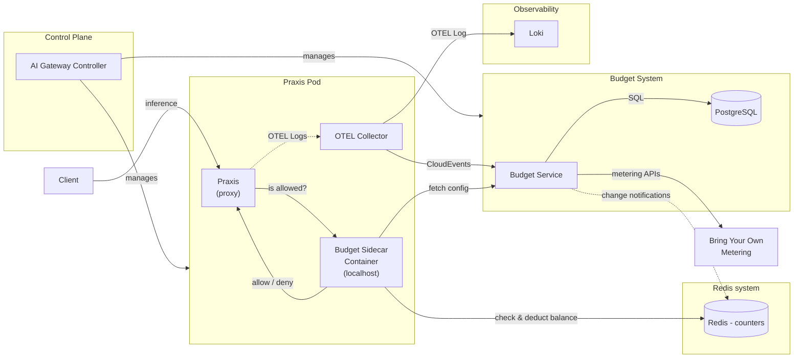
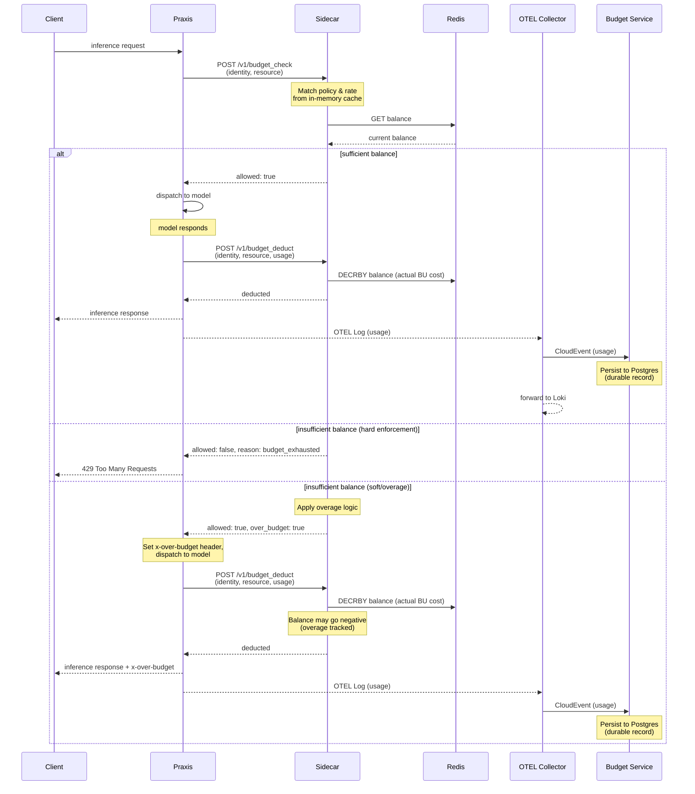
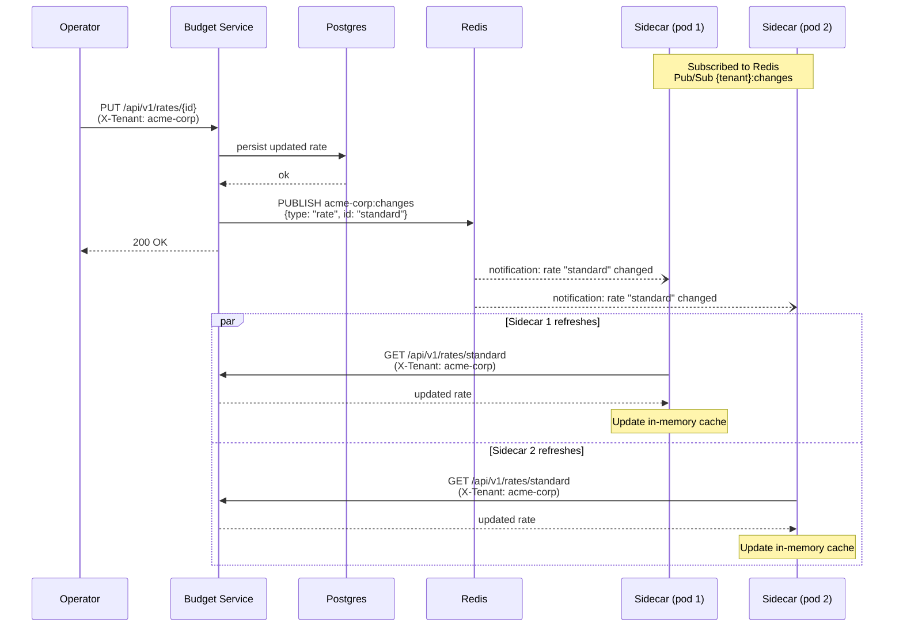

# Open Data Hub - AI Gateway Tokenomics and Budget Service

<!-- copy and paste this template to start authoring your own ADR -->
<!-- for the Status of new ADRs, please use Approved, since it will be approved by the time it is merged -->
<!-- remove this comment block too -->

|                |            |
| -------------- | ---------- |
| Date           | insert date |
| Scope          | |
| Status         | Approved |
| Authors        | Marius Danciu |
| Supersedes     | N/A |
| Superseded by: | N/A |
| Tickets        | |
| Other docs:    | none |

## What

This document proposes a new usage metering solution that is part of the RHOAI product. It allows customers to configure and manage costs and attribution and also visualize usage in the UI dashboards.

## Why

Usage metering and budget enforcement is a major feature of AI Gateway and a very frequent topic raised by customers.

## Goals

* Define the architecture for the Budget Service
* Define the Budget Service APIs
* Define end-to-end flows
* Define the high-level integration with third-party solutions like M360 or OpenMeter, but the actual integration details may be subject to different ADRs in later phases
* This is meant to be a usage metering solution as part of MaaS that works out of the box without bringing in new dependencies (such as Kafka) that customers need to install and manage. Customers don't need to perform extra installation steps in order to have usage metering and budget quota enforcement enabled.
* Budget quota enforcement is intentionally kept as a separate concept from rate limiting. Rate limiting is a QoS topic that for now remains managed in MaaSSubscription at control plane level and applied by Praxis at data plane level.
* Budget cost is abstracted away and referred to in this document as Budget Units (BU).

## Non-Goals

* This is not a billing service. We do not intend to manage aspects like:
    * multi currency
    * invoices
    * billing cycles
    * auditability and disputes
* This is not a generic competing solution for M360 or OpenMeter
* Usage for other resource types apart from tokens, e.g., GPUs. However, the design is flexible so we can address other types of resources in the future.
* The Budget Service storage does not represent the SoR for usage metering. The document will address this separation in the next sections.
* Pacing (spend-rate policies such as daily sub-limits derived from a monthly budget). The architecture supports it in the sidecar without changes to Praxis or the object model, but it is out of scope for the initial implementation.
* Multiple tenants per gateway. The initial implementation supports one tenant per gateway. Multi-tenant gateways may be considered in later releases.
* Distributed tokenomics across multiple clusters. This ADR assumes a single-cluster deployment. Federated budget enforcement, cross-cluster balance synchronization, and multi-cluster usage aggregation are not addressed.

## How


### Architecture



Notes:
- In the Praxis POD, AIGC also brings in the BSC (Budget Sidecar Container)
- Praxis filter remains a PEP (Policy Enforcement Point). All budget calculations happen in the budgeting system (sidecar container and/or budget service)
- Redis/Valkey is used for atomic balance counters and change notification Pub/Sub. The Budget Service publishes change notifications to Redis when configuration objects are updated; sidecars subscribe and fetch the changed objects from the Budget Service REST API. Configuration objects (policies, rates, budget definitions) are cached in the sidecar's memory, not stored in Redis.
- To limit the number of dependencies, this proposal does not assume the existence of a pub/sub system such as Kafka. However, adding one later can be considered as a mechanism to control back pressure and provide ordering for deduplication. The OTEL Collector could also be a candidate for deduplication, but this ADR does not prescribe an OTEL Collector design. We assume that an existing OTEL Collector is used and that it is at least capable of receiving the usage events and propagating them to both the SoR as OTEL logs and to the Budget Service as CloudEvents.

#### Inference Flow (budget check)



#### Configuration Update Flow

This section describes how control plane settings are propagated to data-plane components such as the Budget Sidecar.



##### Budget Service ↔ Sidecar Sync

The sidecar fetches configuration objects (policies, rates, budget definitions) from the Budget Service REST API and caches them in memory. Redis is used only for balance counters and lightweight change notifications — not for storing configuration objects.

Each gateway serves exactly one tenant and may have multiple Praxis pods. All sidecars for the same tenant share Redis balance counters, which makes Redis the natural coordination point for multi-replica consistency.

##### How state flows

1. An operator creates or updates a rate, budget, or policy via the Budget Service REST API
2. The Budget Service persists the change to the durable backend (Postgres by default) and publishes a change notification to Redis (e.g., via Pub/Sub: `{tenant}:changes` channel with the object type and ID)
3. Each sidecar subscribes to its tenant's change notifications. On receiving a notification, it fetches the updated object from the Budget Service REST API and refreshes its in-memory cache

On startup, the sidecar calls the Budget Service REST API to fetch all policies, rates, and budgets for its tenant and subscribes to Redis change notifications.

##### What lives where

| Store | Data | Role |
|---|---|---|
| Sidecar (in-memory) | Policies, rates, budget definitions | Cached configuration for admission decisions. Refreshed from the Budget Service API on startup and on change notifications |
| Redis | Balances, change notifications | Atomic counters for the hot path (read by sidecar for checks, decremented by sidecar for deductions, reset by Budget Service for period renewal) and lightweight Pub/Sub for cache invalidation |
| Budget Service (API) | Policies, rates, budget definitions, consumption | Authoritative source served from the durable backend. Sidecars fetch from here |

##### Consumption data

The sidecar does not report consumption back to the Budget Service. Consumption data reaches the Budget Service through the OTEL pipeline: Praxis emits an OTEL Log after each response, the OTEL Collector transforms it into a CloudEvent, and the Budget Service persists it to the durable backend (see [Consumption Emission](#consumption-emission)).

##### Failure Modes

| Scenario | Behavior |
|---|---|
| Redis unavailable | Sidecar serves decisions from its in-memory cache. Change notifications are missed — the sidecar continues with stale config until Redis recovers. Balance checks and deductions are unavailable — the sidecar applies fail-open or fail-closed per operator configuration |
| Budget Service unavailable | Sidecar continues with its in-memory cache and Redis balances. Config changes are delayed until the Budget Service recovers. Consumption data continues to flow via the OTEL pipeline independently |
| Sidecar restarts | Sidecar fetches its tenant's full state from the Budget Service REST API and subscribes to Redis change notifications |


#### Multi-Tenancy

The Budget Service is a single shared instance serving all tenants (soft multi-tenancy). All data is tenant-scoped and every management API request must carry the `X-Tenant` header to identify which tenant's budgets, rates, or policies are being managed.

At the gateway level, each gateway serves exactly one tenant. The sidecar running in the gateway pod inherits this tenant scope — it fetches only that tenant's configuration from the Budget Service API and reads only that tenant's Redis keys. This simplifies the sidecar's local state and avoids cross-tenant data leakage.

| Component | Tenancy model |
|---|---|
| Budget Service (central) | Single instance, soft multi-tenancy. All API calls scoped by `X-Tenant` header |
| Gateway + Sidecar | One tenant per gateway. Sidecar receives only that tenant's budget state |
| Redis | Keys namespaced by tenant ID |
| Postgres | All tables include a tenant ID column |


### Budget object model

The budget domain is modeled with three objects: **Rate**, **Budget**, and **BudgetPolicy**.

#### Rate

Defines BU costs per usage unit for a given resource. Resource matching and cost keys are flexible key-value maps — new usage categories (images, tool calls, video seconds) require no schema change.

| Field | Type | Description |
|---|---|---|
| `name` | string | Unique identifier for this rate table |
| `items` | list | One or more rate items (see below) |

Each **RateItem** contains:

| Field | Type | Description |
|---|---|---|
| `resource` | map | Resource matching keys (e.g., `model`, `provider`, `region`) |
| `costs` | map | BU per usage unit (e.g., `input_tokens: 3`, `output_tokens: 15`, `cache_read_tokens: 1`) |

The resource and cost keys are dynamically set. Admins can provide any key-value pairs here. However, for end-to-end consistency the cost fields emitted by Praxis in the OTEL logs are shown in the [Consumption Emission](#consumption-emission) section.

#### Budget

Pure capacity definition — how much BU and when it resets. No subject, no enforcement, no rates.

| Field | Type | Description |
|---|---|---|
| `name` | string | Unique identifier for this budget |
| `limit` | integer | BU capacity for each period |
| `period.start` | timestamp | UTC anchor for period calculation |
| `period.duration` | duration | Fixed period length (e.g., `P1M`, `P3M`, `P7D`) |
| `renewal` | one of | Reset behavior at period boundary |

**Renewal** variants:

| Variant | Fields | Description |
|---|---|---|
| `drain` | — | Use it or lose it; balance resets to `limit` each period |
| `rollover` | `max_carry` (optional) | Unused BU carry forward, optionally capped |

#### BudgetPolicy

Binds one or more subjects to a budget with a rate table and optional overage behavior. A policy can list multiple subjects — all share the same budget, rate, and overage configuration. When per-subject customization is needed (different rates or overage behavior), create separate policies.

| Field | Type | Description |
|---|---|---|
| `budget_ref` | string | References a Budget by name |
| `rate_ref` | string | References a Rate by name — controls BU pricing for all subjects in this policy |
| `subjects` | list | One or more subjects (see below) |
| `subjects[].kind` | one of | `user`, `group`, `organization`, or `tenant` |
| `subjects[].name` | string | Identity of the subject |
| `overage` | optional, one of | Behavior when the budget is exhausted (see below) |
| `deduct_overage` | optional, boolean | If true, any overage from the previous period is deducted from the next period's balance at renewal. Defaults to false |

If `overage` is absent, enforcement is **hard** — requests are rejected with 429 when the budget is exceeded.

**Overage** variants:

| Variant | Fields | Description |
|---|---|---|
| `soft` | `rate_ref` (optional) | Continue charging this budget past the limit, optionally at a different rate. Injects `x-over-budget: true` header upstream |
| `group` | `rate_ref` (optional) | Fall back to the group-level budget, optionally at a different rate |
| `organization` | `rate_ref` (optional) | Fall back to the organization-level budget, optionally at a different rate |
| `tenant` | `rate_ref` (optional) | Fall back to the tenant-level budget, optionally at a different rate |

**Ambiguity warning:** A user can belong to multiple groups and organizations. When overage is set to `group` or `organization`, the system may find multiple matching policies at that level. Since group and organization membership is only known at request time (via SelfTokenReview), this ambiguity cannot be validated at policy creation time. At request time, if multiple policies match, the sidecar applies the most restrictive one and emits a warning event so the operator can resolve it by creating a direct user policy.


#### Budget Units (BU) as the Accounting Abstraction

Budget Units are an important simplification from actual currency and reinforce the claim that this is not a billing system. Customers can attribute actual currency amounts per BU if necessary, but again this is not the SoR.

A budget becomes straightforward:

- Budget limit: 100,000 BU per 30-day period
- Each model has a BU rate table (potentially different per tenant/group)
- Consumption = tokens used * BU rate for that token type and model
- Remaining = limit - total consumption in BU


### Separation of Concerns: Rate Limiting vs Budget Enforcement

Rate limiting and budget enforcement answer fundamentally different questions:

| Concern | Question | Protects | Example |
|---|---|---|---|
| Rate limiting | Too fast? | Infrastructure from overload | 100 req/s max |
| Budget enforcement | Too much total? | Cost control | 1000 USD/month cap |


Rate limiting belongs in the proxy regardless of tokenomics — it protects backend model servers from burst traffic. Budget enforcement is a business concern that belongs in the external budget system.

OpenMeter, for comparison, handles entitlements (budget/quota enforcement) but not rate limiting. These are separate systems in practice.


### BU Cost Computation

The BU cost for a request is computed by matching usage keys against the rate table's cost keys:

```
cost_bu = sum(usage[key] * rate.costs[key]) for all keys in rate.costs
```

Both `usage` and `rate.costs` are dynamic key-value maps. For the initial token-based implementation, the well-known cost keys are:

| Key | Meaning |
|---|---|
| `input_tokens` | Input tokens (excluding cache reads and writes) |
| `output_tokens` | Output tokens (excluding reasoning) |
| `cache_read_tokens` | Input tokens served from cache |
| `cache_write_tokens` | Input tokens written to cache |
| `reasoning_tokens` | Output tokens used for reasoning |

For example, with the `standard` rate from the sample config (`input_tokens: 3, output_tokens: 15, cache_read_tokens: 1, cache_write_tokens: 4, reasoning_tokens: 15`):

```
cost_bu = 312 * 3 + 87 * 15 + 20 * 1 + 5 * 4 + 30 * 15 = 2711 BU
```

New cost keys (e.g., `image_count`, `tool_calls`, `video_seconds`) can be added to rate tables without schema changes — the formula applies generically to any keys present in both the usage data and the rate table.

Different subjects can have different rate tables assigned via their BudgetPolicy `rate_ref`. The same model costs different subjects different BU amounts. This makes the rate table a unified pricing and discount mechanism — no secondary discount logic is needed.

#### Token Limits via Unit-Cost Rate Tables

The same cost computation formula naturally supports raw token limits — no additional concepts are required. A rate table where every cost key has a weight of 1 turns the BU cost into a plain token count:

```yaml
rates:
  - name: token-counting
    items:
      - resource:
          model: "*"
          provider: "*"
        costs:
          input_tokens: 1
          output_tokens: 1
          cache_read_tokens: 1
          cache_write_tokens: 1
          reasoning_tokens: 1
```

With this rate table, the formula `sum(usage[key] * rate.costs[key])` reduces to `sum(usage[key] * 1)` = total tokens consumed. A Budget with `limit: 1000000` and a BudgetPolicy referencing `rate_ref: token-counting` enforces a 1,000,000 token cap.

A subject can have **two policies**: one referencing a weighted rate table (e.g., `standard`) against a BU budget for cost control, and one referencing a unit-cost rate table (e.g., `token-counting`) against a token budget for capacity control. The sidecar evaluates both and enforces the most restrictive outcome.

This means that token limits as defined in MaaSSubscription today can be expressed entirely within the existing budget object model — the same Redis counters, check-then-deduct flow, and period renewal logic apply without modification.

#### Relationship to MaaSSubscription

A MaaSSubscription binds multiple subjects (users and groups) to multiple models with a shared token limit. The budget object model can express the same semantics — and more flexibly — using its existing primitives:

- **Multiple models** are covered by the rate table's `items` list, which can contain entries for any number of models. Wildcard resource matching (e.g., `model: "*"`) extends this further.
- **Multiple subjects sharing a budget** are expressed directly in a single BudgetPolicy's `subjects` list. All subjects in the policy share the same budget, rate, and overage configuration — analogous to a Kubernetes RoleBinding listing multiple subjects for the same role.
- **Token limits** are expressed via unit-cost rate tables as described above.

The key advantage over MaaSSubscription is per-subject flexibility. When subjects need different rates or overage behavior against the same budget, separate BudgetPolicy objects are created — each with its own `rate_ref`. Alice can be on the `standard` rate while Bob is on the `discounted` rate, both drawing from the same shared budget pool. Subjects can also have individual BU budgets alongside shared token budgets. MaaSSubscription cannot express these distinctions.

> **Note:** The examples above use wildcard resource matching (`model: "*"`) to apply the same token counting across all models. The details of wildcard and pattern-based resource matching will be defined during implementation.


### Sidecar Architecture

#### The Problem

If Praxis calls the Budget Service synchronously on every request, inference latency depends on that external call. If the Budget Service is slow or unavailable, Praxis blocks or fails.

#### Sidecar as the Budget System's Local Agent

Each Praxis replica calls a localhost sidecar container provided and managed by the budget system. The sidecar runs in the same pod as Praxis.

From Praxis's perspective, the contract is simple: call `localhost:port` with who and what model, get back allow or deny, and after the model responds, call again with the actual token usage for deduction. Whether the sidecar answers from local state or calls the Budget Service is invisible to Praxis.

#### Sidecar Responsibilities

The budget system owns the sidecar and controls all caching and sync behavior:

| Responsibility | Description |
|---|---|
| Allow locally | Match policies and rates from in-memory cache, check balances in Redis. Tenants with plenty of budget remaining get fast approvals |
| Deny locally | When the balance is clearly exhausted |
| Deduct locally | After the model responds, compute BU cost from in-memory rates and atomically decrement Redis balance via `DECRBY`. This keeps balance updates synchronous and minimizes the overshoot window |
| Fail-open / fail-closed | Operator-configured behavior when Redis is unreachable |
| Cache refresh | Fetch config from Budget Service API on startup, subscribe to Redis Pub/Sub for change notifications, fetch updated objects on demand |
| No consumption reporting | Consumption data flows to the Budget Service via the OTEL pipeline (Praxis → OTEL Collector → CloudEvent), not from the sidecar. The sidecar deducts from Redis for real-time balance accuracy, but does not persist usage to Postgres |

#### What This Solves

**Fleet coherence.** All sidecars for the same tenant share Redis balance counters and receive the same Pub/Sub change notifications. Multiple Praxis replicas with their own sidecars are automatically coordinated — balances are shared atomically via Redis, and config changes propagate to all sidecars via the notification + fetch pattern.

**Availability.** The sidecar depends on Redis for balances and on the Budget Service API for config. A Budget Service outage blocks config refreshes and management API changes but does not affect admission decisions — the sidecar continues serving from its in-memory cache and Redis balances.

**Latency.** Localhost calls are sub-millisecond. The admission path stays fast regardless of the Budget Service's latency.

#### What Praxis Needs to Know

| Concern | Praxis responsibility |
|---|---|
| Who | Tenant identity, resolved from headers or authentication |
| What | Model and capabilities |
| Usage deduction | After the model responds, call the sidecar with actual token usage for immediate balance deduction |
| Usage emission | Emit an OTEL Log with actual token counts. The Budget Service persists the durable usage record via the CloudEvent pipeline |
| Enforcement | Call the sidecar, honor the allow/deny decision, apply hard (429) or soft (`x-over-budget: true` header) behavior |

Everything else — BU rates, balances, policies, discounts, pacing, fleet coordination, caching strategy — lives in the budget system and its sidecar.


### Identity Resolution

The `identity` object passed in the budget check call contains the full identity context needed for policy matching: user, groups, organization, and tenant. Praxis is responsible for resolving this identity before calling the sidecar.

| Field | Source | Description |
|---|---|---|
| `user` | Authentication token / headers | The authenticated user identity |
| `groups` | SelfTokenReview or OIDC token claims | Groups the user belongs to. Only known at request time — not available at policy creation time |
| `organization` | SelfTokenReview or OIDC token claims | Organization the user belongs to. Only known at request time |
| `tenant` | Gateway configuration | The tenant served by this gateway. Fixed per gateway — not resolved per request |

Identity resolution happens entirely within Praxis, before the budget check call. The sidecar receives the resolved identity and uses it to match policies — it does not perform any authentication or identity lookup itself.

The fact that group and organization membership is only known at request time has implications for policy validation and ambiguity resolution (see [Validation Rules](#validation-rules)).


### Admission and Deduction Flow

The budget flow has two phases: check before dispatch, deduct after completion. Both phases share the same policy resolution logic.

#### Policy Resolution

When the sidecar receives a request (check or deduct), it resolves the applicable budgets through the following chain:

1. **Identity → BudgetPolicies.** Match the subject's identity (user, groups, organization, tenant) against all cached policies' `subjects` lists. A user may match multiple policies — directly by name, via group/org membership, or via tenant. Precedence rules apply: most-specific subject kind wins (user > group > organization > tenant). If multiple policies match at the same specificity level, the most restrictive is applied and a warning is emitted (see [Validation Rules](#validation-rules)).

2. **BudgetPolicy → Rate.** Each matched policy carries a `rate_ref`. The sidecar looks up the corresponding Rate from its in-memory cache.

3. **Resource → RateItem.** The request's resource keys (e.g., `model: "claude-sonnet-5-5"`, `provider: "anthropic"`) are matched against the Rate's `items` to find the applicable RateItem.

4. **RateItem × Usage → BU cost.** The cost is computed as `sum(usage[key] * rateItem.costs[key])` for all keys present in the rate item's costs map.

5. **BudgetPolicy → Budget → Redis key.** The policy's `budget_ref` identifies the Budget, which maps to the Redis key `{tenant}:balance:{budget_ref}`.

Steps 1–3 and 5 are used by the check phase (to read the balance). All five steps are used by the deduct phase (to compute cost and decrement the balance).

A single request may resolve to multiple policies pointing to different budgets (e.g., a BU budget and a token budget). Each budget is checked and deducted independently.

#### Phase 1: Check (before dispatch)

Praxis sends the sidecar: "User A, model X."

The sidecar:
1. Looks up all matching budget policies for User A from its in-memory cache (a user may match multiple policies for different budgets)
2. Reads the current balance from Redis for each matched budget
3. If all balances > 0: **allow**
4. If any balance <= 0: **deny** (hard enforcement) or **allow with `over_budget: true`** (soft/overage logic). The most restrictive outcome wins

The check is a read operation — no balance modification occurs at this stage.

#### Phase 2: Deduct (after model responds)

After the model responds, Praxis calls the sidecar with the actual token usage. The sidecar computes the BU cost and immediately decrements the Redis balance — this keeps balance updates synchronous and minimizes the window for concurrent request overshoot.

The sidecar:
1. Receives the identity, resource, and actual token usage from Praxis
2. Finds all matching policies for the subject (the subject may have multiple policies for different budgets)
3. For each matched policy: matches the resource to the policy's rate table, computes actual BU cost, and atomically decrements the Redis balance for that budget via `DECRBY`
4. If any balance goes negative, subsequent budget checks will see the negative balance and apply overage logic

Separately, Praxis emits an OTEL Log with the actual token usage. The OTEL Collector transforms it into a CloudEvent and delivers it to the Budget Service, which persists the usage record(s) to Postgres. This is the durable record for reporting, overage tracking, and reconciliation — not the real-time balance path.

The Budget Service writes to Redis only for period renewal (`SET`) and reconciliation (rebuild from Postgres if Redis state is lost).

#### Why No Reservation System

This design intentionally avoids a reservation-based model (pre-decrementing an estimated cost before dispatch). The `max_completion_tokens` parameter is unreliable — clients may omit it, set it arbitrarily high, or the actual usage may diverge significantly from the estimate. A reservation system built on unreliable estimates introduces complexity (holds, settlements, releases, orphaned hold cleanup) without delivering accurate budget enforcement.

Instead, the system uses a simpler check-then-deduct approach: the sidecar checks the current balance before dispatch and deducts the actual cost immediately after the response. Overage is detected and tracked post-request rather than prevented pre-request.

When the sidecar detects that a budget is over (balance <= 0 at check time), Praxis can strip the output stream back to the client and inject the `x-over-budget` header in the response, signaling to the caller that the budget has been exceeded.

#### Overage Tracking and Period Carry-Forward

When a deduction drives the Redis balance negative, the sidecar continues to operate — subsequent budget checks see a negative balance and apply hard or soft enforcement accordingly. The Budget Service tracks the cumulative overage for each budget from the usage ledger in Postgres.

At period renewal, the Budget Service resets the Redis balance to the budget limit. If the BudgetPolicy has `deduct_overage` enabled, the Budget Service subtracts the previous period's overage from the new balance:

```
new_balance = limit - previous_period_overage   (if deduct_overage is true)
new_balance = limit                              (if deduct_overage is false or absent)
```

This ensures that overspend in one period is not silently forgiven — it reduces the next period's capacity. The `deduct_overage` field is optional on BudgetPolicy and defaults to false (overage is not carried forward).

#### Edge Cases

| Scenario | Behavior |
|---|---|
| Redis unavailable during check or deduct | Sidecar applies fail-open or fail-closed per operator configuration. If Redis is unavailable during deduction, the sidecar returns an error — the OTEL pipeline still persists the usage to Postgres, and the Budget Service can reconcile the Redis balance on recovery |
| Budget Service unavailable when CloudEvent arrives | OTEL Collector retries delivery. The Postgres usage record is delayed, but the Redis balance was already decremented by the sidecar — real-time enforcement is unaffected |
| Concurrent requests between check and deduct | The overshoot window is minimal — deduction happens synchronously in the same request path (sidecar → Redis), not via an async pipeline. Overshoot is limited to truly concurrent requests that pass the check before any of their deductions land |
| Sidecar deducts from Redis but CloudEvent never reaches Budget Service | Redis balance is correct (decremented by sidecar), but Postgres is missing the usage record. The Budget Service should detect this discrepancy during reconciliation — the Redis balance is lower than the sum of Postgres records. This is a data completeness issue for reporting, not a balance accuracy issue |

#### Event Deduplication

The OTEL Collector may retry delivery of a CloudEvent if it does not receive a timely acknowledgement from the Budget Service (e.g., network timeout, pod restart). Without deduplication, a retried event would be persisted twice in Postgres, corrupting usage reports and overage calculations.

The Budget Service uses the CloudEvent `id` field as an idempotency key. The `usage` table has a unique constraint on `(tenant_id, event_id, budget_ref)`. On receipt, for each matched budget:

1. Insert the usage row with `ON CONFLICT DO NOTHING`
2. If zero rows were inserted — this budget's row is a duplicate; skip it
3. If one row was inserted — the usage record is persisted

Note that deduplication here protects the Postgres ledger, not the Redis balance. The Redis balance was already decremented by the sidecar synchronously during the request. The OTEL pipeline is the durable persistence path — deduplication ensures the Postgres records remain accurate for reporting, overage tracking, and reconciliation.

### Storage Architecture: Redis + Postgres

Redis and Postgres serve different roles in the budget system:

| Layer | Store | Purpose |
|---|---|---|
| Sidecar (in-memory) | Memory | Cached policies, rates, and budget definitions. Fetched from the Budget Service API, refreshed via Redis change notifications |
| Hot path (shared) | Redis | Atomic balance counters and Pub/Sub change notifications |
| Durable (default backend) | Postgres | Authoritative ledger, budget/rate/policy definitions, usage history, reconciliation |

The sidecar caches configuration objects (policies, rates, budget definitions) in memory, fetched from the Budget Service REST API. Redis handles only what requires shared atomic state — balance counters — plus lightweight Pub/Sub notifications for cache invalidation.

Postgres is the default durable backend because it is already supported and operated in RHOAI. For the usage ledger workload (append-only writes, time-range aggregation queries), Postgres is adequate at single-cluster scale — LLM inference throughput bounds the event rate to a level well within Postgres capabilities. Table partitioning by time range and BRIN indexes on timestamp columns keep query performance acceptable as the ledger grows.

However, if usage volume or analytical query complexity outgrows Postgres, a columnar store such as ClickHouse would be a natural successor for the usage ledger — it offers superior compression, faster aggregation over high-cardinality dimensions, and built-in time-series partitioning. The Budget Service implementation must abstract the storage layer behind a trait boundary so that the durable backend can be replaced without affecting the rest of the system (sidecar protocol, Redis balances, API contracts).

When the Budget Service integrates with an external platform such as M360 or OpenMeter (see [Bring Your Own Metering](#bring-your-own-metering)), the external system can serve as the durable store instead of — or alongside — Postgres. In that scenario, the sidecars are unaffected because they fetch configuration from the Budget Service API (not from Postgres directly) and use Redis only for balances.

Consumption data reaches the Budget Service via the OTEL pipeline, not from the sidecar directly. See the [Storage Schema](#storage-schema) section for details on the Postgres and Redis schemas.

Redis operations:

- **Check (sidecar, before dispatch):** `GET {tenant}:balance:{budget_id}` — read the current balance to make an admission decision.
- **Deduct (sidecar, after model responds):** `DECRBY {tenant}:balance:{budget_id} <actual_bu_cost>` — atomically decrement by the actual BU cost. The balance may go negative (overage). This happens synchronously in the request path for real-time accuracy.
- **Reset (Budget Service, on period renewal):** `SET {tenant}:balance:{budget_id} <new_balance>` — set balance to `limit` (or `limit - previous_overage` if `deduct_overage` is enabled on the policy).
- **Reconcile (Budget Service, on demand):** `SET {tenant}:balance:{budget_id} <reconciled_balance>` — rebuild the Redis balance from the Postgres usage ledger if Redis state is lost or suspected to be incorrect.


### Pacing

Budget systems are accumulators — they track total spend against a cap but have no opinion about the shape of consumption over time. A tenant with a 30-day budget and a 100 req/s rate limit could exhaust their entire monthly budget in minutes if each request is expensive.

Pacing sits between rate limiting and budget enforcement:

| Concern | Question | Example |
|---|---|---|
| Rate limiting | Too fast? | 100 req/s max |
| **Pacing** | **Too much too soon?** | **No more than 10,000 BU/day from a 100,000 BU/month budget** |
| Budget enforcement | Too much total? | 100,000 BU/month cap |

Pacing is a policy decision that varies by use case: batch processing may want to burst, customer-facing apps need steady availability. The sidecar is a natural place to enforce spend-rate policies — the Budget Service can configure the sidecar with daily or hourly sub-limits derived from the period budget. Pacing becomes a sidecar-local policy, not a Praxis concern.

Pacing is out of scope for the initial implementation, but the architecture supports it without changes to Praxis or the object model.


### Validation Rules

#### At policy creation time

| Rule | Description |
|---|---|
| No conflicting rate for the same budget | A subject must not appear in multiple policies that reference the same `budget_ref` with different `rate_ref` values. Since multiple policies for the same budget share a single balance counter, the system cannot determine which rate to use for cost computation. This is validated across all policies — including subjects listed in multi-subject policies |
| `budget_ref` must resolve | Must reference an existing Budget |
| `rate_ref` must resolve | Must reference an existing Rate |
| Overage `rate_ref` must resolve | If present, must reference an existing Rate |
| Overage level constraints | Overage level must be higher than or equal to each subject's kind within the policy. `soft` is valid for any subject kind. `group` is valid for `user`. `organization` is valid for `user` or `group`. `tenant` is valid for `user`, `group`, or `organization`. If a policy lists subjects of mixed kinds, the overage level must be valid for all of them |

#### At request time

| Rule | Description |
|---|---|
| Most-specific wins | A user with a direct policy takes precedence over any group, organization, or tenant policy |
| Ambiguous group/organization membership | A user in multiple groups or organizations that have policies results in the most restrictive policy being applied. A warning event is emitted so the operator can resolve the ambiguity by creating a direct user policy. Group and organization membership is only known at request time (i.e. via SelfTokenReview or from the OIDC token claims) and cannot be validated at policy creation time |


### API: REST

The Budget Service exposes a REST API for managing rates, budgets, and budget policies. All endpoints require the `X-Tenant` header.

> **Note:** The exact request and response payloads will be defined in a separate API specification document.

#### Rates

| Method | Endpoint | Description |
|---|---|---|
| `GET` | `/api/v1/rates` | List all rates |
| `GET` | `/api/v1/rates/{id}` | Get a rate by name |
| `POST` | `/api/v1/rates` | Create a rate |
| `PUT` | `/api/v1/rates/{id}` | Update a rate |
| `DELETE` | `/api/v1/rates/{id}` | Delete a rate |

#### Budgets

| Method | Endpoint | Description |
|---|---|---|
| `GET` | `/api/v1/budgets` | List all budgets |
| `GET` | `/api/v1/budgets/{id}` | Get a budget by name |
| `POST` | `/api/v1/budgets` | Create a budget |
| `PUT` | `/api/v1/budgets/{id}` | Update a budget |
| `DELETE` | `/api/v1/budgets/{id}` | Delete a budget |

#### Budget Policies

| Method | Endpoint | Description |
|---|---|---|
| `GET` | `/api/v1/budget_policies` | List all policies |
| `GET` | `/api/v1/budget_policies/{id}` | Get a policy by ID |
| `POST` | `/api/v1/budget_policies` | Create a policy |
| `PUT` | `/api/v1/budget_policies/{id}` | Update a policy |
| `DELETE` | `/api/v1/budget_policies/{id}` | Delete a policy |

#### Usage Query

```
GET /api/v1/usage
```

Returns aggregated usage data with flexible grouping and time bucketing. All results are scoped by the `X-Tenant` header.

**Query parameters:**

| Param | Type | Description |
|---|---|---|
| `range` | string | Time window: `24h`, `7d`, `30d`, `90d`, `180d`, `365d`, `mtd` (month-to-date), `qtd`, `ytd`, `custom`. Default: `7d` |
| `from` | string | Start date (`YYYY-MM-DD`), required when `range=custom` |
| `to` | string | End date (`YYYY-MM-DD`, inclusive), required when `range=custom` |
| `group_by` | string | Comma-separated dimensions to group by: `model`, `provider`, `region`, `user`, `group`, `org`. Omit for flat totals |
| `granularity` | string | Time bucketing: `total`, `hour`, `day`, `week`, `month`. Default: `total` |
| `user` | string | Filter by user |
| `group` | string | Filter by group |
| `org` | string | Filter by organization |
| `model` | string | Filter by model |
| `provider` | string | Filter by provider |
| `region` | string | Filter by region. Reserved for future. |
| `cluster` | string | Filter by cluster. Reserved for future.|

The `group_by` dimensions correspond to the dynamic resource keys in the rate tables. New dimensions (e.g., `tool`, `capability`) work without API changes since resource keys are stored as JSONB.

**Response structure:**

```json
{
  "range": { "from": "...", "to": "..." },
  "granularity": "total | hour | day | week | month",
  "group_by": ["..."],
  "data": [
    {
      "bucket": "...",
      "dimensions": { "key": "value" },
      "requests": 0,
      "usage": { "cost_key": 0 },
      "bu_cost": 0
    }
  ]
}
```

| Field | Description |
|---|---|
| `bucket` | Present only when `granularity` is not `total`. Format depends on granularity: ISO timestamp for `hour`, date for `day`, etc. |
| `dimensions` | Contains only the fields specified in `group_by`. Empty map when `group_by` is omitted |
| `requests` | Number of requests in this bucket/group |
| `usage` | Dynamic map of aggregated usage values. Keys match the cost keys defined in the rate tables (e.g., `input_tokens`, `output_tokens`, `cache_read_tokens`, `cache_write_tokens`, `reasoning_tokens`). The keys present depend on what the rate tables define — new cost keys appear automatically |
| `bu_cost` | Total BU cost for this bucket/group |

The `data` array is always returned, even when it contains a single element.

**Example 1 — Tenant-wide totals for the current month:**

```
GET /api/v1/usage?range=mtd
```

```json
{
  "range": { "from": "2026-11-01", "to": "2026-11-17" },
  "granularity": "total",
  "group_by": [],
  "data": [
    {
      "dimensions": {},
      "requests": 1842,
      "usage": {
        "input_tokens": 612000,
        "output_tokens": 234000,
        "cache_read_tokens": 85000,
        "cache_write_tokens": 12000,
        "reasoning_tokens": 41000
      },
      "bu_cost": 310500
    }
  ]
}
```

**Example 2 — Usage grouped by model and provider for a specific user:**

```
GET /api/v1/usage?group_by=model,provider&range=30d&user=alice
```

```json
{
  "range": { "from": "2026-10-18", "to": "2026-11-17" },
  "granularity": "total",
  "group_by": ["model", "provider"],
  "data": [
    {
      "dimensions": { "model": "claude-sonnet-5-5", "provider": "anthropic" },
      "requests": 142,
      "usage": {
        "input_tokens": 48200,
        "output_tokens": 18500,
        "cache_read_tokens": 6800,
        "cache_write_tokens": 1200,
        "reasoning_tokens": 4300
      },
      "bu_cost": 24500
    },
    {
      "dimensions": { "model": "granite-3.3-8b", "provider": "ibm" },
      "requests": 55,
      "usage": {
        "input_tokens": 18400,
        "output_tokens": 9800
      },
      "bu_cost": 8700
    }
  ]
}
```

**Example 3 — Daily breakdown by model for the last 3 days:**

```
GET /api/v1/usage?group_by=model&granularity=day&range=custom&from=2026-11-14&to=2026-11-17
```

```json
{
  "range": { "from": "2026-11-14", "to": "2026-11-17" },
  "granularity": "day",
  "group_by": ["model"],
  "data": [
    {
      "bucket": "2026-11-14",
      "dimensions": { "model": "claude-sonnet-5-5" },
      "requests": 23,
      "usage": {
        "input_tokens": 8100,
        "output_tokens": 3200,
        "cache_read_tokens": 1100,
        "cache_write_tokens": 200,
        "reasoning_tokens": 800
      },
      "bu_cost": 4200
    },
    {
      "bucket": "2026-11-14",
      "dimensions": { "model": "granite-3.3-8b" },
      "requests": 12,
      "usage": {
        "input_tokens": 4100,
        "output_tokens": 2200
      },
      "bu_cost": 1900
    },
    {
      "bucket": "2026-11-15",
      "dimensions": { "model": "claude-sonnet-5-5" },
      "requests": 31,
      "usage": {
        "input_tokens": 11200,
        "output_tokens": 4100,
        "cache_read_tokens": 1500,
        "cache_write_tokens": 300,
        "reasoning_tokens": 900
      },
      "bu_cost": 5600
    }
  ]
}
```

**Example 4 — Hourly usage for a specific organization, no grouping (timeline):**

```
GET /api/v1/usage?granularity=hour&range=24h&org=research
```

```json
{
  "range": { "from": "2026-11-16", "to": "2026-11-17" },
  "granularity": "hour",
  "group_by": [],
  "data": [
    {
      "bucket": "2026-11-16T00:00:00Z",
      "dimensions": {},
      "requests": 12,
      "usage": {
        "input_tokens": 4200,
        "output_tokens": 1800,
        "cache_read_tokens": 600,
        "cache_write_tokens": 100,
        "reasoning_tokens": 300
      },
      "bu_cost": 2100
    },
    {
      "bucket": "2026-11-16T01:00:00Z",
      "dimensions": {},
      "requests": 8,
      "usage": {
        "input_tokens": 2800,
        "output_tokens": 1200,
        "cache_read_tokens": 400,
        "cache_write_tokens": 50,
        "reasoning_tokens": 200
      },
      "bu_cost": 1400
    }
  ]
}
```

**Example 5 — Monthly usage per user (top consumers report):**

```
GET /api/v1/usage?group_by=user&granularity=month&range=90d
```

```json
{
  "range": { "from": "2026-08-19", "to": "2026-11-17" },
  "granularity": "month",
  "group_by": ["user"],
  "data": [
    {
      "bucket": "2026-09",
      "dimensions": { "user": "alice" },
      "requests": 320,
      "usage": {
        "input_tokens": 105000,
        "output_tokens": 42000,
        "cache_read_tokens": 15000,
        "cache_write_tokens": 3000,
        "reasoning_tokens": 8000
      },
      "bu_cost": 54200
    },
    {
      "bucket": "2026-09",
      "dimensions": { "user": "bob" },
      "requests": 180,
      "usage": {
        "input_tokens": 62000,
        "output_tokens": 28000,
        "cache_read_tokens": 8000,
        "cache_write_tokens": 1500,
        "reasoning_tokens": 5000
      },
      "bu_cost": 32800
    }
  ]
}
```

#### Personal Usage

```
GET /api/v1/usage/me
```

A self-scoped view of the authenticated caller's own usage. Accepts the same `range`, `from`, `to`, `group_by`, and `granularity` parameters as the main usage query, but automatically filters to the caller's identity — no `user` or admin RBAC required. Identity fields (`user`, `group`, `org`) are not allowed in `group_by` — this endpoint returns only the caller's own data and does not expose other users' usage.

This provides a clean separation: `GET /api/v1/usage` is the admin/reporting API (tenant-scoped, requires RBAC), while `GET /api/v1/usage/me` is the end-user API (self-scoped, available to any authenticated user).

```
GET /api/v1/usage/me?range=mtd&group_by=model
```

```json
{
  "range": { "from": "2026-11-01", "to": "2026-11-17" },
  "granularity": "total",
  "group_by": ["model"],
  "data": [
    {
      "dimensions": { "model": "claude-sonnet-5-5" },
      "requests": 87,
      "usage": {
        "input_tokens": 28400,
        "output_tokens": 11200,
        "cache_read_tokens": 4100,
        "cache_write_tokens": 800,
        "reasoning_tokens": 2600
      },
      "bu_cost": 15300
    }
  ]
}
```


All these objects are scoped per tenant, identified in the request via the `X-Tenant` header. They are scoped per tenant and not per AI Gateway organization, since the tenant admin manages costs, not the organization admin. This is a simplification choice that may be relaxed later. However, as described in the previous sections, budget policies can be created per organization.

A tenant admin automatically has the RBAC permissions to manage these objects. From an RBAC point of view we need three separate virtual resources:
- rates
- budgets
- budget-policy 
The api group for these resources is `budget.aigateway.opendatahub.io`


### API: Sidecar

The sidecar exposes local endpoints for Praxis to check budget availability and deduct usage. These are hot-path calls — localhost only, never exposed outside the pod.

#### Check Budget

```
POST /v1/budget_check
```

```json
{
  "identity": {
    "user": "alice",
    "groups": ["engineering", "ml-team"],
    "organization": "research",
    "tenant": "acme-corp"
  },
  "resource": {
    "model": "claude-sonnet-5-5",
    "provider": "anthropic"
  }
}
```

| Field | Type | Description |
|---|---|---|
| `identity.user` | string | User identity (resolved by Praxis from auth/headers) |
| `identity.groups` | list of strings | Groups the user belongs to (from SelfTokenReview or OIDC claims) |
| `identity.organization` | string | Organization the user belongs to |
| `identity.tenant` | string | Tenant identity |
| `resource.model` | string | Model identifier |
| `resource.provider` | string | Model provider |

The check is a read-only operation — the sidecar reads the current Redis balance to make an admission decision but does not modify it. No tokens are estimated or reserved. The actual deduction happens after the model responds via the [Deduct Budget](#deduct-budget) endpoint.

Response (modeled after [OpenMeter's entitlement access API](https://openmeter.io/docs/api)):

A user may match multiple policies for different budgets (e.g., a personal BU budget and a shared token budget). The response reflects the aggregate decision and includes per-budget details:

```json
{
  "allowed": true,
  "over_budget": false,
  "budgets": [
    {
      "budget_ref": "team-alpha-monthly",
      "balance": 85000,
      "usage": 15000,
      "overage": 0
    },
    {
      "budget_ref": "team-token-limit",
      "balance": 420000,
      "usage": 580000,
      "overage": 0
    }
  ]
}
```

| Field | Type | Description |
|---|---|---|
| `allowed` | boolean | Whether the request should proceed — `true` only if all matched budgets allow it (equivalent to OpenMeter's `hasAccess`) |
| `over_budget` | boolean | Whether any matched budget is exceeded — Praxis uses this to set the `x-over-budget: true` header upstream |
| `budgets` | list | Per-budget details for all matched policies |
| `budgets[].budget_ref` | string | Which budget was matched |
| `budgets[].balance` | integer | Current BU balance for this budget |
| `budgets[].usage` | integer | Total BU consumed in the current period for this budget |
| `budgets[].overage` | integer | BU consumed past the budget limit (0 if within budget) |

When `allowed` is `false`, the response includes a `reason` field:

```json
{
  "allowed": false,
  "over_budget": true,
  "reason": "budget_exhausted",
  "budgets": [
    {
      "budget_ref": "team-alpha-monthly",
      "balance": 0,
      "usage": 100000,
      "overage": 0
    }
  ]
}
```

> **Note:** The exact payloads may change and will be defined in a separate API specification document.

#### Deduct Budget

```
POST /v1/budget_deduct
```

Called by Praxis after the model responds, with the actual token usage. The sidecar computes the BU cost for each matched budget and atomically decrements the Redis balance via `DECRBY`.

```json
{
  "identity": {
    "user": "alice",
    "groups": ["engineering", "ml-team"],
    "organization": "research",
    "tenant": "acme-corp"
  },
  "resource": {
    "model": "claude-sonnet-5-5",
    "provider": "anthropic"
  },
  "usage": {
    "input_tokens": 312,
    "output_tokens": 87,
    "cache_read_tokens": 20,
    "cache_write_tokens": 5,
    "reasoning_tokens": 30
  }
}
```

| Field | Type | Description |
|---|---|---|
| `identity` | object | Same identity context as the check call |
| `resource` | map | Resource keys for rate table matching |
| `usage` | map | Actual token usage from the model response. Keys match the cost keys in rate tables |

Response:

```json
{
  "deductions": [
    {
      "budget_ref": "team-alpha-monthly",
      "bu_cost": 2711,
      "balance": 82289
    },
    {
      "budget_ref": "team-token-limit",
      "bu_cost": 454,
      "balance": 419546
    }
  ]
}
```

| Field | Type | Description |
|---|---|---|
| `deductions` | list | Per-budget deduction results |
| `deductions[].budget_ref` | string | Which budget was charged |
| `deductions[].bu_cost` | integer | BU cost deducted from this budget |
| `deductions[].balance` | integer | Remaining balance after deduction |

### Consumption Emission

After a model responds, Praxis emits an OTEL Log record containing the resource identification and actual token usage. The OTEL Collector forwards this as a CloudEvent to the Budget Service, which persists the usage record(s) to Postgres. This is the durable persistence path for reporting, overage tracking, and reconciliation. The real-time balance deduction is handled by the sidecar (see [Deduct Budget](#deduct-budget)).

The OTEL Log record carries the following attributes:

```json
{
  "Timestamp": "2026-11-16T14:32:05.123Z",
  "SeverityText": "INFO",
  "Body": "inference_usage",
  "Attributes": {
    "request_id": "req-abc123",
    "identity.user": "alice",
    "identity.groups": ["engineering", "ml-team"],
    "identity.organization": "research",
    "identity.tenant": "acme-corp",
    "resource.model": "claude-sonnet-5-5",
    "resource.provider": "anthropic",
    "resource.region": "us-east-1",
    "usage.input_tokens": 312,
    "usage.output_tokens": 87,
    "usage.cache_read_tokens": 20,
    "usage.cache_write_tokens": 5,
    "usage.reasoning_tokens": 30
  },
  "Resource": {
    "service.name": "praxis",
    "service.instance.id": "praxis-pod-abc-0",
    "k8s.namespace.name": "ai-gateway"
  }
}
```

| Field | Description |
|---|---|
| `request_id` | Unique request identifier for correlation |
| `identity.*` | Full identity context of the request |
| `resource.*` | Dynamic resource keys matching rate table entries (e.g., `model`, `provider`, `region`). The set of keys depends on how the rate tables are configured |
| `usage.*` | Dynamic usage keys matching the cost keys in rate tables (e.g., `input_tokens`, `output_tokens`, `cache_read_tokens`, `cache_write_tokens`, `reasoning_tokens`). New cost keys appear automatically when added to rate tables |

The `resource.*` fields are matched against rate table entries to find the applicable rate. The `usage.*` fields are multiplied by the corresponding cost keys to compute BU cost:

```
cost_bu = sum(usage[key] * rate.costs[key]) for all keys in rate.costs
```

This OTEL Log record is also forwarded to Loki for observability.

#### CloudEvent

The OTEL Collector transforms the Log record into a CloudEvent and sends it to the Budget Service via HTTP. The CloudEvent follows the [CloudEvents v1.0 specification](https://cloudevents.io/):

```json
{
  "specversion": "1.0",
  "id": "evt-7f3a2b1c-4d5e-6f78-9a0b-1c2d3e4f5678",
  "source": "praxis/praxis-pod-abc-0",
  "type": "io.opendatahub.aigateway.usage.v1",
  "time": "2026-11-16T14:32:05.123Z",
  "datacontenttype": "application/json",
  "data": {
    "request_id": "req-abc123",
    "identity": {
      "user": "alice",
      "groups": ["engineering", "ml-team"],
      "organization": "research",
      "tenant": "acme-corp"
    },
    "resource": {
      "model": "claude-sonnet-5-5",
      "provider": "anthropic",
      "region": "us-east-1"
    },
    "usage": {
      "input_tokens": 312,
      "output_tokens": 87,
      "cache_read_tokens": 20,
      "cache_write_tokens": 5,
      "reasoning_tokens": 30
    }
  }
}
```

| Field | Description |
|---|---|
| `specversion` | CloudEvents specification version |
| `id` | Unique event identifier (for deduplication) |
| `source` | Originating Praxis instance |
| `type` | Event type — `io.opendatahub.aigateway.usage.v1` |
| `time` | Timestamp of the inference completion |
| `data.request_id` | Unique request identifier for correlation |
| `data.identity` | Full identity context from the OTEL Log |
| `data.resource` | Dynamic resource keys matching rate table entries |
| `data.usage` | Dynamic usage keys matching rate table cost keys |

The Budget Service persists the CloudEvent data to the `usage` table in Postgres and exposes it via the metering APIs for external systems (Bring Your Own Metering). The usage records are also used to compute cumulative overage per budget for period carry-forward (see [Overage Tracking and Period Carry-Forward](#overage-tracking-and-period-carry-forward)).

### Storage Schema

> **Note:** The schemas below are subject to change as the implementation evolves. They are included in this ADR for exemplification purposes and to illustrate the data model — the actual column names, types, and constraints will be finalized during implementation.

#### Postgres

Postgres is the default durable backend and the authoritative source of truth in standalone deployments. When the Budget Service integrates with an external metering platform, Postgres may be replaced by the external system's storage — the Budget Service treats the durable backend as a pluggable layer behind Redis.

All tables include a `tenant_id` column for multi-tenancy. Dynamic fields (resource keys, cost keys, usage values) are stored as JSONB. Reference fields, timestamps, and scalar values are separate columns.

##### `rates`

| Column | Type | Description |
|---|---|---|
| `id` | uuid | Primary key |
| `tenant_id` | text | Tenant scope |
| `name` | text | Unique rate table name (within tenant) |
| `items` | jsonb | Array of rate items, each with `resource` (dynamic key-value map) and `costs` (dynamic key-value map) |
| `created_at` | timestamptz | Creation timestamp |
| `updated_at` | timestamptz | Last update timestamp |

##### `budgets`

| Column | Type | Description |
|---|---|---|
| `id` | uuid | Primary key |
| `tenant_id` | text | Tenant scope |
| `name` | text | Unique budget name (within tenant) |
| `limit` | bigint | BU capacity per period |
| `period_start` | timestamptz | UTC anchor for period calculation |
| `period_duration` | text | ISO 8601 duration (e.g., `P1M`, `P7D`) |
| `renewal_type` | text | `drain` or `rollover` |
| `max_carry` | bigint | Maximum rollover BU (null for drain) |
| `created_at` | timestamptz | Creation timestamp |
| `updated_at` | timestamptz | Last update timestamp |

##### `budget_policies`

| Column | Type | Description |
|---|---|---|
| `id` | uuid | Primary key |
| `tenant_id` | text | Tenant scope |
| `budget_ref` | text | References a budget by name |
| `rate_ref` | text | References a rate by name |
| `subjects` | jsonb | Array of subjects, each with `kind` and `name` (e.g., `[{"kind": "user", "name": "alice"}, {"kind": "user", "name": "bob"}]`) |
| `overage` | jsonb | Overage configuration — level and optional rate_ref (null for hard enforcement) |
| `deduct_overage` | boolean | Whether to deduct previous period overage from next period balance. Default false |
| `created_at` | timestamptz | Creation timestamp |
| `updated_at` | timestamptz | Last update timestamp |

##### `usage`

Append-only ledger of usage records. This is the durable record that feeds reporting, overage tracking, and the metering APIs. Rows are never updated or deleted. The Budget Service computes cumulative overage per budget from this ledger for period carry-forward. A single inference request may produce multiple usage rows — one per budget charged (e.g., if a user has both a BU budget and a token budget, two rows are written with different `budget_ref` and `bu_cost` values).

| Column | Type | Description |
|---|---|---|
| `id` | bigserial | Primary key |
| `tenant_id` | text | Tenant scope |
| `event_id` | text | CloudEvent `id` — idempotency key. Unique constraint on `(tenant_id, event_id, budget_ref)` prevents duplicate processing while allowing one row per budget charged |
| `request_id` | text | Request identifier for correlation |
| `timestamp` | timestamptz | When the request completed |
| `identity` | jsonb | Full identity context (e.g., `{"user": "alice", "groups": ["engineering", "ml-team"], "organization": "research"}`). Stored as JSONB so new identity scopes can be added without schema changes |
| `resource` | jsonb | Dynamic resource keys (e.g., `{"model": "claude-sonnet-5-5", "provider": "anthropic"}`) |
| `usage` | jsonb | Dynamic usage keys (e.g., `{"input_tokens": 312, "output_tokens": 87, "cache_read_tokens": 20}`) |
| `bu_cost` | bigint | Computed BU cost |
| `budget_ref` | text | Which budget was charged |

> **Note:** The usage query API supports multiple granularities (hour, day, week, month). Initially, all queries are served directly from the `usage` table using `date_trunc` and appropriate indexes. Pre-aggregated rollup tables (e.g., hourly or daily) can be added later if query performance requires it. This is an implementation and optimization detail that does not affect the API contract.


#### Redis/Valkey

Redis handles atomic shared state and change notifications. Configuration objects (policies, rates, budget definitions) are not stored in Redis — they are cached in sidecar memory and served by the Budget Service API. All keys are namespaced by tenant ID.

| Key pattern | Type | Description |
|---|---|---|
| `{tenant}:balance:{budget_id}` | integer | Current BU balance for a budget. Decremented atomically by the sidecar after each response via `DECRBY`. May go negative (overage). Reset by the Budget Service on period renewal |
| `{tenant}:changes` | Pub/Sub channel | Change notifications published by the Budget Service when a policy, rate, or budget is created, updated, or deleted. Payload contains the object type and ID. Sidecars subscribe to this channel and fetch the changed object from the Budget Service API |

The balance key is the critical path — the sidecar reads it for admission checks and atomically decrements it on deduction. The Budget Service writes to balance keys only for period renewal and reconciliation.

**Note:** The low-level schema details are intentionally omitted from this document as they tend to change as the design and implementation evolve, risking this information becoming outdated. For this reason we aim to cover only the high-level aspects here.


### Bring Your Own Metering

The Budget Service is designed as a self-contained solution that works out of the box. However, customers who already operate an external metering or billing platform — such as OpenMeter, Monetize360, or a custom solution — can integrate it with the Budget Service.

#### Integration boundary

All external metering integration happens exclusively at the Budget Service level. The rest of the stack — Praxis, the sidecar, Redis, the OTEL pipeline — remains completely unchanged and unaware of any external backend. This is a deliberate architectural choice:

- **Praxis** continues to call the sidecar for admission decisions. It does not know whether consumption data is forwarded elsewhere.
- **The sidecar** continues to fetch config from the Budget Service API and use Redis for balances. Its sync protocol is unchanged.
- **The OTEL pipeline** continues to emit logs and CloudEvents to the Budget Service. No additional collectors or exporters are needed.

The Budget Service acts as the single integration point, translating its internal consumption data into the format expected by the external system.

#### Integration patterns

| Pattern | Description |
|---|---|
| Push (webhook/event) | The Budget Service forwards consumption events to an external system's ingestion endpoint (e.g., OpenMeter's event API or M360's usage API) as they are persisted |
| Pull (metering API) | The external system queries the Budget Service's metering APIs to retrieve consumption data on its own schedule |
| Backend replacement | The external system replaces Postgres as the durable store. The Budget Service writes budget objects and usage records to the external system instead of Postgres. Redis remains the operational store — Praxis, sidecars, and the OTEL pipeline are unaffected |

#### What the external system receives

The Budget Service can expose usage data: request ID, identity (user, groups, organization, tenant), resource keys (model, provider, region), usage keys (token counts), BU cost, and timestamp. The external system can then apply its own pricing, aggregation, and billing logic.

#### What the external system does not control

Budget enforcement decisions (allow/deny) remain with the Budget Service and its sidecars. The external system is a consumer of usage data, not an authority on admission. If a customer wants the external system to influence budget limits, this is done by updating budgets and rates via the Budget Service's management API — not by bypassing the sidecar.

> **Note:** The specific integration details for each external platform (API mappings, authentication, retry policies) will be addressed in separate ADRs as those integrations are prioritized.


### Observability

The budget system produces observability data at multiple levels:

#### OTEL Logs (via Praxis)

Praxis emits an OTEL Log record after each inference response containing full identity, resource, and token usage. These logs are forwarded to Loki for observability and to the Budget Service (as CloudEvents) for durable persistence. See [Consumption Emission](#consumption-emission) for the exact log structure.

#### Metrics

The sidecar and Budget Service expose Prometheus metrics for monitoring:

| Metric | Source | Description |
|---|---|---|
| Budget utilization | Sidecar | Current balance as a percentage of the budget limit, per budget |
| Admission decisions | Sidecar | Counter of allow/deny decisions, labeled by tenant, subject, and reason (sufficient, soft overage, hard deny) |
| Deduction latency | Sidecar | Histogram of Redis balance deduction latency on `DECRBY` |
| Overage events | Sidecar | Counter of requests that triggered overage logic |
| Overage amount | Budget Service | Cumulative BU overage per budget in the current period |
| Config refresh latency | Sidecar | Latency of config fetches from the Budget Service API |
| CloudEvent ingestion | Budget Service | Counter and latency of CloudEvent processing |

#### Alerts

The Budget Service does not include a built-in alert management system. All metrics are exposed as standard Prometheus metrics, and alerting is handled by the operator's existing Prometheus/Alertmanager infrastructure. The recommended approach is to define PrometheusRule resources (or equivalent alerting rules) based on the metrics above. The table below lists recommended alert conditions as a starting point — operators can adjust thresholds and add custom rules to fit their environment:

| Condition | Severity | Description |
|---|---|---|
| Budget utilization > 80% | Warning | Tenant approaching budget limit |
| Budget utilization > 95% | Critical | Tenant near exhaustion |
| Overage exceeds threshold | Warning | Budget overage growing — may indicate runaway consumption or misconfigured rates |
| Config refresh failures | Warning | Sidecar cannot reach Budget Service API — serving stale config |
| Ambiguous policy match | Warning | Multiple group/org policies matched for a user — operator should create a direct user policy |

#### UI Dashboards

The RHOAI UI can query the Budget Service metering APIs to display:

- Consumption over time (BU spent per period, per tenant/user/group)
- Budget utilization (remaining vs limit, with trend projection)
- Top consumers (users or models by BU consumption)
- Overage history (when and how often budgets were exceeded)


## Open Questions

| # | Question | Context |
|---|---|---|
| 1 | **Fail-open or fail-closed default?** | When Redis is unreachable, should the sidecar allow requests (fail-open) or reject them (fail-closed)? This is operator-configurable, but the default affects out-of-the-box behavior. Fail-open risks overspend; fail-closed risks blocking legitimate requests |
| 2 | **Maximum negative balance tolerance** | When deductions drive a balance negative, how far negative is acceptable before the system takes corrective action? Concurrent requests between check and deduction can cause overshoot. Unbounded negative balances could indicate a problem |
| 3 | **Redis persistence strategy** | Should Redis use AOF, RDB snapshots, or both? This affects how much balance data is lost on a Redis restart and how quickly it can be rebuilt from Postgres |
| 4 | **Pub/Sub delivery guarantees** | Redis Pub/Sub is fire-and-forget — if a sidecar misses a notification (e.g., during a brief disconnect), it will serve stale config. Should the sidecar also poll the Budget Service API periodically as a fallback? If so, at what interval? |
| 5 | **BudgetPolicy ↔ MaaSSubscription relationship** | Should a BudgetPolicy reference a MaaSSubscription? Currently, policies bind a subject to a budget and rate, but there is no explicit link to the subscription that governs the subject's access. A reference could enable subscription-scoped budget enforcement and usage visibility per subscription, but it introduces a dependency on the control plane's subscription model |


## Alternatives

### Adopt OpenMeter or another open-source metering solution

Solutions like OpenMeter provide entitlement management, usage metering, and billing integrations. However, adopting a third-party solution introduces several concerns:

- **Dependency footprint.** OpenMeter requires Kafka, ClickHouse, and its own control plane. Customers would need to install and maintain these additional components. The goal of this design is an end-to-end solution that works out of the box without requiring customers to manage extra infrastructure.
- **Feature surface.** Third-party solutions come with their own UIs, APIs, and features (billing integrations, plan management, invoicing) that overlap with or conflict with the RHOAI product experience. Hiding or removing these features requires forking the upstream project, which leads to ongoing maintenance debt as the upstream evolves.
- **Integration cost.** Adapting an external solution to fit the Praxis sidecar architecture, the OTEL-based consumption pipeline, and the multi-tenancy model would require significant glue code — potentially more effort than building the focused subset of functionality we actually need.

OpenMeter's entitlement model (feature-based access with boolean/metered/static grants) informed parts of this design, particularly the budget check API response format. The Budget Service can expose metering data via APIs for customers who want to integrate with OpenMeter or similar solutions downstream (Bring Your Own Metering), without requiring them as runtime dependencies.

### Synchronous budget checks against the central Budget Service

Instead of the sidecar architecture, Praxis could call the Budget Service directly on every request. This was rejected because:

- **Latency.** Every inference request would depend on a network round trip to the Budget Service. Under load or during Budget Service degradation, inference latency increases or requests fail.
- **Availability coupling.** A Budget Service outage would block all inference requests, making budget enforcement a single point of failure for the entire gateway.
- **Fleet coordination.** With multiple Praxis replicas, each calling the Budget Service independently, the central service becomes a contention point for atomic balance operations.

The sidecar model decouples the admission path from the central service. Localhost calls are sub-millisecond, and the sidecar continues serving decisions from local state during outages.

### Redis-only or Postgres-only storage

- **Redis-only:** Provides the required latency but lacks durability guarantees. A Redis restart or eviction loses balance state and usage history. Rebuilding from scratch is not feasible without an authoritative ledger.
- **Postgres-only:** Provides durability but cannot meet the sub-millisecond latency requirement for the admission hot path. Even with connection pooling, atomic check-and-decrement under high concurrency would bottleneck on row-level locks.

The hybrid approach uses each store for what it does best: Redis for the latency-sensitive hot path and Postgres as the durable source of truth.


## Security and Privacy Considerations

### In-Cluster Communication

All communication between components happens exclusively within the Kubernetes cluster network over TLS:

- **Sidecar → Budget Service** (REST API calls to fetch config) — in-cluster only, never exposed publicly
- **Sidecar → Redis** (balance counters, Pub/Sub subscriptions) — in-cluster only
- **Budget Service → Redis** (balance updates, change notifications) — in-cluster only

The Praxis-to-sidecar communication is localhost only (same pod), so it does not traverse the network at all and requires no authentication. Both containers share the same pod security boundary — if one is compromised, the other is already accessible.

### Service-to-Service Authentication

The sidecar's REST API calls to the Budget Service (for fetching policies, rates, and budgets) are authenticated using Kubernetes ServiceAccounts and projected ServiceAccount tokens (bound tokens with audience and expiry). The sidecar presents its ServiceAccount token, and the Budget Service validates it against the Kubernetes TokenReview API.

Authorization is enforced via RBAC. A dedicated virtual resource `s2s` in the `budget.aigateway.opendatahub.io` API group controls which ServiceAccounts are allowed to fetch budget state from the Budget Service. The same API group also defines three virtual resources (`rates`, `budgets`, `budget-policy`) for management operations.

The AI Gateway Controller is responsible for creating the appropriate RoleBindings when it provisions a gateway and its sidecar.

### Tenant Isolation

All management API requests require the `X-Tenant` header. The Budget Service validates that the caller has RBAC permissions for the specified tenant's resources. A missing or unauthorized `X-Tenant` header results in a 403 response.

At the data plane level, each sidecar fetches only its own tenant's config from the Budget Service API (the `X-Tenant` header scopes the response) and reads only its tenant's Redis keys (see [Multi-Tenancy](#multi-tenancy)). Tenant isolation in Redis is enforced by key naming convention (`{tenant}:*`) and Pub/Sub channel naming (`{tenant}:changes`). Redis ACLs or separate Redis instances per tenant can provide stronger isolation if required.

### PII in Identity Fields

The `identity` object (user, groups, organization, tenant) flows through the OTEL Log, CloudEvent, and Postgres usage records. These fields may contain personally identifiable information depending on the identity provider configuration. Operators should be aware that usage records in Postgres retain identity context for reconciliation and reporting purposes. Data retention policies for the `usage` table should align with the organization's privacy requirements.

### Redis Data Security

Redis holds balance counters and Pub/Sub change notifications. It does not store configuration objects, usage records, or identity information. Redis should be configured with TLS for in-transit encryption and access restricted to the sidecar and Budget Service via network policies.

## Implementation notes

We recommend that the Budget Service and the Budget Sidecar be implemented in Rust rather than Go. Tokenomics support is a critical part of the system, so we need to optimize system resources in terms of memory footprint and CPU. Rust also avoids potential CPU spikes caused by a garbage collector.

## Risks

| Risk | Likelihood | Impact | Mitigation |
|---|---|---|---|
| **Redis data loss** — Redis restart or crash loses balance counters | Medium | High | Redis persistence (AOF/RDB). Budget Service reconciliation rebuilds balances from Postgres usage records |
| **Redis/Postgres divergence** — Sidecar decrements Redis but the CloudEvent never reaches the Budget Service (e.g., OTEL pipeline failure). Redis balance is correct, but Postgres is missing usage records | Low | Medium | Budget Service reconciliation detects the discrepancy (Redis balance is lower than the Postgres-computed balance). Missing records can be recovered from OTEL logs in Loki |
| **Missed Pub/Sub notifications** — Sidecar misses a Redis change notification and serves stale config (wrong rates or policies) | Low | Medium | Optional periodic polling of the Budget Service API as a fallback. Sidecar restart triggers a full config fetch |
| **Concurrent request overshoot** — Multiple requests pass the balance check before their deductions land, causing the balance to go negative | Low | Low | The overshoot window is minimal — deductions happen synchronously in the sidecar via Redis `DECRBY`, not via an async pipeline. Only truly concurrent requests (overlapping check-to-deduct windows) can overshoot. Negative balances block subsequent hard admissions. The `deduct_overage` policy option ensures overshoot is recovered in the next period |
| **Sidecar memory pressure** — Tenants with many policies, rates, or budget definitions cause high memory usage in the sidecar | Low | Low | Config objects are small (KV maps). Monitor sidecar memory usage. If needed, limit the number of objects per tenant |
| **Budget Service as single point for config** — Budget Service outage prevents config refresh for all sidecars | Medium | Low | Sidecars continue with in-memory cached config. Only new config changes are delayed. Admission decisions and Redis balances are unaffected |


## Stakeholder Impacts

| Group                         | Key Contacts         | Date       | Impacted? |
| ----------------------------- | -------------------- | ---------- | --------- |
| Tokenomics                    |   Marius Danciu      |            |     Y     |
| Praxis                        |   Shane Utt          |            |     Y     |
| Dashboard                     |   Andrew Ballantine  |            |     Y     |
| MaaS                          |   Jamie Land         |            |    TBD    |


## References


## Reviews

| Reviewed by                   | Date       | Notes |
| ----------------------------- | ---------  | ------|
|                               |            |       |
