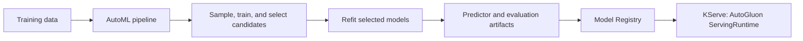

# Open Data Hub - AutoML Architecture Decision

|                |            |
| -------------- | ---------- |
| Date           | 2026-07-20 |
| Scope          | AutoML Component |
| Status         | Approved |
| Authors        | Lukasz Cmielowski |
| Supersedes     | N/A |
| Superseded by: | N/A |
| Tickets        | [RHAISTRAT-1066](https://redhat.atlassian.net/browse/RHAISTRAT-1066) |
| Other docs:    | [ODH-ADR-0002](./ODH-ADR-0002-experiment-settings.md) · [ODH-ADR-0003](./ODH-ADR-0003-model-insights.md) · [ODH-ADR-0004](./ODH-ADR-0004-mlflow-integration.md) |

## What

AutoML provides managed Kubeflow Pipelines for building, evaluating, and selecting AutoGluon predictors in Red Hat OpenShift AI. It supports separate pipelines for tabular classification and regression, and for time-series forecasting.

The result is a refitted AutoGluon predictor that users can register in RHOAI Model Registry and deploy on KServe with the AutoGluon ServingRuntime.

## Why

Building competitive tabular and time-series models normally requires selecting algorithms, configuring training, evaluating candidates, and preparing a deployable model. AutoML makes that workflow available through a consistent RHOAI pipeline experience while using AutoGluon's model selection and ensembling capabilities.

## Goals

* Provide managed AutoML training for tabular and time-series data.
* Produce refitted, deployable AutoGluon predictors and evaluation artifacts.
* Integrate with RHOAI Connections, MLflow, Model Registry, and KServe.
* Support programmatic and Dashboard-driven workflows.
* Define stable boundaries with the input and artifact contracts in sibling ADRs.

## Non-goals

* Non-tabular modalities or unsupervised learning.
* Traditional, user-configured hyperparameter optimization.
* Automatic Model Registry registration or KServe deployment as pipeline steps.
* Requiring a user-managed serving image for the supported serving path.

## How

## Architecture

| Component | Responsibility |
| --- | --- |
| Kubeflow Pipelines | Orchestrates catalog-managed training workflows composed from reusable components. |
| AutoGluon | Builds, evaluates, ensembles, and refits candidate predictors. |
| RHOAI Connections | Supplies namespace-scoped credentials for S3-compatible input data. |
| MLflow | Tracks enabled runs, metrics, and artifact references; see [ODH-ADR-0004](./ODH-ADR-0004-mlflow-integration.md). |
| Model Registry and KServe | Register and serve a selected predictor after training. |

## Training and delivery lifecycle

The pipeline samples data for initial model selection, then refits the selected models on the full training data. AutoGluon uses its supported model selection and ensembling approach rather than a separate traditional HPO workflow.

Model Registry registration and KServe deployment are post-training Dashboard or platform actions. Users register the selected refitted predictor artifact, not leaderboard or run-summary artifacts.

## Pipeline families

| Pipeline | Supports | Key outcome |
| --- | --- | --- |
| Tabular training | Binary classification, multiclass classification, and regression | Refit tabular predictors ranked by the selected evaluation metric. |
| Time-series training | Forecasting | Refit time-series predictors for the configured horizon. |

Both use S3-compatible input data through RHOAI Connections. Their public parameters, data formats, presets, and evaluation-metric constraints are defined in [ODH-ADR-0002](./ODH-ADR-0002-experiment-settings.md).

## Outputs and supported paths

Each run emits refitted predictor artifacts, metrics, leaderboards, and generated notebooks. Per-model paths, `model.json`, insight artifacts, and scoring schemas are defined in [ODH-ADR-0003](./ODH-ADR-0003-model-insights.md).

The supported user paths are:

| Path | Outcome |
| --- | --- |
| API or Dashboard submission | Starts a tabular or time-series AutoML run. |
| Run artifacts and notebooks | Inspect models, metrics, and predictions. |
| Model Registry | Register a selected refitted predictor. |
| KServe with AutoGluon ServingRuntime | Deploy a registered predictor. |

## Security and operational boundaries

Connection names, not credentials, are pipeline inputs. Credentials remain in namespace-scoped Kubernetes Secrets and are injected only into the steps that require them. Predictors and training data remain in user-configured storage and are governed by the corresponding project access controls.

Training duration and resource consumption depend on data size, task type, and preset. The preset limits and resource envelopes in [ODH-ADR-0002](./ODH-ADR-0002-experiment-settings.md) are the supported guardrails.

## Alternatives

Manual model development leaves model selection, evaluation, and deployment preparation to each user. A custom AutoML framework or a traditional HPO-focused solution would add substantial maintenance and operational complexity. AutoGluon was selected because it provides mature tabular and time-series training, evaluation, and ensembling within the supported RHOAI workflow.

## References

* [AutoGluon](https://github.com/autogluon/autogluon)
* [Kubeflow Pipelines Components](https://github.com/red-hat-data-services/pipelines-components)
* [RHOAI Connections API ADR](/architecture-decision-records/operator/ODH-ADR-Operator-0009-connection-api.md)

## Reviews

| Reviewed by  | Date      | Approval | Notes |
|--------------|-----------|----------|-------|
| Ana Biazetti | Jan, 27   | TBD      | Pending approval |
| Yuan Tang | Feb, 17th | YES      | N/A   |
