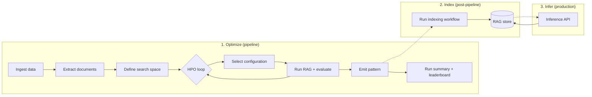

# Open Data Hub - AutoRAG Architecture Decision

|                |            |
| -------------- | ---------- |
| Date           | 2026-08-28 |
| Scope          | AutoRAG Component |
| Status         | Approved |
| Authors        | Lukasz Cmielowski |
| Supersedes     | N/A |
| Superseded by: | N/A |
| Tickets        | [RHAISTRAT-188](https://redhat.atlassian.net/browse/RHAISTRAT-188) · [RHAISTRAT-2623](https://redhat.atlassian.net/browse/RHAISTRAT-2623) |
| Other docs:    | [ODH-ADR-0002](./ODH-ADR-0002-experiment-settings.md) · [ODH-ADR-0003](./ODH-ADR-0003-rag-templates.md) · [ODH-ADR-0004](./ODH-ADR-0004-rag-pattern-inference.md) · [ODH-ADR-0005](./ODH-ADR-0005-rag-pattern-evaluation.md) · [ODH-ADR-0006](./ODH-ADR-0006-mlflow-integration.md) |

## What

This ADR documents the architecture decision for AutoRAG, an automated system for building and optimizing Retrieval-Augmented Generation (RAG) applications within Red Hat OpenShift AI. AutoRAG uses Kubeflow Pipelines to orchestrate a hyperparameter optimization (HPO) workflow, explore a configurable RAG search space, and select parameter settings using GAM-based prediction.

## Why

Manually testing RAG chunking, embedding, retrieval, and generation configurations is slow and difficult to compare consistently. AutoRAG systematically explores those choices against a user benchmark and emits a portable RAG pattern that can be indexed and served.

## Goals

* Provide automated optimization of document RAG applications within RHOAI
* Integrate with existing RHOAI infrastructure (Kubeflow Pipelines, MaaS for chat and embeddings, database services, MLflow)
* Emit portable RAG patterns that separate **optimization**, **indexing**, and **inference** concerns
* Evaluate patterns consistently against user-provided benchmarks
* Use RHOAI Connections for namespace-scoped data and service access

## Non-Goals

* Auto LLM deployment / shut down for experiment run purposes
* Direct coupling to a specific LLM vendor or database product (access goes through platform abstractions)
* LLM fine-tuning or model training capabilities
* Optimization resume/checkpointing for interrupted runs

## How

AutoRAG is implemented as a Kubeflow Pipeline. The pipeline optimizes on a **document sample**; pattern artifacts are designed for **full-corpus indexing** and production inference. Vector and Graph patterns share the same artifact envelope, distinguished by `template_id` ([ODH-ADR-0003](./ODH-ADR-0003-rag-templates.md), [ODH-ADR-0004](./ODH-ADR-0004-rag-pattern-inference.md)).

### Architecture

Kubeflow Pipelines orchestrates the managed optimization and indexing workflows. ai4rag explores and evaluates configurations; MaaS provides models and embeddings; a vector or graph store holds the resulting index. RHOAI Connections provide namespace-scoped access to these services. MLflow is an optional tracking integration.

The first release supports Agentic Vector and Agentic Graph RAG. Concrete store-provider compatibility, template identifiers, settings, evaluation, artifacts, and tracking contracts are owned by the sibling ADRs.

### Lifecycle Phases

AutoRAG spans three phases. Only the first runs inside the optimization pipeline; the others are driven by pattern artifacts.

During optimization, AutoRAG evaluates configurations on a document sample and emits ranked patterns. A user selects a pattern, indexes the full corpus, then uses the pattern settings for production retrieve-and-generate. The `pattern.json` contract is defined in [ODH-ADR-0004](./ODH-ADR-0004-rag-pattern-inference.md); settings and metrics are defined in [ODH-ADR-0002](./ODH-ADR-0002-experiment-settings.md) and [ODH-ADR-0005](./ODH-ADR-0005-rag-pattern-evaluation.md).

## Alternatives

* **Manual configuration** — retains full control but makes systematic comparison difficult.
* **Grid or random search** — is simpler but inefficient for the configured search space.
* **A bespoke optimizer** — adds a long-term algorithm and maintenance burden.

**Decision:** use ai4rag and GAM-based optimization within the managed KFP workflow.

### OGX integration

OGX is not selected as the AutoRAG retrieval, generation, or vector-store layer. OGX is planned to be shut down and migrated to Praxis, which will expose only a subset of its APIs. Its closed-source vector-store implementation offers limited support for building and evolving vector stores. Its file-search-style Responses implementation also constrains the ability to introduce more advanced retrieval and generation algorithms.

AutoRAG therefore uses template-specific LangChain adapters to access the selected vector or graph store directly. This preserves the flexibility needed for the supported RAG patterns and future retrieval and generation capabilities.

## Security and Privacy Considerations

* RHOAI Connections are namespace-scoped; parameters and artifacts contain references, not credential values.
* Documents, benchmark data, and run artifacts stay in the user-selected project storage and follow its access and retention controls.
* MaaS and database access are provided only through authorized project Connections.

## References

* [ai4rag GitHub Repository](https://github.com/IBM/ai4rag)
* [Kubeflow Pipelines Components](https://github.com/red-hat-data-services/pipelines-components/tree/main/pipelines/training/autorag)
* [RHOAI Connections API ADR](/architecture-decision-records/operator/ODH-ADR-Operator-0009-connection-api.md)
* AutoRAG sibling ADRs:
  * [ODH-ADR-0002 — Optimization settings](./ODH-ADR-0002-experiment-settings.md)
  * [ODH-ADR-0003 — RAG templates](./ODH-ADR-0003-rag-templates.md)
  * [ODH-ADR-0004 — Pattern inference](./ODH-ADR-0004-rag-pattern-inference.md)
  * [ODH-ADR-0005 — Pattern evaluation](./ODH-ADR-0005-rag-pattern-evaluation.md)
  * [ODH-ADR-0006 — MLflow integration](./ODH-ADR-0006-mlflow-integration.md)

## Reviews

| Reviewed by | Date | Approval | Notes |
| ----------- | ---- |----------|-------|
| Francisco Javier Arceo |  Jan, 29th | YES | N/A   |
