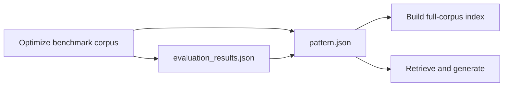

# Open Data Hub - AutoRAG Pattern Inference

|                |            |
| -------------- | ---------- |
| Date           | 2026-08-31 |
| Scope          | AutoRAG Component |
| Status         | Approved |
| Authors        | Lukasz Cmielowski |
| Supersedes     | N/A |
| Superseded by: | N/A |
| Tickets        | [RHAISTRAT-1846](https://redhat.atlassian.net/browse/RHAISTRAT-1846) · [RHAISTRAT-1731](https://redhat.atlassian.net/browse/RHAISTRAT-1731) · [RHAISTRAT-1724](https://redhat.atlassian.net/browse/RHAISTRAT-1724) · [RHAISTRAT-1424](https://redhat.atlassian.net/browse/RHAISTRAT-1424) · [RHAISTRAT-2623](https://redhat.atlassian.net/browse/RHAISTRAT-2623) · [RHOAIENG-88692](https://redhat.atlassian.net/browse/RHOAIENG-88692) · [RHOAIENG-90017](https://redhat.atlassian.net/browse/RHOAIENG-90017) |
| Other docs:    | [ODH-ADR-0001-autorag](./ODH-ADR-0001-autorag.md) · [ODH-ADR-0002-experiment-settings](./ODH-ADR-0002-experiment-settings.md) |

## What

Define the portable RAG-pattern artifact that connects optimization, full-corpus indexing, and retrieve-and-generate inference.

## Why

Optimization produces settings for a benchmark corpus, while a deployable RAG application needs to index the full corpus and use the selected settings at inference time. A versioned pattern artifact keeps those stages aligned without preserving a request-body template that would quickly become stale.

## Goals

* Make a selected RAG pattern portable between AutoRAG workflows and consumers.
* Keep the settings used for indexing and inference together.
* Represent vector and graph patterns without imposing graph-specific fields on vector patterns.
* Keep evaluation results and optional generated helpers associated with the pattern.

## Non-goals

* Define the metric catalog or evaluation-result schema; see [ODH-ADR-0005](ODH-ADR-0005-rag-pattern-evaluation.md).
* Define exact managed-pipeline paths, object-storage layouts, deployment manifests, or notebook implementation details.

## How

## Pattern lifecycle



The selected pattern is the source of truth for the settings consumed by both indexing and inference. Generated helpers may make those settings easier to use, but do not replace the pattern artifact.

## Pattern artifacts

| Artifact | Purpose |
| --- | --- |
| `pattern.json` | Authoritative, portable record of a selected pattern. |
| `evaluation_results.json` | Per-question evaluation output associated with the pattern. |
| Helper artifacts | Generated notebooks, starter kits, or deployment helpers derived from the pattern. |
| Diagnostic artifacts | Backend-generated diagnostics associated with the pattern. Their presence and location are contractual; their payload schema remains backend-specific. |

## pattern.json

`pattern.json` is the stable envelope. The schema below shows the contract shared by supported templates; template-specific fields are defined by their template.

```text
pattern.json
├── name, template_id, iteration, max_combinations, duration_seconds
├── settings
│   ├── store_binding (provider_type, collection_name)
│   ├── chunking (method, chunk_size, chunk_overlap, include_metadata)
│   ├── embedding (model_id, embedding_params)
│   ├── graph_extraction (graph only)
│   ├── retrieval (method, number_of_chunks, search_mode;
│   │              hybrid: ranker_strategy, ranker_k, ranker_alpha;
│   │              graph: profile-specific controls)
│   └── generation (model_id, sampling, prompts, language)
├── indexing
│   └── pipeline_spec (pipeline_name, parameters, overrides_allowed)
├── inference
│   └── runtime_spec (framework, protocol, image, connections)
└── evaluation
    └── metrics[] (evaluator, name, description, scores, optimization_metric)
```

| Section | Responsibility |
| --- | --- |
| `identity` | Pattern name, `template_id`, optimization iteration, and provenance. |
| `settings` | The selected store, chunking, embedding, retrieval, generation, and template-specific settings. |
| `indexing` | The managed indexing workflow and its pattern-derived, non-secret inputs. |
| `inference` | Runtime requirements and connection references for retrieve-and-generate consumers. |
| `evaluation` | Aggregate metric values and references to detailed evaluation output. |

`template_id` is required by the Dashboard, indexing, and serving. Its supported values and profile semantics are defined in [ODH-ADR-0003](ODH-ADR-0003-rag-templates.md).

`settings` is the common source for both downstream stages: indexing uses the selected store, chunking, embedding, and extraction settings; inference uses the selected store, retrieval, and generation settings. The originating optimization run's `preset` is copied into `indexing.pipeline_spec.parameters` so full-corpus indexing uses the same preset-defined extraction behavior. Any consumer override must be explicitly permitted by the template, non-secret, and recorded with the request. `pattern.json` may contain connection references, but never connection material.

### Example pattern.json

```json
{
  "name": "Pattern1",
  "template_id": "agentic_rag",
  "iteration": 0,
  "max_combinations": 90,
  "duration_seconds": 48,
  "settings": {
    "store_binding": {
      "provider_type": "milvus",
      "collection_name": "ai4rag_20260824161307_t2pxa4s3"
    },
    "chunking": {
      "method": "hybrid",
      "chunk_size": 512,
      "chunk_overlap": 0,
      "include_metadata": true
    },
    "embedding": {
      "model_id": "publishers/ai-eng-cracow/models/redhataibge-m3",
      "embedding_params": {
        "embedding_dimension": 1024,
        "context_length": 1015
      }
    },
    "retrieval": {
      "method": "simple",
      "number_of_chunks": 5,
      "search_mode": "hybrid",
      "ranker_strategy": "weighted",
      "ranker_alpha": 0.5
    },
    "generation": {
      "model_id": "publishers/ai-eng-cracow/models/qwen3-8b-fp8-dynamic",
      "temperature": 0.2,
      "max_completion_tokens": 2048,
      "context_template_text": "Document {doc_number}:\\n{document}",
      "user_message_text": "Context: {reference_documents}\\n\\nQuestion: {question}",
      "system_message_text": "Answer from the provided context only.",
      "language": { "code": "en", "name": "English" }
    }
  },
  "indexing": {
    "pipeline_spec": {
      "pipeline_name": "documents-indexing-pipeline",
      "parameters": {
        "preset": "balanced",
        "maas_secret_name": "maas",
        "db_secret_name": "milvus",
        "input_data_secret_name": "documents-storage",
        "input_data_bucket_name": "documents",
        "input_data_keys": ["source/"],
        "batch_size": 20,
        "provider_type": "milvus",
        "collection_name": "ai4rag_20260824161307_t2pxa4s3",
        "embedding_model_id": "publishers/ai-eng-cracow/models/redhataibge-m3",
        "embedding_params": {
          "embedding_dimension": 1024,
          "context_length": 1015
        },
        "chunking_method": "hybrid",
        "chunk_size": 512,
        "chunk_overlap": 0,
        "include_metadata": true
      },
      "overrides_allowed": ["input_data_secret_name", "input_data_bucket_name", "input_data_keys", "batch_size"]
    }
  },
  "inference": {
    "runtime_spec": {
      "framework": "langgraph",
      "protocol": "responses",
      "image": "quay.io/opendatahub/odh-autorag-inference:odh-stable",
      "connections": {
        "maas_secret_name": "maas",
        "db_secret_name": "milvus"
      }
    }
  },
  "evaluation": {
    "metrics": [
      {
        "name": "faithfulness",
        "evaluator": "unitxt",
        "scores": { "mean": 0.9063, "ci_low": 0.8806, "ci_high": 0.9292 }
      },
      {
        "name": "overall_score",
        "evaluator": "custom",
        "scores": { "mean": 0.8806, "ci_low": 0.7844, "ci_high": 0.936 },
        "optimization_metric": true
      }
    ]
  }
}
```

### Graph-only fields

The graph profile (`agentic_graph_rag`) may contain graph extraction and graph retrieval settings. The vector profile (`agentic_rag`) must not contain graph-only settings.

The indexing contract carries graph extraction as `graph_extraction_config`; it is derived from the selected graph settings. The graph template owns the detailed field schema and validation rules, so consumers should treat graph-specific settings as opaque unless they implement that template.

## Retrieve and generation

Retrieve-and-generate consumers use a selected pattern to configure a Responses-compatible endpoint. One-click deployment mounts that pattern as the immutable baseline configuration; the request carries the user's input and only explicitly permitted, non-secret overrides. This supports the Dashboard test experience as well as generated or custom clients.

The Dashboard and generated helpers initialize a deployment from the selected pattern. The serving application resolves MaaS and database connections from its deployment configuration; requests must not contain connection material. Runtime-specific request formats and generated-client details belong to the relevant consumer documentation.

### Deployment and consumption options

AutoRAG provides the following supported ways to consume a selected pattern. Each is derived from the same `pattern.json` contract and resolves its connection references in the target environment.

| Option | Audience | Purpose |
| --- | --- | --- |
| Inference notebook | Data scientist | Inspect retrieve-and-generate behavior with a sample query. |
| Starter kit | Developer | Download and customize a generated application seeded with the selected pattern. |
| One-click deployment | Operator or Dashboard user | Deploy the default application from `inference.runtime_spec`. |
| Dashboard test endpoint | Dashboard user | Interactively test retrieve-and-generate for a selected pattern; it is not the production serving API. |

The indexing notebook is the corresponding full-corpus indexing helper. Generated notebooks, starter kits, and the default deployment must preserve the selected pattern settings; they may expose only allowed non-secret overrides.

One-click deployment exposes the same Responses-compatible API and mounts the selected `pattern.json` read-only as its baseline configuration. The deployed application uses that pattern for the model, store binding, embedding model, retrieval controls, and prompt defaults. Deployment injects MaaS and database credentials only through Secret references (for example, `secretKeyRef`, `envFrom`, or a mounted Secret); `SandboxClaim.spec.env` is limited to non-secret values.

#### Responses-compatible request

The mounted pattern supplies the selected model, store binding, embedding model, retrieval controls, and prompt defaults. A request supplies `input` and may override only the fields explicitly permitted by the template. Shared prompt and context behavior remains a server default. AutoRAG uses the Responses shape with an `autorag_retrieval` tool extension; it is not an OpenAI built-in tool.

| Pattern setting | Request behavior |
| --- | --- |
| `generation.model_id` | Mounted default; not required in the request. |
| `generation.temperature`, `generation.max_completion_tokens`, `generation.system_message_text` | Optional request overrides when permitted by the template. |
| `store_binding`, `embedding.model_id`, `retrieval` | Mounted defaults; not caller-configurable for the one-click endpoint. |
| User's question | Required `input`. |

```json
{
  "input": "What is the refund policy?"
}
```

The server applies the mounted pattern and shared prompt/context defaults, retrieves supporting content, and generates the response. The service rejects connection material and caller-supplied store, embedding, or retrieval configuration; it resolves only its deployment-provided MaaS and database credentials.

The deployed retrieve-and-generate endpoint accepts authenticated callers only. The deployment validates the caller identity according to the platform's serving policy before serving requests; `/health` is the only unauthenticated endpoint.

## Index building

Full-corpus indexing is invoked from the selected pattern's `indexing` section. The managed workflow rebuilds the index using the pattern's store binding and selected indexing settings, including graph extraction for graph patterns. `indexing.pipeline_spec.parameters.preset` is copied from the originating optimization run, preserving its preset-defined extraction behavior.

The corpus reference and managed workflow inputs are supplied at submission time, as defined in [ODH-ADR-0002](ODH-ADR-0002-experiment-settings.md). The resulting index must remain associated with the pattern and corpus revision that produced it. Pipeline implementation, storage layout, and task paths are deliberately outside this ADR.

## Related documents

* [ODH-ADR-0002: Experiment Settings](ODH-ADR-0002-experiment-settings.md)
* [ODH-ADR-0003: RAG Templates](ODH-ADR-0003-rag-templates.md)
* [ODH-ADR-0005: RAG Pattern Evaluation](ODH-ADR-0005-rag-pattern-evaluation.md)
* [ODH-ADR-0006: MLflow Integration](ODH-ADR-0006-mlflow-integration.md)
