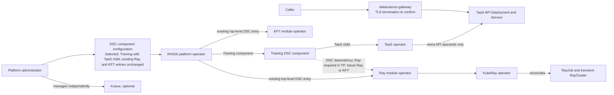
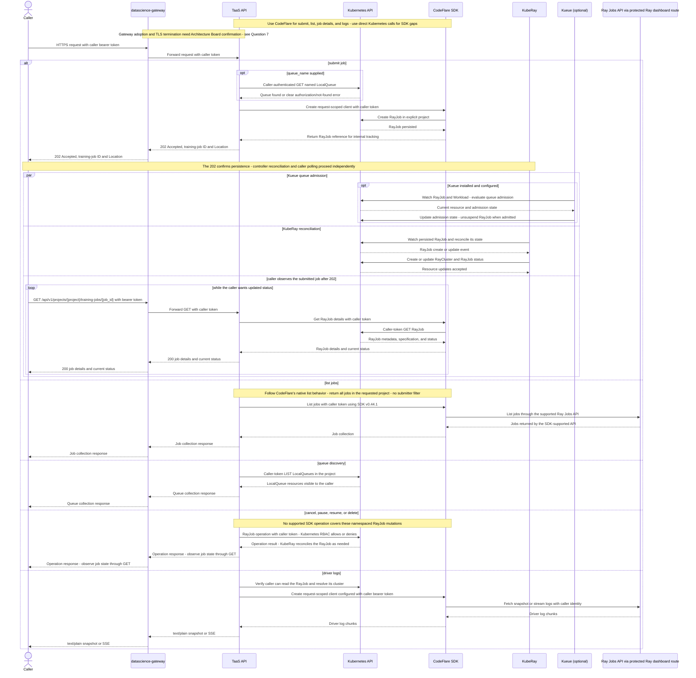

# Open Data Hub - Training as a Service in RHOAI Technical Preview

|                |                                                                                                                                                                                                 |
|----------------|-------------------------------------------------------------------------------------------------------------------------------------------------------------------------------------------------|
| Date           | October 26, 2026                                                                                                                                                                                |
| Scope          | Training as a Service (TaaS), Distributed Workloads                                                                                                                                             |
| Status         | Pending                                                                                                                                                                                        |
| Authors        | Umberto Manganiello                                                                                                                                                                             |
| Supersedes     | N/A                                                                                                                                                                                             |
| Superseded by: | N/A                                                                                                                                                                                             |
| Tickets        | [RHAIRFE-3342](https://redhat.atlassian.net/browse/RHAIRFE-3342), [RHAISTRAT-2712](https://redhat.atlassian.net/browse/RHAISTRAT-2712)                                                          |
| Other docs:    | [Module Onboarding ADR](../operator/ODH-ADR-Operator-0012-module-onboarding.md); [Gateway API Authentication ADR](../operator/ODH-ADR-Operator-0012-gateway-api-authentication-architecture.md) |

## What

This ADR records the user-validated architecture baseline for integrating Training as a Service (TaaS) into Red Hat
OpenShift AI (RHOAI) as a Technical Preview component targeted for RHOAI 3.7. TaaS provides a project-scoped REST API
for submitting and observing training jobs; Ray is the first backend.

The baseline applies the RHOAI module-controller pattern to the TaaS API service. For the TP, the proposed ingress is the
`datascience-gateway` used by MLflow and other components. The TaaS operator is not responsible for
installing or operating Ray, Kueue, or training workloads. The approval recorded here covers the decisions in the
summary below; unresolved platform and security items remain release gates or require separate owner decisions.

## Why

The current TaaS Developer Preview is delivered separately from RHOAI and has no DSC component integration. Bringing the
API into RHOAI requires a clear ownership boundary, a supported ingress and authentication path, and an identity model
that preserves the caller's permissions when the service creates RayJob resources.

These decisions are especially important for a TP: a service account with broad namespace permissions could turn an API
request into workload authority beyond the caller's intent, and the platform's 3.7 lifecycle and ingress details are not
yet publicly specified.

## Goals

- Integrate the TaaS API as a RHOAI module component for the RHOAI 3.7 Technical Preview target.
- Provide a simple REST entry point for training-job submission and observation, so callers do not need to write Python
  client code or backend-specific YAML or learn Ray/KFT submission details.
- Support Ray as the initial backend through the existing CodeFlare SDK managed RayJob path.
- Expose cancel, pause, and resume actions, and allow deletion of RayJobs in any state, using the caller's identity.
- Expose the API through `datascience-gateway` for the TP.
- Keep the TaaS operator focused on the API service lifecycle and its platform-facing resources.
- Expose driver-log snapshots and streaming according to the DP API contract, subject to the verification gates in this
  ADR.

## Non-Goals

- Installing or managing Ray, KubeRay, Kueue, RayJobs, or user training workloads from the TaaS operator.
- Supporting KFT/Trainer as a backend in this TP. The API reports that this backend is unsupported (HTTP 501) until a
  later decision.
- Providing worker/rank log selection, durable log storage, or a TaaS job database.
- Supporting Compute Profiles; they were removed from the project scope.
- Defining a generic cross-service job resource or stable cross-backend identifier. The public Training API resource and
  identifier remain training-specific, as in the DP contract.
- Supporting non-training job types or turning this TP into a platform-wide generic Jobs API. Any future generalization
  requires separate product and architecture decisions with EvalHub.
- Delivering a unified TaaS client SDK in this TP. The REST API is the customer-facing submission interface; the
  CodeFlare SDK remains an internal integration for the Ray backend.
- Resource estimation; it was a DP stretch goal and is out of scope for this project.

## How

### Decision summary

1. **RHOAI integration:** Ship TaaS as a module component with its own operator and a separate stateless API Deployment.
   The operator owns the API Deployment, Service, configuration, `datascience-gateway` integration, operand
   NetworkPolicy, and monitoring resources. Keep controller privileges out of the API runtime.
2. **Backend ownership:** Use Ray first. Ray remains independently enabled through its existing DSC entry; enabling
   TaaS does not enable Ray. The Training DSC component depends on Ray for the TP and cannot report `Ready=True` unless
   Ray is enabled. The dependency may allow either Ray or KFT in a future release. The TaaS operator never installs or
   removes backend components. Kueue remains separately administered and optional.
3. **Request identity and SDK boundary:** TaaS uses the existing CodeFlare Python SDK as its entry point for supported
   Ray operations; the caller-facing interface is the TaaS REST API. Use CodeFlare SDK v0.44.1 for supported submission,
   job-listing, job-detail, and log operations, configured with the original caller's bearer token. Use direct
   caller-token Kubernetes API calls for operations the SDK does not expose, including queue validation/discovery and
   job control or deletion where no SDK operation is available.
   For SDK operations that call Kubernetes, configure its Kubernetes client explicitly from the incoming caller bearer
   token. Do not use in-cluster credential auto-detection, which can
   select the TaaS pod's service account. Kubernetes independently authorizes each Kubernetes operation.
4. **Ingress (proposed):** Expose the API through the existing `datascience-gateway` used by MLflow and other
   components. Confirm with the Architecture Board that this is appropriate for TaaS and provides TLS termination
   (Open Question 7). Preserve the caller's bearer token for caller-native Kubernetes requests.
5. **Job listing and details:** List jobs using CodeFlare's native behavior, without filtering by submitter. Read job
   details and status from the caller-authorized RayJob resource.
6. **Logs:** Callers can request a `text/plain` snapshot with `follow=false` or receive new log output as an SSE stream
   with `follow=true`.
7. **Kueue:** Do not install or manage Kueue. Queue selection is supported in the TP request: when supplied, set the
   Kueue `queue-name` label on the RayJob and check that the named LocalQueue exists in the project using the caller's
   token before submission; return a clear error promptly if it does not exist or the caller cannot read it. If
   `queue_name` is omitted, Kueue applies its default behavior; TaaS does not choose the queue. If Kueue is not set up to
   manage the project, submit without queue selection and the job is not Kueue-managed. Keep project queue
   discovery in the TP contract. After the Kubernetes API accepts the RayJob, return `202 Accepted` without waiting for
   Kueue admission. Report a Kueue-suspended RayJob as `PENDING`; quota or other asynchronous admission delays do not
   delay the POST. A LocalQueue is inactive when its `.status.conditions` contains an entry with `type: Active` and
   `status: "False"`. Whether TaaS checks for this before submission remains open; quota shortage is a workload admission
   state, not an inactive queue. Never silently drop an explicitly requested queue or bypass platform admission policy.
8. **API compatibility:** Use the pinned DP OpenAPI `1.4.0-dp` as the starting contract, and explicitly review any TP
   change. Add the cancel, pause, and resume operations below to the TP contract; the current DP page does not define
   them. The current DP page documents project-qualified paths relative to `/api/v1`; confirm the pinned OpenAPI and
   final API-owner approval before implementation. Use the training-job resource and identifier defined by the API
   contract; do not expose a RayJob-shaped public resource or identifier.
9. **Job controls:** Add cancel, pause, and resume actions to the TP API. Cancel stops execution while retaining the
   RayJob for status inspection; DELETE removes the RayJob in any state, including queued, running, or paused, and
   asks KubeRay to stop its active workload as part of cleanup. Do not reject DELETE solely because the RayJob is
   non-terminal.
   Distinguish a user-requested pause from Kueue's queue-admission suspension in API status. Public action and status
   semantics follow the API spec; Kueue and KubeRay manage the underlying job lifecycle.

### Lifecycle and ownership

For RHOAI 3.7, the platform operator adds a top-level `Training` component with TaaS as a child while keeping the
existing top-level Ray and KFT entries unchanged. The Training component depends on Ray in the TP, so it cannot report
`Ready=True` unless Ray is enabled. A future dependency may be satisfied by either Ray or KFT. Exact DSC field names
remain to be confirmed. Each operator owns its operands: the TaaS operator manages only API operands, while Ray and KFT
operators own their respective stacks. The TaaS operator follows the module onboarding ADR and guide. The onboarding ADR specifies
`components.platform.opendatahub.io` for module APIs and requires a beta API version for TP. Use that group and a beta
version (initially proposed as `v1beta1`); confirm the concrete kind, CR name, DSC schema, and supported version with
the RHOAI 3.7 platform owners. No public 3.7 contract was available during this research.

| Element                         | Owner                                      | Boundary                                                                                                                                                    |
|---------------------------------|--------------------------------------------|-------------------------------------------------------------------------------------------------------------------------------------------------------------|
| TaaS operator                   | RHOAI module lifecycle                     | Reconciles TaaS API operands and reports readiness; does not own Ray, Kueue, or training jobs.                                                              |
| TaaS API runtime                | TaaS service                               | Stateless API with no broad workload-management privileges; caller identity is forwarded through `datascience-gateway`.                                  |
| TaaS API ingress                | `datascience-gateway`                      | Exposes the API through the existing gateway used by MLflow and other components; Architecture Board confirmation remains open (Question 7).                 |
| Ray module / KubeRay operator   | RHOAI Ray component                        | Owns Ray/KubeRay lifecycle and reconciliation of RayJob resources and transient RayClusters.                                                                |
| Kueue                           | Separately administered platform component | Optional queue admission; TaaS neither installs nor manages it.                                                                                             |
| RayJob and transient RayCluster | Caller project and KubeRay                 | Job resource is created in the explicit caller project; KubeRay owns transient cluster reconciliation and cleanup.                                          |

For RHOAI 3.7, enabling TaaS does not enable Ray: administrators continue to manage Ray through its existing DSC entry.
The Training component remains not ready until Ray is enabled. Moving Ray and KFT under `Training` may be considered in a
future release after a compatibility and migration plan is agreed; it is not part of the 3.7 change.

### Request and backend flows

The API requires an explicit project in every project-scoped path; a project name is a resource selector, not
authorization. It must not select a default namespace or fall back to a privileged identity. For CodeFlare, the intended
configuration supplies the caller bearer token to the SDK's Kubernetes client explicitly; do not use SDK auto-detection
of the in-pod service-account credential. The SDK's documented `set_api_client(...)` registration must be checked for
process-global state and concurrent-request safety. The pinned integration must isolate credentials per caller; it must
not let one request replace the client used by another. `datascience-gateway` must forward the original credential to
TaaS; if it is unavailable or invalid downstream, fail closed. Never substitute an in-pod service-account token or trust
caller-supplied identity headers.

Verify that the pinned CodeFlare SDK isolates caller-specific clients when requests run concurrently. Do not register a
different caller client through process-global `set_api_client(...)` state per request unless the SDK guarantees
isolation.

### REST contract carried forward from DP

Paths below are relative to `/api/v1`. `{project}` is the explicit OpenShift namespace; `{job_id}` is the
training-job identifier defined by the API contract.
The pinned DP OpenAPI remains authoritative for request schemas and detailed response bodies.

| Operation               | Path                                                  | Authorization and behavior                                                                                                                                                                                                                                                                                                                                                                                                                                                   |
|-------------------------|-------------------------------------------------------|------------------------------------------------------------------------------------------------------------------------------------------------------------------------------------------------------------------------------------------------------------------------------------------------------------------------------------------------------------------------------------------------------------------------------------------------------------------------------|
| Submit training         | `POST /projects/{project}/training-jobs`              | Create a RayJob with CodeFlare using caller's bearer token. If `queue_name` is supplied, first verify that the caller can read the LocalQueue, then apply it as `kueue.x-k8s.io/queue-name`; if omitted, Kueue applies its default behavior and TaaS does not choose a queue. Return `202 Accepted`, the API training-job ID, and `Location` as soon as Kubernetes accepts the RayJob; do not wait for Kueue admission or job start. |
| List jobs               | `GET /projects/{project}/training-jobs`               | Use CodeFlare SDK v0.44.1's native list behavior with the caller identity to return all jobs in `{project}`; do not apply a submitter filter.                                                                                                                                                                                                                                                                                                                                   |
| Read job details/status | `GET /projects/{project}/training-jobs/{job_id}`      | Read the RayJob through CodeFlare using the caller's token; map provisioning, waiting, and Kueue-suspended states to `PENDING`, and expose user-requested cancel/pause/resume progress separately.                                                                                                                                                                                                                                                                                 |
| Read/follow driver logs | `GET /projects/{project}/training-jobs/{job_id}/logs` | Driver logs only. A request-scoped CodeFlare client configured with the caller bearer token retrieves logs; TaaS relays chunks as SSE. Snapshot uses `follow=false`; follow mode uses SSE. `409` if logs are not ready; `410` if the managed RayCluster is gone. CodeFlare enforces caller authorization for log retrieval. |
| Cancel job              | `POST /projects/{project}/training-jobs/{job_id}/cancel`  | Request cancellation of a queued or running job while retaining its RayJob for status inspection. Return `202 Accepted`; expose the eventual terminal state through GET as defined by the API spec.                                                                                                                                                                                                                                                                               |
| Pause job               | `POST /projects/{project}/training-jobs/{job_id}/pause`   | Request a pause while retaining the RayJob. Return `202 Accepted`; expose pause progress and state through GET as defined by the API spec.                                                                                                                                                                                                                                                                                                                                      |
| Resume job              | `POST /projects/{project}/training-jobs/{job_id}/resume`  | Request resumption of a paused job. Return `202 Accepted`; expose resumption progress through GET as defined by the API spec.                                                                                                                                                                                                                                                                                                                                                  |
| Delete job              | `DELETE /projects/{project}/training-jobs/{job_id}`       | Caller-authorized delete in any state, including queued, running, and paused. Do not reject solely because the RayJob is non-terminal. KubeRay stops non-terminal Ray jobs during RayJob deletion and cleans up managed resources; transient logs and job status may become unavailable after cleanup. External checkpoints and model outputs are not deleted.                                                                                                                                                                              |
| Discover algorithms     | `GET /algorithms`                                     | Reflect the configured Ray Training Image/release catalog and parameter schemas, not a hard-coded universal list.                                                                                                                                                                                                                                                                                                                                                            |
| Discover project queues | `GET /projects/{project}/queues`                      | Keep the DP endpoint. List LocalQueues in the requested project using the caller's token. If Kueue is absent or not set up for the project, return `200`, `kueue_enabled: false`, `queues: []`.                                                                                                                                                                                                                                                                              |

The request requires `name`, `model`, `dataset`, and `algorithm`. The current DP page describes optional queue, resource
topology, backend, and output settings. If `queue_name` is omitted, Kueue applies its default behavior; TaaS does not
choose or add a queue. If Kueue is not set up to manage the project, the job is submitted without Kueue management. If
the caller names a queue, TaaS checks that LocalQueue with the caller's token and applies it to the RayJob; a missing
queue or a queue the caller cannot read fails promptly with a clear error. After Kubernetes accepts the RayJob, return
`202 Accepted` immediately without waiting for Kueue admission. A Kueue-suspended RayJob is reported as `PENDING`; quota
and other admission delays are asynchronous. A user-requested pause is a separate state from Kueue admission suspension.
Kueue's LocalQueue `Active` condition can identify some configuration
problems, such as an inactive referenced ClusterQueue. An active queue can still have jobs waiting for quota; that does
not delay or fail the POST. An omitted output is ephemeral, and a supplied output requires `destination_uri`. The DP Ray job name
constraint is DNS-1035-compatible and at most 47 characters. The `kft` backend remains unimplemented and returns `501`.
Expose job-control progress and outcomes through GET. Keep the stable JSON error format and DP status distinctions
(`400`, `401`, `403`, `404`, `409`, `410`, `415`, `422`, and `501`); confirm additional TP status values and response
codes for cancel, pause, resume, and deletion in the TP OpenAPI review.

### Caller RBAC contract

The API uses the caller's identity for SDK-backed Ray operations and sends direct Kubernetes operations with the
caller's token. Kubernetes enforces RBAC on each Kubernetes request; any SAR preflight would only fail early and would
not replace authorization by the SDK's downstream Ray API or by the Kubernetes API.

| API operation           | Required permission or scope                                                                                    | Enforcement                                                                                                        |
|-------------------------|-----------------------------------------------------------------------------------------------------------------|--------------------------------------------------------------------------------------------------------------------|
| Submit                  | `create` on `rayjobs.ray.io` in `{project}`                                                                     | Kubernetes API server; CodeFlare request-scoped client                                                             |
| List jobs               | List all jobs in `{project}`; no submitter filter                                                                | CodeFlare SDK with caller identity; verify the protected Ray Jobs path enforces caller/project authorization        |
| Read job                | `get` on `rayjobs.ray.io` in `{project}`                                                                        | Kubernetes API server through CodeFlare SDK with caller identity                                                   |
| Cancel job              | RayJob operation in `{project}`                                                                                  | Kubernetes API server applies the caller's RBAC; behavior follows the API spec                                        |
| Pause / resume job      | `patch` on `rayjobs.ray.io` in `{project}` if implemented through RayJob suspension                            | Kubernetes API server; coordinate with Kueue because it also controls `spec.suspend`                               |
| Delete job              | `delete` on `rayjobs.ray.io` in `{project}`                                                                     | Kubernetes API server; allowed in any state and triggers cleanup for active workloads                               |
| Validate supplied queue | `get` on `localqueues.kueue.x-k8s.io` in `{project}` when `queue_name` is supplied                              | Kubernetes API server; fail promptly if the queue is missing or the caller cannot read it                          |
| Discover queues         | `list` on `localqueues.kueue.x-k8s.io` in `{project}`                                                           | Kubernetes API server; absence of Kueue is handled without cluster-scoped list permission                          |
| Read logs               | Caller-authorized access to the Ray job's logs through CodeFlare                                                  | CodeFlare SDK enforces the caller's authorization; no shared credential is used                                     |

The API accepts callers authenticated as OpenShift identities. For a non-human caller, the customer chooses and sets up
the identity, for example a ServiceAccount with the required project RBAC, and manages its token issuance and rotation.
TaaS accepts and forwards that caller identity through the same path as any other OpenShift caller; it does not
provision or manage customer identities or require a separate non-human authentication flow.

The TaaS operator has narrowly scoped permissions to reconcile the API service operands and
discover module dependencies. Those permissions do not grant the TaaS **API service** permission to impersonate callers
or submit jobs as its service account. The TaaS API runtime must not receive broad RayJob CRUD, Secret-read, or
cluster-wide Kueue-list permissions merely to make caller-native operations work. Kubernetes RBAC collection `list`
permission is namespace-scoped and does not filter by job creator. Using the caller identity, CodeFlare's native list
behavior returns all jobs in the requested project without a submitter filter.

### Workload authority and data handling

The TaaS request does not accept ServiceAccount names or raw credential values. It accepts project-scoped storage
references: `hf://` identifies a Hugging Face repository URL and carries the name of its credential Secret; `s3://`
identifies an S3 connection backed by a project Secret, and `pvc://` identifies a PVC. During submission, TaaS uses
the caller's Kubernetes token to resolve and check the referenced project resources. This checks reference access only:
the Ray workload accesses PVC data through its mounted volume and Hugging Face/S3 data using the referenced storage
credentials, not the caller's OpenShift token. TaaS submits RayJobs as the caller, so matching platform authorization
and admission controls continue to apply to those RayJobs as they do to direct submissions. TaaS does not
install, configure, or modify Ray/KubeRay admission policy; standalone
Ray/KubeRay policy validation is outside this ADR. TaaS does not maintain its own durable job database or persist caller
credentials or driver logs. It does not persist the full request payload; it may retain an explicitly allow-listed subset
of non-secret submission metadata, such as the submitter and selected training parameters, in RayJob metadata for
caller-authorized job details. The RayJob specification is stored by Kubernetes, and Ray retains job/log state only for
its configured lifetime. Never log bearer tokens or credentials; treat driver logs as sensitive user content.

### Release gates

Before TP release, owners must demonstrate:

- Original bearer-token propagation through `datascience-gateway` to caller-native Kubernetes API calls and the
  CodeFlare Kubernetes client.
- CodeFlare client isolation with the pinned SDK: prove that concurrent requests cannot overwrite or reuse each other's
  caller credentials; do not use `set_api_client(...)` as per-request mutable global state unless the implementation
  provides and verifies isolation.
- Caller authorization for RayJob create/list/get/patch/delete, job-control actions, and namespaced LocalQueue reads.
  Verify that CodeFlare list calls use the caller identity, and verify that project-local storage
  references are resolved with caller authorization. Separately verify that the workload uses the referenced HF/S3
  credentials or mounted PVC to access the data. Fail closed on missing or unauthorized resources, with no service-
  account fallback or cluster-scoped Kueue probe.
- Verify cancel, pause, resume, and delete behavior against the API spec and supported Ray, KubeRay, CodeFlare, and
  Kueue versions. Kubernetes RBAC authorizes each caller operation; active deletion stops the workload, and user pause
  remains distinct from Kueue admission suspension.
- Verify the exact CodeFlare submission path does not require cluster-scoped Kueue, DataScienceCluster, or
  operator-version reads under the caller identity; disable or isolate any such optional probe rather than granting
  cluster-wide read to API callers.
- Snapshot and SSE behavior on the exact supported Ray image: memory/latency bounds, SSE backpressure and disconnect
  cleanup, and the image's worker-log redirection/deduplication behavior.
- RHOAI 3.7 DSC/component lifecycle, Module CR API, `datascience-gateway`, and bearer-token forwarding against the
  actual release API.
- Test CodeFlare SDK v0.44.1 with the supported Ray image, KubeRay version, and RayJob submission mode as one
  configuration.
- Verify the supported KubeRay status exposed while Kueue holds a RayJob suspended, and map that state to API `PENDING`
  without polling admission in the submit request.

### Additional requirements and options for Architecture Board review

The following requirements and design options extend the TP architecture described above. The TaaS ownership, DSC, and
storage approaches below are selected; custom-code options remain for Architecture Board review.

#### Operator ownership and packaging

**Decision:** TaaS has its own operator, which owns the API Deployment and its platform-facing resources and release
lifecycle. It does not own Ray, Kueue, or training workloads.

#### DSC structure and backend enablement

**Decision:** Add a top-level `Training` DSC component with TaaS as a child, while preserving the existing top-level Ray
and KFT entries for RHOAI 3.7. The DSC dependency requires Ray for Training to report `Ready=True` in the TP. In a
future release, this dependency may be satisfied by either Ray or KFT. Exact DSC field names remain an implementation
detail to confirm with platform owners (Open Question 1). This does not add KFT backend support to the TP API.

#### Multi-tenancy and authorization

**Requirement:** Treat the OpenShift project/namespace named by `{project}` as the tenant. For Kubernetes operations,
TaaS uses the caller's identity and Kubernetes RBAC authorizes each operation; TaaS does not maintain a separate
endpoint-to-resource authorization policy. Whether to add a caller-identity SAR preflight solely for earlier errors is
open. Non-Kubernetes operations still need an explicit authorization path. Algorithm discovery is currently the only
non-Kubernetes endpoint and should be available to all API callers without project-specific authorization.

- **Authorization architecture — Architecture Board:** Kubernetes enforces RBAC on operations sent with the caller's
  token. Should TaaS also use a caller-identity SAR preflight to fail earlier, despite the extra authorization request?
  A SAR preflight would not replace authorization by the operation itself. The selected ingress is
  `datascience-gateway`; Architecture Board confirmation, including TLS termination, is Open Question 7.
- **Job visibility:** Callers with list access to `{project}` see all jobs there, regardless of submitter; TaaS uses
  CodeFlare SDK v0.44.1's native list behavior.
- **Related resources:** Logs follow their RayJob in `{project}`. Model, dataset, and custom-code storage access uses
  project-scoped RHOAI Connections for the TP, with Data Connect Hub support planned when available, or authorized
  PVCs; TaaS does not manage raw storage credentials. The remaining
  cross-system question is whether an MLflow workspace must match `{project}` or may be another workspace the caller is
  authorized to use. Keeping the workspace aligned with the project keeps experiment and run metadata within the same
  tenant, as in EvalHub's workspace/namespace model.

#### Algorithm discovery

**Requirement:** Report algorithms and parameter schemas available in the configured Ray runtime, rather than a
hard-coded universal catalog.

**Proposed implementation:** Configure one `trainingRuntime.image` per TaaS deployment. At pod startup, an init
container using that image imports its installed Training Hub package and inspects `AlgorithmRegistry` and callable
metadata. The algorithm implementations stay in the runtime image; the init container writes their names and parameter
schemas to a `catalog.json` in a shared pod-local `emptyDir`. The API container mounts it read-only and uses it for
algorithm discovery and request parameter validation. The catalog is derived from the same runtime image used by
training jobs; changing the image rolls out the pod and regenerates the catalog. This matches the approach in
[training-service PR #12](https://github.com/opendatahub-io/training-service/pull/12).

The proposed storage is ephemeral because the catalog is regenerated at startup and does not need to outlive the pod.
A ConfigMap is an alternative if the catalog is generated and versioned before deployment against a pinned runtime
image; the image and catalog must then be updated together.

#### Custom training code submission

**Requirement:** The Training API should support submitting user-provided training code alongside predefined
algorithms, with an identifiable entrypoint and parameters. RHAIRFE-3751 requests this custom-code path. The following
options are for Architecture Board review; this extends the Training API workflow and does not prescribe a new service
or backend. Supported frameworks and runtime configurations remain subject to refinement.

1. **Reference a packaged code artifact (recommended).** Accept a project-authorized PVC path or S3-compatible object
   URI, together with an entrypoint and parameters. For S3, the request also references the approved storage Connection;
   for PVC, the workload mounts the authorized claim. Pin the artifact with an immutable object version or digest where
   supported. This aligns code, model, and dataset inputs with reference-based storage, and avoids putting source code
   in the REST body. The Board must confirm supported URI forms, retrieval/mount behavior, and how the workload is
   authorized to read the artifact.
2. **Reference a user-built container image.** Accept an image reference, command/entrypoint, and parameters; prefer an
   immutable image digest. The image can package code and dependencies together, but requires image build/publish
   workflows, registry access policy, image validation, and an explicit supported runtime contract.
3. **Inline source in the REST request (last resort; not recommended).** Add a source/function field, entrypoint, and
   parameters to the submission payload. This gives users a single-request workflow, but requires strict request-size
   limits and decisions about supported language/function contracts, dependencies, source validation, versioning, and
   reproducibility. Source and credentials must not be copied into persisted RayJob fields, logs, or error responses;
   achieving this may require a separate secure artifact/Secret creation flow.

Whichever option is selected, user code must run within administrator-approved runtime and resource limits and must not
gain access to TaaS credentials, service-host files, or other projects' resources. Define source and non-secret
parameter visibility in job inspection and the output contract as part of the submission design.

#### Model, dataset, and output storage authentication

**Decision:** For the TP, use project-scoped RHOAI Connections for model, dataset, and output storage credentials. Add
Data Connect Hub support when that component is available. Do not send raw storage credentials in the request. Storage
credentials are separate from the caller's OpenShift bearer token, which authorizes API and Kubernetes operations.

## Open Questions

1. **Architecture Board / platform owners — DSC schema:** Confirm the RHOAI 3.7 field names for a top-level Training
   component with TaaS as a child and a Ray dependency, while preserving the existing top-level Ray and KFT entries. A
   future release may allow either Ray or KFT to satisfy the dependency.
2. **Queue activity:** Should TaaS reject submission if the selected LocalQueue has a condition with `type: Active` and
   `status: "False"`?
3. **RHOAI 3.7 API contract:** Confirm the Module CR name/kind/version and TaaS CRD mapping with the 3.7 platform
   owners. The module ADR specifies the module API group and requires a beta version for TP; the concrete TaaS CRD is
   not specified by public 3.7 docs.
4. **Component and API names:** Confirm the public component/CRD name and whether the project-qualified DP paths remain
   the TP contract. Avoid collisions with Training Hub, Trainer's Training API terminology, and the existing
   `training-service` repository/name.
5. **Custom training code submission:** Confirm the recommended packaged-code reference from a
    project-authorized PVC or S3-compatible object, including immutable version/digest, entrypoint, S3 Connection
    reference, and runtime retrieval. Decide whether a user-built container image is also supported. Inline source is
    last-resort and not recommended. Define the request contract, runtime/dependency limits, and source/parameter
    inspection behavior. RHAIRFE-3751 covers this enhancement; do not infer that arbitrary code is accepted through the
    existing `algorithm` field.
6. **MLflow workspace tenancy — architecture/MLflow owners:** For optional experiment tracking under RHAIRFE-3752,
    should the selected MLflow workspace match `{project}` in `POST /projects/{project}/training-jobs`, or may the
    caller select another workspace they are authorized to access?
7. **TaaS ingress — Architecture Board:** Is `datascience-gateway`, including its TLS termination, appropriate for TaaS?

## Alternative approaches for the selected TP architecture

### TaaS operator installs or owns Ray and Kueue

Not Recommended. Ray and Kueue have independent platform modules and administrator-controlled lifecycles. Putting their
operators or CRDs under TaaS would broaden permissions, couple releases, and risk removing capabilities still used by
other components. The Training DSC dependency controls readiness; the TaaS operator does not install or manage either
backend. Kueue remains optional and separately managed.

### Submit jobs with a TaaS service account after a SAR check

Not Recommended. This replaces the caller's authorization with the service account's permissions and creates a check/use gap.
RayJob creation, updates, deletion, and Kubernetes reads must be sent to the Kubernetes API with the caller's token, so
Kubernetes RBAC authorizes each operation. Log retrieval is not permission to use a shared Ray identity for submission
or control.

### Expose TaaS directly through an OpenShift Route

Not Recommended for the TP. Use `datascience-gateway`; confirm its suitability and TLS termination with the Architecture
Board (Open Question 7).

### Store job records in a TaaS database

Not Recommended for this TP. RayJob CRs hold job identity and status, while CodeFlare provides the TP job-list behavior.
A second database would add consistency, lifecycle, and authorization work without improving transient driver-log
availability. Durable logs or cross-backend history would require a separate retention and storage decision.

### Enable a KFT/Trainer backend first

Rejected for this TP. The final DP agreement selected Ray as the first backend; KFT/Trainer support is deferred and
returns 501 until separately implemented and supported.

### Provide all-worker or rank-specific logs

Rejected for this TP. Ray's driver/job-entrypoint log API does not provide a generic way to select a rank-zero worker
pod for arbitrary jobs. Fan-out to all worker pods would also multiply log requests and client load. A future
rank-specific contract would require the training runtime to identify or funnel rank-zero output.

## Security and Privacy Considerations

- The Kubernetes API server authorizes RayJob creation and detail reads through CodeFlare, and direct RayJob
  control/delete and LocalQueue operations using the caller's bearer token. CodeFlare list and log operations must also
  preserve and enforce the caller's identity at their downstream API. Never submit as the TaaS service account after a
  TokenReview or SAR check.
- Forward the original bearer token through the selected ingress path for caller-native Kubernetes calls.
  Identity headers alone cannot authorize downstream API operations.
- For non-human callers, customers choose and manage an OpenShift identity, such as a ServiceAccount with least-privilege
  project RBAC. TaaS accepts that identity through the same caller-authentication path and does not provision identities
  or tokens. Keep the caller identity separate from the TaaS API pod's service account; do not submit on the caller's
  behalf using a shared TaaS runtime token.
- The Ray Jobs API is not a per-OpenShift-user API by default. Ray warns that access to the dashboard/Jobs services can
  allow arbitrary code execution; protect the Ray dashboard Route with the supported RHOAI authentication and
  kube-rbac-proxy path. CodeFlare log retrieval uses the caller identity. RayJob controls use
  caller-token Kubernetes operations, authorized by Kubernetes RBAC. Do not give the TaaS service account enhanced Ray
  permissions for logs or control. Current upstream Ray token authentication is a
  single static cluster token, not per-user identity; do not treat it as the caller's identity or expose it to API callers.
- TaaS does not expose caller-selected ServiceAccounts or arbitrary Secret mounts and does not modify platform
  authorization or admission policy. Ray/KubeRay policy is managed and validated at the platform/component level, outside
  this ADR.
- Do not persist credentials or log contents in TaaS-owned storage. Do not persist the full request payload in RayJob
  metadata; retain only an explicitly allow-listed subset of non-secret submission metadata, such as the submitter and
  selected training parameters. Caller-authorized job details may return this subset, not the full request. Avoid logging
  tokens or other credentials; treat returned driver logs as potentially sensitive user content.
- Keep Kueue and Ray installation/lifecycle outside the TaaS operator. The operator and API runtime have
  different permission needs; the API runtime must not inherit the module controller's privileges.

## Risks

- **Ray Jobs/dashboard access is privileged.** It can expose job submission and other control operations; the
  supported protected Ray dashboard route and CodeFlare caller authorization must remain in place.
- **Platform RayJob policy is outside TaaS scope.** The API submits RayJobs as the caller and does not configure
  Ray/KubeRay admission policy. Matching platform controls apply to TaaS and direct RayJob submissions alike.
- **Snapshot logging may consume excessive memory or latency.** The SDK fetches the full driver log before TaaS applies
  its tail limit; impose and validate bounded response behavior.
- **Streaming behavior is best-effort.** Ray's `tail_job_logs` is a WebSocket iterator; reconnect, resume cursor, and
  durable ordering are not guaranteed by the current API. Disconnect and backpressure behavior need implementation
  testing.
- **Pause/resume may not preserve training progress.** KubeRay's current upstream suspension behavior deletes the
  RayCluster and submitter; a new cluster is created on resume. Continuing from the prior training step may require
  checkpoint support in the user-provided training code. Kueue also uses the RayJob suspension field for admission.
- **3.7 platform interfaces may change.** Component lifecycle, ingress and token-forwarding support, and API shape need
  confirmation against the supported release.
- **DSC schema details need platform confirmation.** The selected 3.7 change adds Training with TaaS as a child and
  requires Ray for Training readiness, while preserving the existing top-level Ray/KFT entries. Future dependency on
  either Ray or KFT may require a separate compatibility change.
- **Kueue defaulting depends on platform setup.** The no-queue behavior only uses the intended Kueue default if the
  supported installation provides the required LocalQueue defaulting behavior in the project.
- **Project-wide job visibility:** Callers with permission to list jobs can see jobs submitted by others in the same
  project; CodeFlare's native list behavior does not filter by submitter.

## Stakeholder Impacts

| Group                        | Key Contacts | Date       | Impacted? |
|------------------------------|--------------|------------|-----------|
| Distributed Workloads / TaaS | TBD          | 2026-10-26 | Yes       |
| RHOAI Platform / Operator    | TBD          | 2026-10-26 | Yes       |
| Product Security             | TBD          | 2026-10-26 | Yes       |
| QE / Release Engineering     | TBD          | 2026-10-26 | Yes       |

## References

- [TaaS DP Architecture (Confluence)](https://redhat.atlassian.net/wiki/spaces/RHODS/pages/471990958/TaaS+DP+Architecture) —
  source for the DP endpoint paths, caller-authorized RayJob operations, response semantics, and logging contract.
  Retrieved October 26, 2026; the page remains an architecture review draft with reviewer sign-off pending.
- [Pinned TaaS DP OpenAPI contract](https://github.com/opendatahub-io/training-service/blob/0b6b28e7b46c385ee27348cebe2b43549a2d0ff6/api/openapi.yaml) —
  DP API schema and operation contract.
- [RHAIRFE-3751 — Training API: Predictive Training with Custom Functions](https://redhat.atlassian.net/browse/RHAIRFE-3751) —
  requests custom training functions or packaged code alongside predefined algorithms; supported frameworks and runtime
  configurations are to be agreed during refinement.
- [RHAIRFE-3752 — Training API: MLflow Experiment Tracking](https://redhat.atlassian.net/browse/RHAIRFE-3752) —
  requests optional association of training jobs with authorized MLflow experiments/workspaces and recording of run
  parameters, reported metrics, and model outputs.
- [ODH Module Onboarding ADR](../operator/ODH-ADR-Operator-0012-module-onboarding.md)
  and [Module Onboarding Guide](../operator/design/module-onboarding-guide.md)
- [Gateway API Authentication ADR](../operator/ODH-ADR-Operator-0012-gateway-api-authentication-architecture.md)
- [TrustyAI Service Operator EvalHub Route reconciler](https://github.com/opendatahub-io/trustyai-service-operator/blob/5b622da8bda70884742c5c0a571d670795a7155e/controllers/evalhub/route.go)
  and [EvalHub deployment proxy configuration](https://github.com/opendatahub-io/trustyai-service-operator/blob/5b622da8bda70884742c5c0a571d670795a7155e/controllers/evalhub/deployment.go)
  — the Route targets the HTTPS Service port with reencrypt TLS; `kube-rbac-proxy` terminates backend TLS and enforces authentication/authorization.
- [RHOAI 3.6 EA.2 Component Integration guide](https://github.com/opendatahub-io/opendatahub-operator/blob/v3.6.0-ea.2/docs/COMPONENT_INTEGRATION.md) —
  latest operator guide identified during research; not a 3.7 specification.
- [RHOAI 3.6 KubeRay architecture context](https://github.com/opendatahub-io/architecture-context/blob/main/architecture/rhoai-3.6/kuberay.md) —
  describes the Ray dashboard HTTPRoute and kube-rbac-proxy access path; generated context, not a 3.7 product
  specification.
- [RHOAI 3.6 CodeFlare SDK architecture context](https://github.com/opendatahub-io/architecture-context/blob/main/architecture/rhoai-3.6/codeflare-sdk.md) —
  historical context for CodeFlare v0.39.1; the intended TP version is v0.44.1. The page also records client-scoping and
  cluster-scoped Kueue probe findings that must be rechecked against the TP version.
- [CodeFlare SDK authentication documentation](https://project-codeflare.github.io/codeflare-sdk/user-docs/authentication.html)
  and [CodeFlare SDK repository](https://github.com/project-codeflare/codeflare-sdk)
- [CodeFlare SDK RayJob documentation](https://project-codeflare.github.io/codeflare-sdk/user-docs/rayjob.html) —
  documents the SDK RayJob interface and log retrieval using the caller's identity.
- [Kubernetes Service Accounts](https://kubernetes.io/docs/concepts/security/service-accounts/)
  and [projected ServiceAccount token volumes](https://kubernetes.io/docs/concepts/storage/projected-volumes/) —
  describe ServiceAccount identity, short-lived TokenRequest credentials, token audiences, and projected-token rotation.
- [OpenShift
  `oc create token` documentation](https://docs.openshift.com/container-platform/4.22/html/cli_tools/openshift-cli-oc) —
  documents requesting a service-account token with a specified duration or audience.
- [Ray 2.55.1 JobSubmissionClient](https://docs.ray.io/en/releases-2.55.1/cluster/running-applications/job-submission/doc/ray.job_submission.JobSubmissionClient.html), [
  `get_job_logs`](https://docs.ray.io/en/releases-2.55.1/cluster/running-applications/job-submission/doc/ray.job_submission.JobSubmissionClient.get_job_logs.html),
  and [
  `tail_job_logs`](https://docs.ray.io/en/releases-2.55.1/cluster/running-applications/job-submission/doc/ray.job_submission.JobSubmissionClient.tail_job_logs.html)
- [Ray security guidance](https://docs.ray.io/en/latest/ray-security/index.html) — Ray Dashboard/Jobs access must be
  restricted because it can expose arbitrary code execution and cluster control.
- [Ray Jobs REST API](https://docs.ray.io/en/latest/cluster/running-applications/job-submission/rest.html) — documents
  the job stop operation; TaaS control requests use caller-authorized Kubernetes operations as defined in the API spec.
- [Ray token authentication design](https://docs.ray.io/en/master/core/internals/token-authentication.html) — current
  upstream documentation describes a single static cluster token; verify behavior in the exact supported TP Ray build.
- [KubeRay RayJob API reference](https://docs.ray.io/en/latest/cluster/kubernetes/references/api.html) — current API
  reference documents Kubernetes-delegated token auth as unsupported for RayJob and `spec.suspend` behavior; verify
  control and cleanup behavior against the exact TP KubeRay release.
- [KubeRay RayJob controller](https://github.com/ray-project/kuberay/blob/master/ray-operator/controllers/ray/rayjob_controller.go)
  — current upstream deletion handling requests a stop for a non-terminal Ray job before removing the RayJob finalizer;
  verify this behavior in the RHOAI TP bundle.
- [Kueue default LocalQueue setup](https://kueue.sigs.k8s.io/docs/tasks/manage/enforce_job_management/setup_default_local_queue/)
  and [Kueue RayJob integration](https://kueue.sigs.k8s.io/docs/tasks/run/rayjobs/) — upstream documents namespace-local
  `default` queue behavior and the `kueue.x-k8s.io/queue-name` label on RayJobs; verify the bundled RHOAI versions and
  policy.
- [Kueue job troubleshooting](https://kueue.sigs.k8s.io/docs/tasks/troubleshooting/troubleshooting_jobs/) — documents
  that admission/quota state is asynchronous and that a missing or misconfigured LocalQueue can leave the Workload
  inadmissible; use caller-authenticated queue validation for a fast submission error and verify RayJob status mapping
  in the supported bundle.
- [Kueue queue troubleshooting](https://kueue.sigs.k8s.io/docs/tasks/troubleshooting/troubleshooting_queues/) —
  LocalQueue `status.conditions[type=Active]` reports some queue or referenced ClusterQueue configuration problems,
  distinct from per-Workload quota admission.
- [RHOAI 3.5 Ray workload documentation](https://docs.redhat.com/en/documentation/red_hat_openshift_ai_self-managed/3.5/html/working_with_distributed_workloads/running-ray-based-distributed-workloads_distributed-workloads)
- [Kubernetes TokenReview API](https://kubernetes.io/docs/reference/kubernetes-api/authentication-resources/token-review-v1/)
  and [SubjectAccessReview API](https://kubernetes.io/docs/reference/kubernetes-api/authorization-resources/subject-access-review-v1/)
- [Kubernetes Secrets good practices](https://kubernetes.io/docs/concepts/security/secrets-good-practices/)
- [Kubernetes RBAC authorization](https://kubernetes.io/docs/reference/access-authn-authz/rbac/) — namespaced resource
  permissions and optional `resourceNames` behavior; `list` does not provide creator-based filtering.

## Reviews

| Reviewed by | Date | Notes                                    |
|-------------|------|------------------------------------------|
| TBD         | TBD  | Pending architecture and platform review |
