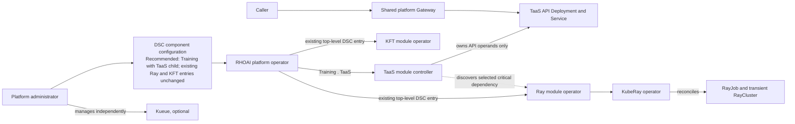
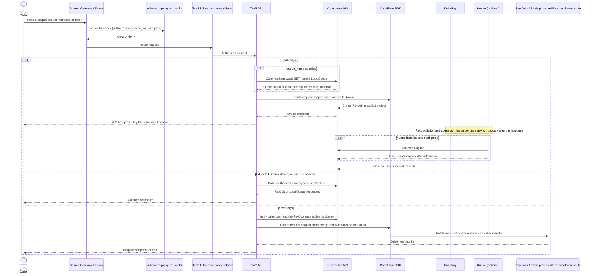

# Open Data Hub - Training as a Service in RHOAI Technical Preview

|                |                                                                                                                                                                                                 |
|----------------|-------------------------------------------------------------------------------------------------------------------------------------------------------------------------------------------------|
| Date           | October 26, 2026                                                                                                                                                                                |
| Scope          | Training as a Service (TaaS), Distributed Workloads                                                                                                                                             |
| Status         | Approved                                                                                                                                                                                        |
| Authors        | Umberto Manganiello                                                                                                                                                                             |
| Supersedes     | N/A                                                                                                                                                                                             |
| Superseded by: | N/A                                                                                                                                                                                             |
| Tickets        | [RHAIRFE-3342](https://redhat.atlassian.net/browse/RHAIRFE-3342), [RHAISTRAT-2712](https://redhat.atlassian.net/browse/RHAISTRAT-2712)                                                          |
| Other docs:    | [Module Onboarding ADR](../operator/ODH-ADR-Operator-0012-module-onboarding.md); [Gateway API Authentication ADR](../operator/ODH-ADR-Operator-0012-gateway-api-authentication-architecture.md) |

## What

This ADR records the user-validated architecture baseline for integrating Training as a Service (TaaS) into Red Hat
OpenShift AI (RHOAI) as a Technical Preview component targeted for RHOAI 3.7. TaaS provides a project-scoped REST API
for submitting and observing training jobs; Ray is the first backend.

The baseline applies the RHOAI module-controller and shared Gateway patterns to the TaaS API service. It does not make
the TaaS controller responsible for installing or operating Ray, Kueue, or training workloads. The approval recorded
here covers the decisions in the summary below; unresolved platform and security items remain release gates or require
separate owner decisions.

## Why

The current TaaS Developer Preview is delivered separately from RHOAI and has no DSC component integration. Bringing the
API into RHOAI requires a clear ownership boundary, a supported ingress and authentication path, and an identity model
that preserves the caller's permissions when the service creates RayJob resources.

These decisions are especially important for a TP: a service account with broad namespace permissions could turn an API
request into workload authority beyond the caller's intent, and the platform's 3.7 lifecycle and gateway details are not
yet publicly specified.

## Goals

- Integrate the TaaS API as a RHOAI module component for the RHOAI 3.7 Technical Preview target.
- Provide a simple REST entry point for training-job submission and observation, so callers do not need to write Python
  client code or backend-specific YAML or learn Ray/KFT submission details.
- Support Ray as the initial backend through the existing CodeFlare SDK managed RayJob path.
- Execute job submission and RayJob CRUD with the calling user's bearer token and permissions.
- Use the shared platform Gateway API authentication pattern.
- Keep the TaaS module controller focused on the API service lifecycle and its platform-facing resources.
- Expose driver-log snapshots and streaming according to the DP API contract, subject to the verification gates in this
  ADR.

## Non-Goals

- Installing or managing Ray, KubeRay, Kueue, RayJobs, or user training workloads from the TaaS module controller.
- Supporting KFT/Trainer as a backend in this TP. The API reports that this backend is unsupported (HTTP 501) until a
  later decision.
- Providing worker/rank log selection, durable log storage, or a TaaS job database.
- Supporting job cancel, pause, or resume operations. DELETE applies only to terminal RayJob resources.
- Making Compute Profiles part of the TP critical path.
- Defining a new backend-neutral job resource or stable cross-backend job identifier in this ADR.
- Supporting non-training job types or turning this TP into a platform-wide generic Jobs API. Any future generalization
  requires separate product and architecture decisions with EvalHub.
- Delivering a unified TaaS client SDK in this TP. The REST API is the customer-facing submission interface; the
  CodeFlare SDK remains an internal integration for the Ray backend.
- Making resource estimation a TP acceptance requirement. It was a DP stretch goal and is not part of the TP baseline.

## How

### Decision summary

1. **RHOAI integration:** Ship TaaS as a module component with a module-controller Deployment and a separate stateless
   API Deployment. The controller owns the API Deployment, Service, configuration, HTTPRoute registration, operand
   NetworkPolicy, and monitoring resources. Keep controller privileges out of the API runtime.
2. **Backend ownership:** Use Ray first. The TaaS controller discovers Ray and never installs or removes the separate
   Ray module. Ray is a critical dependency for this TP because no other backend is implemented; if Ray is absent or not
   ready, the TaaS module reports `Ready=False` with a dependency reason and continues reconciling. Kueue remains
   separately administered and optional.
3. **Request identity:** Execute Kubernetes operations as the caller. For CodeFlare operations, configure the SDK's
   Kubernetes client explicitly from the incoming caller bearer token (for example, the documented
   `AuthConfig(method="openshift", k8s_api_host=..., token=...)` and `get_k8s_client(config=...)` flow), then provide
   that client to the SDK using the API supported by the pinned version. Use the caller-authenticated Kubernetes API for
   listing, details/status, terminal deletion, and namespaced LocalQueue discovery. Do not use in-cluster credential
   auto-detection, which can select the TaaS pod's service account. The published CodeFlare setup uses
   `set_api_client(...)`; verify that the pinned SDK supports isolated caller-specific clients under concurrent requests
   before using that setter in a shared API process. Do not mutate process-global SDK credentials per request unless
   concurrency isolation is demonstrated. The service does not perform a SAR check and then submit as its own service
   account. A TokenReview or SAR is not a substitute for invoking Kubernetes as the caller.
4. **Ingress:** Register an HTTPRoute on the shared platform Gateway and follow the platform flow: Envoy calls
   kube-auth-proxy for an external authorization decision, then routes data traffic to the TaaS kube-rbac-proxy sidecar,
   which terminates TLS at the pod boundary. The original caller credential must be made available securely to the API
   for downstream caller-native Kubernetes operations. The gateway ADR does not establish that forwarding behavior, so
   it remains a release gate; identity headers alone are insufficient.
5. **Job source of truth:** Keep no durable TaaS job database. The namespaced RayJob CR is the source for listing and
   status/details; the API lists all RayJobs the caller can read in the requested project, whether or not TaaS created
   them. The API maps RayJob provisioning, waiting, and Kueue-suspended states to `PENDING` and reports runtime states
   when available.
6. **Logs:** Keep driver/job-entrypoint snapshot and streaming logs as a DP carry-forward requirement. The proposed
   implementation example is to create a request-scoped CodeFlare client configured with the original caller's bearer
   token, use its Ray job log-streaming interface, and relay chunks to the caller as SSE. This avoids relying on the API
   pod's service-account identity or granting that service account enhanced Ray permissions. Do not use CodeFlare
   in-cluster credential auto-detection for this path. The CodeFlare SDK documents token-based Kubernetes
   authentication, but its exact log-streaming path and whether it forwards and enforces this caller identity through
   the RHOAI Ray Jobs route must be verified against the supported SDK/Ray versions before release. If that path cannot
   enforce caller authorization, defer the logs endpoint rather than falling back to a shared or privileged service
   credential. The candidate contract uses `follow=false` for a `text/plain` snapshot with a default tail of 100 lines
   and `follow=true` for SSE. Logs are transient and available only while the managed RayCluster is reachable.
   Worker/rank selection and durable retention are out of scope.
7. **Kueue:** Do not install or manage Kueue. Queue selection is supported in the TP request: when supplied, set the
   Kueue `queue-name` label on the RayJob and check that the named LocalQueue exists in the project using the caller's
   token before submission; return a clear error promptly if it does not exist or the caller cannot read it. When
   `queue_name` is omitted and a namespace-local LocalQueue named `default` is configured, Kueue defaulting applies that
   queue even when other LocalQueues exist; TaaS does not choose or add a queue. If Kueue is not set up to manage the
   project, submit without queue selection and the job is not Kueue-managed. Upstream Kueue defaulting is stable since
   v0.17; verify that the RHOAI-supported Kueue release and namespace setup provide this behavior. Keep project queue
   discovery in the TP contract. After the Kubernetes API accepts the RayJob, return `202 Accepted` without waiting for
   Kueue admission. Report a Kueue-suspended RayJob as `PENDING`; quota or other asynchronous admission delays do not
   delay the POST. Kueue exposes LocalQueue configuration health through the `status.conditions` entry with
   `type: Active`; whether TaaS rejects an explicitly selected queue when this condition is `False` remains open. Quota
   shortage is a workload admission state, not an inactive queue. Never silently drop an explicitly requested queue or
   bypass platform admission policy.
8. **API compatibility:** Use the pinned DP OpenAPI `1.4.0-dp` as the starting contract, and explicitly review any TP
   change. The current DP page documents project-qualified paths relative to `/api/v1`; confirm the pinned OpenAPI and
   final API-owner approval before implementation. Use RayJob names as current IDs; a backend-neutral identifier is not
   defined here.

### Lifecycle and ownership

The lifecycle diagram depicts recommended DSC option 4 below; the option is a recommendation, not an approved platform
schema. For RHOAI 3.7, the platform operator adds a top-level `Training` component with TaaS as a child while keeping the
existing top-level Ray and KFT entries unchanged. The exact DSC field names remain to be confirmed. Each component
operator retains ownership of its own operands: the TaaS controller manages only API operands, while Ray and KFT
operators own their respective stacks. The module controller follows the module onboarding ADR and guide. The onboarding ADR specifies
`components.platform.opendatahub.io` for module APIs and requires a beta API version for TP. Use that group and a beta
version (initially proposed as `v1beta1`); confirm the concrete kind, CR name, DSC schema, and supported version with
the RHOAI 3.7 platform owners. No public 3.7 contract was available during this research.

| Element                         | Owner                                      | Boundary                                                                                                                                                    |
|---------------------------------|--------------------------------------------|-------------------------------------------------------------------------------------------------------------------------------------------------------------|
| TaaS module controller          | RHOAI module lifecycle                     | Reconciles TaaS API operands and reports readiness; does not own Ray, Kueue, or training jobs.                                                              |
| TaaS API runtime                | TaaS service                               | Stateless API process behind the TaaS kube-rbac-proxy sidecar; holds no persistent caller credentials and receives no broad workload-management privileges. |
| Shared Gateway                  | RHOAI platform                             | Routes the TaaS HTTPRoute and invokes kube-auth-proxy for authentication/authorization decisions.                                                           |
| Ray module / KubeRay operator   | RHOAI Ray component                        | Owns Ray/KubeRay lifecycle and reconciliation of RayJob resources and transient RayClusters.                                                                |
| Kueue                           | Separately administered platform component | Optional queue admission; TaaS neither installs nor manages it.                                                                                             |
| RayJob and transient RayCluster | Caller project and KubeRay                 | Job resource is created in the explicit caller project; KubeRay owns transient cluster reconciliation and cleanup.                                          |

For RHOAI 3.7, enabling TaaS does not enable Ray: administrators continue to manage Ray through its existing DSC entry.
TaaS reports `Ready=False` until this critical dependency is available. Moving Ray and KFT under `Training` may be
considered in a future release after a compatibility and migration plan is agreed; it is not part of the 3.7 change.

### Request and backend flows

The API requires an explicit project in every project-scoped path; a project name is a resource selector, not
authorization. It must not select a default namespace or fall back to a privileged identity. For CodeFlare, the intended
configuration supplies the caller bearer token to the SDK's Kubernetes client explicitly; do not use SDK auto-detection
of the in-pod service-account credential. The SDK's documented `set_api_client(...)` registration must be checked for
process-global state and concurrent-request safety. The pinned integration must isolate credentials per caller; it must
not let one request replace the client used by another. The exact mechanism by which the original credential passes the
Gateway and proxy chain is not specified by the platform ADR and must be proven before release. If the credential is
unavailable or invalid downstream, fail closed; never substitute an in-pod service-account token or trust
caller-supplied identity headers.

The Ray Jobs API is a separate trust boundary. The proposed logs path uses a CodeFlare client configured with the
original caller bearer token, then uses the SDK's Ray job log-streaming interface to retrieve driver logs and relay them
to the caller. This is an example of caller-token use without granting the TaaS API service account broader Ray
permissions. CodeFlare's documented token setup configures its Kubernetes client; it does not, by itself, establish that
the supported SDK log operation forwards that token to the Ray dashboard route or that the route enforces project-level
access. Also verify that the SDK client can be isolated per API request; a process-global client registration cannot
safely represent concurrent callers unless the SDK provides an isolation mechanism. Current RHOAI 3.6 architecture
context shows the Ray dashboard route protected by the platform Gateway and a kube-rbac-proxy sidecar, but this does not
prove that the caller's OpenShift identity is preserved for TaaS-to-Ray requests. Current upstream Ray documentation
describes one static cluster token; the current KubeRay API reference says Kubernetes-delegated token authentication is
unsupported for RayJob. These are current upstream references, not the exact 3.7 bundle. Verify the complete SDK-to-Ray
path and operation-level authorization before release; do not use a shared Ray token or the TaaS pod's service-account
token as a substitute for caller identity.

### REST contract carried forward from DP

Paths below are relative to `/api/v1`. `{project}` is the explicit OpenShift namespace; `{job_id}` is the RayJob name.
The pinned DP OpenAPI remains authoritative for request schemas and detailed response bodies.

| Operation               | Path                                                  | Authorization and behavior                                                                                                                                                                                                                                                                                                                                                                                                                                                   |
|-------------------------|-------------------------------------------------------|------------------------------------------------------------------------------------------------------------------------------------------------------------------------------------------------------------------------------------------------------------------------------------------------------------------------------------------------------------------------------------------------------------------------------------------------------------------------------|
| Submit training         | `POST /projects/{project}/training-jobs`              | Create a RayJob with CodeFlare using caller's bearer token. If `queue_name` is supplied, first verify that the caller can read the LocalQueue, then apply it as `kueue.x-k8s.io/queue-name`; when the field is omitted, let configured platform/Kueue defaulting apply `default`, including when other LocalQueues exist. Return `202 Accepted`, RayJob name as `id`, and `Location` as soon as Kubernetes accepts the RayJob; do not wait for Kueue admission or job start. |
| List jobs               | `GET /projects/{project}/training-jobs`               | List RayJobs the caller can list in that project, including RayJobs not created by TaaS.                                                                                                                                                                                                                                                                                                                                                                                     |
| Read job details/status | `GET /projects/{project}/training-jobs/{job_id}`      | Get the RayJob in the requested project using caller's token; map provisioning, waiting, and Kueue-suspended states to `PENDING`.                                                                                                                                                                                                                                                                                                                                            |
| Read/follow driver logs | `GET /projects/{project}/training-jobs/{job_id}/logs` | Driver logs only. Proposed implementation: a request-scoped CodeFlare client configured with the caller bearer token streams logs from the Ray job; TaaS relays chunks as SSE. Snapshot uses `follow=false`; follow mode uses SSE. `409` if logs are not ready; `410` if the managed RayCluster is gone. Ship only after verifying that the supported SDK and protected Ray Jobs route preserve and enforce caller authorization; otherwise defer the endpoint.              |
| Delete terminal record  | `DELETE /projects/{project}/training-jobs/{job_id}`   | Caller-authorized delete of a terminal RayJob only. Return `409` for a non-terminal job. KubeRay applies its configured cleanup; checkpoints and model outputs are not deleted.                                                                                                                                                                                                                                                                                              |
| Discover algorithms     | `GET /algorithms`                                     | Reflect the configured Ray Training Image/release catalog and parameter schemas, not a hard-coded universal list.                                                                                                                                                                                                                                                                                                                                                            |
| Discover project queues | `GET /projects/{project}/queues`                      | Keep the DP endpoint. List LocalQueues in the requested project using the caller's token. If Kueue is absent or not set up for the project, return `200`, `kueue_enabled: false`, `queues: []`.                                                                                                                                                                                                                                                                              |

The request requires `name`, `model`, `dataset`, and `algorithm`. The current DP page describes optional queue, resource
topology, backend, and output settings; the TP baseline includes the clarified queue-selection behavior. If `queue_name`
is omitted and a namespace-local `default` LocalQueue exists with Kueue defaulting enabled, Kueue applies it even if
other LocalQueues are present. TaaS does not
choose or add a queue. If Kueue is not set up to manage the project, the job is submitted without Kueue management. If
the caller names a queue, TaaS checks that LocalQueue with the caller's token and applies it to the RayJob; a missing
queue or a queue the caller cannot read fails promptly with a clear error. After Kubernetes accepts the RayJob, return
`202 Accepted` immediately without waiting for Kueue admission. A Kueue-suspended RayJob is reported as `PENDING`; quota
and other admission delays are asynchronous. Kueue's LocalQueue `Active` condition can identify some configuration
problems, such as an inactive referenced ClusterQueue. Whether TaaS rejects an explicitly named queue on `Active=False`
remains open. An existing queue that is `Active=True` can still have jobs waiting for quota; that does not delay or fail
the POST. An omitted output is ephemeral, and a supplied output requires `destination_uri`. The DP Ray job name
constraint is DNS-1035-compatible and at most 47 characters. The `kft` backend remains unimplemented and returns `501`.
Cancel, pause, and resume are not exposed. Keep the stable JSON error format and the DP status distinctions (`400`,
`401`, `403`, `404`, `409`, `410`, `415`, `422`, and `501`) unless the TP OpenAPI review changes them.

### Caller RBAC contract

The user-facing API authorizes each Kubernetes operation by sending it to the Kubernetes API with the caller's token. A
preflight authorization check can improve error messages, but the operation itself still uses the caller credential.

| API operation           | Minimum namespaced resource authorization                                                                       | Enforcement                                                                                                        |
|-------------------------|-----------------------------------------------------------------------------------------------------------------|--------------------------------------------------------------------------------------------------------------------|
| Submit                  | `create` on `rayjobs.ray.io` in `{project}`                                                                     | Kubernetes API server; CodeFlare request-scoped client                                                             |
| List jobs               | `list` on `rayjobs.ray.io` in `{project}`                                                                       | Kubernetes API server                                                                                              |
| Read job                | `get` on `rayjobs.ray.io` in `{project}`                                                                        | Kubernetes API server                                                                                              |
| Delete terminal job     | `delete` on `rayjobs.ray.io` in `{project}` (and caller-readable state)                                         | Kubernetes API server; API checks terminal state before deletion                                                   |
| Validate supplied queue | `get` on `localqueues.kueue.x-k8s.io` in `{project}` when `queue_name` is supplied                              | Kubernetes API server; fail promptly if the queue is missing or the caller cannot read it                          |
| Discover queues         | `list` on `localqueues.kueue.x-k8s.io` in `{project}`                                                           | Kubernetes API server; absence of Kueue is handled without cluster-scoped list permission                          |
| Read logs               | At minimum `get` on the RayJob in `{project}`; the additional Ray dashboard authorization mapping is unresolved | Must be enforced at the protected Ray dashboard path; no shared credential is accepted as proof of caller identity |

The API accepts callers authenticated as OpenShift identities. For a non-human caller, the customer chooses and sets up
the identity, for example a ServiceAccount with the required project RBAC, and manages its token issuance and rotation.
TaaS accepts and forwards that caller identity through the same path as any other OpenShift caller; it does not
provision or manage customer identities or require a separate non-human authentication flow.

The TaaS **module controller** has its own narrowly scoped permissions to reconcile the API service operands and
discover module dependencies. Those permissions do not grant the TaaS **API service** permission to impersonate callers
or submit jobs as its service account. The TaaS API runtime must not receive broad RayJob CRUD, Secret-read, or
cluster-wide Kueue-list permissions merely to make caller-native operations work. Kubernetes RBAC collection `list`
permission is namespace-scoped; it does not filter a list by job creator. If a caller has `list` on RayJobs in a
project, that caller can see the project collection unless a separate, explicitly designed and enforced ownership
authorization layer is added.

### Workload authority and data handling

The TaaS request does not accept ServiceAccount names or Secret references in its payload. TaaS submits
RayJobs as the caller, so matching platform authorization and admission controls continue to apply to those RayJobs as
they do to direct submissions. TaaS does not install, configure, or modify Ray/KubeRay admission policy; standalone
Ray/KubeRay policy validation is outside this ADR. TaaS does not maintain its own durable job database or persist caller
credentials, request payloads, or driver logs. The RayJob specification is stored by Kubernetes, and Ray retains job/log
state only for its configured lifetime. Never log bearer tokens or credentials; treat driver logs as sensitive user
content.

### Release gates

Before TP release, owners must demonstrate:

- Original bearer-token propagation from the Gateway through the TaaS backend to caller-native Kubernetes API calls and
  the CodeFlare Kubernetes client.
- CodeFlare client isolation with the pinned SDK: prove that concurrent requests cannot overwrite or reuse each other's
  caller credentials; do not use `set_api_client(...)` as per-request mutable global state unless the implementation
  provides and verifies isolation.
- Caller authorization for RayJob create/list/get/delete and namespaced LocalQueue reads, with no service-account
  fallback or cluster-scoped Kueue probe.
- Verify the exact CodeFlare submission path does not require cluster-scoped Kueue, DataScienceCluster, or
  operator-version reads under the caller identity; disable or isolate any such optional probe rather than granting
  cluster-wide read to API callers.
- An end-to-end CodeFlare SDK log path configured with the original caller bearer token, including proof that the
  protected Ray dashboard route enforces caller/project authorization, that no TaaS service-account fallback or enhanced
  Ray permission is required, and that log access does not grant unintended Ray job submission/stop authority.
- Snapshot and SSE behavior on the exact supported Ray image: memory/latency bounds, SSE backpressure and disconnect
  cleanup, and the image's worker-log redirection/deduplication behavior.
- RHOAI 3.7 DSC/component lifecycle, Module CR API, and shared Gateway availability against the actual release API.
- Supported Ray image, CodeFlare SDK version, KubeRay version, and RayJob submission mode pinned and tested as one
  supported configuration.
- Verify the supported KubeRay status exposed while Kueue holds a RayJob suspended, and map that state to API `PENDING`
  without polling admission in the submit request.

### Additional requirements and options for Architecture Board review

The following requirements and design options extend the TP architecture described above. The recommendations are
proposals for Architecture Board review, not approved decisions.

#### Operator ownership and packaging

**Requirement:** Assign clear ownership for the TaaS API lifecycle, its controller permissions, and its release and
upgrade path.

The current ADR baseline is a dedicated TaaS RHOAI module component with a module controller managing the API
Deployment and its platform-facing resources. This ADR compares that baseline with placing TaaS ownership in an existing
operator.

1. **Dedicated TaaS operator/module (current baseline).** A TaaS module controller owns the API Deployment, Service,
   configuration, route registration, and related operands; it does not own Ray, Kueue, or training workloads. This
   gives TaaS a clear lifecycle, release cadence, and permission boundary, and avoids coupling the REST API lifecycle to
   a backend operator. It adds another operator/module package and its associated onboarding, upgrade, and maintenance
   work.
2. **Extend an existing operator to own the TaaS API component.** The KubeRay operator is the candidate under
   consideration. It could reconcile the TaaS API Deployment and related resources while the API remains a separate
   service. This may reuse existing operator packaging and lifecycle machinery, but couples TaaS delivery, permissions,
   and upgrades to the Ray component. That coupling may complicate using TaaS with a future backend that does not require
   Ray, such as KFT. The operator would also take responsibility for a REST API outside its current Ray/KubeRay
   reconciliation function.

#### DSC structure and backend enablement

**Requirement:** Add TaaS to the platform-managed DSC lifecycle while preserving compatibility with the current DSC in
RHOAI 3.7. The TaaS API operator must not own Ray or KFT. The current DSC exposes Ray and KFT as separate top-level
components; their locations must remain unchanged for 3.7. Exact names and field structure for the new TaaS component are
subject to confirmation by platform owners.

1. **Add a standalone TaaS entry; keep Ray and KFT unchanged.** Add a new top-level DSC entry for the Training as a
   Service API operator. Continue enabling Ray and KFT through their existing DSC entries. TaaS does not trigger backend
   enablement; administrators must enable a backend separately. This preserves compatibility but does not group TaaS
   under a Training component.
2. **Add a TaaS entry with a `backend` subelement.** Keep the existing Ray and KFT entries and add a TaaS DSC entry with
   `backend: Ray`, `backend: KFT`, or both. The platform operator enables the corresponding existing backend components
   from this selection. This offers a compact user choice, but creates two configuration paths for the same components
   unless precedence between `TrainingService.backend` and the standalone Ray/KFT entries is defined. It also couples
   TaaS selection to backend activation.
3. **Move TaaS, Ray, and KFT under a single Training DSC item in 3.7.** Replace the existing top-level Ray and KFT DSC
   entries with children under one Training item, alongside TaaS. This groups the components and gives each a distinct
   lifecycle, but changes the existing DSC structure and risks breaking compatibility for 3.7.
4. **Add a top-level Training item with TaaS as a child; preserve existing Ray and KFT entries.** Add the new Training
   component and place TaaS beneath it, while leaving the existing top-level Ray and KFT DSC entries unchanged for 3.7.
   Administrators continue to enable Ray separately, and TaaS does not own or reconcile either backend. Moving Ray and
   KFT under Training can be considered in a future release after its compatibility and migration requirements are
   defined.

**Recommendation: option 4.** It introduces TaaS under a Training component while preserving the existing Ray and KFT
locations in DSC v3 for RHOAI 3.7. Administrators continue to control Ray independently, and the TaaS API operator remains
responsible only for the API lifecycle. A later release may move Ray and KFT under Training, subject to a separate
compatibility and migration decision. This recommendation does not add KFT backend support to the TaaS 3.7 TP API; KFT
support remains separately scoped and the TP API's KFT operation remains unsupported unless that scope changes.

#### Custom training code submission

**Requirement:** The Training API should support submitting user-provided training code alongside predefined
algorithms, with an identifiable entrypoint and parameters. RHAIRFE-3751 requests this custom-code path. The following
options are for Architecture Board review; this extends the Training API workflow and does not prescribe a new service
or backend. Supported frameworks and runtime configurations remain subject to refinement.

1. **Reference a packaged code artifact (recommended).** Accept a project-authorized PVC path or S3-compatible object
   URI, together with an entrypoint and parameters. For S3, the request also references the approved storage Connection;
   for PVC, the workload mounts the authorized claim. Pin the artifact with an immutable object version or digest where
   supported. This aligns code, model, and dataset inputs with reference-based storage, and avoids putting source code
   in the REST body. The Board must confirm supported URI forms, retrieval/mount behavior, and how the workload is
   authorized to read the artifact.
2. **Reference a user-built container image.** Accept an image reference, command/entrypoint, and parameters; prefer an
   immutable image digest. The image can package code and dependencies together, but requires image build/publish
   workflows, registry access policy, image validation, and an explicit supported runtime contract.
3. **Inline source in the REST request (last resort; not recommended).** Add a source/function field, entrypoint, and
   parameters to the submission payload. This gives users a single-request workflow, but requires strict request-size
   limits and decisions about supported language/function contracts, dependencies, source validation, versioning, and
   reproducibility. Source and credentials must not be copied into persisted RayJob fields, logs, or error responses;
   achieving this may require a separate secure artifact/Secret creation flow.

Whichever option is selected, user code must run within administrator-approved runtime and resource limits and must not
gain access to TaaS credentials, service-host files, or other projects' resources. Define source and non-secret
parameter visibility in job inspection and the output contract as part of the submission design.

#### Model, dataset, and output storage authentication

**Requirement:** Requests must identify model, dataset, and output locations and define how the training workload gets
authorized storage access. The DP architecture calls for credential references authorized in the project. The options
below define how credentials reach the workload. S3 credentials are distinct from the caller's OpenShift bearer token,
which continues to authorize API and Kubernetes operations.

1. **Reference an RHOAI Connection (recommended).** Store S3-compatible endpoint and credentials in a project-scoped
   RHOAI Connection and pass its reference alongside the model, dataset, or output URI. TaaS passes the reference to the
   training workload; it does not accept or persist raw access keys. Confirm how caller authorization to use a
   Connection is enforced and how the Ray runtime consumes the reference.
2. **Pass credentials in the request body.** Accept a credential value alongside a storage URI, for example
   `{ "dataset": { "url": "s3://...", "key": "..." } }`. This avoids pre-provisioning a Connection, but exposes
   credentials to request handling and risks persisting them in RayJob specs, logs, traces, or errors. Supporting this
   safely would require a design that materializes the credential into a protected, short-lived project Secret and never
   places the value in persisted job fields.
3. **Support both Connection references and request credentials.** This offers flexibility but requires explicit
   precedence, validation, redaction, Secret lifecycle, and policy rules when both are supplied. It retains the risks of
   the request-credential option.

**Recommendation:** use project-scoped RHOAI Connection references for S3-compatible model, dataset, and output storage.
Do not send raw storage credentials in the request. A URI alone is not authorization: the workload must receive only the
credentials it is permitted to use, and TaaS must not use its own service-account identity to access the bucket.

## Open Questions

1. **Architecture Board / platform owners — DSC structure and component enablement:** Confirm the exact RHOAI 3.7 DSC
   schema and field names for a top-level Training component with TaaS as a child, while preserving the existing top-level
   Ray and KFT entries. Confirm the enablement and status behavior for the new component. Moving Ray and KFT under
   Training may be considered for a future release, with compatibility and migration defined separately. The module
   onboarding ADR defines dependency discovery and readiness, but not automatic component enablement.
2. **Queue setup and admission behavior:** Keep `GET /projects/{project}/queues`. When `queue_name` is omitted, Kueue
   applies the namespace-local `default` LocalQueue even when other LocalQueues exist, provided defaulting is configured
   and supported by the bundled version (stable upstream since v0.17). A supplied queue is checked with the caller's
   token and applied to the RayJob; fail promptly with a clear error if it is missing or unreadable. Return
   `202 Accepted` as soon as Kubernetes accepts the RayJob and report Kueue-suspended jobs as `PENDING`; a job waiting
   for quota remains pending, and the POST does not wait for quota or queue admission. Kueue reports some
   LocalQueue/ClusterQueue configuration problems through the LocalQueue `Active` condition, while individual workload
   quota shortage is reflected in Workload admission status. Whether TaaS should reject an explicitly named LocalQueue
   when `Active=False` remains open; exposing detailed quota/admission reasons would require a separate decision about
   reading the associated Workload. The preflight check is not atomic with RayJob creation: if the LocalQueue is deleted
   after validation, Kueue may leave the accepted workload inadmissible. Also define how the status API represents that
   race and what happens if Kueue is present but no `default` LocalQueue/defaulting is configured. Verify that the
   selected CodeFlare submission path does not require a cluster-wide Kueue/operator-version probe. The DP page includes
   queue discovery and selection.
3. **Job visibility:** Should `GET /projects/{project}/training-jobs` return all RayJobs the caller is authorized to
   read in the project, including jobs submitted by other users, or only jobs submitted by that caller? The DP contract
   carries forward the caller-readable RayJob collection. Kubernetes RBAC `list` is namespace-level and does not filter
   by creator; caller-only filtering requires trustworthy creator attribution and consistent enforcement for list,
   detail, logs, and delete operations.
4. **Ray driver-log authorization:** The proposed example is a request-scoped CodeFlare client configured with the
   caller bearer token, streaming Ray job logs and relaying them through TaaS; this avoids giving the TaaS API service
   account enhanced Ray permissions. If the supported path cannot enforce the caller's identity, defer the logs endpoint rather than release it with shared Ray authority.
5. **RHOAI 3.7 API contract:** Confirm the DSC field, Module CR name/kind/version, and platform-owned dependency
   behavior with the 3.7 platform owners. The module ADR specifies the module API group and requires a beta version for
   TP; the concrete TaaS CRD and DSC mapping are not specified by public 3.7 docs.
6. **Component and API names:** Confirm the public component/CRD name and whether the project-qualified DP paths remain
   the TP contract. Avoid collisions with Training Hub, Trainer's Training API terminology, and the existing
   `training-service` repository/name.
7. **Supported runtime and SDK client model:** Pin the exact RHOAI TP Ray image, CodeFlare SDK, KubeRay/Ray versions,
   and KubeRay RayJob submission mode as one supported combination. Confirm the SDK's caller-token configuration and how
   its client is isolated per request under concurrency; the documented `set_api_client(...)` pattern must not create
   shared mutable caller identity. Do not infer the 3.7 combination from the RHOAI 3.5 image or current upstream Ray.
8. **Backend-neutral API:** Before adding KFT/Trainer, decide whether the public resource and identifier should remain
    RayJob-shaped or introduce a backend-neutral job abstraction. This is not required to implement the Ray-only TP.
9. **Custom training code submission:** Confirm the recommended packaged-code reference from a
    project-authorized PVC or S3-compatible object, including immutable version/digest, entrypoint, S3 Connection
    reference, and runtime retrieval. Decide whether a user-built container image is also supported. Inline source is
    last-resort and not recommended. Define the request contract, runtime/dependency limits, and source/parameter
    inspection behavior. RHAIRFE-3751 covers this enhancement; do not infer that arbitrary code is accepted through the
    existing `algorithm` field.
10. **Model, dataset, and output storage authentication:** Choose between project-scoped RHOAI
    Connection references, credentials supplied in the request body, or supporting both. The recommendation is
    Connection references. Define how the caller is authorized to use a Connection, how references are passed to the Ray
    workload, how credentials are kept out of RayJob specs and logs, and whether code artifacts may reuse these
    Connections. The caller's OpenShift bearer token and storage credentials are separate identities.
11. **Operator ownership and packaging — platform/operator owners:** Should the dedicated TaaS module/controller in the
    current baseline own the API lifecycle, or should the KubeRay operator reconcile the TaaS API component? Clarify
    whether the API remains a separate Deployment, how its lifecycle behaves when Ray/KubeRay is disabled or removed,
    whether future non-Ray backends could use TaaS independently, and which team owns permissions, releases, and
    upgrades. Confirm whether this requires formal Architecture Board review.
12. **MLflow workspace tenancy — architecture/MLflow owners:** For optional experiment tracking under RHAIRFE-3752,
    should the selected MLflow workspace match `{project}` in `POST /projects/{project}/training-jobs`, or may the
    caller select another workspace they are authorized to access?

The DP page states that list/detail operations return RayJobs readable by the caller in the explicit project, including
resources not created by TaaS. It does not decide whether visibility is intended to be project-wide or per-user. A
project path alone grants no access, and namespace-level `list` permission returns the collection rather than filtering
by creator.

## Alternative approaches for the selected TP architecture

### TaaS controller installs or owns Ray and Kueue

Not Recommended. Ray and Kueue have independent platform modules and administrator-controlled lifecycles. Putting their
operators or CRDs under TaaS would broaden permissions, couple releases, and risk removing capabilities still used by
other components. The TaaS controller only discovers Ray; Kueue is optional and remains separately managed.

### Submit jobs with a TaaS service account after a SAR check

Not Recommended. This replaces the caller's authorization with the service account's permissions and creates a check/use gap.
RayJob creation and Kubernetes reads/deletes must be sent to the Kubernetes API with the caller's token. Log retrieval
is a separate unresolved read path and must not be treated as permission to use a shared Ray identity for submission.

### Use a direct OpenShift Route or a TaaS-specific OAuth proxy

Not Recommended for the RHOAI integration. The approved RHOAI component pattern uses the shared Gateway API with
kube-auth-proxy and kube-rbac-proxy. A component-specific route and proxy stack would diverge from that platform
contract.

### Store job records in a TaaS database

Not Recommended for this TP. RayJob CRs already hold the job identity and status, and the DP contract lists all caller-readable
RayJobs in the project. A second database would add consistency, lifecycle, and authorization work without improving the
transient driver-log availability. Durable logs or cross-backend history would require a separate retention and storage
decision.

### Enable a KFT/Trainer backend first

Rejected for this TP. The final DP agreement selected Ray as the first backend; KFT/Trainer support is deferred and
returns 501 until separately implemented and supported.

### Provide all-worker or rank-specific logs

Rejected for this TP. Ray's driver/job-entrypoint log API does not provide a generic way to select a rank-zero worker
pod for arbitrary jobs. Fan-out to all worker pods would also multiply log requests and client load. A future
rank-specific contract would require the training runtime to identify or funnel rank-zero output.

## Security and Privacy Considerations

- The Kubernetes API server must authenticate and authorize RayJob create/list/get/delete and LocalQueue list operations
  using the caller's bearer token. Never submit as the TaaS service account after a TokenReview or SAR check.
- Forward the original bearer token through the Gateway chain for caller-native Kubernetes calls. Identity headers alone
  cannot authorize downstream API operations.
- For non-human callers, customers choose and manage an OpenShift identity, such as a ServiceAccount with least-privilege
  project RBAC. TaaS accepts that identity through the same caller-authentication path and does not provision identities
  or tokens. Keep the caller identity separate from the TaaS API pod's service account; do not submit on the caller's
  behalf using a shared TaaS runtime token.
- The Ray Jobs API is not a per-OpenShift-user API by default. Ray warns that access to the dashboard/Jobs services can
  allow arbitrary code execution; protect the Ray route with the supported RHOAI Gateway and kube-rbac-proxy path and
  verify the CodeFlare SDK log call uses and preserves the caller bearer token. Do not give the TaaS service account
  enhanced Ray permissions for logs. Current upstream Ray token authentication is a single static cluster token, not
  per-user identity; do not treat it as the caller's identity or expose it to API callers.
- TaaS does not expose caller-selected ServiceAccounts or arbitrary Secret mounts and does not modify platform
  authorization or admission policy. Ray/KubeRay policy is managed and validated at the platform/component level, outside
  this ADR.
- Do not persist credentials, request payloads, or log contents. Avoid logging tokens or other credentials. Treat
  returned driver logs as potentially sensitive user content.
- Keep Kueue and Ray installation/lifecycle outside the TaaS controller. The module controller and API runtime have
  different permission needs; the API runtime must not inherit the module controller's privileges.

## Risks

- **Ray log authorization is unresolved.** The proposed CodeFlare client uses the caller bearer token and avoids
  enhanced service-account permissions, but the supported SDK's log-streaming operation and the RHOAI proxy route must
  be shown to preserve and enforce caller authorization. Ray Jobs/dashboard access can expose job submission and other
  control operations.
- **Platform RayJob policy is outside TaaS scope.** The API submits RayJobs as the caller and does not configure
  Ray/KubeRay admission policy. Matching platform controls apply to TaaS and direct RayJob submissions alike.
- **Snapshot logging may consume excessive memory or latency.** The SDK fetches the full driver log before TaaS applies
  its tail limit; impose and validate bounded response behavior.
- **Streaming behavior is best-effort.** Ray's `tail_job_logs` is a WebSocket iterator; reconnect, resume cursor, and
  durable ordering are not guaranteed by the current API. Disconnect and backpressure behavior need implementation
  testing.
- **3.7 platform interfaces may change.** Component lifecycle, Gateway availability, and API shape need confirmation
  against the supported release.
- **DSC schema and lifecycle behavior need platform confirmation.** The recommended 3.7 change adds Training with TaaS as
  a child and preserves the existing top-level Ray/KFT entries. Future consolidation requires a separate compatibility
  and migration plan.
- **Kueue defaulting depends on platform setup.** The no-queue behavior only uses the intended Kueue default if the
  supported installation provides the required LocalQueue defaulting behavior in the project.
- **Project-wide list permissions may expose peer jobs.** Namespace-level `list` rights do not apply creator-based
  filtering; per-user privacy is not provided by the Kubernetes RBAC contract alone.

## Stakeholder Impacts

| Group                        | Key Contacts | Date       | Impacted? |
|------------------------------|--------------|------------|-----------|
| Distributed Workloads / TaaS | TBD          | 2026-10-26 | Yes       |
| RHOAI Platform / Operator    | TBD          | 2026-10-26 | Yes       |
| Product Security             | TBD          | 2026-10-26 | Yes       |
| QE / Release Engineering     | TBD          | 2026-10-26 | Yes       |

## References

- [TaaS DP Architecture (Confluence)](https://redhat.atlassian.net/wiki/spaces/RHODS/pages/471990958/TaaS+DP+Architecture) —
  source for the DP endpoint paths, caller-authorized RayJob operations, response semantics, and logging contract.
  Retrieved October 26, 2026; the page remains an architecture review draft with reviewer sign-off pending.
- [Pinned TaaS DP OpenAPI contract](https://github.com/opendatahub-io/training-service/blob/0b6b28e7b46c385ee27348cebe2b43549a2d0ff6/api/openapi.yaml) —
  DP API schema and operation contract.
- [RHAIRFE-3751 — Training API: Predictive Training with Custom Functions](https://redhat.atlassian.net/browse/RHAIRFE-3751) —
  requests custom training functions or packaged code alongside predefined algorithms; supported frameworks and runtime
  configurations are to be agreed during refinement.
- [RHAIRFE-3752 — Training API: MLflow Experiment Tracking](https://redhat.atlassian.net/browse/RHAIRFE-3752) —
  requests optional association of training jobs with authorized MLflow experiments/workspaces and recording of run
  parameters, reported metrics, and model outputs.
- [ODH Module Onboarding ADR](../operator/ODH-ADR-Operator-0012-module-onboarding.md)
  and [Module Onboarding Guide](../operator/design/module-onboarding-guide.md)
- [Gateway API Authentication ADR](../operator/ODH-ADR-Operator-0012-gateway-api-authentication-architecture.md)
- [RHOAI 3.6 EA.2 Component Integration guide](https://github.com/opendatahub-io/opendatahub-operator/blob/v3.6.0-ea.2/docs/COMPONENT_INTEGRATION.md) —
  latest operator guide identified during research; not a 3.7 specification.
- [RHOAI 3.6 KubeRay architecture context](https://github.com/opendatahub-io/architecture-context/blob/main/architecture/rhoai-3.6/kuberay.md) —
  describes the Ray dashboard HTTPRoute and kube-rbac-proxy access path; generated context, not a 3.7 product
  specification.
- [RHOAI 3.6 CodeFlare SDK architecture context](https://github.com/opendatahub-io/architecture-context/blob/main/architecture/rhoai-3.6/codeflare-sdk.md) —
  records CodeFlare v0.39.1, request/client scoping, and the cluster-scoped Kueue version probe finding.
- [CodeFlare SDK authentication documentation](https://project-codeflare.github.io/codeflare-sdk/user-docs/authentication.html)
  and [CodeFlare SDK repository](https://github.com/project-codeflare/codeflare-sdk)
- [CodeFlare SDK RayJob documentation](https://project-codeflare.github.io/codeflare-sdk/user-docs/rayjob.html) —
  documents the SDK RayJob interface; verify the log-streaming operation and caller-token behavior for the pinned TP
  version.
- [Kubernetes Service Accounts](https://kubernetes.io/docs/concepts/security/service-accounts/)
  and [projected ServiceAccount token volumes](https://kubernetes.io/docs/concepts/storage/projected-volumes/) —
  describe ServiceAccount identity, short-lived TokenRequest credentials, token audiences, and projected-token rotation.
- [OpenShift
  `oc create token` documentation](https://docs.openshift.com/container-platform/4.22/html/cli_tools/openshift-cli-oc) —
  documents requesting a service-account token with a specified duration or audience.
- [Ray 2.55.1 JobSubmissionClient](https://docs.ray.io/en/releases-2.55.1/cluster/running-applications/job-submission/doc/ray.job_submission.JobSubmissionClient.html), [
  `get_job_logs`](https://docs.ray.io/en/releases-2.55.1/cluster/running-applications/job-submission/doc/ray.job_submission.JobSubmissionClient.get_job_logs.html),
  and [
  `tail_job_logs`](https://docs.ray.io/en/releases-2.55.1/cluster/running-applications/job-submission/doc/ray.job_submission.JobSubmissionClient.tail_job_logs.html)
- [Ray security guidance](https://docs.ray.io/en/latest/ray-security/index.html) — Ray Dashboard/Jobs access must be
  restricted because it can expose arbitrary code execution and cluster control.
- [Ray token authentication design](https://docs.ray.io/en/master/core/internals/token-authentication.html) — current
  upstream documentation describes a single static cluster token; verify behavior in the exact supported TP Ray build.
- [KubeRay RayJob API reference](https://docs.ray.io/en/latest/cluster/kubernetes/references/api.html) — current API
  reference documents Kubernetes-delegated token auth as unsupported for RayJob; verify against the exact TP KubeRay
  release.
- [Kueue default LocalQueue setup](https://kueue.sigs.k8s.io/docs/tasks/manage/enforce_job_management/setup_default_local_queue/)
  and [Kueue RayJob integration](https://kueue.sigs.k8s.io/docs/tasks/run/rayjobs/) — upstream documents namespace-local
  `default` queue behavior and the `kueue.x-k8s.io/queue-name` label on RayJobs; verify the bundled RHOAI versions and
  policy.
- [Kueue job troubleshooting](https://kueue.sigs.k8s.io/docs/tasks/troubleshooting/troubleshooting_jobs/) — documents
  that admission/quota state is asynchronous and that a missing or misconfigured LocalQueue can leave the Workload
  inadmissible; use caller-authenticated queue validation for a fast submission error and verify RayJob status mapping
  in the supported bundle.
- [Kueue queue troubleshooting](https://kueue.sigs.k8s.io/docs/tasks/troubleshooting/troubleshooting_queues/) —
  LocalQueue `status.conditions[type=Active]` reports some queue or referenced ClusterQueue configuration problems,
  distinct from per-Workload quota admission.
- [RHOAI 3.5 Ray workload documentation](https://docs.redhat.com/en/documentation/red_hat_openshift_ai_self-managed/3.5/html/working_with_distributed_workloads/running-ray-based-distributed-workloads_distributed-workloads)
- [Kubernetes TokenReview API](https://kubernetes.io/docs/reference/kubernetes-api/authentication-resources/token-review-v1/)
  and [SubjectAccessReview API](https://kubernetes.io/docs/reference/kubernetes-api/authorization-resources/subject-access-review-v1/)
- [Kubernetes Secrets good practices](https://kubernetes.io/docs/concepts/security/secrets-good-practices/)
- [Kubernetes RBAC authorization](https://kubernetes.io/docs/reference/access-authn-authz/rbac/) — namespaced resource
  permissions and optional `resourceNames` behavior; `list` does not provide creator-based filtering.

## Reviews

| Reviewed by | Date | Notes                                    |
|-------------|------|------------------------------------------|
| TBD         | TBD  | Pending architecture and platform review |
