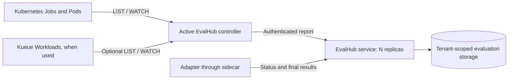

# ADR: EvalHub Job failure reconciliation

| Field | Value |
| --- | --- |
| Date | 2026-11-24 |
| Scope | EvalHub on Kubernetes and OpenShift; TrustyAI operator integration |
| Status | Draft |
| Authors | [Jooyeon Mok](https://github.com/j-mok-dev) |
| Supersedes | N/A |
| Superseded by: | N/A |
| Tickets | [EvalHub #1294](https://github.com/eval-hub/eval-hub/issues/1294), [RHAI-10550](https://redhat.atlassian.net/browse/RHAI-10550), [RHAI-12783](https://redhat.atlassian.net/browse/RHAI-12783) |
| Other docs: | none |

## What

This draft proposes an EvalHub-owned controller that detects evaluation Job failures and, when Kueue is used, queue admission problems. It reports these to the EvalHub service, which corrects the stored benchmark and evaluation status.

The controller runs as a separate process and Deployment. One active controller serves all API server replicas of the same EvalHub instance. It is included in both operator-managed and standalone Kubernetes installations.

## Why

We need to solve two problems.

**1. Close gaps in failure detection.**

An adapter normally reports status and results through its sidecar. If it exits without a final report, Kubernetes may show a failed execution while EvalHub stays Pending or Running.

The example in [EvalHub #1294](https://github.com/eval-hub/eval-hub/issues/1294) describes BBQ running out of memory while two other benchmarks completed. The evaluation stayed Running. The service-log analysis found no failed benchmark event. It did not establish why that report was missing. EvalHub should record the failed benchmark, keep the completed results, and update the overall status.

The operator checks selected container and startup failures. It does not use final Job failure alone as a general fallback. We need to improve these checks and add a general check for Jobs that Kubernetes marks as finally failed. Moving the existing code alone will not fix the detection gaps.

**2. Make failure monitoring work without the TrustyAI operator.**

EvalHub can be installed without the TrustyAI operator. These installations also need Job/Pod monitoring and status correction. If they use Kueue, they also need its Workload status reporting. Keeping either function only in the operator leaves a gap in standalone installations. EvalHub must provide both as part of its own installation, with Kueue support enabled only when needed.

The proposed separate controller also keeps its watches independent of API server replica count.

## Goals

- Correct evaluation status when an execution fails without a final adapter report.
- Preserve working failure checks, completed results, and user cancellation.
- Support Kubernetes and OpenShift installations with or without the TrustyAI operator.
- Provide Kueue Workload status reporting in both installation modes when Kueue is used.
- Keep controller watches independent of API server replica count.
- Keep failure reports within the correct EvalHub instance, tenant, and execution.
- Handle restarts, repeated reports, and races with adapter callbacks safely.

## Non-Goals

- Rerun failed evaluations or add a global evaluation timeout.
- Treat a missing Pod or report as proof of execution failure.
- Solve missing reports from Jobs that succeeded.

## How

### Component responsibilities

EvalHub provides the controller from its own codebase. A new repository is not required.

| Component | Responsibility |
| --- | --- |
| EvalHub controller | Watch evaluation Jobs/Pods and optional Kueue Workloads, check evidence, and report execution or admission problems to the service. |
| EvalHub service | Create evaluation Jobs, validate reports, update tenant-scoped storage, and run result handling. |
| TrustyAI operator | Install and configure the controller, namespace list, and permissions when the operator is used. |
| Standalone installer or administrator | Provide the same controller and configuration without the operator. |

The controller has no direct database access. It sends reports to the existing status update API, `POST /api/v1/evaluations/jobs/{id}/events`, through the EvalHub Kubernetes Service. Multiple API replicas must share persistent evaluation storage so that any ready replica can handle the report. The service uses the verified caller identity from the existing authentication layer and checks permissions to distinguish controller reports from adapter callbacks. Adapter callbacks cannot mark a failure as coming from the controller.

### One active watcher

Controller replicas use a Kubernetes Lease unique to their EvalHub instance to elect a leader. Only the leader starts informers, caches, and workers, including any enabled Kueue watcher. They stop when leadership is lost. Some frameworks start caches before leader election; these watches must not start in standby replicas.

Job/Pod changes and optional Kueue Workload changes enter work queues for checking. Duplicate work is combined and retries use backoff. A new leader lists existing resources, syncs its caches, and checks them again. Recovery needs both the stored execution record and retained Kubernetes evidence.

Kueue remains a separate optional system. Enable the Workload watcher only when this EvalHub instance uses Kueue and a supported Workload API is available. Job/Pod monitoring must work without Kueue. If Kueue reporting is configured but its API is unavailable, expose that configuration problem.

### Execution and queue checks

| Evidence | Proposed behavior |
| --- | --- |
| OOM, selected init/sidecar failures, startup errors, and scheduling or mount failures covered by the operator | Move the existing checks, messages, grace periods, and retries. Review the early-reporting policy below. Reuse init diagnostics from [EvalHub #1271](https://github.com/eval-hub/eval-hub/pull/1271). |
| A Job has the terminal condition `Failed=True` | Add a general failure check, including when its Pod has gone. |
| A Kueue Workload has `QuotaReserved=False` with `Reason=Inadmissible` | Move the existing Workload report conditions and message codes to the optional watcher. Review the resulting evaluation status below. |
| A missing Pod/report, or a successful Job without a report | Do not invent an execution failure. |

Refresh the required Kubernetes evidence before reporting failure. Retry temporary API errors. Existing scheduling and startup rules are early failure policies; they do not prove the Job is terminal.

Kueue admission problems are different from terminal Job failures. The existing operator reports the selected `Inadmissible` condition as a benchmark failure, but that condition may recover. Review this status mapping before implementation. Ordinary queue waiting must not be treated as execution failure.

### Apply and correct results

After creating a Kubernetes Job, the service persists its UID together with the owning EvalHub instance, tenant, evaluation, and benchmark execution. Check this stored link before applying a controller report. Names and labels alone are not sufficient.

For Kueue reports, also verify that the Workload's owning Job UID matches that persisted execution and that both resources are in the allowed tenant namespace. Apply the same result and cancellation protections to both report types.

The service reads current state and applies each change in one tenant-scoped transaction, using the existing SQL row-locking path. It records whether the failure was reported by the controller or the adapter in a server-only field. Do not trust client-supplied `message_origin` for this decision.

| Stored state and incoming update | Required behavior |
| --- | --- |
| The adapter's final result for this benchmark execution was saved first | Preserve it. Ignore the reconciler failure. |
| Reconciler failure was saved first; a final report for the same execution arrives | Replace only that failure, save the final result, remove stale reconciler diagnostics, and recalculate the overall status. |
| Overall evaluation is Failed or PartiallyFailed | Allow the same narrow correction. Do not use this as a general permission to reopen terminal evaluations. |
| Evaluation was cancelled, or the benchmark was finalized by the adapter | Preserve cancellation and final results. |
| A progress callback or duplicate failure report arrives | Do not reopen a terminal benchmark or repeat the same state change. |

Keep other benchmark results intact and preserve compatibility with existing adapter callback requests. Repeated processing must not duplicate notifications or exports. Leader election does not replace these storage and result-handling safeguards.

### Installation and handover

The initial handover targets the operator and EvalHub versions shipped together in RHOAI 3.7 EA.

Use a protected ConfigMap per EvalHub instance for allowed namespaces. The operator maintains it when present; the standalone installer or administrator maintains it otherwise. Apply changes while running. On namespace removal, stop its watches and queued work. The service must also check the allowed scope before applying controller reports. Define when removal takes effect for requests already in progress; this remains an open question.

Give the controller its own ServiceAccount and namespace-scoped Job/Pod `get/list/watch` access, plus Event reads needed for diagnostics. Add namespace-scoped Workload `get/list/watch` only when Kueue reporting is enabled. Any retained Job/Workload label or annotation updates need explicit patch permissions. Restrict Lease access to the controller's control namespace. Evaluation Pods receive no watcher or controller-report permissions.

During migration, enable only one reporter for each report type at a time. Recheck existing Jobs and enabled Kueue Workloads after handover. Confirm both report paths work in both installation modes before retiring the matching Job/Pod and Workload reconcilers in the operator. Remove operator permissions only when no remaining function needs them. The operator continues to manage installation, configuration, and permissions when present.

## Open Questions

1. EvalHub currently creates Jobs with `backoffLimit: 0` and Pod `restartPolicy: Never`. If the adapter container is OOMKilled, should we report failure as soon as we detect it, or wait until Kubernetes sets the Job condition `Failed=True`?
2. After a late final report corrects a reconciler failure, should the service publish an updated evaluation card to enabled OCI/MLflow targets? What Kubernetes Event and service log should record the correction? This also matters when benchmark results change but the overall state stays PartiallyFailed.
3. How long should Job/Workload evidence be retained for restart and upgrade recovery? Is the current one-hour Job cleanup TTL sufficient for the recovery window we want to support?
4. Which controller settings should the operator generate, and which need user-facing fields in the EvalHub CR? What standalone manifests or installation tooling must provide the controller Deployment, configuration, ServiceAccount, Lease access, and namespace permissions?
5. A Kueue `Inadmissible` condition can describe a missing LocalQueue that an administrator can later create. Should such cases keep the evaluation Pending with diagnostics, or report Failed as the operator does today? How should later admission clear or correct the earlier report?
6. When does a namespace removal take effect, and how should the controller and API replicas stop queued or in-progress reports from being applied after that point?

## Alternatives

| Option | Benefit | Cost or limitation |
| --- | --- | --- |
| Improve checks only in the TrustyAI operator | Reuses the existing controller and deployment. | Standalone EvalHub still depends on the operator for failure recovery. |
| Move Job/Pod reporting but keep Kueue reporting in the operator | Keeps the initial move smaller. | Standalone installations using Kueue still lack Workload status reporting. |
| Run a controller in every EvalHub API replica | Adds no separate Deployment. | Duplicate watches and caches grow with API replicas. It also needs storage and duplicate-report protection. |
| Elect one API replica to run the watchers | Can limit all enabled watches without another Deployment, if only the leader starts informers. | Monitoring remains tied to API server lifecycle and permissions. It does not fully address separation of responsibilities. |
| Separate EvalHub controller with one active leader, proposed | Provides Job/Pod and optional Kueue reporting without the operator. API scaling does not add watchers. Permissions and lifecycle are separate. | Adds a Deployment, configuration, service communication, and leader failover. |
| Rely only on adapter/sidecar callbacks | Keeps monitoring simple. | Cannot recover when the execution dies without a final report. |

## Security and Privacy Considerations

Adapter payloads and tenant-created Kubernetes objects are not trusted controller evidence. The service must authenticate and authorize the reporting controller, verify the persisted execution binding, and keep writes tenant-scoped.

The namespace ConfigMap selects the intended scope; RBAC limits actual access. Both must agree. Protect ConfigMap writes and validate namespace entries. Grant access through RoleBindings in each allowed namespace, using namespace Roles or a shared ClusterRole.

Use bounded diagnostic details and stable message codes. Do not copy secrets, environment values, full Pod specs, or unrelated Events into stored errors. For mount failures, check the Pod status, matching Event reason, event age, and grace period. Use the Event message for diagnostic details.

## Risks

| Risk | Response included in this design | Remaining limitation or decision |
| --- | --- | --- |
| Early reports may mark a recoverable condition as failed. | Recheck Kubernetes evidence and allow a final adapter report for the same execution to correct a reconciler failure. | OOM reporting timing and the treatment of Kueue admission problems still need a decision. |
| Leader changes can delay monitoring. | The new leader lists existing resources and syncs its caches before processing them. | A temporary monitoring delay remains during the handover between leaders. |
| Job cleanup may remove evidence before recovery. | Recheck existing resources after a restart, using the stored execution binding. | Deleted evidence cannot be recovered this way. The current default Job cleanup TTL is one hour; the required retention period still needs a decision. |
| The operator-to-controller handover could cause duplicate reporting or a monitoring gap. | Require one active reporter per report type, recheck resources after handover, and verify the new paths before retiring the old reconcilers. | The implementation must define the activation and handover steps to avoid duplicate reporting and monitoring gaps. |

## Stakeholder Impacts

| Group | Key Contacts | Date | Impacted? |
| --- | --- | --- | --- |
| EvalHub maintainers | TBD | TBD | Yes |
| TrustyAI operator maintainers | TBD | TBD | Yes |
| Standalone installation tooling and administrators | TBD | TBD | Yes |
| API consumers and result integrations | TBD | TBD | Maybe |

- **EvalHub maintainers:** Provide the controller and update report validation, status correction, and result handling in the service.
- **TrustyAI operator maintainers:** Retire the existing reporting reconcilers and manage the new controller's installation, configuration, permissions, and upgrades, including downstream RHOAI packaging.
- **Standalone installation tooling and administrators:** Include the controller Deployment, ServiceAccount, namespace configuration, and permissions in the installation.
- **API consumers and result integrations:** A failed state may later be corrected by a final adapter report. Consumers may need to account for corrected states and updated exports. This proposal keeps callback request formats and the tenant model in EH-0002 intact.

## References

- [EvalHub #1294: original proposal and discussion](https://github.com/eval-hub/eval-hub/issues/1294)
- [EH-0001: EvalHub service ADR](https://github.com/opendatahub-io/architecture-decision-records/blob/main/architecture-decision-records/eval-hub/ODH-ADR-EH-0001-eval-hub-service.md)
- [EH-0002: EvalHub tenancy ADR](https://github.com/opendatahub-io/architecture-decision-records/blob/main/architecture-decision-records/eval-hub/ODH-ADR-EH-0002-multi-tenancy-and-authz.md)
- Existing operator reporting: [Job/Pod failures](https://github.com/trustyai-explainability/trustyai-service-operator/blob/5c8fade22739ceb2efd15897768965677ae7705f/controllers/evalhub/evaluation_job_failure_reconciler.go#L529-L539) and [Kueue Workloads](https://github.com/trustyai-explainability/trustyai-service-operator/blob/5c8fade22739ceb2efd15897768965677ae7705f/controllers/evalhub/evaluation_failed_kueue_workloads_reconciler.go)
- [Kueue troubleshooting: Pending versus Inadmissible](https://kueue.sigs.k8s.io/docs/tasks/troubleshooting/troubleshooting_jobs/)

## Reviews

| Reviewed by | Date | Notes |
| --- | --- | --- |
