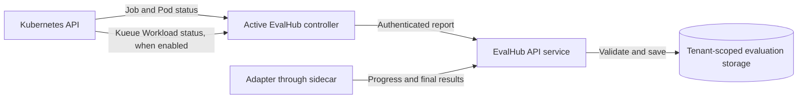

# ADR: EvalHub Job failure reconciliation

| Field | Value |
| --- | --- |
| Date | 2026-11-24 |
| Scope | EvalHub on Kubernetes and OpenShift; TrustyAI operator integration |
| Status | Draft |
| Authors | [Jooyeon Mok](https://github.com/j-mok-dev) |
| Supersedes | N/A |
| Superseded by: | N/A |
| Tickets | [EvalHub #1294](https://github.com/eval-hub/eval-hub/issues/1294), [RHAI-10550](https://redhat.atlassian.net/browse/RHAI-10550), [RHAI-12783](https://redhat.atlassian.net/browse/RHAI-12783) |
| Other docs: | none |

## What

The TrustyAI operator already watches EvalHub Jobs and Pods and reports selected failures to the EvalHub service. When Kueue is used, it also reports certain queue admission problems. Installations without the operator lack this monitoring.

**RHOAI 3.7 EA1.** This ADR proposes adding one fallback to the existing operator. When a Job has the terminal condition `Failed=True`, the operator can report the failure through its existing path even if the adapter sent no final report. Including this fix in EA1 depends on completing validation in the time available.

**RHOAI 3.7 GA target.** Under the proposed GA design, a controller shipped with EvalHub takes over Job/Pod monitoring, including the terminal failure check, and optional Kueue reporting. This gives standalone installations the same monitoring. In operator-managed installations, the new controller takes over reporting from the operator.

The controller runs in its own Deployment with a dedicated ServiceAccount. It has no user-facing API and does not run adapters or user code. One controller is active per EvalHub instance, regardless of the number of API server replicas.

## Why

**1. The existing checks can miss a failed Job.**

In [EvalHub #1294](https://github.com/eval-hub/eval-hub/issues/1294), BBQ ran out of memory and two other benchmarks completed. The evaluation stayed Running. The service logs showed no failure report for BBQ. The cause of the missing report is unknown.

The operator checks for specific problems, such as container and startup failures. If those checks miss a failure and the adapter sends no final report, EvalHub can still show the evaluation as Running. When Kubernetes marks the Job as failed, EvalHub should use that information to update the failed benchmark and keep the completed results.

**2. Standalone installations need the same monitoring.**

Improving the checks in the TrustyAI operator would help operator-managed installations. An EvalHub installation without the operator would still lack those checks. If it uses Kueue, it would also lack the operator’s queue status reports.

Shipping the controller with EvalHub makes this monitoring available in both installation modes. Running it in its own Deployment lets the API service scale without starting more watchers.

## Goals

**EA1 operator fix**

- Keep the existing failure checks and add a fallback for Jobs that Kubernetes marks as failed when the adapter sends no final report.
- Update the affected benchmark and the overall evaluation status. Preserve completed results from other benchmarks and respect user cancellation.

**Proposed GA controller**

- Carry the terminal failure check and result protections forward into the new controller.
- Provide the same monitoring on Kubernetes and OpenShift, with or without the TrustyAI operator. Include Kueue Workload reporting when Kueue is used.
- Keep the number of watches independent of the number of EvalHub API replicas.
- Apply each report only to the matching EvalHub instance, tenant, and benchmark execution.
- Handle controller restarts, duplicate reports, and late adapter callbacks without overwriting final adapter results or sending duplicate notifications.

## Non-Goals

- Rerun failed evaluations or add a global evaluation timeout.
- Treat a missing Pod or report as proof of execution failure.
- Recover missing results when a Job succeeds but the adapter sends no final report.

## How

The following design describes the proposed GA controller and its integration with the EvalHub service. The EA1 operator change uses the existing reporting path.

### Component responsibilities

The controller lives in the EvalHub repository. It runs in its own Deployment and can scale independently of the EvalHub API server.

| Component | Responsibility |
| --- | --- |
| EvalHub controller | Watch evaluation Jobs and Pods. When Kueue is enabled, also watch its Workloads. Check the evidence and report problems to the EvalHub service. |
| EvalHub service | Create evaluation Jobs, validate incoming reports, and update the benchmark and evaluation status in the tenant’s database records. |
| TrustyAI operator | In operator-managed installations, deploy the controller and configure its allowed namespaces and permissions. The controller takes over Job/Pod and Kueue reporting after handover. |
| Standalone installer or administrator | Deploy the same controller and configure its allowed namespaces and permissions. |

The controller sends failure reports to the existing EvalHub status API (`POST /api/v1/evaluations/jobs/{id}/events`) through the EvalHub Kubernetes Service. Any ready API replica can handle the report because the replicas share the same evaluation storage.

The EvalHub service checks the caller’s identity and permissions to tell a controller report from an adapter callback. It checks that the report belongs to the same benchmark execution before updating the stored status.

This ADR covers Job/Pod monitoring and optional Kueue Workload reporting. A future proposal for expired-record cleanup should specify the data and permissions that task needs.

The active controller lists existing resources and then watches for changes.

### One active controller per EvalHub instance

Controller replicas use a Kubernetes Lease to elect one leader per EvalHub instance. Only the leader starts the watches, caches, and workers. Standby replicas wait for leadership. When the leader loses its Lease, it stops watching and processing work.

A new leader lists existing resources and syncs its caches before processing them. If a Job failed while there was no leader, the new leader can still report the failure as long as the Job and its `Failed=True` condition are available and the service can match it to the stored execution. If the evidence has already been deleted, the controller cannot infer failure from the missing Job or Pod.

The controller queues resource changes for processing. It combines duplicate work and waits longer between retries after temporary errors.

The leader also watches Kueue Workloads when Kueue reporting is enabled and the Workload API is available. If reporting is enabled but the API is unavailable, the controller reports the configuration problem and continues monitoring Jobs and Pods.

### Execution and queue checks

| What the controller observes | Proposed behavior |
| --- | --- |
| A container, startup, scheduling, or mount problem covered by an existing operator check | Move the existing check with its diagnostic message, grace period, and retry rules. Reuse the init diagnostics from [EvalHub #1271](https://github.com/eval-hub/eval-hub/pull/1271). |
| Kubernetes marks a Job `Failed=True` | Report the Job failure even if its Pod is already gone. This is the same fallback proposed for the EA1 operator. |
| A Kueue Workload has `QuotaReserved=False` with `Reason=Inadmissible` | Move the existing check to the optional Kueue watcher. This condition can clear later. How EvalHub should represent it remains an open question. |
| A Pod or final report is missing | Missing information alone is insufficient to report a failure. This also applies when a Job succeeds without a final adapter report. |

Before reporting a failure, the controller checks the current Kubernetes state and retries temporary API errors. Some existing checks can report a problem before a Job reaches its final state. Ordinary queue waiting does not count as an execution failure.

### Apply and correct results

When the EvalHub service creates a Kubernetes Job, it stores the Job UID with the EvalHub instance, tenant, evaluation, and benchmark execution. Before applying a controller report, the service checks that the report matches this stored record. Job names and labels alone cannot identify the execution.

For a Kueue report, the service also checks that the Workload belongs to the Job with that UID and that both resources are in the tenant’s allowed namespace. The same rules for final results and cancellation apply to both Job and Kueue reports.

The service uses the existing SQL row lock when it updates an evaluation. In one transaction for that tenant, it locks the evaluation row, reads the current state, and applies the update rules below.

When the service saves a failure, it records whether the controller or the adapter reported it. The service sets this field from the authenticated caller’s identity. A `message_origin` value in the request cannot override it.

| Stored state | Incoming report | What the service does |
| --- | --- | --- |
| The user cancelled the evaluation. | Any later report. | Keep the evaluation cancelled. |
| The adapter already finalized this benchmark execution. | A controller failure report. | Keep the adapter’s final result. |
| The controller recorded a failure for this benchmark execution. | The adapter sends a final report for the same execution. | Save the adapter’s final result, clear the earlier controller diagnostics, and recalculate the overall evaluation status. Keep the other benchmark results. |
| The benchmark is already in a terminal state. | A progress update or a repeated failure report. | Keep the current state. A repeated report must not trigger duplicate notifications or exports. |

Even if the overall evaluation is already `Failed` or `PartiallyFailed`, the service can still replace a controller-reported failure with the adapter’s final result for that same execution.

Keep other benchmark results intact and preserve compatibility with existing adapter callback requests. Repeated processing must not duplicate notifications or exports. Leader election does not replace these storage and result-handling safeguards.

### Installation and handover

Given the limited time to implement and validate changes for RHOAI 3.7 EA1, this ADR limits the EA1 scope to adding the terminal Job failure check to the existing TrustyAI operator. Verify that a terminally failed Job with no final adapter report updates the correct benchmark through the existing service, while preserving completed results and user cancellation. Verify that a late operator failure report preserves an adapter result already saved for the same benchmark execution.

RHOAI 3.7 GA is the proposed target for moving the existing checks, including the terminal failure fallback, to the separate EvalHub controller. This target depends on agreement on the controller’s Kubernetes permissions and validation of both installation modes.

Each EvalHub instance has a ConfigMap that lists the namespaces its controller should monitor. Limit write access to those who maintain the list: the operator in an operator-managed installation, or the designated administrator or installer in a standalone installation.

The controller applies changes while running. When a namespace is removed, it stops watching that namespace and skips its queued work. The service checks the current allowed list when it validates each report. A report that passed the namespace check before removal can finish under the usual update rules. Any report still awaiting that check is evaluated against the current list.

Give the controller a dedicated ServiceAccount. In each allowed namespace, grant it `get`, `list`, and `watch` access to Jobs and Pods, plus the Event reads needed to diagnose failures. Grant the same read and watch access to Kueue Workloads only when Kueue reporting is enabled.

Limit Lease access to the controller’s control namespace. If the controller needs to update labels or annotations on Jobs or Workloads, grant `patch` access explicitly. This proposal adds no watch permissions to the EvalHub API server Pods. Evaluation Pods receive no watch permissions or permission to submit controller reports.

In operator-managed installations, switch each report type from the operator to the EvalHub controller with only one reporter active at a time. After the switch, the controller checks existing Jobs. If Kueue reporting is enabled, it also checks existing Workloads.

Verify Job/Pod reporting in both operator-managed and standalone installations. Verify Kueue reporting in both modes with Kueue enabled. Then remove the corresponding reconcilers from the operator and drop any monitoring permissions it no longer needs. The operator continues to install and configure the controller and manage its permissions.

## Open Questions

These questions concern the proposed GA design. EA1 retains the operator’s current early failure and Kueue reporting policies.

1. EvalHub currently creates Jobs with `backoffLimit: 0` and Pod `restartPolicy: Never`. If the adapter container is OOMKilled, should the controller report the failure immediately or wait until Kubernetes sets the Job condition `Failed=True`?
2. If a late adapter report changes a benchmark result after EvalHub has exported the evaluation card, should EvalHub publish an updated card?
3. How long should EvalHub be able to recover missed failures after a controller outage or upgrade? Is the current one-hour Job TTL long enough? When Kueue is enabled, how long should Workloads be retained for recovery?
4. In both operator-managed and standalone installations, can the controller use the existing EvalHub settings to determine which namespaces to watch and whether to watch Kueue Workloads? If administrators need a separate setting, what should it control?
5. If Kueue marks a Workload as `Inadmissible` because its LocalQueue is missing, should EvalHub mark the affected benchmark as `Failed`, as the operator does today, or keep it `Pending` and show the reason? If Kueue later admits the same Workload, how should EvalHub update the benchmark status and message?

## Alternatives

| Option | Benefit | Cost or limitation |
| --- | --- | --- |
| Improve the checks in the TrustyAI operator (proposed for EA1) | Reuses the existing watcher and its Kubernetes permissions. | Installations without the operator still lack failure monitoring. |
| Move Job/Pod monitoring to EvalHub and keep Kueue reporting in the operator | Moves fewer checks at first. | Standalone installations that use Kueue still lack Workload status reports. |
| Run watchers in every EvalHub API replica | Uses the existing API Deployment. | Each additional replica adds watches and caches. |
| Elect one EvalHub API replica to run the watchers | Only the leader watches resources. Uses the existing API Deployment. | API Pods need monitoring permissions because any replica can become the leader. |
| Rely on adapter callbacks alone | Requires no Kubernetes watcher. | If an adapter exits before its final report, EvalHub can stay `Pending` or `Running`. |
| **Run a separate EvalHub controller with one active leader (proposed for GA)** | Both installation modes get Job/Pod monitoring and optional Kueue reporting. API replicas can scale independently. | Adds a Deployment to operate and a ServiceAccount with Kubernetes permissions to secure. A new leader needs time to resume monitoring. |

## Security and Privacy Considerations

Moving monitoring to the EvalHub controller gives a new ServiceAccount access to Kubernetes resources. The controller runs in its own Pods, has no user-facing API, and does not run evaluation code. Before handover, review these questions.

1. Which resources can the controller read or change, and in which namespaces?
2. Could an EvalHub API server Pod or an evaluation Pod use the controller's credentials?
3. Which monitoring permissions does the TrustyAI operator still need after handover, and which can be removed?

The service accepts a controller report only from a controller authorized to report for that EvalHub instance. Before updating a benchmark, the service checks the Job UID against the execution record stored for that tenant.

Keep the controller’s monitoring permissions in sync with the namespace list in the ConfigMap. Restrict who can edit the list and validate each namespace entry. In each allowed namespace, use a RoleBinding that refers to a local Role or a shared ClusterRole.

Store a stable error code and a short diagnostic message. Keep secrets, environment variable values, full Pod specs, and unrelated Events out of stored errors.

For mount failures, check the Pod status, matching Event reason, event age, and grace period. Use the Event message for diagnostic details.

## Risks

| Risk | How the design handles it | What remains open |
| --- | --- | --- |
| An early report can mark a recoverable condition as failed. | Recheck the Kubernetes evidence before reporting. Allow a final adapter report to correct a controller-reported failure for the same execution. | When should an OOM failure be reported? How should EvalHub show a recoverable Kueue admission problem? |
| Monitoring can pause during a restart or leader change. Failure evidence may expire during that pause. | On startup, the active controller checks existing resources against stored execution records. | Recovery depends on the evidence still being available. Is the current one-hour Job TTL long enough? |
| The proposed GA controller will have its own Kubernetes credentials. | Give it a dedicated ServiceAccount and limit monitoring permissions to the allowed namespaces. | Review credential isolation and the permissions each component retains after handover. |
| During the proposed GA handover, both components could report the same failure, or neither could report it. | Switch one report type at a time, keep one reporter active, and recheck existing resources after the switch. | Define the switch and rollback steps so each report type stays covered. |

## Stakeholder Impacts

| Group | Key Contacts | Date | Impacted? |
| --- | --- | --- | --- |
| EvalHub maintainers | TBD | TBD | Yes |
| TrustyAI operator maintainers | TBD | TBD | Yes |
| Standalone installation tooling and administrators | TBD | TBD | Yes |
| API consumers and result integrations | TBD | TBD | Maybe |

- **EvalHub maintainers.** For the proposed GA release, provide the controller and update the service to validate failure reports and correct stored results.
- **TrustyAI operator maintainers.** For EA1, add the terminal Job failure check if validation can be completed in the time available. For the proposed GA handover, deploy and configure the EvalHub controller, verify reporting, and then retire the corresponding operator reconcilers.
- **Standalone installation maintainers and administrators.** For the proposed GA release, provide the controller Deployment, ServiceAccount, namespace configuration, and permissions so standalone installations can use the same monitoring.
- **API consumers and result integrations.** A late adapter report may correct a previously reported benchmark failure. Consumers that treat the first failure as final may need to handle that correction. Whether EvalHub republishes an exported evaluation card remains open.

## References

- [EvalHub #1294: original proposal and discussion](https://github.com/eval-hub/eval-hub/issues/1294)
- [EH-0001: EvalHub service ADR](https://github.com/opendatahub-io/architecture-decision-records/blob/main/architecture-decision-records/eval-hub/ODH-ADR-EH-0001-eval-hub-service.md)
- [EH-0002: EvalHub tenancy ADR](https://github.com/opendatahub-io/architecture-decision-records/blob/main/architecture-decision-records/eval-hub/ODH-ADR-EH-0002-multi-tenancy-and-authz.md)
- Existing operator reporting: [Job/Pod failures](https://github.com/trustyai-explainability/trustyai-service-operator/blob/5c8fade22739ceb2efd15897768965677ae7705f/controllers/evalhub/evaluation_job_failure_reconciler.go#L529-L539) and [Kueue Workloads](https://github.com/trustyai-explainability/trustyai-service-operator/blob/5c8fade22739ceb2efd15897768965677ae7705f/controllers/evalhub/evaluation_failed_kueue_workloads_reconciler.go)
- [Kueue troubleshooting: Pending versus Inadmissible](https://kueue.sigs.k8s.io/docs/tasks/troubleshooting/troubleshooting_jobs/)

## Reviews

| Reviewed by | Date | Notes |
| --- | --- | --- |
