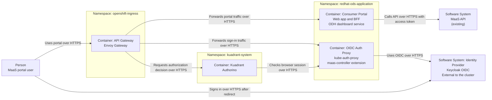
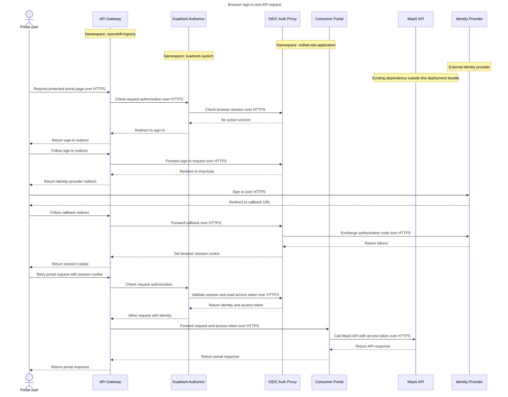

# Open Data Hub - MaaS Consumer Portal OIDC Gateway Layout

|                |            |
| -------------- | ---------- |
| Date           | 2026-10-19 |
| Scope          | model-serving, MaaS consumer portal OIDC gateway layout |
| Status         | Draft |
| Authors        | Lindani Phiri|
| Supersedes     | N/A |
| Superseded by: | N/A |
| Tickets        | RHAI-10605 |
| Other docs:    | none |

## What

Serve the AI consumer UI from the MaaS gateway. Use a route-specific Gateway API `HTTPRoute` for the UI. Run `kube-auth-proxy` as an extension of the `maas-controller` deployment, not as a separate operand. Keep the proxy lifecycle independent of `GatewayConfig`. Allow one UI BFF service to serve multiple Gateways when tenant context and authenticated identity are preserved.

## Why

OIDC is an explicit business requirement for the AI consumer UI. Serving the UI from the MaaS gateway keeps portal traffic, model traffic, and authentication policy under one gateway owner. Running `kube-auth-proxy` inside the `maas-controller` deployment avoids another standalone operand and keeps the proxy aligned with the controller's release and scaling model.

This layout also aligns the consumer portal with the general MaaS architecture, where each `AITenant` has a separate Gateway. AI Grid is the exception: it uses one shared Gateway. The portal uses the same Gateway boundary as model traffic instead of introducing a second gateway owner.

In non-AI Grid deployments, each `AITenant` has a separate Gateway. A single UI BFF can serve those Gateways, reducing duplicate deployments while preserving the Gateway boundary. AI Grid uses a single Gateway, so it does not require this multi-Gateway BFF capability in the MVP.

Keeping `kube-auth-proxy` separate from `GatewayConfig` also avoids coupling a UI authentication concern to the Gateway configuration lifecycle. This lets the UI and MaaS teams release independently.

## Goals

* Serve the AI consumer UI from the MaaS gateway.
* Align the consumer portal with the general MaaS Gateway architecture and preserve the AI Grid single-Gateway MVP.
* Allow one UI BFF service to serve multiple MaaS Gateways in non-AI Grid deployments.
* Use a route-specific Gateway API `HTTPRoute` for the consumer UI.
* Run `kube-auth-proxy` as an extension of the `maas-controller` deployment.
* Manage `kube-auth-proxy` independently of `GatewayConfig`.
* Define the owner, update path, and scaling model for `kube-auth-proxy`.
* Define the routing model and redirect URIs for OIDC callbacks.
* Record the migration path from the odh-dashboard gateway to the MaaS gateway.
* Keep OpenShift OAuth available for deployments that do not use OIDC.

## Non-Goals

* Define the authentication chain or Envoy filter order.
* Define the identity-header contract.
* Define session scope, lifetime, refresh, or logout.
* Define broker outage behavior.
* Define programmatic access through SSO and API keys.
* Deploy or federate the broker.
* Add tenant-specific OIDC configuration.
* Apply multi-Gateway BFF sharing to the AI Grid MVP.

## How

The diagrams below show the target deployment and request flow. They provide context for the gateway layout. RHAI-10604 owns the identity contract and authentication-chain details.

Keycloak is shown as the reference identity provider. Any OIDC provider that emits the agreed claims can be used.

All traffic shown in these diagrams uses HTTPS.

### Deployment and traffic flow

### Portal sign-in and API request sequence

### Route and proxy deployment

The MaaS gateway exposes the portal on a stable public hostname and path. A route-specific `HTTPRoute` matches the portal path. It redirects the bare prefix to the same path with a trailing slash, rewrites the public prefix to the portal service's internal path, and removes client-supplied identity headers. It then forwards the request to the portal service over HTTPS on port 8443.

A second route-specific `HTTPRoute` matches `/oauth2`. It forwards sign-in, callback, and logout requests to `kube-auth-proxy` on port 4180. The proxy uses the OIDC authorization-code flow. The BFF receives the verified access token through the trusted header contract defined by RHAI-10604.

The [proof of concept](https://github.com/lphiri/maas-portal-integration-poc) runs `kube-auth-proxy` as a standalone Deployment and Service. This ADR proposes moving that container into the `maas-controller` Deployment. The route, policy, and backend contract stay the same; only the proxy's owner and scaling model change.

A backend TLS policy enables HTTPS from the gateway to the portal service. A `NetworkPolicy` allows only the gateway and Authorino to reach the proxy on TCP port 4180.

### Gateway layout

General MaaS deployments give each `AITenant` a separate MaaS Gateway. AI Grid uses a single shared MaaS Gateway. A route-specific Gateway API `HTTPRoute` attaches the UI path to the relevant Gateway and routes traffic to the consumer UI service.

A single UI BFF service can serve multiple Gateways in non-AI Grid deployments. For the AI Grid MVP, the BFF serves the single AI Grid Gateway. Each request carries the tenant identifier and the authenticated identity. The BFF uses both values to enforce tenant isolation.

The MaaS and Gateway team owns the `HTTPRoute`, its Gateway attachment, and its backend references. The UI team owns the UI service and coordinates endpoint changes with the MaaS and Gateway team.

### `kube-auth-proxy` deployment

`kube-auth-proxy` runs as an extension of the `maas-controller` deployment. It is not a separate operand.

The MaaS team owns `kube-auth-proxy` updates. The proxy scales with the `maas-controller` deployment. Its resource requests, limits, and replica count are managed as part of that deployment.

`GatewayConfig` does not manage `kube-auth-proxy`. This keeps UI authentication independent from gateway configuration changes.

### Routing and redirect URIs

The consumer UI uses a stable HTTPS hostname and path. The `HTTPRoute` forwards UI traffic to the consumer UI service.

OIDC callback redirect URIs are based on that hostname and path. The UI registers the callback URI with the OIDC client. The gateway forwards callback requests to `kube-auth-proxy`.

### Migration path

The current AI consumer UI is served from the odh-dashboard gateway. The migration moves the UI route to the MaaS gateway.

The rollout keeps the old route available until the new route is validated. The existing portal remains the default out-of-the-box portal, attached only to the default MaaS gateway.

### OpenShift OAuth compatibility

OpenShift OAuth remains available for deployments that do not use OIDC. Deployments can select OpenShift OAuth instead of OIDC without changing the UI service or the `maas-controller` deployment layout.

## Open Questions

* Should the existing portal remain the default portal for a fresh installation, attached only to the default MaaS gateway, and serve as the consumer portal for users with Kubernetes accounts? This would provide an out-of-the-box experience without OIDC setup for use cases outside AI Grid.
* The RHAI DSC currently has a managed option for the consumer portal. What should that option mean in this deployment architecture?
* Where should `kube-auth-proxy` run: `redhat-ai-gateway-infra` or `redhat-ods-application`?

## Alternatives

### Serve the UI from the odh-dashboard gateway

This option keeps the current deployment, but it leaves UI traffic outside the MaaS gateway. It also splits authentication policy between two gateway owners and makes the MaaS and UI teams coordinate across two release trains.

It also requires each portal user to have a Kubernetes identity. That conflicts with the no-Kubernetes-identity requirement in the AI Grid identity contract.

### Run `kube-auth-proxy` as a separate operand

This option separates the proxy lifecycle from `maas-controller`, but it adds another operand, service, and deployment to operate. It also duplicates scaling and upgrade work that the controller deployment already provides.

### Use one standalone auth-proxy Deployment per Gateway

This option keeps normal UI traffic on supported Gateway API and Kuadrant resources. It allows a shared UI service and a shared BFF service when tenant styling is selected by hostname, path, or runtime configuration.

It still adds one auth-proxy Deployment and Service per Gateway. That duplicates proxy lifecycle, scaling, and update work. This ADR instead runs the proxy as an extension of the `maas-controller` deployment.

### Use an `EnvoyFilter` without Kuadrant

This option replaces the Kuadrant `AuthPolicy` with a custom Lua filter on the Gateway. The filter calls the auth proxy, copies identity headers, and routes `/oauth2` traffic.

The filter depends on generated route IDs, virtual-host names, filter ordering, and Envoy protobuf types. Gateway or Istio upgrades can break it. Use this option only when Kuadrant is unavailable.

### Run the auth proxy as a UI sidecar in reverse-proxy mode

This option runs the auth proxy in the same pod as a tenant-specific UI Deployment. The proxy handles login locally and forwards traffic to the UI.

It still requires an `EnvoyFilter`, couples the UI and proxy lifecycles, and multiplies UI Deployments. Use this option only when a tenant requires a separate UI Deployment and accepts the extra operational cost.

### Use `GatewayConfig` to manage `kube-auth-proxy`

This option centralizes gateway-related configuration, but it couples UI authentication to gateway configuration. A `GatewayConfig` change could then affect UI sign-in even when the gateway itself is unchanged.

## Security and Privacy Considerations

* Apply the route-specific `HTTPRoute` only to the intended UI path.
* When a BFF serves multiple Gateways, use the tenant identifier and authenticated identity to enforce tenant isolation.
* Keep OpenShift OAuth available for deployments that do not use OIDC.
* Keep `kube-auth-proxy` updates and scaling under the MaaS team's control.
* Do not expose the OIDC callback URI beyond the intended UI route.

## Risks

* Moving the UI route can break existing bookmarks and redirect URIs.
* Running `kube-auth-proxy` with `maas-controller` couples proxy scaling to controller scaling.
* A misconfigured `HTTPRoute` can send UI traffic to the wrong backend.
* A BFF that serves multiple Gateways increases the impact of an isolation bug.
* The migration must preserve OpenShift OAuth deployments.

## Stakeholder Impacts

| Group | Key Contacts | Date | Impacted? |
| ----- | ------------ | ---- | --------- |
| MaaS and Gateway team |  |  | Yes |
| Consumer Portal UI and BFF team |  |  | Yes |
| Platform networking and Kuadrant operators |  |  | Yes |

**Notes:**

* The MaaS and Gateway team owns the gateway layout, `HTTPRoute`, and `kube-auth-proxy` deployment.
* The UI team owns the consumer UI service and coordinates route changes.
* The platform networking team owns Gateway API and Kuadrant support.

## References

* [AI Grid shared-OIDC identity contract ADR](./ODH-ADR-MS-0006-ai-grid-shared-oidc-identity-contract.md).
* [AI Gateway tenancy ADR](./ODH-ADR-MS-0003-ai-gateway-tenancy.md).
* [MaaS subscription architecture ADR](./ODH-ADR-MS-0003-maas-subscription-architecture.md).
* [MaaS portal integration proof of concept](https://github.com/lphiri/maas-portal-integration-poc).
* [RHAI-10605](https://redhat.atlassian.net/browse/RHAI-10605).

## Reviews

| Reviewed by | Date | Notes |
| ----------- | ---- | ----- |
|             |      |       |
