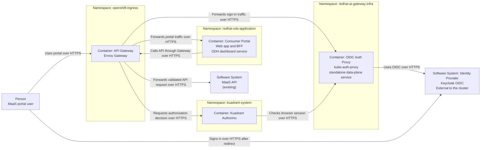
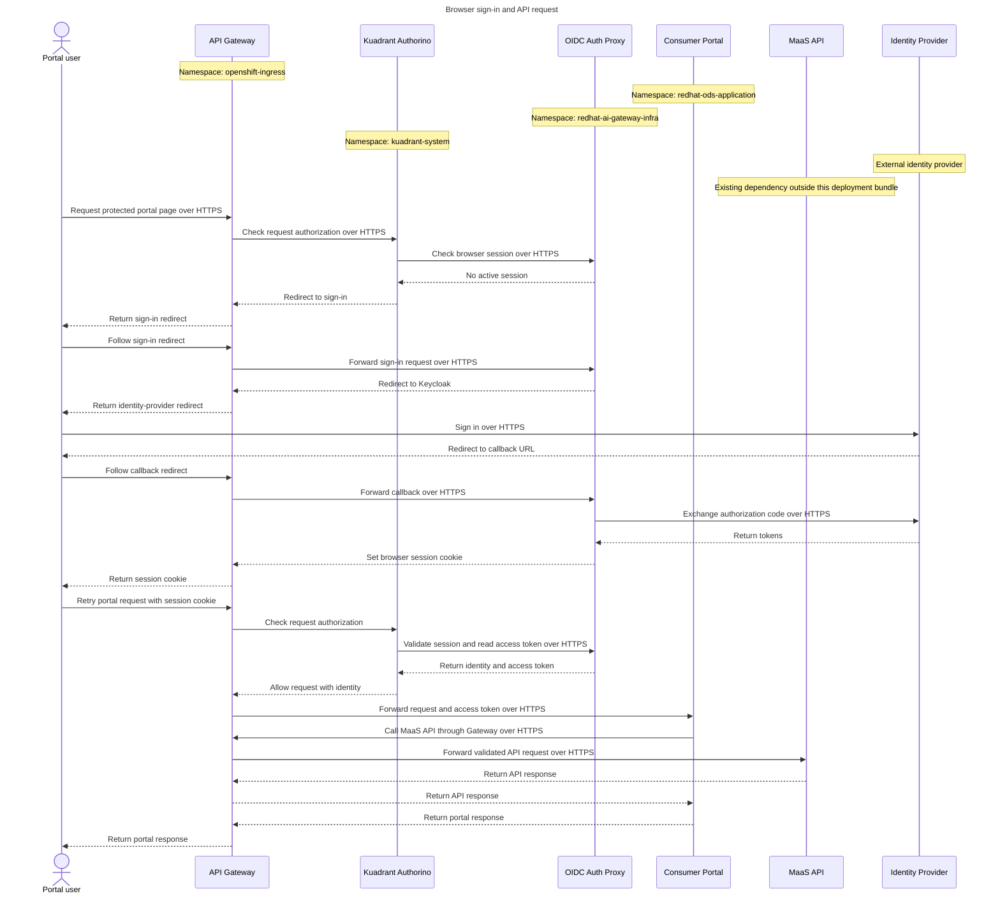

# Open Data Hub - MaaS Consumer Portal OIDC Gateway Layout

|                |            |
| -------------- | ---------- |
| Date           | 2026-10-19 |
| Scope          | model-serving, MaaS consumer portal OIDC gateway layout |
| Status         | Approved |
| Authors        | Lindani Phiri|
| Supersedes     | N/A |
| Superseded by: | N/A |
| Tickets        | RHAI-10605 |
| Other docs:    | none |

## What

Serve the AI consumer UI from the MaaS gateway. Use a route-specific Gateway API `HTTPRoute` for the UI. Run `kube-auth-proxy` as a standalone data-plane Deployment and Service in `redhat-ai-gateway-infra`, not as an extension of a controller Deployment. Keep the proxy lifecycle independent of the RHOAI Platform `GatewayConfig`. For the MVP, serve the portal only on the default `AITenant` Gateway. A future release may allow one UI BFF service to serve multiple Gateways when trusted tenant context and authenticated identity are preserved.

The RHOAI Platform `GatewayConfig` is the platform-wide configuration for the main RHOAI dashboard gateway. It is not the MaaS Gateway configuration.

## Why

OIDC is an explicit business requirement for the AI consumer UI. Serving the UI from the MaaS gateway keeps portal traffic, model traffic, and authentication policy under one gateway owner. Running `kube-auth-proxy` as a standalone data-plane service keeps browser-session traffic out of a controller pod and lets the proxy scale independently.

This layout also aligns the consumer portal with the general MaaS architecture, where each `AITenant` has a separate Gateway. AI Grid is the exception: it uses one shared Gateway. The portal uses the same Gateway boundary as model traffic instead of introducing a second gateway owner.

In non-AI Grid deployments, each `AITenant` has a separate Gateway. This support is in scope because non-AI Grid deployments ship in the same release. For the MVP, the consumer portal is supported only on the default `AITenant`. The default `AITenant` owns the default MaaS Gateway. This limit lets the portal work for AI Grid and non-AI Grid use cases without adding multi-Gateway routing logic to the BFF.

A single UI BFF service can serve multiple Gateways in a future release. That design reduces duplicate deployments while preserving the Gateway boundary.

MaaS owns the portal `HTTPRoute`, `AuthPolicy`, and proxy resources. The UI team owns the portal and BFF code. The “How” section lists the reasons for this ownership.

The selected layout also positions MaaS for a native Praxis OIDC mechanism. Portal traffic and identity already pass through the Gateway policy layer, so MaaS can replace the current proxy and policy integration without moving the public route or changing the BFF contract.

## Goals

* Serve the AI consumer UI from the MaaS gateway.
* Align the consumer portal with the general MaaS Gateway architecture and preserve the AI Grid single-Gateway MVP.
* Support non-AI Grid deployments in the same release.
* Limit the MVP consumer portal to the default `AITenant`.
* Record the future design for one UI BFF service to serve multiple MaaS Gateways.
* Use a route-specific Gateway API `HTTPRoute` for the consumer UI.
* Route BFF calls to the MaaS API through the validating Gateway.
* Attach one `kube-auth-proxy` to each Gateway that serves the consumer portal.
* Run `kube-auth-proxy` as a standalone data-plane Deployment and Service in `redhat-ai-gateway-infra`.
* Manage `kube-auth-proxy` independently of the RHOAI Platform `GatewayConfig`.
* Define the owner, update path, namespace, and scaling model for `kube-auth-proxy`.
* Define the `AITenant` CRD fields needed for OIDC client secret references and token refresh settings.
* Define the mutually exclusive `oidc` and `openshift` authentication modes on `AITenant`.
* Separate DSC-controlled UI and BFF deployment from `AITenant`-controlled portal exposure.
* Define TLS and Gateway API permissions for cross-namespace traffic.
* Define the routing model and redirect URIs for OIDC callbacks.
* Record the migration path from the odh-dashboard gateway to the MaaS gateway.
* Keep OpenShift OAuth available for tenants that select the `openshift` mode.

## Non-Goals

* Define the authentication chain or Envoy filter order.
* Define the identity-header contract.
* Define session scope, lifetime, refresh, or logout behavior.
* Define broker outage behavior.
* Define programmatic access through SSO and API keys.
* Deploy or federate the broker.
* Add per-organization OIDC configuration.
* Implement multi-Gateway BFF routing in the MVP.

## How

The diagrams below show the target deployment and request flow. They provide context for the gateway layout. RHAI-10604 owns the identity contract and authentication-chain details.

Keycloak is shown as the reference identity provider. Any OIDC provider that emits the agreed claims can be used.

All traffic shown in these diagrams uses HTTPS.

### Deployment and traffic flow

### Portal sign-in and API request sequence

### Route and proxy deployment

The MaaS gateway exposes the portal on a stable public hostname and path. A route-specific `HTTPRoute` matches the portal path. It redirects the bare prefix to the same path with a trailing slash, rewrites the public prefix to the portal service's internal path, and removes client-supplied identity headers. It then forwards the request to the portal service over HTTPS on port 8443.

A second route-specific `HTTPRoute` matches `/oauth2`. It forwards sign-in, callback, and logout requests to `kube-auth-proxy` on port 4180. The proxy uses the OIDC authorization-code flow. The BFF receives the verified access token through the trusted header contract defined by RHAI-10604.

`kube-auth-proxy` exposes two interfaces. The public `/oauth2` interface handles sign-in, callback, and logout. The internal validation interface receives session-validation requests from Authorino. This ADR does not use the Envoy `ext_authz` deployment mode.

The [proof of concept](https://github.com/lphiri/maas-portal-integration-poc) validates the route, policy, and backend contract. This ADR keeps `kube-auth-proxy` as a standalone Deployment and Service and moves it to `redhat-ai-gateway-infra`. The proxy is not embedded in a controller Deployment.

A backend TLS policy enables HTTPS from the gateway to the portal service. A second backend TLS policy enables HTTPS from the gateway and Authorino to `kube-auth-proxy` on TCP port 4180. That policy names the trusted certificate authority and the SNI server name. A `NetworkPolicy` allows only the gateway and Authorino to reach the proxy.

### Gateway layout

General MaaS deployments give each `AITenant` a separate MaaS Gateway. AI Grid uses a single shared MaaS Gateway. When the consumer portal is enabled for a tenant, that tenant's Gateway has one attached `kube-auth-proxy`. A route-specific Gateway API `HTTPRoute` attaches the UI path to the relevant Gateway and routes traffic to the consumer UI service.

For the MVP, only the default `AITenant` is enabled for the consumer portal. The BFF serves the default `AITenant` Gateway and does not implement multi-Gateway routing logic.

In a future release, a single UI BFF service can serve multiple Gateways. The Gateway derives the tenant context from its trusted hostname or an equivalent gateway-injected value. It rejects a missing or mismatched tenant identifier before authorization. The BFF does not trust a client-supplied tenant key.

The MaaS implementation owns the portal `HTTPRoute`, its Gateway attachment, its backend references, the `AuthPolicy`, and the `kube-auth-proxy` resources. The next subsection lists the reasons for this ownership. The UI team owns the UI and BFF Services and coordinates endpoint changes with the MaaS and Gateway team.

The MaaS implementation restricts the Gateway listener with `allowedRoutes`. It creates the required `ReferenceGrant` resources for cross-namespace backend references. It checks `HTTPRoute` status before it considers the route ready.

### Why MaaS manages `kube-auth-proxy`

The MaaS implementation manages the proxy resources. It does not run the proxy inside a controller Deployment.

The ADR does not choose whether the `maas-controller` or the `aigateway-controller` performs this reconciliation. That choice remains an implementation decision.

This ownership makes sense because the MaaS implementation:

* Resolves OIDC settings and Secret references from the `AITenant` CRD.
* Owns the Gateway topology, route attachment, and backend references.
* Configures `AuthPolicy` and payload-processing bypass.
* Creates one proxy for each Gateway that serves the consumer portal.
* Reconciles the proxy Deployment, Service, ServiceAccount, and `NetworkPolicy`.
* Keeps the proxy lifecycle independent of the RHOAI Platform `GatewayConfig`.
* Keeps browser-session traffic out of the controller pod.
* Scales and updates the proxy independently from the controller.

### OIDC configuration

The `AITenant` CRD must expose the OIDC parameters that `kube-auth-proxy` needs. These parameters include the OIDC client secret reference and token refresh settings. The MVP keeps this list to the minimum needed.

The `AITenant` CRD also defines a mutually exclusive authentication mode. The supported values are `oidc` and `openshift`. The MaaS implementation reconciles the proxy and its Gateway resources in both modes. In `oidc` mode, the proxy uses the tenant OIDC provider. In `openshift` mode, the proxy uses OpenShift OAuth. The tenant OIDC client Secret is not used in `openshift` mode.

The tenant creates the OIDC client Secret in the tenant namespace. The `AITenant` CRD names that Secret and its data key. The MaaS implementation validates the reference, copies or projects the Secret into `redhat-ai-gateway-infra`, and reconciles the copy when the source Secret changes. The implementation uses namespace-scoped RBAC for both namespaces.

This configuration model keeps tenant OIDC settings and Gateway resources in one reconciliation path.

### Consumer portal enablement

Two settings control the consumer portal:

* The RHAI DSC managed option controls whether the UI and BFF Deployment are installed.
* The `AITenant` CRD defines `consumerPortal.enabled`. This field controls whether the MaaS implementation reconciles the portal `HTTPRoute`, `AuthPolicy`, and `kube-auth-proxy` for that tenant.

A tenant receives the consumer portal only when both settings are enabled. The DSC option is the install gate. The `AITenant` field is the tenant gate. For the MVP, only the default `AITenant` qualifies for the tenant gate.

The `AITenant` field is optional for the AI Grid MVP and defaults to `true`. AI Grid uses the default `AITenant` and requires the consumer portal. The default `AITenant` can set the field to `false`. In a future release, non-default non-AI Grid tenants can use the field to avoid unnecessary tenant-specific gateway infrastructure.

When `consumerPortal.enabled` is `false`, or when the `AITenant` is not the default tenant in the MVP, the MaaS implementation does not create the tenant-specific portal `HTTPRoute`, `AuthPolicy`, or `kube-auth-proxy`. It removes those resources if it previously created them. The setting does not control the UI or BFF Deployment.

The default MaaS Gateway is always enabled. When the DSC option installs the UI and BFF Deployment and the default `AITenant` enables the consumer portal, the default Gateway receives the consumer portal route. This preserves the out-of-the-box experience. The default Gateway is not removed or disabled by `consumerPortal.enabled`.

### `kube-auth-proxy` deployment

`kube-auth-proxy` runs as a standalone Deployment and Service in `redhat-ai-gateway-infra`. It is not a container in a controller Deployment.

The MaaS implementation reconciles the proxy Deployment, Service, ServiceAccount, and `NetworkPolicy`. The proxy scales independently from the controller Deployment. Its resource requests, limits, and replica count are managed as part of the MaaS Gateway integration.

The RHOAI Platform `GatewayConfig` does not manage `kube-auth-proxy`. This keeps UI authentication independent from the platform gateway configuration lifecycle.

For the MVP, the MaaS implementation creates one `kube-auth-proxy` for the default `AITenant` Gateway. In a future release, non-AI Grid deployments can create one proxy for each `AITenant` Gateway that enables the consumer portal.

### Routing and redirect URIs

The consumer UI uses a stable HTTPS hostname and path. The `HTTPRoute` forwards UI traffic to the consumer UI service.

OIDC callback redirect URIs are based on that hostname and path. The UI registers the callback URI with the OIDC client. The gateway forwards callback requests to `kube-auth-proxy`.

### Forward-auth integration and future Praxis migration

The current integration uses `kube-auth-proxy` for the OAuth code flow, session management, and the internal validation endpoint. Authorino calls that endpoint directly.

The referenced Praxis change defines a forward-auth resolver. That resolver delegates session checks to an external endpoint and does not run the OAuth code flow. It does not replace `kube-auth-proxy` by itself. A future design must keep `kube-auth-proxy` or provide an equivalent OIDC session service.

The selected layout keeps a migration path to a native Praxis OIDC mechanism. Because the Gateway already owns routing, authentication, and identity injection, that future migration can preserve the public hostname, redirect URIs, and trusted-header contract.

The referenced Praxis change is still open. This ADR records the migration path only and does not commit to a release.

### Migration path

The current AI consumer UI is served from the odh-dashboard gateway. The migration moves the UI route to the MaaS gateway.

The rollout keeps the old route available until the new route is validated. Whether the existing portal remains the default out-of-the-box portal after validation is an open question.

### OpenShift OAuth compatibility

OpenShift OAuth remains available when `AITenant` sets the authentication mode to `openshift`. The MaaS implementation still reconciles `kube-auth-proxy` and the portal Gateway resources for that tenant. It configures the proxy to use OpenShift OAuth instead of the tenant OIDC provider. The UI service and BFF contract remain unchanged.

## Open Questions

* Should the existing portal remain the default portal for a fresh installation, attached only to the default MaaS gateway, and serve as the consumer portal for users with Kubernetes accounts? This would provide an out-of-the-box experience without OIDC setup for use cases outside AI Grid.

## Alternatives

### Serve the UI from the odh-dashboard gateway

This option keeps the current deployment, but it leaves UI traffic outside the MaaS gateway. It also splits authentication policy between two gateway owners and makes the MaaS and UI teams coordinate across two release trains.

It also requires each portal user to have a Kubernetes identity. That conflicts with the no-Kubernetes-identity requirement in the AI Grid identity contract. Consumer portal access without Kubernetes access is also a requirement for the general use case.

### Run `kube-auth-proxy` inside a controller Deployment

This option avoids a separate proxy Deployment and Service, but it mixes control-plane and data-plane traffic in one pod. Browser-session load then affects controller scaling, and a proxy update can restart the selected controller. It also makes the controller pod host a data-plane workload that belongs to the MaaS Gateway integration.

### Use one standalone auth-proxy Deployment per Gateway

This option keeps normal UI traffic on supported Gateway API and Kuadrant resources. It allows a shared UI service and a shared BFF service when tenant styling is selected by hostname, path, or runtime configuration.

It still adds one auth-proxy Deployment and Service per Gateway. That duplicates proxy lifecycle, scaling, and update work when every Gateway uses the same OIDC configuration. This ADR accepts that cost for non-AI Grid deployments because each `AITenant` can require a different OIDC configuration.

### Use an `EnvoyFilter` without Kuadrant

This option replaces the Kuadrant `AuthPolicy` with a custom Lua filter on the Gateway. The filter calls the auth proxy, copies identity headers, and routes `/oauth2` traffic.

The filter depends on generated route IDs, virtual-host names, filter ordering, and Envoy protobuf types. Gateway or Istio upgrades can break it. Use this option only when Kuadrant is unavailable.

### Run the auth proxy as a UI sidecar in reverse-proxy mode

This option runs the auth proxy in the same pod as a tenant-specific UI Deployment. The proxy handles login locally and forwards traffic to the UI.

It still requires an `EnvoyFilter`, couples the UI and proxy lifecycles, and multiplies UI Deployments. Use this option only when a tenant requires a separate UI Deployment and accepts the extra operational cost.

### Use the RHOAI Platform `GatewayConfig` to manage `kube-auth-proxy`

This option centralizes gateway-related configuration, but it couples UI authentication to the platform gateway configuration. A RHOAI Platform `GatewayConfig` change could then affect UI sign-in even when the MaaS Gateway is unchanged.

## Security and Privacy Considerations

* Apply the route-specific `HTTPRoute` only to the intended UI path.
* When a future BFF serves multiple Gateways, use the gateway-derived tenant context and authenticated identity to enforce tenant isolation.
* Keep OpenShift OAuth available for tenants that select the `openshift` mode.
* Keep `kube-auth-proxy` updates and scaling under the MaaS Gateway integration's control.
* Restrict direct access to `kube-auth-proxy`, the BFF, and the MaaS API with `NetworkPolicy`, mTLS, or equivalent controls.
* Do not expose the OIDC callback URI beyond the intended UI route.

## Risks

* Moving the UI route can break existing bookmarks and redirect URIs.
* Running `kube-auth-proxy` as a standalone service adds one Deployment and Service to operate.
* A misconfigured `HTTPRoute` can send UI traffic to the wrong backend.
* Extending the portal beyond the default `AITenant` requires multi-Gateway routing logic in the BFF.
* The migration must preserve OpenShift OAuth deployments.

## Stakeholder Impacts

| Group | Key Contacts | Date | Impacted? |
| ----- | ------------ | ---- | --------- |
| MaaS and Gateway team |  |  | Yes |
| Consumer Portal UI and BFF team |  |  | Yes |
| Platform networking and Kuadrant operators |  |  | Yes |

**Notes:**

* The MaaS and Gateway team owns the portal `HTTPRoute`, `AuthPolicy`, and `kube-auth-proxy` resources.
* The UI team owns the consumer UI service and coordinates route changes.
* The platform networking team owns Gateway API and Kuadrant support.

## References

* [AI Grid shared-OIDC identity contract ADR](./ODH-ADR-MS-0007-ai-grid-shared-oidc-identity-contract.md).
* [AI Gateway tenancy ADR](https://github.com/opendatahub-io/architecture-decision-records/blob/main/architecture-decision-records/model-serving/ODH-ADR-MS-0003-ai-gateway-tenancy.md).
* [MaaS portal integration proof of concept](https://github.com/lphiri/maas-portal-integration-poc).
* [Praxis native OIDC forward-auth mechanism](https://github.com/praxis-proxy/policy/pull/154).
* [RHAI-10605](https://redhat.atlassian.net/browse/RHAI-10605).

## Reviews

| Reviewed by | Date | Notes |
| ----------- | ---- | ----- |
|             |      |       |
