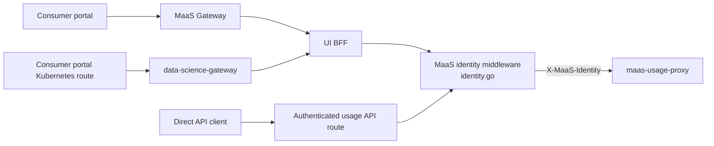

# Open Data Hub - MaaS Usage Dashboard Authentication, Authorization, and Data Scoping

|                |            |
| -------------- | ---------- |
| Date           | 2026-11-14 |
| Scope          | model-serving, MaaS consumer portal, usage dashboard |
| Status         | Draft |
| Authors        | Lindani Phiri, Kevin Howell |
| Depends on     | [ADR-0007](ODH-ADR-MS-0007-ai-grid-shared-oidc-identity-contract.md) |
| Amends         | ADR-0007 organization claim scope, pending approval |
| Superseded by: | N/A |
| Tickets        | RHAI-10635, RHAI-8074 |
| Other docs:    | [ADR-0007](ODH-ADR-MS-0007-ai-grid-shared-oidc-identity-contract.md), [ADR-0008](ODH-ADR-MS-0008-maas-consumer-portal-oidc-gateway-layout.md) |

## What

Shared MaaS identity middleware validates OIDC and Kubernetes credentials and creates a common `X-MaaS-Identity` representation.
The middleware in `identity.go` makes this identity reusable across MaaS handlers and forwards it to `maas-usage-proxy`.
The usage proxy enforces usage boundaries for both identity sources and reviews Kubernetes tenant permissions.

Kubernetes-authenticated `AITenant` admins see tenant-wide usage, OIDC organization admins see organization-wide usage, and ordinary users see personal usage.
The release supports the consumer portal through an OIDC route and a separate Kubernetes route.
An `AITenant` is MaaS's top-level access boundary.

## Why

OIDC and Kubernetes identities supply different information.
An OIDC token can supply organization membership through the ADR-0007 token shape.
An organization requirement must not block Kubernetes users or OIDC users without that shape.
The Kubernetes route lets existing Kubernetes users access the consumer portal without onboarding them to an external OIDC identity provider.
Legacy standard-RHOAI OIDC configurations that provide only username and groups, without `org_id`, remain supported.

Usage records need consistent ownership across producers and queries.
OIDC ownership uses issuer and subject, while this release uses username-based Kubernetes ownership with the limitations below.
Readable names make historical records understandable after resources disappear.
Both browser entry points and direct APIs need the same access boundaries.

Shared middleware gives MaaS handlers one authenticated identity representation for OIDC and Kubernetes callers.
The usage proxy applies the same authorization rules across browser routes and direct APIs.

## Goals

- Support the agreed deployment and authentication combinations from the first release.
- Enforce `AITenant`, organization, and personal boundaries on the server.
- Keep Kubernetes tenant permission reviews in `maas-usage-proxy`.
- Validate OIDC and Kubernetes tokens in shared MaaS identity middleware.
- Reuse one `X-MaaS-Identity` representation across MaaS handlers and the usage proxy.
- Include a Kubernetes-authenticated `AITenant` Admin view in the MaaS dashboard.
- Capture immutable IDs for `AITenant` resources, organizations, and OIDC users, with readable names for every identity source.
- Use tenant-scoped Kubernetes usernames for this release and document the next-release UID gap.
- Preserve inference availability and usage records when identity metadata is incomplete.

## Non-Goals

- Require organization claims in every standard RHOAI OIDC identity.
- Create Kubernetes identities for AI Grid organization users.
- Change model or subscription eligibility, implement metering, or calculate quota from usage logs.
- Define Provider Admin dashboards or replace existing OpenShift and ACM access.
- Add ID and name requirements for subscriptions, models, API keys, or sites.
- Require historical migration, multiple organization memberships, or portals for non-default `AITenant` resources in the first release.
- Implement immutable Kubernetes user ownership in this release.
- Implement Kubernetes organization scope in this release.
- Choose dashboard technology, storage layout, or query-language implementation.

## How

### Deployment modes and browser entry points

Trusted deployment configuration selects AI Grid or standard RHOAI.
Token claims do not select the deployment mode.
Standard RHOAI activates organization permissions only when an OIDC token presents the complete ADR-0007 organization shape.
It does not create an artificial organization for identities without that shape.

| Deployment | Authentication | Available scopes |
| --- | --- | --- |
| AI Grid organization access | OIDC | Organization and user |
| AI Grid organization access | OpenShift/Kubernetes | Tenant and user |
| Standard RHOAI | OIDC with ADR-0007 organization shape | Organization and user |
| Standard RHOAI | OIDC without organization shape | User |
| Standard RHOAI | OpenShift/Kubernetes | Tenant and user |

#### Consumer portal OIDC route

The consumer portal follows ADR-0008 and uses the tenant's MaaS `Gateway` and configured authentication mode.
The initial portal serves only the default `AITenant`.
The authorization model applies to any `AITenant`, and AI Grid initially permits one organization per user.

#### Consumer portal Kubernetes route

The consumer portal can also mount on a completely separate `HTTPRoute` with Kubernetes authentication only.
This separate route can serve AI Grid or standard RHOAI.
Its behavior is the same in both deployments: it provides `AITenant` and personal boundaries only.
That route can attach to a separate `Gateway`, including the existing RHOAI Dashboard `Gateway`.
It does not require the portal's OIDC route or its OIDC session.
The route lets existing Kubernetes users use the consumer portal without onboarding them to an external OIDC identity provider.

The Kubernetes route reuses existing gateway authentication and token forwarding.
The MaaS identity middleware authenticates the forwarded credential through `TokenReview`, which asks Kubernetes to authenticate a token.
It creates `X-MaaS-Identity` from the authenticated result for the usage proxy.
The proxy applies the same tenant and personal boundaries in both deployments.
Kubernetes groups do not establish AI Grid organization membership.

The middleware always uses Kubernetes `TokenReview` for this route, even when the portal for the same `AITenant` uses OIDC.
Trusted route configuration names the cluster that performs `TokenReview` and the `AITenant` whose data the route serves.
The route does not accept the portal's OIDC session cookie or ID token.

Each route binds requests to one `AITenant` through operator-controlled configuration.
The usage proxy resolves that `AITenant`'s immutable identity, authentication policy, and actual tenant namespace.
It rejects conflicting tenant context and ignores client-supplied tenant headers.

The UI BFF is the UI's backend service.
Both browser routes use this service to forward usage requests through the shared MaaS identity middleware to the usage proxy.

Both browser routes share the UI BFF, MaaS identity middleware, and usage proxy.
The proxy applies the same ownership and scope semantics after authentication.
The separate UI mount is an additional entry point, not a replacement for the portal layout in ADR-0008.
Existing Provider Admin routes remain outside this request path.

### Roles and current authority

The gateway authenticates browser requests, applies route-level access control, and forwards the credential.
The shared MaaS middleware validates the credential and constructs one normalized identity.
The `maas-usage-proxy` owns fine-grained usage authorization and record-level tenant filtering for both OIDC and Kubernetes requests.

Kubernetes RBAC assigns permissions through `RoleBinding` resources.
`AITenant` administration reuses the existing MaaS capability: `create` on `maasauthpolicies` in API group `maas.opendatahub.io`.
The permission review uses the selected `AITenant`'s actual tenant namespace, rather than one global namespace.

A `SubjectAccessReview` evaluates a named subject's permissions.
The proxy submits the caller's verified Kubernetes username and groups through its authorized review service identity.
It never substitutes its own `ServiceAccount` as the subject whose tenant permissions determine caller access.
The production authorization path does not use `SelfSubjectAccessReview`.

One shared helper decides whether a caller can access a tenant.
For example, the helper can expose `hasAccessToTenant(context, tenantId)`.
The helper hides the `SubjectAccessReview` details for Kubernetes.
Usage handlers do not branch on the authentication source.

#### Shared MaaS identity middleware

The shared middleware in `identity.go` validates the incoming token before it constructs identity.
OIDC validation covers the configured issuer, signature, audience, and expiry.
Kubernetes validation uses `TokenReview` against the configured cluster and audience.
Trusted route configuration selects the authentication method and binds the request to an `AITenant`.
Client-supplied values cannot select the authentication method or change the tenant.
Each route enables exactly one authentication method.
The middleware processes only that method's credential or identity fields.
The gateway removes identity fields that belong to the other authentication method.
The middleware rejects any request that still contains identity fields for both methods.

The middleware converts both token types into one common `X-MaaS-Identity` representation.
It carries the authentication source, caller identity, verified groups, and applicable organization membership and roles.
OIDC identity follows ADR-0007's issuer, subject, and organization semantics.
The middleware makes this identity available to MaaS handlers and forwards it to the usage proxy.
The detailed payload fields and serialization remain implementation choices within this common contract.

The middleware removes supplied copies of `X-MaaS-Identity` and constructs a new value only after successful token validation.
The usage proxy accepts that value only through the trusted middleware path and makes sure that its structure and source are valid.
It uses the authenticated identity without repeating token validation and performs its own authorization decisions.
Other MaaS handlers can reuse the same middleware and identity representation while retaining their own permission rules.
This ADR amends ADR-0007's organization claim scope for usage authorization.

#### Kubernetes tenant permission review

For Kubernetes callers, the proxy determines tenant administration through a `SubjectAccessReview` for the route-selected `AITenant`.
An allowed review establishes tenant administration, while a denied review grants no tenant-admin authority.
OIDC callers never use `SubjectAccessReview` and never receive tenant scope.
Their personal access still follows the valid canonical identity and applicable membership rules.

The proxy requests a review only when a Kubernetes caller requests tenant scope.
Personal scope never requests a review.

This ADR keeps tenant permission review in the usage proxy for this release.
The existing data-science-gateway uses custom Envoy filters.
Attaching Kuadrant authorization policies to that gateway needs a separate design for filter ordering.

An allowed review establishes `AITenant` administration only.
It grants no AI Grid organization membership or role.
The review uses the verified Kubernetes username and groups, without a user UID.
Tenant authority applies only to the route-selected tenant and stays separate from verified OIDC organization roles.
The proxy uses the permission review result to authorize usage access.

An authenticated non-admin retains personal access after a completed, denied tenant-admin review.
If a required review fails or returns a malformed result, the proxy returns HTTP 503 without a scope fallback.
A missing, malformed, or incomplete result fails that review.

#### Usage roles

OIDC organization administration requires the verified `admins` role for the requested organization.
It grants visibility across that organization, including subscriptions that the administrator does not personally administer.
An organization role never grants `AITenant` administration or expands inference eligibility.

| Persona | Usage visibility | Authority |
| --- | --- | --- |
| `AITenant` Admin | All usage within the selected `AITenant` | Kubernetes authentication and tenant RBAC capability reviewed by `maas-usage-proxy` |
| Organization Admin | All usage within one verified organization | Current organization membership and `admins` role |
| User | Personal usage within the available boundary | Valid tenant authentication; OIDC callers with an organization additionally require current organization membership |

In standard RHOAI, ordinary users need no separate MaaS membership assignment after they pass the `AITenant` authentication policy.
If a standard RHOAI OIDC token presents the ADR-0007 organization shape, organization authority follows that verified shape.
Kubernetes `ServiceAccount` identities use the same personal scope and require explicit tenant RBAC permissions for tenant-wide access.
`AITenant` Admin and Provider Admin remain distinct roles with separate interfaces.

This decision amends ADR-0007's organization claim scope and replaces its subscription-limited observability visibility for this dashboard after approval.
ADR-0007 continues to govern its other organization administration and inference permissions.
The usage proxy does not infer organization administration from a group name.

### Kubernetes request processing

The Kubernetes path retains the existing gateway's browser authentication and token forwarding.
The shared MaaS middleware authenticates the forwarded token and creates `X-MaaS-Identity` for downstream handlers.
The usage proxy consumes that identity and applies the same personal boundary as the OIDC path.
Tenant scope is available only on this Kubernetes path.

The request follows these steps:

1. The gateway and UI BFF forward the Kubernetes credential to the MaaS identity middleware through the trusted path.
2. The middleware performs `TokenReview` and creates the common identity from the authenticated username and groups.
3. The middleware forwards `X-MaaS-Identity` to the usage proxy, which performs `SubjectAccessReview` when tenant scope is requested.

The review tests `create` on `maasauthpolicies` in API group `maas.opendatahub.io`, using the selected `AITenant`'s actual namespace.
An allowed review permits tenant scope, while a denied review returns HTTP 403 for that scope.
Personal scope uses the authenticated identity without a tenant-admin review.
Review errors return HTTP 503 without a scope fallback.
The middleware includes `system:authenticated` exactly once with the verified Kubernetes groups.

The middleware's service identity needs permission to create `TokenReview` resources.
The usage proxy's service identity needs permission to create `SubjectAccessReview` resources.
Both components require trusted tenant configuration and the Kubernetes API trust bundle for their respective reviews.
The usage proxy receives the common identity rather than the raw Kubernetes token.

This path grants no organization scope in this release.
Kubernetes organization scope is planned for a future release and will require a trusted organization mapping.
This path changes no legacy management or inference interface.
The existing organization-only `/v1/logs/*` authorization still needs adaptation before it can serve this path.

### User identity and readable names

Usage queries must use the same tenant, organization, and user identities as the producers that record usage.
Producer and query paths must agree on ownership and readable names.
Readable names support display and never grant access.

Kubernetes username changes, reuse, and collisions can affect usage ownership.
These existing identity constraints apply to both producer and query paths.

### Producer attribution and incomplete records

Producers record trusted tenant, user, and applicable organization identities, with readable names, when usage occurs.
Historical records retain that attribution.
For API-key inference, attribution follows the stored key owner and verified subscription selection.
Client-supplied identity and the dashboard viewer never determine event ownership.

If attribution is incomplete, inference continues while producers preserve available usage and report missing information.
Views include only records with authoritative ownership for their scope.
Missing readable names do not change access when ownership is established.
Older records follow the same rule, and the first release requires no historical backfill.

### Usage authorization boundaries

The usage proxy derives the selected `AITenant` from trusted route configuration and rejects conflicting client-supplied tenant context.
It applies caller permissions before it retrieves usage data.
Backend services authenticate the proxy through a dedicated read identity, while producers use a separate write identity.
These service credentials never grant callers access beyond their authorized usage boundary.

Every request names `usage_scope=user`, `usage_scope=organization`, or `usage_scope=tenant`.
`usage_scope` is a supported API request parameter.
It is not a backend query label, and the identity middleware does not use it for authentication.
The proxy validates the parameter after the middleware authenticates the caller.
It expresses intent and never grants permission.
An unavailable scope returns HTTP 403 instead of silently broadening or downgrading the request.

| Deployment and scope | Authentication type | Authorization level | Required authority | Enforced ownership |
| --- | --- | --- | --- | --- |
| Standard RHOAI, `user` | OIDC without organization shape | User | Valid tenant authentication | `AITenant` and caller user ID |
| Standard RHOAI, `user` | Kubernetes | User | Valid tenant authentication | `AITenant` and caller user ID |
| Standard RHOAI, `user` | OIDC with ADR-0007 organization shape | User | Current member of the requested organization | `AITenant`, organization, and caller user ID |
| Standard RHOAI, `organization` | OIDC with ADR-0007 organization shape | Organization Admin | Verified `admins` role | `AITenant` and organization ID |
| Standard RHOAI, `tenant` | Kubernetes | `AITenant` Admin | Tenant-admin review | `AITenant` ID |
| AI Grid, `user` | OIDC | User | Current member of the requested organization | `AITenant`, organization, and caller user ID |
| AI Grid, `user` | Kubernetes | User | Valid tenant authentication | `AITenant` and caller user ID |
| AI Grid, `organization` | OIDC | Organization Admin | Verified `admins` role | `AITenant` and organization ID |
| AI Grid, `tenant` | Kubernetes | `AITenant` Admin | Tenant-admin review | `AITenant` ID |

Standard RHOAI grants organization scope only through the complete ADR-0007 OIDC shape.
An incomplete organization claim grants no organization visibility.

The proxy restricts all records used by a query to the authorized boundary before aggregation or other user-controlled processing.
It rejects requests whose ownership restrictions conflict with that boundary or cannot be enforced.
The choice of query language and storage filtering mechanism remains an implementation decision.

An administrator can narrow an authorized view by one exact user ID or organization ID within that boundary.
The proxy resolves readable-name searches only against authorized records.
The selected name or filter never grants additional access.

The same boundary covers usage records, summaries, user lists, metadata, and error responses.
The proxy derives metadata only from authorized records or denies the operation.
No response can reveal records outside the caller's current scope.

Only approved read-only paths and methods are available.
The proxy does not expose ingestion, deletion, arbitrary upstream URLs, or query statistics that reveal other callers' data.
It sanitizes backend errors without changing the authorized scope.

### Trusted identity forwarding

Both UI routes forward usage requests through their authenticated `HTTPRoute` and the shared UI BFF to MaaS identity middleware.
The middleware validates the credential and forwards `X-MaaS-Identity` to the usage proxy through a protected internal path.
The proxy rejects requests that bypass this path or contain conflicting identity or tenant context.
The identity header never grants access independently of the trusted forwarding path.

OIDC usage ownership derives from the authenticated issuer and subject.
Kubernetes usage ownership derives from the username returned by the middleware's `TokenReview`.
For Kubernetes callers, the proxy reviews tenant permissions and enforces the requested usage boundary.
For OIDC callers, the proxy enforces the requested personal or organization boundary without a tenant review.
Caller-supplied identity and role assertions never grant usage authority.

Direct API clients present accepted OIDC or Kubernetes credentials to the designated usage API route.
Those requests pass through the same MaaS identity middleware before reaching the usage proxy.
Direct requests follow the same identity, tenant binding, and authorization rules as browser requests.
The usage API rejects inference API keys as usage credentials.

## Alternatives

| Alternative | Tradeoff and decision |
| --- | --- |
| Require an organization in every deployment | Reject. It blocks supported standard RHOAI identities and creates an unnecessary mapping system. |
| Use separate authorization rules for each UI route | Reject. Authentication differs, but ownership and role semantics must remain consistent. |
| Perform Kubernetes tenant reviews in the usage proxy | Selected. The usage proxy owns these reviews. Revisiting their placement in the future requires a new ADR. |
| Infer tenant administration from the dashboard `Route` permission | Reject. That permission does not establish administration of the selected `AITenant`. |
| Authorize a query without constraining its inputs | Reject. Missing user filters and nested selectors can expose broader data before aggregation. |
| Let the dashboard access usage storage without the usage proxy | Reject. Backend service credentials do not enforce caller-level ownership. |
| Use inference API keys for usage queries | Reject. Key possession does not establish current dashboard permissions or membership. |

## Security and Privacy Considerations

The usage proxy is the business authorization boundary for both UI mounts and direct APIs.
Each public route binds the caller to a trusted tenant.
OIDC routes authenticate the credential at the gateway and deliver identity through trusted internal paths.
Shared MaaS middleware validates OIDC and Kubernetes tokens before the usage proxy receives their normalized identity.
The proxy accepts `X-MaaS-Identity` only from that middleware through a trusted internal path.
Internal service credentials grant backend access without granting callers access to every record.

Tenant and organization authority remain distinct.
Tenant scope is available only to Kubernetes callers in this release.
Organization scope is available only to OIDC callers with the verified organization shape in this release.
The standard RHOAI mode activates organization access only through the complete ADR-0007 OIDC shape.
AI Grid organization onboarding creates no Kubernetes identities or per-user `RoleBinding` resources.

Display names describe records and never authorize access.
The verified Kubernetes username supplies ownership identity for this release.
The ID derivation separates authentication sources.
OIDC retains issuer-and-subject ownership, while Kubernetes username reuse remains the documented next-release gap.
The normalizer preserves event ownership and accepts legacy associations only when their provenance is authoritative.

Names and user activity require the existing retention and data-access controls.
Tokens, session cookies, and internal authentication headers must not appear in usage records, logs, or browser responses.
Internal service destinations and identity forwarding require operator-controlled configuration to preserve the trusted path.

## Risks

| Risk | Mitigation |
| --- | --- |
| A separate UI route bypasses authorization | Require route-specific authentication and the shared usage proxy on every path. |
| Token claims activate an unintended deployment mode | Resolve mode and tenant from trusted deployment configuration. |
| A Kubernetes username changes or is reused after deletion | This release splits history on rename and can expose prior usage after reuse. Add UID-based ownership in the next release. |
| Distinct active accounts share a username | Enforce unique usernames within each `AITenant` across accepted authentication sources and clusters. |
| Producer and query identities use different ownership inputs | Align key-owner metadata, producers, and queries with the agreed identity contract before enabling personal views. |
| A query aggregates unauthorized records | Constrain every selector before user-controlled stages and reject unsupported forms. |
| Metadata or statistics expose other users | Derive responses from scoped records or deny the endpoint. |
| Claim layouts differ between approved ADRs and current code | Align the common identity adapter and contract-test both producers and readers before rollout. |

## Stakeholder Impacts

| Group | Key Contacts | Date | Impacted? |
| --- | --- | --- | --- |
| Model-as-a-Service | Marius Danciu | 2026-11-14 | Yes |
| Dashboard | Andrew Ballantyne | 2026-11-14 | Yes |
| Observability | Kevin Howell, Arik Hadas | 2026-11-14 | Yes |
| AI Grid | RHAISTRAT-2875 owners | 2026-11-14 | Yes |

- MaaS owns identity normalization, API-key owner metadata, producers, and OIDC and Kubernetes tenant reviews in the usage proxy.
- Shared MaaS identity middleware owns token validation and the reusable `X-MaaS-Identity` representation.
- Dashboard owns the portal integration, separate Kubernetes UI mount, and views for all three access levels.
- Observability owns backend service identities, usage access isolation, and retention.
- AI Grid owns organization identity, membership freshness, and consistent attribution across serving sites.

## References

- [ADR-0007: shared OIDC identity contract](ODH-ADR-MS-0007-ai-grid-shared-oidc-identity-contract.md)
- [ADR-0008: consumer portal gateway layout](ODH-ADR-MS-0008-maas-consumer-portal-oidc-gateway-layout.md)
- [RHAI-10635](https://redhat.atlassian.net/browse/RHAI-10635)
- [RHAI-8074](https://redhat.atlassian.net/browse/RHAI-8074?focusedCommentId=19101141)
- [RHAISTRAT-2883](https://redhat.atlassian.net/browse/RHAISTRAT-2883)
- [Kubernetes `TokenReview` types](https://github.com/kubernetes/api/blob/master/authentication/v1/types.go)

## Reviews

| Reviewed by | Date | Notes |
| --- | --- | --- |
| | | |
