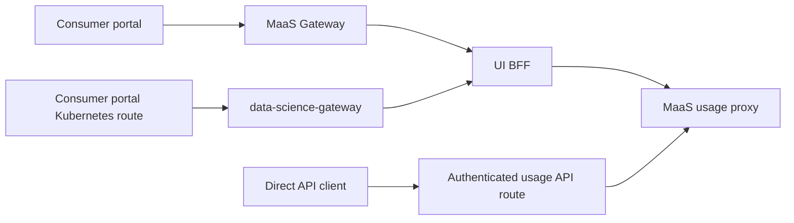

# Open Data Hub - MaaS Usage Dashboard Authentication, Authorization, and Data Scoping

|                |            |
| -------------- | ---------- |
| Date           | 2026-11-14 |
| Scope          | model-serving, MaaS consumer portal, usage dashboard |
| Status         | Draft |
| Authors        | Lindani Phiri, Kevin Howell |
| Supersedes     | ADR-0007 usage visibility restriction only, pending approval |
| Superseded by: | N/A |
| Tickets        | RHAI-10635, RHAI-8074 |
| Other docs:    | [ADR-0007](ODH-ADR-MS-0007-ai-grid-shared-oidc-identity-contract.md), [ADR-0008](ODH-ADR-MS-0008-maas-consumer-portal-oidc-gateway-layout.md) |

## What

The gateway authenticates OIDC and Kubernetes credentials for the MaaS usage dashboard.
OIDC usage requests use authenticated identity that follows ADR-0007's identity and organization semantics.
The MaaS usage proxy (`maas-usage-proxy`) reviews tenant permissions for both OIDC and Kubernetes usage requests.
For Kubernetes usage requests, it also authenticates the forwarded token.

`AITenant` admins see tenant-wide usage, AI Grid organization admins see organization-wide usage through the OIDC route, and ordinary users see personal usage.
The release supports the consumer portal through an OIDC route and a separate Kubernetes route.
An `AITenant` is MaaS's top-level access boundary.

## Why

OIDC and Kubernetes identities supply different information.
AI Grid supplies organization membership through OIDC, while standard RHOAI requires no organization.
An organization requirement must not block Kubernetes users or standard RHOAI OIDC users.
The Kubernetes route lets existing Kubernetes users access the consumer portal without onboarding them to an external OIDC identity provider.
Legacy standard-RHOAI OIDC configurations that provide only username and groups, without `org_id`, remain supported.

Usage records need consistent ownership across producers and queries.
OIDC ownership uses issuer and subject, while this release uses username-based Kubernetes ownership with the limitations below.
Readable names make historical records understandable after resources disappear.
Both browser entry points and direct APIs need the same access boundaries.

The usage proxy applies the same tenant permission rules to OIDC and Kubernetes requests.
This keeps authorization consistent across browser routes and direct APIs.

## Goals

- Support the agreed deployment and authentication combinations from the first release.
- Enforce `AITenant`, organization, and personal boundaries on the server.
- Keep tenant permission reviews for OIDC and Kubernetes in `maas-usage-proxy` by default.
- Authenticate forwarded Kubernetes tokens through the proxy's own `TokenReview`.
- Include an `AITenant` Admin view in the MaaS dashboard.
- Capture immutable IDs for `AITenant` resources, organizations, and OIDC users, with readable names for every identity source.
- Use tenant-scoped Kubernetes usernames for this release and document the next-release UID gap.
- Preserve inference availability and usage records when identity metadata is incomplete.

## Non-Goals

- Add organization support to standard RHOAI, including identities that contain organization claims.
- Create Kubernetes identities for AI Grid organization users.
- Change model or subscription eligibility, implement metering, or calculate quota from usage logs.
- Define Provider Admin dashboards or replace existing OpenShift and ACM access.
- Add ID and name requirements for subscriptions, models, API keys, or sites.
- Require historical migration, multiple organization memberships, or portals for non-default `AITenant` resources in the first release.
- Implement immutable Kubernetes user ownership in this release.
- Choose dashboard technology, storage layout, or query-language implementation.

## How

### Deployment modes and browser entry points

Trusted deployment configuration selects AI Grid or standard RHOAI.
Token claims do not select the deployment mode.
Standard RHOAI does not create an artificial organization or activate organization permissions when an OIDC token contains an organization claim.

| Deployment | Authentication | Available boundaries |
| --- | --- | --- |
| AI Grid organization access | OIDC | `AITenant`, organization, and user |
| AI Grid organization access | OpenShift/Kubernetes | `AITenant` and user |
| Standard RHOAI | OIDC | `AITenant` and user |
| Standard RHOAI | OpenShift/Kubernetes | `AITenant` and user |

#### Consumer portal OIDC route

The consumer portal follows ADR-0008 and uses the tenant's MaaS `Gateway` and configured authentication mode.
The initial portal serves only the default `AITenant`.
The authorization model applies to any `AITenant`, and AI Grid initially permits one organization per user.

#### Consumer portal Kubernetes route

The consumer portal can also mount on a completely separate `HTTPRoute` with Kubernetes authentication only.
This separate route can serve AI Grid or standard RHOAI.
Its behavior is the same in both deployments: it provides `AITenant` and personal boundaries only.
That route can attach to a separate `Gateway`, including the existing RHOAI Dashboard `Gateway`.
It does not require the portal's OIDC route or its OIDC session.
The route lets existing Kubernetes users use the consumer portal without onboarding them to an external OIDC identity provider.

The Kubernetes route reuses existing gateway authentication and token forwarding.
The usage proxy authenticates the forwarded credential through `TokenReview`, which asks Kubernetes to authenticate a token.
The proxy uses existing OpenShift/Kubernetes identities and the same tenant and personal boundaries in both deployments.
It does not map Kubernetes groups to AI Grid organizations.

The proxy always uses Kubernetes `TokenReview` for this route, even when the portal for the same `AITenant` uses OIDC.
Trusted route configuration names the cluster that performs `TokenReview` and the `AITenant` whose data the route serves.
The route does not accept the portal's OIDC session cookie or ID token.

Each route binds requests to one `AITenant` through operator-controlled configuration.
The usage proxy resolves that `AITenant`'s immutable identity, authentication policy, and actual tenant namespace.
It rejects conflicting tenant context and ignores client-supplied tenant headers.

The UI BFF is the UI's backend service.
Both browser routes use this service to forward authenticated usage requests to the shared usage proxy.

Both browser routes share the UI BFF and usage proxy.
The proxy applies the same ownership and scope semantics after authentication.
The separate UI mount is an additional entry point, not a replacement for the portal layout in ADR-0008.
Existing Provider Admin routes remain outside this request path.

### Roles and current authority

The `maas-usage-proxy` owns tenant permission reviews for both OIDC and Kubernetes usage requests by default.
It also owns Kubernetes token reviews.
The gateway continues to authenticate OIDC callers and forward their trusted identity.

Kubernetes RBAC assigns permissions through `RoleBinding` resources.
`AITenant` administration reuses the existing MaaS capability: `create` on `maasauthpolicies` in API group `maas.opendatahub.io`.
The permission review uses the selected `AITenant`'s actual tenant namespace, rather than one global namespace.

A `SubjectAccessReview` evaluates a named subject's permissions.
The proxy submits the caller's verified Kubernetes username and groups, or trusted OIDC RBAC mapping, through its authorized review service identity.
It never substitutes its own `ServiceAccount` as the subject whose tenant permissions determine caller access.
The production authorization path does not use `SelfSubjectAccessReview`.

#### Authenticated identity and trust

OIDC identity follows ADR-0007's issuer, subject, and organization semantics.
The gateway authenticates the caller, and the usage proxy receives identity information through a trusted internal path.
That information must establish the caller's identity, authentication source, and applicable organization membership and roles.
The proxy rejects identity information whose authenticity or origin it cannot establish.

Trusted route configuration selects the authentication method and binds the request to an `AITenant`.
Client-supplied values cannot select the authentication method, change the tenant, or grant administrative authority.
The gateway and internal intermediaries must prevent callers from substituting trusted identity information.
The proxy makes its own tenant permission decision for either identity source.

The identity transport format, header names, and serialization are implementation choices.
This ADR requires no new shared identity format or changes to ADR-0007.
Existing management and inference interfaces retain their contracts.

OIDC permission reviews require an issuer-aware mapping into Kubernetes RBAC.
The canonical OIDC user ID provides a source-qualified subject, while operator-controlled mappings can authorize existing RBAC aliases and groups.
Raw display names, subjects, or groups never imply membership in a same-name Kubernetes identity.
This mapping creates no Kubernetes `User` or `Group` objects for AI Grid members.

#### Tenant permission review

For both OIDC and Kubernetes, the proxy determines tenant administration through a `SubjectAccessReview` for the route-selected `AITenant`.
An allowed review establishes tenant administration, while a denied review grants no tenant-admin authority.
An OIDC identity without a trusted RBAC mapping receives no tenant-admin authority and requires no review.
Personal access still follows the valid canonical identity and the applicable membership rules.

An allowed review establishes `AITenant` administration only.
It grants no AI Grid organization membership or role.
The review uses the mapped OIDC username and groups or the verified Kubernetes username and groups, without a user UID.
Tenant authority applies only to the route-selected tenant and stays separate from verified OIDC organization roles.
The proxy uses the permission review result to authorize usage access.

An authenticated non-admin retains personal access after a completed, denied tenant-admin review.
If a required review fails or returns a malformed result, the proxy returns HTTP 503 without a scope fallback.
A missing, malformed, or incomplete result fails that review.

#### Usage roles

AI Grid organization administration requires the verified `admins` role for the requested organization.
It grants visibility across that organization, including subscriptions that the administrator does not personally administer.
An organization role never grants `AITenant` administration or expands inference eligibility.

| Persona | Usage visibility | Authority |
| --- | --- | --- |
| `AITenant` Admin | All usage within the selected `AITenant` | Tenant RBAC capability reviewed by `maas-usage-proxy` for either identity source |
| Organization Admin | All usage within one AI Grid organization | Current organization membership and `admins` role |
| User | Personal usage within the authorized boundaries | Valid tenant authentication and, in AI Grid, current organization membership |

In standard RHOAI, ordinary users need no separate MaaS membership assignment after they pass the `AITenant` authentication policy.
Kubernetes `ServiceAccount` identities use the same personal scope and require explicit tenant RBAC permissions for tenant-wide access.
`AITenant` Admin and Provider Admin remain distinct roles with separate interfaces.

This decision replaces only ADR-0007's subscription-limited observability visibility after approval.
ADR-0007 continues to govern its other organization administration and inference permissions.
The usage proxy does not infer organization administration from a group name.

### Default Kubernetes implementation

The default Kubernetes path retains the existing gateway's authentication and token forwarding.
The usage proxy performs tenant authorization for that Kubernetes usage route, including browser requests and direct usage API requests.
This keeps usage authorization and its Kubernetes review permissions in one service.
OIDC usage routes retain their gateway authentication, with tenant permission reviews in the same usage proxy.

The request follows these steps:

1. The gateway authenticates the caller and forwards the Kubernetes credential through the existing trusted path.
2. The proxy repeats `TokenReview` against the configured cluster and audience to obtain the verified username and groups.
3. For tenant scope, the proxy submits a named `SubjectAccessReview` through its own authorized service identity.

The review tests `create` on `maasauthpolicies` in API group `maas.opendatahub.io`, using the selected `AITenant`'s actual namespace.
An allowed review permits tenant scope, while a denied review returns HTTP 403 for that scope.
Personal scope uses the verified caller identity without a tenant-admin review.
Review errors return HTTP 503 without a scope fallback.
The proxy derives `system:authenticated` from successful authentication and includes it exactly once with the other verified groups.

Trusted route configuration selects this token-based mode before the proxy processes a request.
It binds the cluster, audience, and `AITenant`, and restricts entry to the intended internal path.
Client-supplied identity cannot select the authentication method or grant authority.
Invalid identity input never triggers a switch to another authentication method.
The proxy derives Kubernetes identity from the forwarded credential.

The proxy's `ServiceAccount` needs permission to create `TokenReview` and `SubjectAccessReview` resources.
It also needs the Kubernetes API trust bundle and trusted tenant configuration.
The UI BFF and any internal intermediaries preserve the forwarded credential over protected internal hops.

The proxy retains the same tenant binding, username-based Kubernetes ownership, and query restrictions.
This mode grants no AI Grid organization scope and changes no legacy management or inference interface.
The existing organization-only `/v1/logs/*` authorization still needs adaptation before it can serve this route.

### User identity and readable names

Usage queries must use the same tenant, organization, and user identities as the producers that record usage.
Producer and query paths must agree on ownership and readable names.
Readable names support display and never grant access.

Kubernetes username changes, reuse, and collisions can affect usage ownership.
These existing identity constraints apply to both producer and query paths.

### Producer attribution and incomplete records

Producers record trusted tenant, user, and applicable organization identities, with readable names, when usage occurs.
Historical records retain that attribution.
For API-key inference, attribution follows the stored key owner and verified subscription selection.
Client-supplied identity and the dashboard viewer never determine event ownership.

If attribution is incomplete, inference continues while producers preserve available usage and report missing information.
Views include only records with authoritative ownership for their scope.
Missing readable names do not change access when ownership is established.
Older records follow the same rule, and the first release requires no historical backfill.

### Usage authorization boundaries

The usage proxy derives the selected `AITenant` from trusted route configuration and rejects conflicting client-supplied tenant context.
It applies caller permissions before it retrieves usage data.
Backend services authenticate the proxy through a dedicated read identity, while producers use a separate write identity.
These service credentials never grant callers access beyond their authorized usage boundary.

Every request names `usage_scope=user`, `usage_scope=organization`, or `usage_scope=tenant`.
This parameter expresses intent and never grants permission.
An unavailable scope returns HTTP 403 instead of silently broadening or downgrading the request.

| Deployment and scope | Required authority | Enforced ownership |
| --- | --- | --- |
| Standard RHOAI, `user` | Valid tenant authentication | `AITenant` and caller user ID |
| Standard RHOAI, `tenant` | `AITenant` Admin | `AITenant` ID |
| AI Grid, `user` | Current member of the requested organization | `AITenant`, organization, and caller user ID |
| AI Grid, `organization` | Organization Admin or `AITenant` Admin | `AITenant` and organization ID |
| AI Grid, `tenant` | `AITenant` Admin | `AITenant` ID |

The proxy restricts all records used by a query to the authorized boundary before aggregation or other user-controlled processing.
It rejects requests whose ownership restrictions conflict with that boundary or cannot be enforced.
The choice of query language and storage filtering mechanism remains an implementation decision.

An administrator can narrow an authorized view by one exact user ID or organization ID within that boundary.
The proxy resolves readable-name searches only against authorized records.
The selected name or filter never grants additional access.

The same boundary covers usage records, summaries, user lists, metadata, and error responses.
The proxy derives metadata only from authorized records or denies the operation.
No response can reveal records outside the caller's current scope.

Only approved read-only paths and methods are available.
The proxy does not expose ingestion, deletion, arbitrary upstream URLs, or query statistics that reveal other callers' data.
It sanitizes backend errors without changing the authorized scope.

### Trusted identity forwarding

Both UI routes forward usage requests through their authenticated `HTTPRoute` and the shared UI BFF.
Internal services preserve authenticated identity and trusted tenant context until the request reaches the usage proxy.
The implementation must protect that information across every internal hop.
The proxy rejects requests that bypass the trusted path or contain conflicting identity or tenant context.

OIDC usage ownership derives from the authenticated issuer and subject.
Kubernetes usage ownership derives from the username returned by the proxy's own `TokenReview`.
For both identity sources, the proxy reviews tenant permissions and enforces the requested usage boundary.
Caller-supplied identity and role assertions never grant usage authority.

Direct API clients present accepted OIDC or Kubernetes credentials to the designated usage API route.
Direct requests follow the same identity, tenant binding, and authorization rules as browser requests.
The usage API rejects inference API keys as usage credentials.

## Alternatives

| Alternative | Tradeoff and decision |
| --- | --- |
| Require an organization in every deployment | Reject. It blocks supported standard RHOAI identities and creates an unnecessary mapping system. |
| Use separate authorization rules for each UI route | Reject. Authentication differs, but ownership and role semantics must remain consistent. |
| Perform OIDC and Kubernetes tenant reviews in the usage proxy | Selected. The usage proxy owns these reviews. Revisiting their placement in the future requires a new ADR. |
| Infer tenant administration from the dashboard `Route` permission | Reject. That permission does not establish administration of the selected `AITenant`. |
| Authorize a query without constraining its inputs | Reject. Missing user filters and nested selectors can expose broader data before aggregation. |
| Let the dashboard access usage storage without the usage proxy | Reject. Backend service credentials do not enforce caller-level ownership. |
| Use inference API keys for usage queries | Reject. Key possession does not establish current dashboard permissions or membership. |

## Security and Privacy Considerations

The usage proxy is the business authorization boundary for both UI mounts and direct APIs.
Each public route binds the caller to a trusted tenant.
OIDC routes authenticate the credential at the gateway and deliver identity through trusted internal paths.
Kubernetes usage routes require the proxy to authenticate the forwarded token before it authorizes access.
Internal service credentials grant backend access without granting callers access to every record.

Tenant and organization authority remain distinct.
The standard RHOAI mode does not activate organization access through OIDC claims.
AI Grid organization onboarding creates no Kubernetes identities or per-user `RoleBinding` resources.

Display names describe records and never authorize access.
The verified Kubernetes username supplies ownership identity for this release.
The ID derivation separates authentication sources.
OIDC retains issuer-and-subject ownership, while Kubernetes username reuse remains the documented next-release gap.
The normalizer preserves event ownership and accepts legacy associations only when their provenance is authoritative.

Names and user activity require the existing retention and data-access controls.
Tokens, session cookies, and internal authentication headers must not appear in usage records, logs, or browser responses.
Internal service destinations and identity forwarding require operator-controlled configuration to preserve the trusted path.

## Risks

| Risk | Mitigation |
| --- | --- |
| A separate UI route bypasses authorization | Require route-specific authentication and the shared usage proxy on every path. |
| Token claims activate an unintended deployment mode | Resolve mode and tenant from trusted deployment configuration. |
| A Kubernetes username changes or is reused after deletion | This release splits history on rename and can expose prior usage after reuse. Add UID-based ownership in the next release. |
| Distinct active accounts share a username | Enforce unique usernames within each `AITenant` across accepted authentication sources and clusters. |
| Producer and query identities use different ownership inputs | Align key-owner metadata, producers, and queries with the agreed identity contract before enabling personal views. |
| A query aggregates unauthorized records | Constrain every selector before user-controlled stages and reject unsupported forms. |
| Metadata or statistics expose other users | Derive responses from scoped records or deny the endpoint. |
| Claim layouts differ between approved ADRs and current code | Align the common identity adapter and contract-test both producers and readers before rollout. |

## Stakeholder Impacts

| Group | Key Contacts | Date | Impacted? |
| --- | --- | --- | --- |
| Model-as-a-Service | Marius Danciu | 2026-11-14 | Yes |
| Dashboard | Andrew Ballantyne | 2026-11-14 | Yes |
| Observability | Kevin Howell, Arik Hadas | 2026-11-14 | Yes |
| AI Grid | RHAISTRAT-2875 owners | 2026-11-14 | Yes |

- MaaS owns identity normalization, API-key owner metadata, producers, and OIDC and Kubernetes tenant reviews in the usage proxy.
- The usage proxy also owns Kubernetes token reviews.
- Dashboard owns the portal integration, separate Kubernetes UI mount, and views for all three access levels.
- Observability owns backend service identities, usage access isolation, and retention.
- AI Grid owns organization identity, membership freshness, and consistent attribution across serving sites.

## References

- [ADR-0007: shared OIDC identity contract](ODH-ADR-MS-0007-ai-grid-shared-oidc-identity-contract.md)
- [ADR-0008: consumer portal gateway layout](ODH-ADR-MS-0008-maas-consumer-portal-oidc-gateway-layout.md)
- [RHAI-10635](https://redhat.atlassian.net/browse/RHAI-10635)
- [RHAI-8074](https://redhat.atlassian.net/browse/RHAI-8074?focusedCommentId=19101141)
- [RHAISTRAT-2883](https://redhat.atlassian.net/browse/RHAISTRAT-2883)
- [Kubernetes `TokenReview` types](https://github.com/kubernetes/api/blob/master/authentication/v1/types.go)

## Reviews

| Reviewed by | Date | Notes |
| --- | --- | --- |
| | | |
