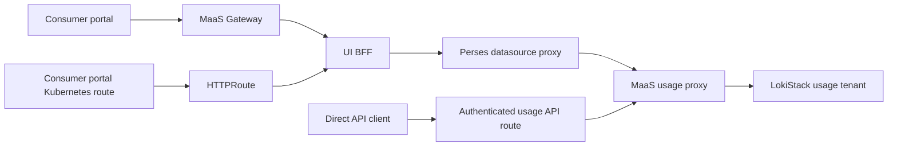

# Open Data Hub - MaaS Usage Dashboard Authentication, Authorization, and Data Scoping

|                |            |
| -------------- | ---------- |
| Date           | 2026-11-14 |
| Scope          | model-serving, MaaS consumer portal, usage dashboard |
| Status         | Draft |
| Authors        | Lindani Phiri |
| Supersedes     | ADR-0007 usage visibility restriction only, pending approval |
| Superseded by: | N/A |
| Tickets        | RHAI-10635, RHAI-8074 |
| Other docs:    | [Agreed requirements](ai-grid-auth-design.md), [ADR-0007](ODH-ADR-MS-0007-ai-grid-shared-oidc-identity-contract.md), [ADR-0008](ODH-ADR-MS-0008-maas-consumer-portal-oidc-gateway-layout.md) |

## What

The gateway authenticates OIDC and Kubernetes credentials for the MaaS usage dashboard.
The shared MaaS usage proxy authorizes requests through the trusted identity envelope defined in ADR-0007.
`AITenant` admins see tenant-wide usage, AI Grid organization admins see organization-wide usage through the OIDC route, and ordinary users see personal usage.
The release supports the consumer portal through an OIDC route and a separate Kubernetes route.
An `AITenant` is MaaS's top-level access boundary.

## Why

OIDC and Kubernetes identities supply different information.
AI Grid supplies organization membership through OIDC, while standard RHOAI requires no organization.
An organization requirement must not block Kubernetes users or standard RHOAI OIDC users.
The Kubernetes route lets existing Kubernetes users access the consumer portal without onboarding them to an external OIDC identity provider.
Legacy standard-RHOAI OIDC configurations that provide only username and groups, without `org_id`, remain supported.

Usage records need consistent ownership across producers and queries.
OIDC ownership uses issuer and subject, while this release uses username-based Kubernetes ownership with the limitations below.
Readable names make historical records understandable after resources disappear.
Both browser entry points and direct APIs need the same access boundaries.

## Goals

- Support the agreed deployment and authentication combinations from the first release.
- Enforce `AITenant`, organization, and personal boundaries on the server.
- Include an `AITenant` Admin view in the MaaS dashboard.
- Capture immutable IDs for `AITenant` resources, organizations, and OIDC users, with readable names for every identity source.
- Use tenant-scoped Kubernetes usernames for this release and document the next-release UID gap.
- Apply role and membership removal to new queries within five minutes.
- Preserve inference availability and usage records when identity metadata is incomplete.

## Non-Goals

- Add organization support to standard RHOAI, including identities that contain organization claims.
- Create Kubernetes identities for AI Grid organization users.
- Change model or subscription eligibility, implement metering, or calculate quota from usage logs.
- Define Provider Admin dashboards or replace existing OpenShift and ACM access.
- Add ID and name requirements for subscriptions, models, API keys, or sites.
- Require historical migration, multiple organization memberships, or portals for non-default `AITenant` resources in the first release.
- Implement immutable Kubernetes user ownership in this release.

## How

### Deployment modes and browser entry points

Trusted deployment configuration selects AI Grid or standard RHOAI.
Token claims do not select the deployment mode.
Standard RHOAI does not create an artificial organization or activate organization permissions when an OIDC token contains an organization claim.

| Deployment | Authentication | Available boundaries |
| --- | --- | --- |
| AI Grid organization access | OIDC | `AITenant`, organization, and user |
| AI Grid organization access | OpenShift/Kubernetes | `AITenant` and user |
| Standard RHOAI | OIDC | `AITenant` and user |
| Standard RHOAI | OpenShift/Kubernetes | `AITenant` and user |

#### Consumer portal OIDC route

The consumer portal follows ADR-0008 and uses the tenant's MaaS `Gateway` and configured authentication mode.
The initial portal serves only the default `AITenant`.
The authorization model applies to any `AITenant`, and AI Grid initially permits one organization per user.

#### Consumer portal Kubernetes route

The consumer portal can also mount on a completely separate `HTTPRoute` with Kubernetes authentication only.
This separate route can serve AI Grid or standard RHOAI.
Its behavior is the same in both deployments: it provides `AITenant` and personal boundaries only.
That route can attach to a separate `Gateway`, including the existing RHOAI Dashboard `Gateway`.
It does not require the portal's OIDC route or its OIDC session.
The route lets existing Kubernetes users use the consumer portal without onboarding them to an external OIDC identity provider.

The gateway authenticates the UI's Kubernetes credential through `TokenReview`, which asks Kubernetes to authenticate a token.
It uses existing OpenShift/Kubernetes identities and the same tenant and personal boundaries in both deployments.
It does not map Kubernetes groups to AI Grid organizations.

The route always uses Kubernetes `TokenReview`, even when the portal for the same `AITenant` uses OIDC.
Trusted route configuration names the cluster that performs `TokenReview` and the `AITenant` whose data the route serves.
The route does not accept the portal's OIDC session cookie or ID token.

Each route binds requests to one `AITenant` through operator-controlled configuration.
The usage proxy resolves that `AITenant`'s immutable identity, authentication policy, and actual tenant namespace.
It rejects conflicting tenant context and ignores client-supplied tenant headers.

The UI BFF is the UI's backend service.
Both browser routes use this service and can have separate datasource proxy prefixes.



Both browser routes share the UI BFF and usage proxy.
The proxy applies the same ownership and scope semantics after authentication.
The separate UI mount is an additional entry point, not a replacement for the portal layout in ADR-0008.
Existing Provider Admin routes remain outside this request path.

### Roles and current authority

Kubernetes RBAC assigns permissions through `RoleBinding` resources.
`AITenant` administration reuses the existing MaaS capability: `create` on `maasauthpolicies` in API group `maas.opendatahub.io`.
The permission review uses the selected `AITenant`'s actual tenant namespace, rather than one global namespace.

A `SubjectAccessReview` evaluates a named subject's permissions.
The gateway submits the verified caller's RBAC username and groups through its authorized review service identity.
It never substitutes its own `ServiceAccount` as the subject whose tenant permissions determine caller access.
The gateway uses `TokenReview` to authenticate Kubernetes credentials and supplies the verified username and groups through the identity envelope.
The production authorization path does not use `SelfSubjectAccessReview`.

The shared identity envelope applies to all MaaS management paths, including API-key management, subscription APIs, dashboard requests, and direct read-only usage APIs.
Operator-controlled route configuration selects the gateway's authentication method.
The gateway emits `X-MaaS-Identity` with `source: "oidc"` or `source: "kubernetes"` after authentication.
The source follows the authentication method in AI Grid and standard RHOAI.
Client-supplied headers cannot select or change that method.

The usage proxy accepts the envelope only through trusted internal paths and enforces usage permissions.
It validates the envelope's structure and permitted source without authenticating the caller's token again.
The gateway removes supplied identity headers before injection, and internal services preserve that trust across every hop.
The gateway resolves tenant administration, while the proxy continues to enforce usage scope.

Existing management endpoints also retain their trusted flat-header paths through ADR-0007's shared identity adapter.
The adapter preserves their permissions and legacy ownership behavior.
Envelope-enabled usage paths require the envelope and never fall back to flat headers after an invalid envelope.
Inference authentication retains its existing contract.

OIDC permission reviews require an issuer-aware mapping into Kubernetes RBAC.
The canonical OIDC user ID provides a source-qualified subject, while operator-controlled mappings can authorize existing RBAC aliases and groups.
Raw display names, subjects, or groups never imply membership in a same-name Kubernetes identity.

If a trusted RBAC mapping is unavailable, the gateway emits no tenant-admin role for that OIDC principal.
Personal access still follows the valid canonical identity and the applicable membership rules.
This mapping creates no Kubernetes `User` or `Group` objects for AI Grid members.

For both identity sources, the gateway derives `tenant_roles` from a `SubjectAccessReview` for the route-selected `AITenant`.
An allowed review produces `["tenant-admin"]`, and a denied review produces `[]`.
A failed review returns an error, without a role or scope fallback.
Backend services consume the assertion without repeating the tenant-admin review and retain their endpoint permission rules.

An allowed review establishes `AITenant` administration only.
It grants no AI Grid organization membership or role.
The review uses the mapped or verified username and groups, without a user UID.
The assertion is valid only for the route-selected tenant and stays separate from organization roles in `claims.roles`.

Authorino's native `authorization.kubernetesSubjectAccessReview` rejects a request when the permission review denies access.
Using it as an unconditional tenant-admin gate therefore blocks ordinary users from personal usage.
The following fragment uses [HTTP metadata](https://docs.kuadrant.io/latest/authorino/docs/features/) to obtain the review result before authorization.
The authorization rules require a completed review, without requiring administrative permission.

```yaml
rules:
  authentication:
    kubernetes:
      kubernetesTokenReview:
        audiences:
          - https://kubernetes.default.svc
      credentials:
        authorizationHeader:
          prefix: Bearer
  metadata:
    tenant_admin_review:
      http:
        url: https://kubernetes.default.svc/apis/authorization.k8s.io/v1/subjectaccessreviews
        method: POST
        contentType: application/json
        sharedSecretRef:
          name: authorino-sar-client
          key: token
        timeout: 2000
        body:
          expression: |
            {
              "apiVersion": "authorization.k8s.io/v1",
              "kind": "SubjectAccessReview",
              "spec": {
                "user": auth.identity.user.username,
                "groups": ["system:authenticated"] + (
                  has(auth.identity.user.groups)
                    ? auth.identity.user.groups.filter(group, group != "system:authenticated")
                    : []
                ),
                "resourceAttributes": {
                  "namespace": "TENANT_NAMESPACE",
                  "group": "maas.opendatahub.io",
                  "resource": "maasauthpolicies",
                  "verb": "create"
                }
              }
            }
  authorization:
    identity:
      patternMatching:
        patterns:
          - predicate: 'auth.identity.authenticated == true'
          - predicate: 'auth.identity.user.username != ""'
    tenant_review_complete:
      patternMatching:
        patterns:
          - predicate: |
              has(auth.metadata.tenant_admin_review.status.allowed) &&
              type(auth.metadata.tenant_admin_review.status.allowed) == bool
          - predicate: |
              !has(auth.metadata.tenant_admin_review.status.evaluationError) ||
              auth.metadata.tenant_admin_review.status.evaluationError == ""
  response:
    success:
      headers:
        X-MaaS-Identity:
          json:
            properties:
              source:
                value: kubernetes
              tenant_roles:
                expression: 'auth.metadata.tenant_admin_review.status.allowed ? ["tenant-admin"] : []'
              user:
                expression: |
                  {
                    "username": auth.identity.user.username,
                    "groups": ["system:authenticated"] + (
                      has(auth.identity.user.groups)
                        ? auth.identity.user.groups.filter(group, group != "system:authenticated")
                        : []
                    )
                  }
    unauthorized:
      code: 503
      message:
        value: Unable to establish management authorization
```

Authorino's [JSON header injection](https://docs.kuadrant.io/latest/authorino/docs/features/) serializes the envelope into `X-MaaS-Identity` after authentication and a completed review.
The envelope contains `source: "kubernetes"`, gateway-derived `tenant_roles`, and the verified username and groups under `user`.
After successful authentication, the gateway includes `system:authenticated` exactly once.
If Kubernetes supplies no groups, the group list contains only `system:authenticated`.

An authenticated non-admin passes the completion rules and receives `tenant_roles: []`.
A missing result, malformed `allowed` value, or non-empty `evaluationError` prevents a success envelope and returns HTTP 503.
The gateway must remove client-supplied identity headers before it injects the envelope.
The usage proxy derives the user ID and enforces the requested scope from the trusted assertion.

Replace `TENANT_NAMESPACE` with the route-selected tenant's actual namespace through operator-controlled rendering.
Set `audiences` to the audience accepted by the deployment's Kubernetes API.
The `authorino-sar-client` `Secret`, in Authorino's namespace, must provide a valid review service token under `token`.
The operator must maintain that credential, and Authorino must trust the Kubernetes API certificate authority.
The review service identity needs `create` on `subjectaccessreviews` in API group `authorization.k8s.io`.
The caller needs no permission to create a general `SubjectAccessReview`.

The fragment configures no review cache, so each request obtains a new decision.
OIDC management paths use the same completion and role rules after trusted mapping into RBAC.
An OIDC identity without a trusted mapping receives `tenant_roles: []` without a review.
Neither a browser session nor a forwarded envelope can preserve tenant authority beyond the five-minute removal deadline.

AI Grid organization administration requires the verified `admins` role for the requested organization.
It grants visibility across that organization, including subscriptions that the administrator does not personally administer.
An organization role never grants `AITenant` administration or expands inference eligibility.

| Persona | Usage visibility | Authority |
| --- | --- | --- |
| `AITenant` Admin | All usage within the selected `AITenant` | Gateway-reviewed tenant RBAC capability in `tenant_roles` |
| Organization Admin | All usage within one AI Grid organization | Current organization membership and `admins` role |
| User | Personal usage within the authorized boundaries | Valid tenant authentication and, in AI Grid, current organization membership |

In standard RHOAI, ordinary users need no separate MaaS membership assignment after they pass the `AITenant` authentication policy.
Kubernetes `ServiceAccount` identities use the same personal scope and require explicit tenant RBAC permissions for tenant-wide access.
`AITenant` Admin and Provider Admin remain distinct roles with separate interfaces.

This decision replaces only ADR-0007's subscription-limited observability visibility after approval.
ADR-0007 continues to govern its other organization administration and inference permissions.
The usage proxy does not infer organization administration from a group name or the PoC's generic `admin` header.

### User identity and readable names

MaaS uses one identity normalizer for authentication, API-key ownership, producers, and usage queries.
An immutable ID stays unchanged for one resource's lifetime.
A UID identifies one creation of a resource.
Tenant, organization, and OIDC identities remain stable under their authoritative identity contracts.
OIDC display names and email addresses never establish ownership or join authentication sources.
Kubernetes ownership uses the verified username in this release, with the limits below.

| Record field | Authoritative source | Requirement |
| --- | --- | --- |
| `maas_tenant_id` | Trusted tenant ID string | Required for every scoped record |
| `maas_tenant_name` | Captured display name, otherwise `AITenant` resource name | Required readable name |
| `organization_id` | Existing stable AI Grid organization identity | Required for AI Grid organization and personal scope |
| `organization_name` | Captured trusted display name, otherwise organization resource name | Required when organization ownership applies |
| `user_id` | OIDC issuer and subject, or trusted tenant ID and verified Kubernetes username | Required for personal scope |
| `user_name` | Trusted OIDC profile name, or authenticated Kubernetes username | Required readable name |

MaaS serializes identity tuples with [RFC 8785](https://www.rfc-editor.org/rfc/rfc8785) and hashes the resulting UTF-8 bytes with SHA-256.
The version and identity kind form a readable prefix.
The following forms define the common encoding:

```text
digest(parts) = lowercase_hex(SHA256(canonical_json(parts)))
maas_tenant_id = "maas-v1-" + digest([tenant_id])
OIDC user_id = "oidc-v1-" + digest([iss, sub])
Kubernetes user_id = "k8s-username-v1-" + digest([tenant_id, username])
```

OIDC issuer and subject comparisons preserve the exact verified strings.
The deployment must guarantee that `tenant_id` is globally unique and never reused.
Distinct active accounts must have unique usernames within each `AITenant`, across accepted authentication sources and clusters.
The Kubernetes user ID identifies a tenant-scoped username, not one creation of an account.
The gateway does not require a user UID for this release.

A Kubernetes username change splits personal usage history.
If a deleted account's username is reused, the new account can access the previous account's usage within its current authorized scope.
Tenant boundaries and current permissions still apply.
UID-based Kubernetes ownership and the transition from username-based records are gaps to fix in the next release.

The same organization ID always appears with its `AITenant` boundary.
Different authentication sources retain separate user histories unless an explicit trusted association links them.
Readable user names require no legal name or email address.

### Producer attribution and incomplete records

Producers capture IDs, names, and ownership when usage occurs.
Historical records retain their original values after a rename, deletion, or ownership reassignment.
The dashboard does not require a current resource lookup to interpret those names.

The `AITenant` controller supplies trusted tenant identity to its producers.
For API-key inference, the stored canonical key owner supplies user identity, and verified subscription selection supplies AI Grid organization ownership.
Client identity headers and the current dashboard viewer never supply event ownership.

Key creation must persist the canonical owner identity from the verified sign-in context.
Existing username-only keys need authoritative ownership data before their records qualify for personal access.
Legacy subscription organization metadata remains usable only through the existing verified selection path.

Standard RHOAI does not require organization attribution or organization resources.
An incidental organization claim or stored organization value does not enable organization permissions there.
The existing MaaS model and subscription authorization rules continue to govern inference.

If required IDs or names are unavailable, inference continues and the producer preserves available usage.
The producer reports a data-quality failure and never guesses ownership or silently drops the record.
Missing names do not grant or remove access when the required ownership IDs are trustworthy.

A view excludes records that lack the IDs required for its boundary.
An `AITenant` Admin can therefore inspect tenant-attributed records that lack a user or organization ID.
Organization and personal views cannot include records with missing ownership at their respective levels.

Older records appear only when authoritative data establishes their original IDs and ownership.
Otherwise, visible history starts when the producer emits the required information.
The first release requires no historical backfill.

Trusted producers stamp `identity_schema_version=v1` on records that meet the canonical ownership contract.
The proxy requires that provenance or an authoritative migration result before admitting records to the corresponding scoped view.
An ID that resembles the new encoding does not prove original ownership.

### Storage tenancy and scope enforcement

Use one Loki usage tenant per `AITenant`, with `maas_tenant_id` as its backend tenant ID.
The identifier format uses Loki-compatible characters and stays within the [150-byte limit](https://grafana.com/docs/loki/latest/operations/multi-tenancy/).
The usage proxy derives the backend tenant from trusted configuration and overwrites any client-supplied `X-Scope-OrgID`.

`LokiStack` authenticates the usage proxy service identity and grants it read access to configured MaaS usage tenants.
Producers use a separate write identity.
The deployment uses a supported service-authentication profile, with static tenancy as the reference `LokiStack` integration.

Individual users do not become `LokiStack` authorization subjects.
The usage proxy enforces business permissions before it calls `LokiStack`.
`AITenant`-wide queries use one backend tenant, so organization administration requires no cross-tenant query federation.

Index `maas_tenant_id` and the AI Grid `organization_id` as stream labels.
Structured metadata stores fields without index entries.
Keep `user_id` and readable names in that metadata.
TSDB is Loki's time-series index format.
The Loki profile must support [structured metadata](https://grafana.com/docs/loki/latest/get-started/labels/structured-metadata/) with TSDB and schema v13 or newer.

Every request names `usage_scope=user`, `usage_scope=organization`, or `usage_scope=tenant`.
This parameter expresses intent and never grants permission.
An unavailable scope returns HTTP 403 instead of silently broadening or downgrading the request.

| Deployment and scope | Required authority | Enforced ownership |
| --- | --- | --- |
| Standard RHOAI, `user` | Valid tenant authentication | `AITenant` and caller user ID |
| Standard RHOAI, `tenant` | `AITenant` Admin | `AITenant` ID |
| AI Grid, `user` | Current member of the requested organization | `AITenant`, organization, and caller user ID |
| AI Grid, `organization` | Organization Admin or `AITenant` Admin | `AITenant` and organization ID |
| AI Grid, `tenant` | `AITenant` Admin | `AITenant` ID |

For example, the proxy enforces these LogQL forms before user-controlled processing:

```text
Standard personal: {maas_tenant_id="<T>"} | user_id="<U>"
Standard tenant:   {maas_tenant_id="<T>"}
AI Grid personal:  {maas_tenant_id="<T>", organization_id="<O>"} | user_id="<U>"
AI Grid org:       {maas_tenant_id="<T>", organization_id="<O>"}
AI Grid tenant:    {maas_tenant_id="<T>"}
```

The proxy parses LogQL and constrains every stream selector, including selectors inside aggregations, subqueries, and binary expressions.
It places the immutable user filter immediately after each selector, before parsers, label transformations, or aggregation.
It rejects conflicting ownership filters and unsupported query forms.

An administrator can narrow an authorized view by one exact user ID or organization ID within that boundary.
The proxy resolves readable-name searches only against authorized records.
The selected name or filter never grants additional access.

The same boundary covers query results, user lists, label values, series metadata, and error responses.
Loki label and series endpoints cannot directly enforce a personal filter stored outside the index.
The proxy derives safe metadata from scoped queries or denies that endpoint.

Only approved read-only paths and methods are available.
The proxy does not expose ingestion, deletion, arbitrary upstream URLs, or query statistics that reveal other callers' data.
It sanitizes backend errors without changing the authorized scope.

### Perses and identity forwarding

Run the embedded Perses dashboard behind the UI's authenticated `HTTPRoute`.
The backend for each UI forwards datasource requests to an internal Perses server.
Project-scoped Loki datasources target the MaaS usage proxy.

The browser uses a relative path on its UI origin.
The portal can mount `/maas-portal/perses`, while the separate UI route uses its own configured prefix.
The BFF maps that prefix to Perses's project datasource proxy endpoint.

| Perses field or route | Required value |
| --- | --- |
| `spec.plugin.kind` | `LokiDatasource` |
| `spec.plugin.spec.proxy.kind` | `HTTPProxy` |
| `proxy.spec.url` | Internal MaaS usage proxy URL, bound to the selected `AITenant` |
| `directUrl` | Omitted |
| `proxy.spec.allowHeaders` | Explicit list containing `X-MaaS-Identity` |
| `proxy.spec.allowedEndpoints` | Exact read-only query paths and methods |
| Perses server route | `/proxy/projects/<project>/datasources/<datasource>/<datasource_api_path>` |

Use Perses v0.55 or newer, which supports the explicit header allowlist.
The browser path forwards the gateway's identity envelope through `X-MaaS-Identity` over trusted internal hops.
The [Perses proxy contract](https://perses.dev/docs/perses/latest/concepts/proxy/) also strips cookies and supports endpoint restrictions.

The gateway removes supplied identity headers before it forwards verified identity.
The BFF and Perses preserve the trusted envelope only over authenticated internal hops.
The usage proxy derives OIDC ownership from `claims.iss` and `claims.sub` in the `source: "oidc"` envelope.
For `source: "kubernetes"`, it uses `user.username` for ownership.
For both sources, it consumes gateway-derived `tenant_roles` for tenant administration without repeating the review.
Both sources use the common management identity contract from ADR-0007.

The envelope's source must agree with the authentication method permitted by trusted route configuration.
The usage proxy does not authorize through a bare username, role header, or client-supplied JSON envelope.
Network policies and service authentication prevent callers from bypassing the intended internal path.

Direct clients send `Authorization: Bearer <token>` to the authenticated usage API route.
The gateway authenticates that credential, removes supplied identity headers, and forwards the trusted envelope to the usage proxy.
These requests use the same identity and scope logic without a browser cookie or Perses.
The usage API rejects inference API keys as usage credentials.

### Permission changes and errors

Current permissions govern historical queries.
Role or organization membership removal must affect new queries within five minutes, including existing browser sessions and direct API tokens.
Token lifetime, identity-provider propagation, and authorization caches share this end-to-end budget.

A valid token signature alone does not prove current membership.
The deployment must refresh claims or consult current authority within the removal deadline.
The proxy denies access when it cannot establish sufficiently fresh authority.

Losing organization membership removes the historical access granted by that membership, including personal usage in that organization.
Independent current `AITenant`-admin authority still permits tenant-wide access.
Losing model or subscription access preserves personal history when the required tenant and organization access remains valid.

The gateway returns HTTP 401 for an invalid, expired, or inappropriate credential on direct usage APIs.
Browser routes invoke their own login integration when authentication expires.
Unauthorized scope requests return HTTP 403, and backend outages return an error without a scope fallback.

Usage responses are not cached for reuse across requests.
The UI clears protected results when the session expires or authorization fails.
The five-minute requirement applies to new queries and does not promise removal of data that a caller already downloaded.

### Rollout and implementation evidence

The MaaS team owns the authorization policy, canonical identity propagation, and usage scope enforcement.
The UI owner manages each browser mount, and the portal follows ADR-0008's resource ownership.
The separate Kubernetes route requires its own `AuthPolicy`, trusted tenant binding, and backend transport controls.

The original PoC demonstrated a route and identity-header pattern but contained an invalid administrator inquiry.
The production design replaces that inquiry with a gateway-submitted `SubjectAccessReview` and tenant-scoped roles in the trusted envelope.
Kubernetes usage ownership remains username-based until the next-release UID work.
The existing token-forwarding, UID-based prototype requires alignment with this revised contract before it can demonstrate the current design.
Local policy tests do not prove deployed token audiences, backend TLS, header delivery, or query isolation.

The rollout requires the following evidence:

1. Make sure that the product's `LokiStack` profile supports the chosen service authentication and structured metadata.
2. Deploy producers that capture the agreed ownership IDs and names, with visible failures for incomplete records.
3. Make sure that management adapters, API-key ownership, producers, and usage queries use consistent identities while preserving trusted flat-header compatibility.
4. Test browser access through both `HTTPRoute` mounts and direct OIDC and Kubernetes requests.
5. Test that gateways replace client-supplied identity headers and that backend services reject untrusted or malformed envelopes without a compatibility fallback.
   Test allowed and denied tenant reviews, review outages, malformed results, unmapped OIDC identities, and assertions forwarded with conflicting tenant context.
6. Test tenant and organization isolation, `ServiceAccount` self-view, OIDC identity stability, active username uniqueness, forged headers, and aggregation queries.
7. Test metadata endpoints, missing ownership IDs, authorization outages, and five-minute permission removal with existing sessions and tokens.
8. Retain existing query routes only while they enforce the same boundaries, then retire them after functional parity.

Record Kubernetes username changes and account recreation as known ownership limitations in this release.
Implement UID-based ownership and migration tests in the next release before claiming protection against Kubernetes username reuse.

There is no `grid_tenant_id` migration requirement.
Standard OpenShift and ACM dashboards keep their existing routes and authorization.
Quota and subscription state stay in `maas-api`.
The BFF can render that state beside usage panels under the same boundaries.

## Alternatives

| Alternative | Tradeoff and decision |
| --- | --- |
| Require an organization in every deployment | Reject. It blocks supported standard RHOAI identities and creates an unnecessary mapping system. |
| Use separate authorization rules for each UI route | Reject. Authentication differs, but ownership and role semantics must remain consistent. |
| Infer tenant administration from the dashboard `Route` permission | Reject. That permission does not establish administration of the selected `AITenant`. |
| Use one Loki tenant per organization or user | Reject. It multiplies tenant configuration and complicates `AITenant`-wide queries. |
| Authorize a query without constraining its inputs | Reject. Missing user filters and nested selectors can expose broader data before aggregation. |
| Connect Perses directly to `LokiStack` | Reject. Storage credentials alone do not enforce caller-level ownership. |
| Route all queries through `maas-api` | Retain its business-state APIs, while the dedicated usage proxy owns LogQL and datasource authorization. |
| Use inference API keys for usage queries | Reject. Key possession does not establish current dashboard permissions or membership. |

## Security and Privacy Considerations

The usage proxy is the business authorization boundary for both UI mounts and direct APIs.
Each public route binds the caller to a trusted tenant, and the gateway authenticates the credential before it constructs the identity envelope.
Internal service credentials grant backend access without granting callers access to every record.

Tenant and organization authority remain distinct.
The standard RHOAI mode does not activate organization access through OIDC claims.
AI Grid organization onboarding creates no Kubernetes identities or per-user `RoleBinding` resources.

Display names describe records and never authorize access.
The verified Kubernetes username supplies ownership identity for this release.
The ID derivation separates authentication sources.
OIDC retains issuer-and-subject ownership, while Kubernetes username reuse remains the documented next-release gap.
The normalizer preserves event ownership and accepts legacy associations only when their provenance is authoritative.

Names and user activity require the existing retention and data-access controls.
Tokens, session cookies, and internal authentication headers must not appear in usage records, logs, or browser responses.
Perses datasource configuration and upstream URLs require operator control to preserve the trusted forwarding path.

## Risks

| Risk | Mitigation |
| --- | --- |
| A separate UI route bypasses authorization | Require route-specific authentication and the shared usage proxy on every path. |
| Token claims activate an unintended deployment mode | Resolve mode and tenant from trusted deployment configuration. |
| A stale group claim still passes tenant RBAC | Apply the five-minute budget to claim freshness and RBAC inputs together. |
| A Kubernetes username changes or is reused after deletion | This release splits history on rename and can expose prior usage after reuse. Add UID-based ownership in the next release. |
| Distinct active accounts share a username | Enforce unique usernames within each `AITenant` across accepted authentication sources and clusters. |
| Producer and query identities use different ownership inputs | Align key-owner metadata, producers, and queries with the agreed identity contract before enabling personal views. |
| A query aggregates unauthorized records | Constrain every selector before user-controlled stages and reject unsupported forms. |
| Metadata or statistics expose other users | Derive responses from scoped records or deny the endpoint. |
| The product backend lacks required Loki features | Make supported service authentication and structured metadata release prerequisites. |
| Claim layouts differ between approved ADRs and current code | Align the common identity adapter and contract-test both producers and readers before rollout. |

## Stakeholder Impacts

| Group | Key Contacts | Date | Impacted? |
| --- | --- | --- | --- |
| Model-as-a-Service | Marius Danciu | 2026-11-14 | Yes |
| Dashboard | Andrew Ballantyne | 2026-11-14 | Yes |
| Observability | Kevin Howell, Arik Hadas | 2026-11-14 | Yes |
| AI Grid | RHAISTRAT-2875 owners | 2026-11-14 | Yes |

- MaaS owns identity normalization, API-key owner metadata, producers, gateway tenant reviews, and the usage proxy.
- Dashboard owns the portal integration, separate Kubernetes UI mount, and views for all three access levels.
- Observability owns the supported `LokiStack` profile, service identities, structured metadata, retention, and backend tenancy.
- AI Grid owns organization identity, membership freshness, and consistent attribution across serving sites.

## References

- [Agreed usage dashboard requirements](ai-grid-auth-design.md)
- [ADR-0007: shared OIDC identity contract](ODH-ADR-MS-0007-ai-grid-shared-oidc-identity-contract.md)
- [ADR-0008: consumer portal gateway layout](ODH-ADR-MS-0008-maas-consumer-portal-oidc-gateway-layout.md)
- [API research and current-source evidence](ai-grid-auth-adr-research.md)
- [Kubernetes PoC review](ai-grid-auth-kubernetes-poc-review.md)
- [RHAI-10635](https://redhat.atlassian.net/browse/RHAI-10635)
- [RHAI-8074](https://redhat.atlassian.net/browse/RHAI-8074?focusedCommentId=19101141)
- [RHAISTRAT-2883](https://redhat.atlassian.net/browse/RHAISTRAT-2883)
- [Perses datasource proxy](https://perses.dev/docs/perses/latest/concepts/proxy/)
- [Loki Operator tenancy modes](https://loki-operator.dev/docs/user-guides/tenancy-modes/)
- [Loki tenant isolation](https://grafana.com/docs/loki/latest/operations/multi-tenancy/)
- [Loki structured metadata](https://grafana.com/docs/loki/latest/get-started/labels/structured-metadata/)
- [Kubernetes `TokenReview` types](https://github.com/kubernetes/api/blob/master/authentication/v1/types.go)
- [RFC 8785: canonical JSON](https://www.rfc-editor.org/rfc/rfc8785)
- [RFC 6234: SHA algorithms](https://www.rfc-editor.org/rfc/rfc6234)

## Reviews

| Reviewed by | Date | Notes |
| --- | --- | --- |
| | | |
