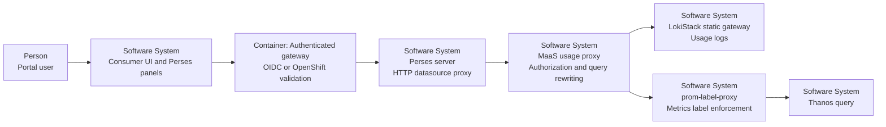
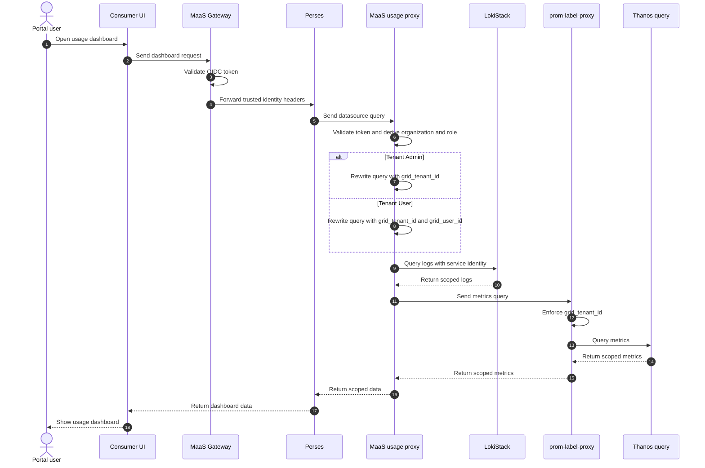
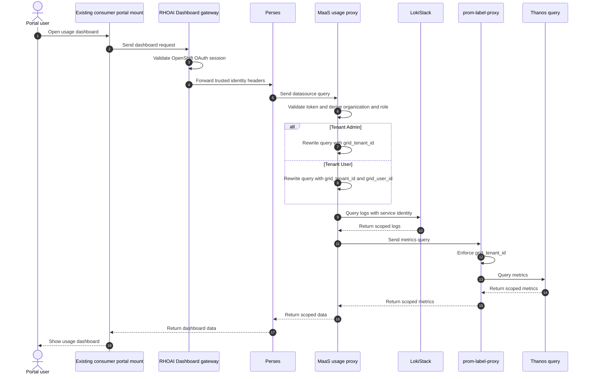

# Open Data Hub - MaaS Usage Dashboard OIDC Authorization and Data Scoping

|                |            |
| -------------- | ---------- |
| Date           | 2026-10-24 |
| Scope          | model-serving, MaaS consumer portal, usage dashboard |
| Status         | Draft |
| Authors        | Lindani Phiri |
| Supersedes     | N/A |
| Superseded by: | N/A |
| Tickets        | RHAI-10635 |
| Other docs:    | ODH-ADR-MS-0007-ai-grid-shared-oidc-identity-contract.md, ODH-ADR-MS-0008-maas-consumer-portal-oidc-gateway-layout.md |

## What

Serve the MaaS usage dashboard from Perses datasources. Keep the authenticated gateway that terminates the consumer portal route as the authentication boundary. Use LokiStack `static` mode with one Loki tenant per AI Grid organization. Put a MaaS usage proxy between Perses and the usage data sources. The proxy validates the gateway identity, rewrites the query, and forwards the request to LokiStack or `prom-label-proxy`.

For the MVP, the OpenShift identity path reuses the existing consumer portal mount on the main RHOAI Dashboard gateway. The MaaS Gateway does not expose a separate OpenShift-authenticated portal route.

LokiStack static OPA rules grant read access to the organization tenant. The MaaS usage proxy adds the organization label for Tenant Admins. It adds the organization and username labels for Tenant Users. Static OPA does not rewrite LogQL, so the usage proxy owns label filtering.

This design bypasses `maas-api` for usage and metrics queries. `maas-api` remains the owner of quota and subscription business state unless that state is materialized into the usage data source.

## Why

Tenant users need personal usage, quota position, and token metrics. Tenant admins need organization-wide usage by user, model, and site. Perses provides the dashboard and datasource model, while LokiStack and `prom-label-proxy` provide the existing observability access controls.

The consumer portal already has an OIDC session and a trusted gateway identity contract. LokiStack `static` mode can use the same OIDC issuer and group claims. This avoids a second identity provider and keeps tenant users off Kubernetes RBAC. A server-side usage proxy lets Perses use standard Loki and Prometheus datasources without exposing raw backend access to the browser.

The main RHOAI Dashboard gateway already supports OpenShift authentication. Reusing that mount for the MVP avoids a second authentication path and keeps the usage proxy behind one trusted ingress.

## Goals

* Use the authenticated session on the consumer portal entry point.
* Keep authentication validation at the gateway that terminates the consumer portal route.
* Reuse the existing RHOAI Dashboard gateway mount for the MVP OpenShift identity path.
* Keep AI Grid organization users free of Kubernetes identities.
* Support an optional OpenShift identity mode for tenants that already have Kubernetes identities.
* Use Perses project datasources and the Perses HTTP datasource proxy.
* Run a MaaS usage proxy as the server-side authorization and query-rewriting boundary.
* Use LokiStack `static` mode with OIDC tenant authentication and in-process OPA authorization.
* Use one LokiStack tenant per AI Grid organization.
* Enforce `grid_tenant_id` for Tenant Admin queries.
* Enforce `grid_tenant_id` and `grid_user_id` for Tenant User queries.
* Preserve `prom-label-proxy` as the Prometheus label-enforcement component.
* Use the `iss` and `sub` claim pair as the stable user identity.
* Use the selected organization claim entry as the tenant scope.
* Use the `admins` role to identify a Tenant Admin for the selected organization.
* Show Tenant Users their personal usage and token metrics.
* Show Tenant Admins organization-wide usage by user, model, and site.
* Allow Tenant Admins to narrow an organization-wide query by one user.
* Return HTTP 403 when a user requests Tenant Admin data without the `admins` role.
* Keep the dashboard free of Kubernetes `TokenReview` and `SubjectAccessReview`.
* Keep the dashboard free of API-key authentication.

## Non-Goals

* Define the usage dashboard queries.
* Implement the usage aggregation service.
* Implement the metering pipeline.
* Implement the dashboard components.
* Build the Provider Admin observability dashboards.
* Deploy or federate the identity provider.
* Add a second identity provider.
* Automatically create Kubernetes identities for tenant users.
* Change the trusted identity-header contract.
* Change the consumer portal gateway layout.
* Support the LokiStack `openshift-logging`, `dynamic`, `passthrough`, or `openshift-network` modes.

## How

In this ADR, a tenant is one selected AI Grid organization. A Tenant Admin is a user with the `admins` role for that organization. A Tenant User is any other valid organization member.



### Request sequences

The following sequence diagrams show the request path for each authentication mode and persona. They omit the browser sign-in details because ODH-ADR-MS-0007 and ODH-ADR-MS-0008 define them.

#### AI Grid shared OIDC mode



#### MVP OpenShift mode



### Perses datasource layout

Run Perses behind the same authenticated gateway route as the consumer portal. In the AI Grid default, this is the MaaS Gateway. In the MVP OpenShift path, this is the existing RHOAI Dashboard gateway and portal mount. The gateway validates the session, removes client-supplied identity headers, and injects the trusted identity headers defined by ODH-ADR-MS-0007.

Create project-scoped Perses datasources. Do not set `directUrl`. Every datasource uses the Perses `HTTPProxy` so queries pass through the Perses server.

The Loki datasource uses `LokiDatasource`. The metrics datasource uses `PrometheusDatasource`. Both point to the MaaS usage proxy.

The datasource forwards only the headers it needs:

| Header | Use |
| ------ | --- |
| `x-forwarded-access-token` | Verified JWT for the usage proxy. |
| `x-maas-username` | Stable subject identity. |
| `x-maas-orgid` | Selected organization ID. |
| `x-maas-roles` | Organization roles. |
| `x-maas-group` | Organization-qualified groups. |

Perses must use `allowHeaders`, not `dropHeaders`. This prevents unlisted browser headers from reaching the usage proxy. The datasource must also use `allowedEndpoints` and allow only read-only query endpoints.

### MaaS usage proxy

The MaaS usage proxy is the authorization and query-rewriting boundary. It is not a simple reverse proxy.

For each request, the proxy:

1. Validates the forwarded access token.
2. Compares the token claims with the trusted gateway headers.
3. Rejects the request if the claims and headers disagree.
4. Derives the user identity, organization, roles, and groups.
5. Checks the requested dashboard role against the `admins` role.
6. Rewrites the Loki or Prometheus query with the required label matchers.
7. Selects the organization's LokiStack tenant.
8. Calls the backend with the proxy's authenticated service identity.

The proxy never trusts a client-supplied `X-Scope-OrgID` header. It derives that value from the verified organization claim.

The proxy applies these filters:

| Persona | LokiStack tenant | Required labels |
| ------- | ---------------- | --------------- |
| Tenant Admin | Organization ID | `grid_tenant_id` |
| Tenant User | Organization ID | `grid_tenant_id` and `grid_user_id` |

`grid_tenant_id` is the selected organization ID. `grid_user_id` is a stable, non-email identifier derived from the canonical `iss` and `sub` pair. A role from one organization never grants authority in another organization.

The proxy rewrites selectors to these forms:

```text
Tenant Admin LogQL: {grid_tenant_id="<organization-id>"}
Tenant User LogQL:  {grid_tenant_id="<organization-id>", grid_user_id="<user-id>"}

Tenant Admin PromQL: {grid_tenant_id="<organization-id>"}
Tenant User PromQL:  {grid_tenant_id="<organization-id>", grid_user_id="<user-id>"}
```

The proxy replaces any client-supplied matcher for these two labels. It rejects a query that tries to broaden the enforced scope.

A Tenant Admin may narrow the organization-wide query by user. The UI passes one selected user ID to the usage proxy. The proxy then rewrites the query to use both `grid_tenant_id` and exactly one `grid_user_id` matcher. If no user is selected, the proxy keeps only the organization filter.

The user filter is a query refinement. It does not grant access and does not replace the organization scope. The proxy rejects a client-supplied regular expression, multiple user values, or a user matcher that conflicts with the selected value.

### LokiStack integration

LokiStack runs in `static` mode. In the AI Grid default, each organization gets one Loki tenant. The tenant ID is the organization ID. The tenant uses OIDC authentication with the AI Grid issuer, `sub` as the username claim, and `groups` as the group claim.

In the MVP OpenShift path, the MaaS usage proxy authenticates to LokiStack with its own mTLS service identity. OPA grants that service identity read access to the organization tenant.

The following example shows the static policy for one organization:

```yaml
tenants:
  mode: static
  authentication:
    - tenantName: grid-usage-42c3e46f
      tenantId: 42c3e46f-2477-44d7-a85b-d3b43f6b31fa
      oidc:
        issuerURL: https://identity.example.com/
        usernameClaim: sub
        groupClaim: groups
        secret:
          name: grid-usage-oidc
  authorization:
    roles:
      - name: grid-usage-reader
        resources:
          - logs
        tenants:
          - 42c3e46f-2477-44d7-a85b-d3b43f6b31fa
        permissions:
          - read
    roleBindings:
      - name: grid-usage-42c3e46f-readers
        roles:
          - grid-usage-reader
        subjects:
          - kind: group
            name: 42c3e46f-2477-44d7-a85b-d3b43f6b31fa/ai-grid-users
          - kind: group
            name: 42c3e46f-2477-44d7-a85b-d3b43f6b31fa/ai-grid-admins
```

The following example shows the Tenant Admin RBAC configuration:

```yaml
tenants:
  mode: static
  authorization:
    roles:
      - name: grid-usage-admin
        resources:
          - logs
        tenants:
          - 42c3e46f-2477-44d7-a85b-d3b43f6b31fa
        permissions:
          - read
    roleBindings:
      - name: grid-usage-42c3e46f-admins
        roles:
          - grid-usage-admin
        subjects:
          - kind: group
            name: 42c3e46f-2477-44d7-a85b-d3b43f6b31fa/ai-grid-admins
```

The `grid-usage-admin` role grants read access to the organization's Loki tenant. It does not broaden the query scope by itself. The MaaS usage proxy checks the `admins` organization role and applies `grid_tenant_id`. It adds `grid_user_id` only when the Tenant Admin selects one user.

The static OPA rule grants the `read` permission on the organization tenant when the verified token contains one of the bound organization groups. It does not inspect LogQL label matchers and cannot return a filter. This is a LokiStack static-mode constraint, not a MaaS limitation.

The MaaS usage proxy calls the organization tenant at `/api/logs/v1/<organization-id>/loki/api/v1/query_range`. It authenticates with its own mTLS service identity. LokiStack validates that identity and applies the static OPA rule. The usage proxy has already rewritten the LogQL selector with the required labels.

Tenant Admin authority comes from the `admins` role in the MaaS organization claim. It does not come from the LokiStack role name. LokiStack grants both Tenant Users and Tenant Admins read access to the same organization tenant; the usage proxy decides whether to add `grid_user_id`.

### Prometheus and `prom-label-proxy`

For metrics, the MaaS usage proxy calls `prom-label-proxy`. The proxy sets `X-Scope-OrgID` to the verified organization ID. It does not accept that header from Perses or the browser.

Run `prom-label-proxy` with:

```text
prom-label-proxy
  -header-name X-Scope-OrgID
  -label grid_tenant_id
  -upstream https://thanos-query.example.com
  -enable-label-apis
  -error-on-replace
```

`prom-label-proxy` enforces the `grid_tenant_id` label in PromQL and Prometheus API requests. It does not authenticate or authorize the caller. The MaaS usage proxy performs that work before it calls `prom-label-proxy`.

`prom-label-proxy` enforces one label. The MaaS usage proxy therefore adds `grid_user_id` to Tenant User PromQL before it calls `prom-label-proxy`. `prom-label-proxy` then adds `grid_tenant_id`. Tenant Admin PromQL contains only `grid_tenant_id` from `prom-label-proxy`.

### Optional OpenShift portal identity mode

The default AI Grid path uses the shared OIDC issuer and LokiStack `static` mode. For the MVP, a tenant with existing Kubernetes identities uses the existing consumer portal mount on the main RHOAI Dashboard gateway. That gateway already performs OpenShift authentication. The MaaS Gateway route is not enabled for this mode.

| Mode | Portal authentication | LokiStack mode | Identity source |
| ---- | --------------------- | -------------- | --------------- |
| AI Grid default | Shared OIDC | `static` | `iss` and `sub` |
| MVP OpenShift | OpenShift OAuth | `static` | Existing Kubernetes identity |

In this mode, the consumer portal uses `AITenant.spec.authentication.mode: openshift`, as defined by ODH-ADR-MS-0008. The existing RHOAI Dashboard gateway authenticates the browser with OpenShift OAuth and injects the same trusted identity-header contract. OpenShift RBAC does not authorize usage-log access in this design.

LokiStack remains in `static` mode. The MaaS usage proxy authenticates to LokiStack with its own mTLS identity, and OPA grants that service identity read access to the organization tenant. The end-user OpenShift identity is used only by the proxy for label rewriting; it is not used as the LokiStack authorization subject.

This avoids `openshift-logging` namespace-based RBAC. The authenticated gateway first maps the verified OpenShift identity to the selected organization and MaaS role. The usage proxy then enforces `grid_tenant_id` and, for Tenant Users, `grid_user_id`.

This optional mode does not create Kubernetes identities. It only uses identities that already exist. It is not valid for the AI Grid shared-OIDC tenant because that tenant must not create Kubernetes users, groups, or role bindings.

### Quota position

Quota and subscription state is business state, not observability data. The dashboard has two supported options:

* The MaaS usage proxy reads a materialized quota view from the usage data source.
* The consumer portal BFF calls `maas-api` for quota and renders it beside the Perses panels.

The dashboard must not calculate quota from metrics. The quota source must remain scoped to the same verified user and organization.

### Session expiry and errors

When the OIDC session is missing or expired, the gateway redirects the browser to SSO. The dashboard does not render partial usage data.

When a valid user requests data outside the selected organization, the usage proxy returns HTTP 403. When a user without the `admins` role requests Tenant Admin data, the usage proxy returns HTTP 403.

When LokiStack, Thanos, or `prom-label-proxy` fails, the dashboard shows an error state and does not change the authorization scope.

## Open Questions

* What is the exact encoding of `grid_user_id` from the `iss` and `sub` pair?
* Does the productized OpenShift Logging release support LokiStack `static` mode?
* Does the LokiStack OIDC client accept the AI Grid token audience?
* Does the first release need the optional Kubernetes identity mode?
* How do OpenShift groups map to MaaS organization roles in the optional mode?
* Does the first release need user-level metrics, or are user-level usage logs sufficient?
* Should Perses be embedded in the Consumer UI or linked as a standalone dashboard?
* Where is the quota read model materialized?

## Alternatives

### Route all usage queries through `maas-api`

The consumer portal BFF would call `maas-api`, and `maas-api` would query the usage data. This keeps business authorization in one service, but it duplicates the Perses datasource proxy model and makes `maas-api` own LogQL and PromQL query rewriting.

This option remains useful for quota and subscription state. It is not the primary path for usage and metrics queries.

### Use static OPA to rewrite label matchers

The LokiStack static OPA policy would inspect the LogQL query and add `grid_tenant_id` and `grid_user_id`. This option keeps filtering in one policy engine, but the static OPA contract returns only allow or deny. It receives the subject, groups, resource, permission, and tenant; it does not receive the query or return matchers.

This option is rejected because LokiStack static OPA cannot rewrite LogQL. The MaaS usage proxy performs that work after OPA grants tenant access.

### Connect Perses directly to LokiStack

Perses would use a Loki datasource that points directly to the static LokiStack gateway. This can authenticate with the AI Grid OIDC issuer, but it bypasses the required organization and username query rewriting.

This option is rejected because OPA tenant access alone does not enforce the `grid_tenant_id` and `grid_user_id` label matchers.

### Connect Perses directly to `prom-label-proxy`

Perses would forward `x-maas-orgid` to `prom-label-proxy`, which would enforce `grid_tenant_id`. This option adds one less proxy, but it relies on network isolation and does not validate the OIDC token immediately before setting the scope header.

This option is rejected because `prom-label-proxy` performs no authentication or authorization.

### Use one Loki tenant per user

Each user would receive a separate Loki tenant. This provides user isolation at the storage boundary, but it creates many tenants and makes retention, querying, and administration expensive.

This option is rejected because organization tenancy plus server-side LogQL rewriting provides the required scope with fewer tenants.

### Use `openshift-logging` for the optional identity mode

LokiStack would use `openshift-logging` and authorize log access through OpenShift RBAC. This mode is designed for application, infrastructure, and audit logs with namespace-scoped permissions.

This option is rejected for the usage dashboard because it cannot enforce the custom `grid_tenant_id` and `grid_user_id` label scope. The optional OpenShift identity mode therefore stays at the portal, while LokiStack remains behind the MaaS usage proxy.

### Use API keys for the dashboard

The dashboard would create or use an API key for usage queries. This option reuses the existing programmatic path, but it mixes browser identity with subscription credentials. It also does not meet the SSO-only consumer portal requirement.

This option is rejected because the dashboard must show data for the signed-in OIDC user.

## Security and Privacy Considerations

Only the authenticated gateway may inject trusted identity headers. The gateway removes client-supplied copies before it injects verified values. Perses must be reachable only through that gateway, and the usage proxy must be reachable only from Perses.

The usage proxy must validate the forwarded access token and reject any mismatch between its claims and the trusted headers. It must parse LogQL and PromQL with a supported parser and must not concatenate untrusted query strings.

The proxy must not expose the access token, trusted identity headers, or usage data to the browser. Usage responses contain user activity, so the UI must render only the fields required by each role.

Tenant User data is personal usage data. Tenant Admin data can contain usage by user for the selected organization. Access to these responses must remain scoped to the selected organization.

The dashboard does not create Kubernetes identities. It does not call `TokenReview` or `SubjectAccessReview`. In the MVP OpenShift mode, the authenticated gateway validates the browser session and the usage proxy enforces the label scope.

## Risks

| Risk | Mitigation |
| ---- | ---------- |
| JWT claims and trusted headers disagree. | Reject the request and test claim-to-header mapping at the gateway. |
| Productized OpenShift Logging does not support LokiStack `static` mode. | Confirm support before implementation and keep the LokiStack integration isolated behind the usage proxy. |
| The LokiStack OIDC client rejects the AI Grid token audience. | Agree on one audience or use a supported token-exchange path before rollout. |
| Organization onboarding does not update the static tenant and role binding. | Reconcile the LokiStack tenant, role, and role binding from the organization resource. |
| The optional OpenShift mode is enabled for the AI Grid tenant. | Reject the configuration and test that the AI Grid tenant remains on shared OIDC and LokiStack `static` mode. |
| The MVP OpenShift mode is confused with LokiStack `openshift-logging`. | Keep OpenShift OAuth at the portal and keep LokiStack behind the MaaS usage proxy. |
| LogQL rewriting is incomplete. | Use the supported Loki parser and test selectors, pipelines, and aggregation expressions. |
| The `grid_user_id` label increases Loki cardinality. | Use one stable user identifier, measure cardinality, and set retention limits. |
| `prom-label-proxy` enforces only one label. | Add `grid_user_id` in the MaaS usage proxy before `prom-label-proxy` adds `grid_tenant_id`. |
| Tenant Admin data is overexposed. | Enforce the `admins` role and organization scope in the usage proxy, not only in the UI. |
| Quota data and usage data use different identities. | Use one canonical user identity and contract-test both data paths. |
| Expired sessions show stale dashboard data. | Do not cache usage responses and redirect expired sessions to SSO. |

## Stakeholder Impacts

| Group | Key Contacts | Date | Impacted? |
| ----- | ------------ | ---- | --------- |
| Model-as-a-Service | Lindani Phiri | 2026-10-24 | Yes |
| Consumer Portal | Pierangelo Di Pilato | 2026-10-24 | Yes |
| Dashboard | Arik Hadas | 2026-10-24 | Yes |
| Observability | Kevin Howell | 2026-10-24 | Maybe |
| AI Grid | RHAISTRAT-2875 owners | 2026-10-24 | Maybe |

* **Model-as-a-Service**: owns the usage proxy, query rewriting, and backend mode selection.
* **Consumer Portal**: owns the Perses integration and the consumer UI session.
* **Dashboard**: owns the Tenant User and Tenant Admin usage views.
* **Observability**: owns LokiStack, Thanos, and the supported product authorization modes.
* **AI Grid**: owns the multi-site usage aggregation contract and site attribution data.

## References

* [RHAI-10635](https://redhat.atlassian.net/browse/RHAI-10635)
* [ODH-ADR-MS-0007-ai-grid-shared-oidc-identity-contract.md](https://github.com/lphiri/architecture-decision-records/blob/main/architecture-decision-records/model-serving/ODH-ADR-MS-0007-ai-grid-shared-oidc-identity-contract.md)
* [ODH-ADR-MS-0008-maas-consumer-portal-oidc-gateway-layout.md](https://github.com/lphiri/architecture-decision-records/blob/main/architecture-decision-records/model-serving/ODH-ADR-MS-0008-maas-consumer-portal-oidc-gateway-layout.md)
* [Perses datasource proxy](https://perses.dev/perses/docs/concepts/proxy/)
* [LokiStack tenancy modes](https://github.com/grafana/loki/blob/main/operator/docs/user-guides/tenancy-modes.md)
* [prom-label-proxy](https://github.com/prometheus-community/prom-label-proxy)

## Reviews

| Reviewed by | Date | Notes |
| ----------- | ---- | ----- |
| | | |
