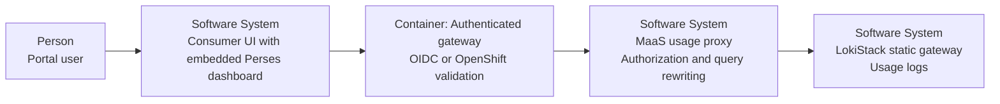
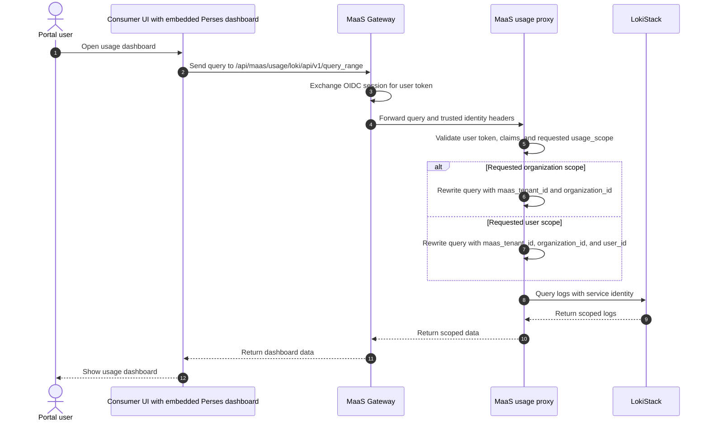
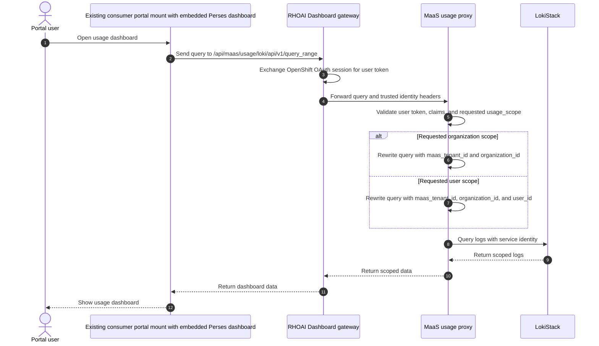

# Open Data Hub - MaaS Usage Dashboard OIDC Authorization and Data Scoping

|                |            |
| -------------- | ---------- |
| Date           | 2026-10-24 |
| Scope          | model-serving, MaaS consumer portal, usage dashboard |
| Status         | Draft |
| Authors        | Lindani Phiri |
| Supersedes     | N/A |
| Superseded by: | N/A |
| Tickets        | RHAI-10635, RHAI-8074 |
| Other docs:    | ODH-ADR-MS-0007-ai-grid-shared-oidc-identity-contract.md, ODH-ADR-MS-0008-maas-consumer-portal-oidc-gateway-layout.md |

## What

Serve the MaaS usage dashboard from a Perses Loki datasource. This phase supports Loki usage logs only. For browser requests, use the authenticated gateway that terminates the consumer portal route to exchange the portal session for a user JWT or OAuth token. Use LokiStack `static` mode with one Loki tenant per organization boundary. Put a MaaS usage proxy between Perses and LokiStack. The MaaS usage proxy is the authorization boundary and the only supported entry point to the Loki usage instance. The proxy validates the user token on every path, rewrites the LogQL query, and forwards the request to LokiStack.

The gateway is mandatory only for the browser UI path, where a session must be exchanged for a user token. CLI and non-dashboard API clients present a bearer token directly to the usage proxy.

MaaS has three usage levels: AITenant, organization, and user. `maas_tenant_id` identifies the AITenant. `organization_id` identifies the organization boundary inside that AITenant. `user_id` identifies the user. In AI Grid, the organization is an AI Grid organization and producers must emit `organization_id`. In a non-AI Grid deployment, the AITenant is the authorization boundary and `organization_id` is optional.

This keeps a consistent three-level model even when the organization level is not subdivided.

For the MVP, the OpenShift identity path reuses the existing consumer portal mount on the main RHOAI Dashboard gateway. The MaaS Gateway does not expose a separate OpenShift-authenticated portal route.

LokiStack static OPA rules grant read access to the organization tenant. The MaaS usage proxy adds the AITenant label and, when an organization boundary exists, the organization label for Tenant Admins. It adds the AITenant label, the organization label when present, and the user label for Tenant Users. Static OPA does not rewrite LogQL, so the usage proxy owns label filtering.

This design bypasses `maas-api` for usage log queries. `maas-api` remains the owner of quota and subscription business state unless that state is materialized into the usage data source.

## Why

Tenant users need personal usage, quota position, and token usage logs. Tenant admins need usage by AITenant, organization, user, model, and site. Perses provides the dashboard and datasource model, while LokiStack provides the log access controls.

The consumer portal already has an OIDC session and a trusted gateway identity contract. The MaaS usage proxy uses one mTLS service identity for LokiStack, so the portal identity mode does not change the LokiStack configuration. This keeps tenant users off Kubernetes RBAC. A server-side usage proxy lets Perses use a standard Loki datasource without exposing raw backend access to the browser.

The main RHOAI Dashboard gateway already supports OpenShift authentication. Reusing that mount for the MVP avoids a second authentication path and keeps the usage proxy behind one trusted ingress.

## Goals

* Use the authenticated session on the consumer portal entry point.
* Support CLI and non-dashboard API clients that send a valid bearer token.
* Use the consumer portal gateway only to exchange a browser session for a user token.
* Validate every user token in the MaaS usage proxy.
* Reuse the existing RHOAI Dashboard gateway mount for the MVP OpenShift identity path.
* Model usage at the AITenant, organization, and user levels.
* Keep AI Grid organization users free of Kubernetes identities.
* Support an optional OpenShift identity mode for tenants that already have Kubernetes identities.
* Use a Perses project Loki datasource and the Perses HTTP datasource proxy.
* Run a MaaS usage proxy as the server-side authorization and query-rewriting boundary.
* Use LokiStack `static` mode with mTLS service authentication and in-process OPA authorization.
* Use one LokiStack tenant per organization boundary.
* Enforce `maas_tenant_id` and, when an organization boundary exists, `organization_id` for Tenant Admin queries.
* Enforce `maas_tenant_id`, `user_id`, and, when an organization boundary exists, `organization_id` for Tenant User queries.
* Show usage by AITenant, organization, and user.
* Use the `iss` and `sub` claim pair as the stable user identity.
* Use the AITenant identifier as the AITenant scope.
* Use the selected organization claim entry as the organization scope.
* Use the `admins` role to identify a Tenant Admin for the selected organization.
* Show Tenant Users their personal usage and token usage logs.
* Show Tenant Admins organization-wide usage by AITenant, organization, user, model, and site.
* Let Kubernetes-authorized Super Admins request one organization tenant at a time.
* Resolve API-key-authenticated inference requests to the organization boundary through their bound subscription.
* Allow Tenant Admins to narrow an organization-wide query by one user.
* Return HTTP 403 when a user requests Tenant Admin data without the `admins` role.
* Keep Tenant User and Tenant Admin paths free of Kubernetes `TokenReview` and `SubjectAccessReview`.
* Keep the browser dashboard free of API-key authentication.

## Non-Goals

* Define the usage dashboard queries.
* Implement the usage aggregation service.
* Implement the metering pipeline.
* Implement the dashboard components.
* Build the Provider Admin observability dashboards.
* Integrate additional usage data backends in this phase.
* Remove existing CLI or non-dashboard API access.
* Deploy or federate the identity provider.
* Add a second identity provider.
* Automatically create Kubernetes identities for tenant users.
* Change the trusted identity-header contract.
* Change the consumer portal gateway layout.
* Authenticate end users directly to LokiStack.
* Support the LokiStack `openshift-logging`, `dynamic`, `passthrough`, or `openshift-network` modes.

## How

In this ADR, an AITenant is the top-level MaaS tenant boundary. An organization is a boundary inside an AITenant. In AI Grid, an organization is an AI Grid organization. In a non-AI Grid deployment, the AITenant is the authorization boundary, and an organization may still exist inside it. A Tenant Admin is a user with the `admins` role for the selected organization. A Tenant User is any other valid organization member.

The usage data uses these labels:

| Level | Label | Meaning |
| ----- | ----- | ------- |
| AITenant | `maas_tenant_id` | The top-level MaaS tenant identifier. |
| Organization | `organization_id` | The selected organization boundary inside the AITenant. Required for AI Grid; optional for non-AI Grid. |
| User | `user_id` | The stable user identifier derived from `iss` and `sub`. |

API-key-authenticated inference requests resolve the key's stored subscription binding first. Subscription selection then returns the subscription's `organization_id`; for a legacy subscription without a stable organization association, it returns `tokenMetadata.organizationId`. The inference path must use that verified subscription-selection result and must not trust a client-supplied organization header.

In a non-AI Grid deployment without a finer organization boundary, subscription selection may return an empty `organization_id`; the usage path then uses `maas_tenant_id` as the authorization boundary. If an AI Grid subscription cannot resolve to one organization boundary, the inference request must fail.

Dashboards may group and filter usage by `maas_tenant_id`, `organization_id`, and `user_id`. The usage proxy enforces the labels that the selected persona requires.



### Request sequences

The following sequence diagrams show the request path for each authentication mode and persona. They omit the browser sign-in details because ODH-ADR-MS-0007 and ODH-ADR-MS-0008 define them.

The gateway is shown only for the browser UI path. CLI and non-dashboard API clients call the usage proxy directly with a bearer token; the usage proxy validates that token and applies the same scoping rules.

#### AI Grid shared OIDC mode



#### MVP OpenShift mode



### CLI and non-dashboard API access

CLI and non-dashboard clients do not use Perses. They continue to call the supported MaaS usage API surface with `Authorization: Bearer <token>`.

CLI and non-dashboard clients present the bearer token directly to the MaaS usage proxy. The gateway is not required on this path. The usage proxy routes every usage log query to LokiStack. Direct access to the Loki usage instance is not supported.

Use the public MaaS usage proxy route and the same `/api/maas/usage` path prefix. For example, send the bearer token to `https://maas-usage.example.com/api/maas/usage/loki/api/v1/query_range`. The browser path uses the gateway host; the CLI path uses the public usage proxy host. Both paths reach the same MaaS usage proxy.

The usage proxy validates the token and derives the same AITenant, organization, role, and user identity used by the dashboard path. The same authorization and label-scoping rules apply. This path does not require an API key.

### Perses datasource layout

Run the embedded Perses dashboard inside the Consumer UI. Its datasource requests use a gateway-relative URL, so the browser sends them to the gateway origin. In the AI Grid default, this is the MaaS Gateway. In the MVP OpenShift path, this is the existing RHOAI Dashboard gateway and portal mount. The gateway validates the session, removes client-supplied identity headers, and injects the trusted identity headers defined by ODH-ADR-MS-0007.

Create project-scoped Perses datasources. Do not set `directUrl`; a direct URL would expose the internal MaaS usage proxy hostname to the browser. Configure the embedded dashboard's `DatasourceApi.buildProxyUrl()` method to return a gateway-relative path such as `/api/maas/usage`. The Perses Loki plugin appends the standard `/loki/api/v1/...` API path.

| Item | Value |
| ---- | ----- |
| Browser origin | The consumer portal or RHOAI Dashboard origin. |
| Browser-visible datasource URL | `/api/maas/usage` |
| Gateway route | `/api/maas/usage/*` |
| Internal upstream | The MaaS usage proxy service URL. |

The gateway reverse-proxies that route to the internal MaaS usage proxy. The browser resolves the relative URL against the gateway origin, so the different hostname of the MaaS usage proxy does not cause cross-origin requests. CORS is therefore not required on the browser path.

The Loki datasource uses `LokiDatasource`. Its server-side proxy target is the MaaS usage proxy, and its browser-visible proxy URL is the gateway route above.

The datasource forwards only the headers it needs:

| Header | Use |
| ------ | --- |
| `x-forwarded-access-token` | Verified JWT for the usage proxy. |
| `x-maas-username` | Stable subject identity. |
| `x-maas-orgid` | Selected organization ID. |
| `x-maas-roles` | Organization roles. |
| `x-maas-group` | Organization-qualified groups. |

Perses must use `allowHeaders`, not `dropHeaders`. This prevents unlisted browser headers from reaching the usage proxy. The datasource must also use `allowedEndpoints` and allow only read-only query endpoints.

The internal MaaS usage proxy hostname is not published to the browser. The gateway route is the only browser-visible address for usage queries.

### MaaS usage proxy

The MaaS usage proxy is the authorization and query-rewriting boundary. It is not a simple reverse proxy.

RHAI-8074 proposed a read-only Loki proxy in `maas-api` and later discussed an Observatorium API fork. This ADR consolidates that work into the MaaS usage proxy. The proxy may reuse the proven LogQL parser and label-matcher enforcement approach from Observatorium API, but it is not exposed as a `maas-api` endpoint.

RHAI-8074 and this ADR both use `organization_id` as the organization label.

This ADR does not depend on an ACM OPA endpoint. On the browser path, the authenticated gateway supplies the verified identity and organization claims. On the direct API path, the usage proxy derives them from the validated bearer token. The usage proxy enforces the required matchers on both paths.

Each query carries an explicit `usage_scope` request parameter. Valid values are `user`, `organization`, and `platform`. The parameter is request intent, not authorization. The proxy validates the requested scope against the verified identity and role. `user` is available to every authenticated organization member and always adds the caller's `user_id`. `organization` requires the organization `admins` role and adds only the AITenant and organization labels unless the Tenant Admin selects one exact user. `platform` requires a verified Kubernetes identity, an allowed `SubjectAccessReview` result, and exactly one selected organization tenant.

An administrator may request either scope. Requesting `user` does not use the administrator role and does not expose another user's data.

For each request, the proxy:

1. Validates the user access token.
2. Compares the token claims with the trusted gateway headers on the browser path.
3. Rejects the request if the claims and headers disagree.
4. Ignores client-supplied identity headers on the direct API path.
5. Derives the AITenant, user identity, organization, roles, and groups.
6. Checks the requested `usage_scope` against the verified organization role.
7. Rewrites the LogQL query with the required label matchers.
8. Selects the organization's LokiStack tenant.
9. Calls the backend with the proxy's authenticated service identity.

The proxy never trusts a client-supplied `X-Scope-OrgID` header. It derives that value from the verified organization claim. It also derives `maas_tenant_id` from the verified AITenant context and does not accept that value from the browser.

The proxy applies these filters:

| Persona | LokiStack tenant | Required labels |
| ------- | ---------------- | --------------- |
| Tenant Admin | Organization ID | `maas_tenant_id` and `organization_id` |
| Tenant User | Organization ID | `maas_tenant_id`, `organization_id`, and `user_id` |
| Kubernetes Super Admin | One selected organization tenant | `maas_tenant_id` and `organization_id` |

`maas_tenant_id` is the AITenant identifier. `organization_id` is the selected organization boundary. `user_id` is a stable, non-email identifier derived from the canonical `iss` and `sub` pair. A role from one organization never grants authority in another organization.

In a non-AI Grid deployment that does not emit `organization_id`, the usage proxy uses `maas_tenant_id` as the organization boundary and does not require the optional label.

The proxy rewrites selectors to these forms:

```text
Tenant Admin LogQL: {maas_tenant_id="<maas-tenant-id>", organization_id="<organization-id>"}
Tenant User LogQL:  {maas_tenant_id="<maas-tenant-id>", organization_id="<organization-id>", user_id="<user-id>"}
```

The proxy replaces any client-supplied matcher for these labels. It rejects a query that tries to broaden the enforced scope.

A Tenant Admin may narrow the organization-wide query by user. The UI passes one selected user ID to the usage proxy. The proxy then rewrites the query to use `maas_tenant_id`, `organization_id`, and exactly one `user_id` matcher. If no user is selected, the proxy keeps the AITenant and organization filters.

The user filter is a query refinement. It does not grant access and does not replace the AITenant and organization scope. The proxy rejects a client-supplied regular expression, multiple user values, or a user matcher that conflicts with the selected value.

### Super Admin access

Super Admin access is Kubernetes-only. An external OIDC identity cannot request `usage_scope=platform`. The organization `admins` role also cannot request it.

A Super Admin must not receive a LokiStack identity that bypasses tenant selection. The usage proxy remains the only LokiStack client.

For `usage_scope=platform`, the proxy:

1. Validates the Kubernetes bearer token with `TokenReview`.
2. Checks Super Admin authority with `SubjectAccessReview`.
3. Resolves the one selected `organization_id` through a trusted MaaS tenancy catalog.
4. Rejects a missing, unknown, or multi-valued organization selection.
5. Adds the exact `maas_tenant_id` and `organization_id` matchers.
6. Queries only that organization's LokiStack tenant.

The `SubjectAccessReview` checks the `get` verb on the `/api/maas/usage/loki` non-resource URL. The proxy does not accept a client-supplied tenant list. The selected `organization_id` names the target tenant but does not authorize the request. Optional AITenant and user filters narrow the query; they never broaden it.

Super Admin requests do not query multiple tenants at once. A Super Admin changes the selected organization to view another tenant. The query results retain `maas_tenant_id` and `organization_id`.

The browser Super Admin path must use the OpenShift-authenticated RHOAI Dashboard gateway. The direct CLI path sends the Kubernetes bearer token to the usage proxy. The MaaS Gateway OIDC path returns HTTP 403 for `usage_scope=platform`.

The following example grants the Super Admin permission to the usage route. Bind an existing OpenShift group to the role; do not create identities for external OIDC users:

```yaml
apiVersion: rbac.authorization.k8s.io/v1
kind: ClusterRole
metadata:
  name: maas-usage-super-admin
rules:
  - nonResourceURLs:
      - /api/maas/usage/loki
      - /api/maas/usage/loki/*
    verbs:
      - get
---
apiVersion: rbac.authorization.k8s.io/v1
kind: ClusterRoleBinding
metadata:
  name: maas-usage-super-admins
roleRef:
  apiGroup: rbac.authorization.k8s.io
  kind: ClusterRole
  name: maas-usage-super-admin
subjects:
  - apiGroup: rbac.authorization.k8s.io
    kind: Group
    name: maas-usage-super-admins
```

### LokiStack integration

LokiStack runs in `static` mode. Each organization boundary gets one Loki tenant. The tenant ID is the `organization_id`. The MaaS usage proxy is the only component that calls LokiStack. It authenticates with its own mTLS service identity, and OPA grants that service identity read access to the organization tenant.

Deploy the Loki usage instance so that only the MaaS usage proxy can reach its query endpoint. Browsers, Perses datasources, `maas-api`, CLI clients, and other platform services must not connect to LokiStack directly. Use a restrictive `NetworkPolicy`, mTLS, or an equivalent authenticated service boundary to enforce this rule.

LokiStack `static` mode supports OIDC or mTLS authentication per tenant, and a tenant uses one mechanism rather than both. This design uses mTLS because the usage proxy already validates the portal identity and rewrites the query. LokiStack does not need to know whether the portal used shared OIDC or OpenShift OAuth.

The following example shows the static policy for one organization:

```yaml
tenants:
  mode: static
  authentication:
    - tenantName: maas-usage-42c3e46f
      tenantId: 42c3e46f-2477-44d7-a85b-d3b43f6b31fa
      mTLS:
        ca:
          caName: maas-usage-proxy-ca
  authorization:
    roles:
      - name: maas-usage-reader
        resources:
          - logs
        tenants:
          - 42c3e46f-2477-44d7-a85b-d3b43f6b31fa
        permissions:
          - read
    roleBindings:
      - name: maas-usage-42c3e46f-readers
        roles:
          - maas-usage-reader
        subjects:
          - kind: user
            name: maas-usage-proxy
```

The following example shows the Tenant Admin RBAC configuration. LokiStack authorizes only the MaaS usage proxy service identity; it does not bind end-user groups:

```yaml
tenants:
  mode: static
  authorization:
    roles:
      - name: maas-usage-admin
        resources:
          - logs
        tenants:
          - 42c3e46f-2477-44d7-a85b-d3b43f6b31fa
        permissions:
          - read
    roleBindings:
      - name: maas-usage-42c3e46f-admin-access
        roles:
          - maas-usage-admin
        subjects:
          - kind: user
            name: maas-usage-proxy
```

The `maas-usage-admin` role grants the usage proxy read access to the organization's Loki tenant. It does not broaden the query scope by itself. The MaaS usage proxy checks the `admins` organization role and applies `maas_tenant_id` and `organization_id`. It adds `user_id` only when the Tenant Admin selects one user.

The static OPA rule grants the `read` permission on the organization tenant to the MaaS usage proxy service identity. It does not inspect LogQL label matchers and cannot return a filter. This is a LokiStack static-mode constraint, not a MaaS limitation.

In a deployment that enables Super Admin access, the proxy service identity receives read access to every usage tenant. This does not grant every user cross-tenant access. The usage proxy validates the end-user token, requires an allowed Kubernetes authorization result, and allows only one selected tenant per request.

The MaaS usage proxy calls the organization tenant at `/api/logs/v1/<organization-id>/loki/api/v1/query_range`. It authenticates with its own mTLS service identity. LokiStack validates that identity and applies the static OPA rule. The usage proxy has already rewritten the LogQL selector with the required labels.

Tenant Admin authority comes from the `admins` role in the MaaS organization claim. It does not come from the LokiStack role name. LokiStack grants the MaaS usage proxy read access to the organization tenant; the usage proxy decides whether to add `user_id`.

### Optional OpenShift portal identity mode

The default AI Grid path uses shared OIDC at the portal and LokiStack `static` mode with mTLS from the usage proxy. For the MVP, a tenant with existing Kubernetes identities uses the existing consumer portal mount on the main RHOAI Dashboard gateway. That gateway already performs OpenShift authentication. The MaaS Gateway route is not enabled for this mode.

| Mode | Portal authentication | LokiStack mode | Identity source |
| ---- | --------------------- | -------------- | --------------- |
| AI Grid default | Shared OIDC | `static` | `iss` and `sub` |
| MVP OpenShift | OpenShift OAuth | `static` | Existing Kubernetes identity |

In this mode, the consumer portal uses `AITenant.spec.authentication.mode: openshift`, as defined by ODH-ADR-MS-0008. The existing RHOAI Dashboard gateway authenticates the browser with OpenShift OAuth and injects the same trusted identity-header contract. OpenShift RBAC does not authorize usage-log access in this design.

LokiStack remains in `static` mode. The MaaS usage proxy authenticates to LokiStack with its own mTLS identity, and OPA grants that service identity read access to the organization tenant. The end-user OpenShift identity is used only by the proxy for label rewriting; it is not used as the LokiStack authorization subject.

This avoids `openshift-logging` namespace-based RBAC. The authenticated gateway first maps the verified OpenShift identity to the selected organization and MaaS role. The usage proxy then enforces `maas_tenant_id`, and when an organization boundary exists it also enforces `organization_id`; for Tenant Users it also enforces `user_id`.

An OpenShift or Kubernetes token does not contain `maas_tenant_id` by default. The gateway or usage proxy must resolve the verified identity to an AITenant through a trusted MaaS tenancy mapping. The exact mapping source and ownership are unresolved. Until that contract is defined and tested, the optional OpenShift mode remains disabled.

This optional mode does not create Kubernetes identities. It only uses identities that already exist. It is not valid for the AI Grid shared-OIDC tenant because that tenant must not create Kubernetes users, groups, or role bindings.

### Upgrade and compatibility

Current AI Grid deployments expose existing proxy Loki query routes. These tenancy and dashboard features are being developed concurrently, and no legacy `grid_tenant_id` label is in use today.

The upgrade must:

1. Deploy the MaaS usage proxy and Perses datasources beside the existing query routes.
2. Keep the existing Loki proxy routes until the new path is validated.
3. Preserve existing dashboards, bookmarks, and OpenShift OAuth deployments.
4. Use `organization_id` in every new AI Grid producer from the start.
5. Remove the old paths only after query parity and authorization tests pass.

No `grid_tenant_id` to `organization_id` migration is required. Only AI Grid producers must emit `organization_id` before the dashboard is enabled.

### Cloud Provider Admin compatibility

The Cloud Provider Admin persona is outside this ADR. The existing AI Grid contract gives that persona vanilla ACM admin access, and `RHAISTRAT-2883` owns the Provider Admin observability dashboards.

The MaaS usage proxy must not replace or gate standard OpenShift dashboards. Standard OpenShift and ACM dashboards remain on their existing routes and use their existing authorization model. During the upgrade, preserve those routes and do not route them through the MaaS usage proxy.

### Quota position

Quota and subscription state is business state, not observability data. The dashboard has two supported options:

* The MaaS usage proxy reads a materialized quota view from the usage data source.
* The consumer portal BFF calls `maas-api` for quota and renders it beside the Perses panels.

The dashboard must not calculate quota from usage logs. The quota source must remain scoped to the same verified AITenant, organization, and user.

### Session expiry and errors

When the OIDC session is missing or expired, the gateway redirects the browser to SSO. The dashboard does not render partial usage data.

When a valid user requests data outside the selected AITenant or organization, the usage proxy returns HTTP 403. When a user without the `admins` role requests Tenant Admin data, the usage proxy returns HTTP 403.

When LokiStack fails, the dashboard shows an error state and does not change the authorization scope.

## Open Questions

* What is the exact encoding of `user_id` from the `iss` and `sub` pair?
* Which existing OpenShift group owns the `maas-usage-super-admins` binding?
* How is `maas_tenant_id` derived and propagated for each AITenant?
* What value does a non-AI Grid AITenant use for `organization_id` when it has no finer organization boundary?
* Does the productized OpenShift Logging release support LokiStack `static` mode?
* Does the first release need the optional Kubernetes identity mode?
* How is `maas_tenant_id` derived from a verified OpenShift or Kubernetes token, and which component owns that mapping?
* How do OpenShift groups map to MaaS organization roles in the optional mode?
* Should Perses be embedded in the Consumer UI or linked as a standalone dashboard?
* Where is the quota read model materialized?
* Which existing dashboards and query routes must remain available during the upgrade?
* Which standard OpenShift dashboards does the Cloud Provider Admin require?
* Does the Cloud Provider Admin continue to use the OpenShift Console or ACM, or is a separate Perses project required?

## Alternatives

### Route all usage queries through `maas-api`

The consumer portal BFF would call `maas-api`, and `maas-api` would query the usage data. This keeps business authorization in one service, but it duplicates the Perses datasource proxy model and makes `maas-api` own LogQL query rewriting.

This option remains useful for quota and subscription state. It is not the primary path for usage log queries.

### Reuse RHAI-8074’s `GET /v1/logs`

This option would expose a read-only Loki proxy through `maas-api`, inject an organization matcher, and defer user-level scoping to a follow-up story. It reuses existing API routing and a proven LogQL parser.

This option is rejected as the dashboard data path because it couples dashboard queries to `maas-api` and leaves Tenant User scoping incomplete. The MaaS usage proxy absorbs the parser and matcher-enforcement work.

### Authorize the original query without rewriting it

This option would classify a query as admin-scoped or user-scoped, ask an OPA service for an allow or deny decision, and forward the original query unchanged.

This option is rejected because a Tenant User query that omits `user_id` would still be organization-wide. Query-shape classification also cannot prove that every selector is scoped. Enforced matchers are stronger than intent checks.

### Use static OPA to rewrite label matchers

The LokiStack static OPA policy would inspect the LogQL query and add `organization_id` and `user_id`. This option keeps filtering in one policy engine, but the static OPA contract returns only allow or deny. It receives the subject, groups, resource, permission, and tenant; it does not receive the query or return matchers.

This option is rejected because LokiStack static OPA cannot rewrite LogQL. The MaaS usage proxy performs that work after OPA grants tenant access.

### Connect Perses directly to LokiStack

Perses would use a Loki datasource that points directly to the static LokiStack gateway. This would require a separate service identity, but it bypasses the required organization and username query rewriting.

This option is rejected because OPA tenant access alone does not enforce the `organization_id` and `user_id` label matchers.

### Use one Loki tenant per user

Each user would receive a separate Loki tenant. This provides user isolation at the storage boundary, but it creates many tenants and makes retention, querying, and administration expensive.

This option is rejected because organization tenancy plus server-side LogQL rewriting provides the required scope with fewer tenants.

### Use `openshift-logging` for the optional identity mode

LokiStack would use `openshift-logging` and authorize log access through OpenShift RBAC. This mode is designed for application, infrastructure, and audit logs with namespace-scoped permissions.

This option is rejected for the usage dashboard because it cannot enforce the custom `maas_tenant_id`, `organization_id`, and `user_id` label scope. The optional OpenShift identity mode therefore stays at the portal, while LokiStack remains behind the MaaS usage proxy.

### Use API keys for the dashboard

The dashboard would create or use an API key for usage queries. This option reuses the existing programmatic path, but it mixes browser identity with subscription credentials. It also does not meet the SSO-only consumer portal requirement.

This option is rejected because the dashboard must show data for the signed-in OIDC user.

## Security and Privacy Considerations

On the browser path, only the authenticated gateway may inject trusted identity headers. The gateway removes client-supplied copies before it injects verified values. Perses must be reachable only through that gateway, and browser traffic must reach the usage proxy only through that gateway.

The browser-visible datasource URL is relative to the gateway origin. The browser does not learn the internal MaaS usage proxy hostname, and the request stays same-origin.

CLI and non-dashboard API requests must present a valid bearer token to the usage proxy. The usage proxy validates that token before it derives identity or applies query scoping. Client-supplied identity headers remain untrusted on this path.

The usage proxy must validate every user access token. On the browser path, it must also reject any mismatch between token claims and trusted gateway headers. It must parse LogQL with a supported parser and must not concatenate untrusted query strings.

The proxy must not expose the access token, trusted identity headers, or usage data to the browser. Usage responses contain user activity, so the UI must render only the fields required by each role.

Tenant User data is personal usage data. Tenant Admin data can contain usage by AITenant, organization, and user. Access to these responses must remain scoped to the selected AITenant and organization.

The dashboard does not create Kubernetes identities. Tenant User and Tenant Admin paths do not call `TokenReview` or `SubjectAccessReview`. Only the optional Super Admin path uses these checks. In the MVP OpenShift mode, the authenticated gateway validates the browser session and the usage proxy enforces the label scope.

The MaaS usage proxy ServiceAccount needs permission to create `TokenReview` and `SubjectAccessReview` objects. These permissions let the proxy ask the Kubernetes API server to authenticate and authorize a Super Admin. They do not grant usage data access by themselves.

## Risks

| Risk | Mitigation |
| ---- | ---------- |
| JWT claims and trusted headers disagree. | Reject the request and test claim-to-header mapping at the gateway. |
| Productized OpenShift Logging does not support LokiStack `static` mode. | Confirm support before implementation and keep the LokiStack integration isolated behind the usage proxy. |
| The LokiStack mTLS certificate or CA is misconfigured. | Automate certificate rotation and test the proxy-to-LokiStack trust chain before rollout. |
| Organization onboarding does not update the static tenant and role binding. | Reconcile the LokiStack tenant, role, and role binding from the organization resource. |
| The optional OpenShift mode is enabled for the AI Grid tenant. | Reject the configuration and test that the AI Grid tenant uses shared OIDC at the portal and mTLS to LokiStack. |
| The MVP OpenShift mode is confused with LokiStack `openshift-logging`. | Keep OpenShift OAuth at the portal and keep LokiStack behind the MaaS usage proxy. |
| CLI requests send an invalid or wrong-audience bearer token. | Validate the issuer and audience in the usage proxy and return HTTP 401. |
| LogQL rewriting is incomplete. | Use the supported Loki parser and test selectors, pipelines, and aggregation expressions. |
| The `user_id` label increases Loki cardinality. | Use one stable user identifier, measure cardinality, and set retention limits. |
| Tenant Admin data is overexposed. | Enforce the `admins` role and the AITenant and organization scope in the usage proxy, not only in the UI. |
| Super Admin data is overexposed. | Use Kubernetes RBAC, reject organization-admin escalation, and keep the tenant list server-owned. |
| A Super Admin request names an invalid tenant. | Resolve the organization through the trusted MaaS tenancy catalog and return HTTP 400 or HTTP 404. |
| Existing query routes are removed before the new path reaches parity. | Keep the old routes until query parity and authorization tests pass. |
| Concurrent AI Grid producer work emits inconsistent organization labels. | Contract-test `organization_id` on every AI Grid producer before the dashboard is enabled. |
| Standard OpenShift dashboards are routed through the MaaS usage proxy. | Keep the Cloud Provider Admin on the existing OpenShift Console or ACM routes. |
| Quota data and usage data use different identities. | Use one canonical user identity and contract-test both data paths. |
| Expired sessions show stale dashboard data. | Do not cache usage responses and redirect expired sessions to SSO. |

## Stakeholder Impacts

| Group | Key Contacts | Date | Impacted? |
| ----- | ------------ | ---- | --------- |
| Model-as-a-Service | Marius Danciu | 2026-10-24 | Yes |
| Dashboard | Andrew Ballantyne | 2026-10-24 | Yes |
| Observability | Kevin Howell, Arik Hadas | 2026-10-24 | Maybe |
| AI Grid | RHAISTRAT-2875 owners | 2026-10-24 | Maybe |
| Cloud Provider Admin | RHAISTRAT-2883 owners | 2026-10-24 | Maybe |

* **Model-as-a-Service**: owns the usage proxy, query rewriting, and backend mode selection.
* **Dashboard**: owns the Tenant User and Tenant Admin usage views.
* **Observability**: owns LokiStack and the supported product log authorization modes.
* **AI Grid**: owns the multi-site usage aggregation contract and site attribution data.
* **Cloud Provider Admin**: owns the standard OpenShift and ACM dashboard access path.

## References

* [RHAI-10635](https://redhat.atlassian.net/browse/RHAI-10635)
* [RHAI-8074](https://redhat.atlassian.net/browse/RHAI-8074?focusedCommentId=19101141)
* [RHAISTRAT-2883](https://redhat.atlassian.net/browse/RHAISTRAT-2883)
* [ODH-ADR-MS-0007-ai-grid-shared-oidc-identity-contract.md](https://github.com/lphiri/architecture-decision-records/blob/main/architecture-decision-records/model-serving/ODH-ADR-MS-0007-ai-grid-shared-oidc-identity-contract.md)
* [ODH-ADR-MS-0008-maas-consumer-portal-oidc-gateway-layout.md](https://github.com/lphiri/architecture-decision-records/blob/main/architecture-decision-records/model-serving/ODH-ADR-MS-0008-maas-consumer-portal-oidc-gateway-layout.md)
* [Perses datasource proxy](https://perses.dev/perses/docs/concepts/proxy/)
* [LokiStack tenancy modes](https://github.com/grafana/loki/blob/main/operator/docs/user-guides/tenancy-modes.md)
* [Observatorium API](https://github.com/observatorium/api)

## Reviews

| Reviewed by | Date | Notes |
| ----------- | ---- | ----- |
| | | |
