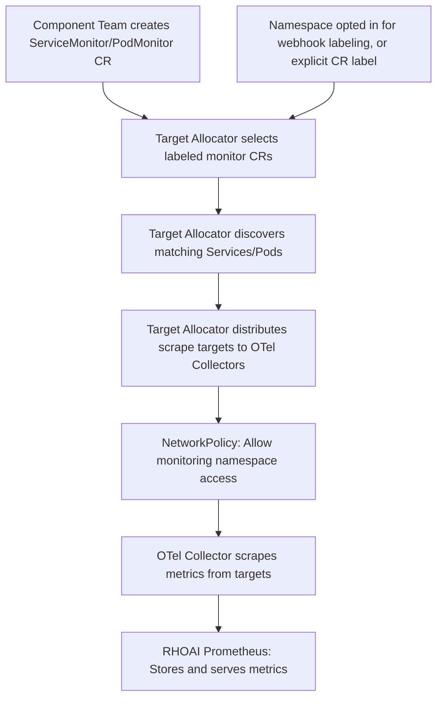

# Open Data Hub - Architecture Decision Record: RHOAI Component Metrics Scraping Guidelines

| **Date** | October 16, 2025 |
|----------|-------------------|
| **Scope** | RHOAI Platform |
| **Status** | Proposed |
| **Authors** | [Dayakar Maruboena](@dayakar349) |
| **Supersedes** | N/A |
| **Superseded by** | N/A |
| **Tickets** | RHOAIENG-25580 |
| **Other docs** | none |

## What

This ADR defines the guidelines for RHOAI component metrics scraping. It originally
documented three approaches: label-based pod scraping, ServiceMonitor CRs, and
PodMonitor CRs. The current modular `odh-observability` stack uses ServiceMonitor or
PodMonitor CRs with the OpenTelemetry Collector's Target Allocator. Pod-label-only
scraping described below applies to an earlier in-tree collector and is not a
supported enrollment method for the modular stack.

**Implementation clarification (2026-11-03):** In current upstream
`odh-observability`, `serviceMonitorSelector` and `podMonitorSelector` both match
`monitoring.opendatahub.io/scrape: "true"` **on the monitor CR**. The admission
webhook can inject that label into `monitoring.coreos.com/v1` monitors in a
namespace opted in with `monitoring.opendatahub.io/scrape=true`. An explicit
monitor label also works. The Target Allocator does not require the target
namespace to have `opendatahub.io/dashboard=true`. Verify the selector on the
*deployed* `OpenTelemetryCollector` when using a different platform version;
an earlier in-tree `rhods-operator` template used
`opendatahub.io/monitoring: "true"` instead. See the in-review
[ODH-ADR-Operator-0020](https://github.com/opendatahub-io/architecture-decision-records/pull/180)
for the proposed rule-evaluation contract; monitor enrollment and rule
evaluation are separate concerns.

## Why

As Red Hat OpenShift AI (RHOAI) grows in complexity with multiple components running across various namespaces, there is a need for clear guidelines on how components expose their metrics for collection by the RHOAI monitoring infrastructure. Different components have varying deployment patterns, service architectures, and monitoring requirements, necessitating multiple strategies for metrics collection while maintaining security and consistency.

Enabling component teams to own their monitoring configuration through ServiceMonitor/PodMonitor CRs provides better scalability, maintainability, and deployment flexibility compared to centralized label-based approaches.

## Goals

- Provide clear guidelines for component developers on metrics integration
- Support multiple deployment patterns (Deployments, StatefulSets, Services)
- Enable component teams to manage ServiceMonitors/PodMonitors independently
- Allow component teams to opt monitors into Target Allocator discovery
- Maintain security through controlled NetworkPolicy access and namespace isolation
- Support both simple and complex metrics collection scenarios

## Non-Goals

- Support non-Prometheus metrics formats
- Provide metrics storage or visualization (handled by existing Prometheus/Grafana stack)
- Define specific metrics that components should expose
- Handle metrics collection outside of Kubernetes environments
- Make a pod label alone enroll metrics in the current modular Target Allocator

## How

The modular stack supports ServiceMonitor and PodMonitor CR enrollment; the
pod-label-only approach in Section 1 describes the earlier in-tree stack.

### Metrics Collection Flow



### 1. Label-Based Pod Scraping (Earlier In-Tree Collector Only)

The modular `odh-observability` collector does not include this generic pod
scrape job. Use a ServiceMonitor or PodMonitor for a new component. The
following description is retained as historical context for older deployments.

Components can expose metrics by applying the `monitoring.opendatahub.io/scrape: "true"` label on their pods. The OpenTelemetry Collector uses Kubernetes pod discovery (`kubernetes_sd_configs` with `role: pod`) and a `relabel_configs` rule to filter pods with this label, scraping metrics on port 8080 at `/metrics`.

**Required:**
- `monitoring.opendatahub.io/scrape: "true"` - Pod label for OTel Collector pod discovery

**Limitations:**
- Metrics port is hardcoded to 8080 and path to `/metrics` in the collector configuration — these are not configurable per-pod
- For custom ports, paths, or multiple endpoints, use ServiceMonitor/PodMonitor CRs instead

**Automatic Application:** A mutating webhook automatically injects the `monitoring.opendatahub.io/scrape: "true"` label into any PodMonitor or ServiceMonitor created in a namespace that carries the `monitoring.opendatahub.io/scrape: "true"` label, provided a Monitoring CR exists in the cluster.

### 2. ServiceMonitor Custom Resource (Recommended)

ServiceMonitor CRs enable component teams to manage their own monitoring configuration independently. The modular Target Allocator discovers labeled ServiceMonitor CRs.

**Required Configuration:**
- **Webhook Opt-in**: Label the monitor's namespace `monitoring.opendatahub.io/scrape: "true"` for automatic CR labeling, or label the monitor CR explicitly. The Target Allocator does not use `opendatahub.io/dashboard` as a monitor discovery selector.
- **ServiceMonitor Labels**: ServiceMonitor CRs must have the label `monitoring.opendatahub.io/scrape: "true"` to be discovered by the Target Allocator
- **NetworkPolicy**: Target namespace must allow ingress from `redhat-ods-monitoring`

**Target Allocator Configuration:**
```yaml
prometheusCR:
  enabled: true
  serviceMonitorSelector:
    matchLabels:
      monitoring.opendatahub.io/scrape: "true"
```

**Component Team Responsibilities:**
- Create and maintain ServiceMonitor CRs in their namespace with the `monitoring.opendatahub.io/scrape: "true"` label
- Opt the monitor's namespace into webhook labeling or set the monitor label explicitly
- Configure `namespaceSelector.matchNames` in ServiceMonitor to list target namespaces
- Configure NetworkPolicy for metrics access
- Test metrics scraping in their deployment pipeline

### 3. PodMonitor Custom Resource (Recommended)

PodMonitor CRs enable direct pod-based metrics collection, ideal for StatefulSets and scenarios requiring pod-level granularity. The modular Target Allocator discovers labeled PodMonitor CRs.

**Required Configuration:**
- **Webhook Opt-in**: Label the monitor's namespace `monitoring.opendatahub.io/scrape: "true"` for automatic CR labeling, or label the monitor CR explicitly.
- **PodMonitor Labels**: PodMonitor CRs must have the label `monitoring.opendatahub.io/scrape: "true"` to be discovered by the Target Allocator
- **NetworkPolicy**: Target namespace must allow ingress from `redhat-ods-monitoring`

**Target Allocator Configuration:**
```yaml
prometheusCR:
  enabled: true
  podMonitorSelector:
    matchLabels:
      monitoring.opendatahub.io/scrape: "true"
```

**Component Team Responsibilities:**
- Create and maintain PodMonitor CRs in their namespace with the `monitoring.opendatahub.io/scrape: "true"` label
- Opt the monitor's namespace into webhook labeling or set the monitor label explicitly
- Configure `namespaceSelector.matchNames` in PodMonitor to list target namespaces
- Configure NetworkPolicy for metrics access
- Test metrics scraping in their deployment pipeline

### Namespace Labeling Strategy

**Current modular behavior:** Target Allocator discovery is based on the
`ServiceMonitor`/`PodMonitor` **CR label**, not an ODH dashboard label on
its namespace. Namespace opt-in enables webhook injection for unlabeled
monitors; the CR can instead carry the label explicitly. The monitor's
own `namespaceSelector` still determines which target namespaces it scrapes.

**Namespace Label for Automatic Injection (Optional When CR Is Explicitly Labeled):**
```yaml
monitoring.opendatahub.io/scrape: "true"     # Namespace opt-in for the webhook
```

**Labeling Responsibility:**
- **Webhook Path**: Opt the monitor's namespace in before creating an unlabeled monitor
- **Explicit CR Label Path**: Set `monitoring.opendatahub.io/scrape: "true"` on the monitor CR

**Verification:**
```bash
# Check webhook opt-in on the monitor's namespace
kubectl get namespace <namespace-name> --show-labels

# Opt in to automatic monitor labeling (if not labeling the CR explicitly)
kubectl label namespace <namespace-name> monitoring.opendatahub.io/scrape=true

# Confirm the monitor CR was labeled and verify the deployed allocator selector
kubectl get servicemonitor <monitor-name> -n <namespace-name> --show-labels
kubectl get opentelemetrycollector data-science-collector -n <monitoring-namespace> -o yaml
```

**Impact of Missing Labels:**
- Without namespace opt-in **and** without an explicit monitor CR label, the monitor will not match the current modular Target Allocator selector
- A monitor may be accepted by Kubernetes yet not discovered by Target Allocator; check the actual CR labels and deployed selector before moving recording rules

**Security Benefit:**
Explicit monitor selection limits unintended discovery; `namespaceSelector`, RBAC,
and NetworkPolicy must still constrain what a selected monitor can scrape.

### NetworkPolicy Requirements

All approaches require that the component namespace allows ingress from the RHOAI monitoring namespace (`redhat-ods-monitoring`). Components must define appropriate NetworkPolicy resources to permit metrics scraping.

**Note**: The monitoring namespace name is typically `redhat-ods-monitoring`. If deploying in a custom environment, verify the actual monitoring namespace name by checking your RHOAI deployment configuration.

### Strategy Selection Guidelines and Use Cases

#### When Label-Based Pod Scraping Was Used (Earlier In-Tree Collector)

**Best for simple, straightforward metrics collection scenarios:**
- Components with a **single metrics endpoint** on standard port (8080) and path (/metrics)
- **Operator-managed deployments** where the ODH operator can automatically apply labels
- Components that don't require **custom scraping configuration**
- **Quick setup** with minimal configuration overhead

**Limitations of label-based approach:**
- Limited to basic scraping configuration
- Cannot handle multiple endpoints with different configurations
- No support for advanced authentication or TLS settings
- Limited relabeling and metric transformation capabilities

#### When to Choose ServiceMonitor CR Over Label-Based Scraping

**ServiceMonitor provides advanced capabilities that label-based scraping cannot:**

**Multiple Endpoints:** Components exposing metrics on different ports/paths require separate endpoint configurations:
```yaml
# Example: Model serving with separate inference and admin metrics
endpoints:
- port: inference-metrics    # Business metrics on :8080/metrics
  interval: 15s
- port: admin-metrics       # Admin metrics on :9090/admin/metrics  
  interval: 60s
```

**Custom Authentication & TLS:** Enterprise components requiring secure metrics access:
- Bearer token authentication beyond default ServiceAccount tokens  
- Custom TLS configuration with specific certificate validation
- mTLS requirements for sensitive metrics

**Advanced Metric Processing:** Components needing metric transformation:
- Filtering specific metrics via relabeling rules
- Renaming metrics for consistency across the platform
- Adding custom labels based on Kubernetes metadata

**Service-Based Discovery:** Components where metrics should be accessed through Services rather than direct pod access for load balancing or service mesh integration.

#### When to Choose PodMonitor CR Over Label-Based Scraping

**PodMonitor provides pod-level capabilities that label-based scraping cannot:**

**StatefulSet Scenarios:** When individual pod metrics are critical:
```yaml
# Example: Distributed training where each replica has unique metrics
# Pod my-training-0: worker_rank=0, training_loss=0.23
# Pod my-training-1: worker_rank=1, training_loss=0.19  
```

**Sidecar Pattern Integration:** Components using service mesh or logging sidecars:
- Envoy proxy metrics from Istio sidecars
- Fluentd/Fluent Bit logging metrics
- Security scanning agent metrics

**Dynamic Pod Discovery:** Scenarios where Services might not be stable:
- Job-based workloads with temporary pods
- Auto-scaling deployments where pod IPs change frequently
- Development environments with frequent pod recreation

**Pod-Level Metadata:** When metrics need pod-specific context:
- Including pod name, IP, and node information in metrics
- Tracking per-pod resource utilization
- Debugging scenarios requiring pod-level granularity

## Implementation Examples

### Label-Based Scraping Example

```yaml
apiVersion: apps/v1
kind: Deployment
metadata:
  name: my-component
  namespace: redhat-ods-applications
spec:
  template:
    metadata:
      labels:
        monitoring.opendatahub.io/scrape: "true"
    spec:
      containers:
      - name: my-component
        image: my-component:latest
        ports:
        - containerPort: 8080
          name: metrics
```

### ServiceMonitor CR Example

```yaml
apiVersion: monitoring.coreos.com/v1
kind: ServiceMonitor
metadata:
  name: my-component-monitor
  namespace: redhat-ods-applications
  labels:
    component: my-component
    monitoring.opendatahub.io/scrape: "true"
spec:
  selector:
    matchLabels:
      app: my-component
  endpoints:
  - port: metrics
    path: /metrics
    interval: 30s
    scrapeTimeout: 10s
  # Example: Multiple endpoints with different configurations
  - port: admin-metrics
    path: /admin/metrics
    interval: 60s
    scrapeTimeout: 15s
    relabelings:
    - sourceLabels: [__name__]
      regex: my_component_admin_(.+)
      targetLabel: __name__
      replacement: admin_${1}
  namespaceSelector:
    matchNames:
      - redhat-ods-applications
```

### PodMonitor CR Example

```yaml
apiVersion: monitoring.coreos.com/v1
kind: PodMonitor
metadata:
  name: my-stateful-component-monitor
  namespace: redhat-ods-applications
  labels:
    component: my-stateful-component
    monitoring.opendatahub.io/scrape: "true"
spec:
  selector:
    matchLabels:
      app: my-stateful-component
  podMetricsEndpoints:
  - port: metrics
    path: /metrics
    interval: 30s
    # Add pod-specific metadata to metrics
    relabelings:
    - sourceLabels: [__meta_kubernetes_pod_name]
      targetLabel: pod_name
    - sourceLabels: [__meta_kubernetes_pod_ip]
      targetLabel: pod_ip
  namespaceSelector:
    matchNames:
      - redhat-ods-applications
```

### NetworkPolicy Example

```yaml
apiVersion: networking.k8s.io/v1
kind: NetworkPolicy
metadata:
  name: allow-monitoring-ingress
  namespace: redhat-ods-applications
spec:
  podSelector:
    matchLabels:
      app: my-component
  policyTypes:
  - Ingress
  ingress:
  - from:
    # Required: Allow access from monitoring namespace
    - namespaceSelector:
        matchLabels:
          kubernetes.io/metadata.name: redhat-ods-monitoring
    ports:
    - protocol: TCP
      port: 8080
```

### Key Implementation Notes

- **Label Consistency**: For the modular Target Allocator, include `monitoring.opendatahub.io/scrape: "true"` on the ServiceMonitor/PodMonitor CR (directly or via the opt-in namespace's webhook). Pod-only labels describe the earlier in-tree collector and do not enroll a monitor in the modular stack. Check the deployed selector on older builds.
- **Namespace Isolation**: `namespaceSelector` in ServiceMonitor/PodMonitor CRs provides an additional security boundary beyond NetworkPolicy
- **Port Naming**: Use descriptive port names (`metrics`, `admin-metrics`) to improve clarity and maintainability
- **NetworkPolicy Requirements**: Every component must include NetworkPolicy rules allowing ingress from `redhat-ods-monitoring` namespace

## Technical Implementation Details

### OpenTelemetry Collector Integration with Target Allocator

The current modular collector uses **Target Allocator** for
`monitoring.coreos.com/v1` `ServiceMonitor`/`PodMonitor` discovery. The
generic label-based pod scrape described in Section 1 belongs to an
earlier in-tree collector, not the modular collector.

#### Target Allocator Implementation

The Target Allocator is a component of the OpenTelemetry Operator that discovers Prometheus Custom Resources (ServiceMonitor/PodMonitor) and distributes scrape targets to OpenTelemetry Collector instances.

**Key Implementation Details:**
- Uses Target Allocator to discover ServiceMonitor/PodMonitor CRs labeled with `monitoring.opendatahub.io/scrape: "true"`
- ServiceMonitors/PodMonitors filter target namespaces using `namespaceSelector.matchNames` to list specific namespace names
- Supports both ServiceMonitor and PodMonitor discovery
- Enables decentralized monitoring configuration management

**OpenTelemetryCollector CR Configuration:**
```yaml
apiVersion: opentelemetry.io/v1beta1
kind: OpenTelemetryCollector
metadata:
  name: odh-monitoring-collector
  namespace: redhat-ods-monitoring
spec:
  mode: statefulset
  targetAllocator:
    enabled: true
    serviceAccount: odh-prometheus-operator  # Requires broad RBAC permissions
    prometheusCR:
      enabled: true
      serviceMonitorSelector:
        matchLabels:
          monitoring.opendatahub.io/scrape: "true"
      podMonitorSelector:
        matchLabels:
          monitoring.opendatahub.io/scrape: "true"
  config:
    receivers:
      prometheus:
        config:
          scrape_configs:
          - job_name: 'serviceMonitor'  # Managed by Target Allocator
          - job_name: 'podMonitor'      # Managed by Target Allocator
```

**Target Allocator Capabilities:**
- **CR Discovery**: Automatically discovers ServiceMonitor and PodMonitor CRs cluster-wide
- **Target Filtering**: Each ServiceMonitor/PodMonitor specifies which namespaces to scrape using `namespaceSelector`
- **Target Distribution**: Distributes scrape targets across multiple collector instances (for scaling)
- **Dynamic Updates**: Watches for CR changes and updates scrape configs in real-time

**RBAC Requirements:**
The Target Allocator requires elevated permissions to watch ServiceMonitor/PodMonitor CRs and discover endpoints across namespaces:
```yaml
apiVersion: v1
kind: ServiceAccount
metadata:
  name: odh-prometheus-operator
  namespace: redhat-ods-monitoring
---
# ClusterRole with permissions to:
# - List/watch ServiceMonitor and PodMonitor CRs
# - List/watch Services, Endpoints, and Pods
# - Access namespace metadata for filtering
```

### Automatic Label Application

A mutating webhook automatically injects the `monitoring.opendatahub.io/scrape: "true"` label into any PodMonitor or ServiceMonitor when:
1. The resource's namespace carries the `monitoring.opendatahub.io/scrape: "true"` label
2. A Monitoring CR (`default-monitoring`) exists in the cluster
3. The label is not already set on the resource (respects user-set values)

## Open Questions

N/A

## Alternatives

N/A

## Security and Privacy Considerations

- **NetworkPolicy Enforcement**: All metrics endpoints must be protected by NetworkPolicy rules that explicitly allow access only from the monitoring namespace
- **Authentication**: Components exposing sensitive metrics should implement bearer token authentication using Kubernetes ServiceAccount tokens
- **TLS Configuration**: HTTPS endpoints should use proper TLS configuration with certificate verification
- **Metric Filtering**: Components should avoid exposing sensitive data in metric labels or values
- **Namespace Isolation**: The `monitoring.opendatahub.io/scrape` label on PodMonitor/ServiceMonitor CRs controls scrape discovery selection. Access enforcement is handled by NetworkPolicy and RBAC

## Risks

- **Target Allocator Performance**: High number of ServiceMonitor/PodMonitor CRs across many namespaces may impact Target Allocator resource usage and discovery latency
- **RBAC Permission Scope**: Target Allocator requires broad cluster permissions to watch CRs and discover endpoints across namespaces
- **Monitor Label Dependency**: Missing or incorrect monitor labels cause silent discovery failures; if relying on injection, also verify namespace opt-in and webhook health
- **Network Policy Misconfiguration**: Incorrectly configured NetworkPolicies could block legitimate metrics collection or allow unauthorized access
- **Component Team Learning Curve**: Teams need to understand ServiceMonitor/PodMonitor CR semantics and Prometheus configuration
- **OpenTelemetry Collector Performance**: High-cardinality metrics from many components could impact collector performance
- **Decentralized Configuration Drift**: Without governance, component teams may create inconsistent or inefficient scraping configurations

## Stakeholder Impacts

| Group                       | Impact                                                      |
| --------------------------- | ----------------------------------------------------------- |
| Component Development Teams | Responsible for creating and maintaining ServiceMonitor/PodMonitor CRs in their namespaces; must ensure namespace labeling and NetworkPolicy configuration |
| Platform Engineering        | Deploys and maintains Target Allocator infrastructure; manages namespace labeling for ODH-managed namespaces; provides templates and documentation |

## References

- [Prometheus Operator Documentation](https://prometheus-operator.dev/)
- [OpenTelemetry Operator Documentation](https://opentelemetry.io/docs/kubernetes/operator/)
- [ServiceMonitor API Reference](https://prometheus-operator.dev/docs/operator/api/#monitoring.coreos.com/v1.ServiceMonitor)
- [PodMonitor API Reference](https://prometheus-operator.dev/docs/operator/api/#monitoring.coreos.com/v1.PodMonitor)

## Reviews

| **Reviewed by** | **Date** | **Notes** |
|-----------------|----------|-----------|
