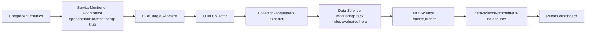

# Open Data Hub - ODH-ADR-Operator-0020 - Component Recording Rules and Alerts on the Data Science MonitoringStack

|                |            |
| -------------- | ---------- |
| Date           | 2026-10-30 |
| Scope          | RHOAI Platform (observability), all components shipping recording rules or alerts |
| Status         | Draft |
| Authors        | [Adrián Sanz](@asanzgom) |
| Supersedes     | N/A |
| Superseded by: | N/A |
| Tickets        | [RHAISTRAT-2418](https://redhat.atlassian.net/browse/RHAISTRAT-2418), [RHAI-491](https://redhat.atlassian.net/browse/RHAI-491) |
| Other docs:    | ODH-ADR-Operator-0010 (component metrics scraping), ODH-ADR-Operator-0011 (Perses dashboard guidelines) |

## What

Component recording rules and alerts are delivered as `monitoring.rhobs/v1` `PrometheusRule` resources in the platform monitoring namespace, evaluated by the Data Science MonitoringStack. They are not delivered as `monitoring.coreos.com/v1` resources in component namespaces evaluated by OpenShift user-workload monitoring (UWM).

This ADR makes explicit a contract that the operator already implements but that no ADR states.

## Why

ODH-ADR-Operator-0011 established `data-science-prometheus-datasource` as the datasource for RHOAI platform metrics in Perses dashboards. That datasource resolves to the Data Science ThanosQuerier:

```
http://thanos-querier-data-science-thanos-querier.<monitoring-ns>.svc.cluster.local:10902
```

The `ThanosQuerier` CR selects stores by `platform.opendatahub.io/part-of: monitoring` within the monitoring namespace only. It does not federate user-workload monitoring. A rule evaluated by UWM is therefore invisible to any dashboard following ODH-ADR-Operator-0011.

The failure mode is silent. Panels render empty rather than erroring, so the gap surfaces during demos rather than CI.

ODH-ADR-Operator-0010 covers how raw metrics are *scraped* into the platform. Nothing states where rules are *evaluated*. Component teams have reasonably concluded that a `PrometheusRule` deployed by an install script into their own namespace is sufficient, which produces a dashboard that cannot work.

The concrete trigger is MaaS Authorino auth decision metrics ([models-as-a-service#1363](https://github.com/opendatahub-io/models-as-a-service/pull/1363)): recording rules shipped by `install-observability.sh` as `monitoring.coreos.com/v1` into the Kuadrant namespace, consumed by a Perses dashboard pointed at `data-science-prometheus-datasource`. The two ends do not meet. The same mismatch is reachable by any component.

## Goals

* State a single evaluation plane for component recording rules and alerts.
* Guarantee that a dashboard conforming to ODH-ADR-Operator-0011 resolves the rules it queries.
* Remove UWM as a dependency for RHOAI component observability.
* Describe the migration path for rules currently evaluated by UWM.
* Make the "rules exist but the dashboard is empty" failure detectable.

## Non-Goals

* Change how raw metrics are scraped. ODH-ADR-Operator-0010 continues to govern that.
* Define Perses dashboard authoring. ODH-ADR-Operator-0011 continues to govern that.
* Remove or disable UWM at the cluster level. Customer workloads may continue to use it.
* Prescribe which metrics or SLOs a component should define.
* Address tracing or logging. ODH-ADR-Operator-0009 covers tracing.

## How

### Delivery

Component rules ship with the operator, not with component install tooling:

```
internal/controller/components/<component>/monitoring/<component>-prometheusrules.tmpl.yaml
```

```yaml
apiVersion: monitoring.rhobs/v1
kind: PrometheusRule
metadata:
  name: <component>-prometheusrules
  namespace: {{.Namespace}}
spec:
  groups: [...]
```

`{{.Namespace}}` is the monitoring namespace from the `DSCInitialization`. The MonitoringStack is created with `resourceSelector: {}`, so every `monitoring.rhobs/v1` rule in that namespace is picked up with no additional labelling.

This is already the shipped pattern for `dashboard`, `datasciencepipelines`, `feastoperator`, `kserve`, `kueue`, `llamastackoperator`, `modelcontroller`, `modelregistry`, `modelsasservice`, `ray`, `sparkoperator`, `trainer`, `trainingoperator`, `trustyai`, and `workbenches`. New rules extend the existing per-component file rather than introducing a parallel delivery mechanism.

### Prerequisite: the metric must reach the Data Science Prometheus first

Moving a rule is not sufficient. The series it references must already be in the Data Science MonitoringStack. Metrics arrive through the collector, not by the MonitoringStack scraping components directly:



The Target Allocator discovers `ServiceMonitor` and `PodMonitor` CRs carrying the label `opendatahub.io/monitoring: "true"`. A component whose endpoint is not yet discovered this way must add that monitor before, or in the same change as, moving its rules.

> ODH-ADR-Operator-0010 describes this selector as `monitoring.opendatahub.io/scrape: "true"` on pods and namespace filtering on `opendatahub.io/dashboard=true`. The shipped Target Allocator configuration uses `opendatahub.io/monitoring: "true"` on the monitor CR. Where the two disagree, the operator configuration is authoritative; ODH-ADR-Operator-0010 should be corrected.

### Authoring constraints

* Rule and alert names share a namespace across all components. Prefix recording rules with the component, for example `maas:auth_deny_ratio:rate5m`.
* Templates are rendered as Go templates. PromQL label references must be escaped: ``{{`{{`}}$labels.instance{{`}}`}}``.
* Ratio expressions should carry an explicit zero fallback (`or on() vector(0)`) so dashboards distinguish "zero" from "no data".
* Alerts should carry `severity`, and `component` matching the DSC component name.

### Transition

`cluster-prometheus-datasource` is currently shipped with `default: true` and is annotated in the operator as a short-term workaround "until decentralized metrics collection is implemented". `data-science-prometheus-datasource` ships with `default: false`.

This ADR does not change those defaults. It states the target: dashboards that explicitly reference `data-science-prometheus-datasource` are correct and must have their rules evaluated on the MonitoringStack. A component in flight has two acceptable states, and must pick one deliberately rather than landing between them:

1. **Fully migrated.** Monitor labelled for the Target Allocator, rules in the operator's `monitoring.rhobs/v1` file, dashboard on `data-science-prometheus-datasource`.
2. **Not yet migrated.** Rules remain UWM-evaluated and the dashboard references `cluster-prometheus-datasource`, with a tracking ticket.

The unacceptable state is a dashboard on `data-science-prometheus-datasource` whose rules are still UWM-evaluated, because it renders empty without error.

### Verification

Dashboard verification must query through the datasource the dashboard itself references. Querying Prometheus or Thanos directly passes against a dashboard that renders blank for users, so it does not demonstrate the dashboard works.

## Alternatives

### Keep rules on UWM and point dashboards at `cluster-prometheus-datasource`

Works today with no migration, and matches the current `default: true`. Rejected as an end state: it contradicts ODH-ADR-Operator-0011, leaves two evaluation planes with different RBAC, retention, and alert routing, and keeps a UWM dependency the platform is trying to shed. Acceptable only as the explicit "not yet migrated" state above.

### Federate user-workload monitoring into the Data Science ThanosQuerier

Add UWM as a store so both planes are queryable from one datasource. Avoids moving any rules and fixes dashboards immediately. Rejected: it doubles storage and query cost for the same series, makes rule ownership ambiguous, entrenches the UWM dependency, and widens the platform's query surface to all customer workload metrics, including ones RHOAI has no RBAC story for.

### Let each component ship its own PrometheusRule via install scripts

The current MaaS approach. Rejected: resources are not lifecycle-managed, so they are not upgraded, reconciled, or removed with the component; they are invisible to the operator's drift detection; and they place rules in namespaces the MonitoringStack does not watch.

### Have the MonitoringStack watch component namespaces

Set a `namespaceSelector` so rules can live next to their components. Rejected for now: it makes any namespace owner able to inject rules into the platform alerting plane, and rule and alert names are global, so a component could silently shadow a platform alert.

## Security and Privacy Considerations

Rules live in the platform monitoring namespace and are delivered by the operator, so adding one requires an operator pull request and architect review. This is intentional: alerting is a platform-wide surface and component teams should not be able to self-serve arbitrary alerts or recording rules into it.

Alert routing is handled by the MonitoringStack Alertmanager. Teams moving alerts from UWM should confirm the destination routing exists before migrating, otherwise alerts will evaluate correctly and go nowhere.

## Risks

* **Label schema drift.** Series arriving through the OTel collector may not carry the same labels as direct UWM scraping. Expressions grouping on labels such as `authconfig` or `namespace` must be re-verified on cluster after migration, not assumed.
* **Migration window.** Between moving the dashboard and moving the rules, panels are empty. Components should move the monitor, rules, and dashboard together.
* **Name collisions.** A shared rule namespace across fifteen-plus components will eventually collide without the prefix convention.
* **Cardinality.** Consolidating component rules onto one MonitoringStack concentrates evaluation cost that was previously spread across UWM.
* **Documentation drift.** ODH-ADR-Operator-0010's selector names already disagree with the shipped configuration, which is partly why this gap went unnoticed.

## Stakeholder Impacts

| Group | Key Contacts | Date | Impacted? |
| --- | --- | --- | --- |
| Platform / Operator | @opendatahub-io/platform | 2026-10-30 | Yes |
| Model Serving / MaaS | @opendatahub-io/model-serving | 2026-10-30 | Yes |
| Components shipping rules | per-component owners | 2026-10-30 | Yes |
| QE | | 2026-10-30 | Yes |
| Dashboard | @opendatahub-io/exploring-team | 2026-10-30 | Maybe |

* **Platform / Operator** owns the MonitoringStack, the datasource defaults, and the per-component rule templates; absorbs the review load for incoming rules.
* **Model Serving / MaaS** is the first migration under RHAI-491 and holds the open dashboard change.
* **Components shipping rules** inherit the authoring constraints and the prefix convention.
* **QE** must verify dashboards through the referenced datasource rather than querying Prometheus directly.
* **Dashboard** is affected only where RHOAI UI surfaces embed Perses dashboards.

## References

* ODH-ADR-Operator-0009 - Observability tracing strategy
* ODH-ADR-Operator-0010 - RHOAI component metrics scraping guidelines
* ODH-ADR-Operator-0011 - Perses dashboard guidelines
* ODH-ADR-Operator-0011 - RHOAI component metrics-based autoscaling (Thanos querier endpoint)
* [models-as-a-service#1363](https://github.com/opendatahub-io/models-as-a-service/pull/1363) - datasource direction discussion

## Reviews

| Reviewed by | Date | Notes |
| --- | --- | --- |
| | | |
