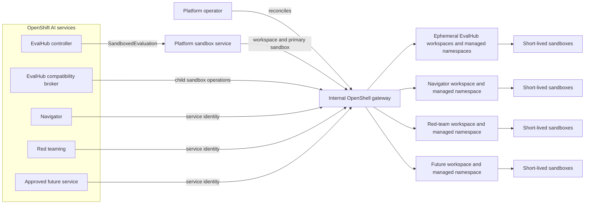

# Open Data Hub - Internal OpenShell Gateway

|                | |
| -------------- | --- |
| Date           | 2026-10-16 |
| Scope          | Operator / Platform Infrastructure / Agent Sandboxing |
| Status         | Draft |
| Authors        | Ann Marie Fred |
| Supersedes     | N/A |
| Superseded by: | N/A |
| Tickets        | [RHAISTRAT-2289](https://redhat.atlassian.net/browse/RHAISTRAT-2289) |
| Other docs:    | [EvalHub sandboxed evaluation runtime proposal](https://github.com/eval-hub/eval-hub/blob/62ebf38b810bef9d06ff2d96c9777d50c3497bc3/docs/adr/0001-sandboxed-evaluation-runtime-for-agentic-frameworks.md), [Data access / Asago policy proposal](https://docs.google.com/document/d/1l9cVsWPcgpp61uq7zwqhs2NMEHK4BXXBtii0GMp5mcE/edit?tab=t.0#heading=h.zgh6ittvb1g4) |

## What

Deploy one platform-managed OpenShell gateway for internal use by OpenShift AI services. The gateway provides a consistent control plane for creating short-lived, policy-constrained sandboxes used as an implementation detail of those services.

The internal gateway is not a cluster-wide OpenShell service for customers. Customer-created agents, independently managed agents, and agents with a lifecycle beyond a bounded service operation use a separate customer-managed OpenShell gateway or another customer-selected runtime.

## Why

Several OpenShift AI services need to execute untrusted or agent-selected code. Current and candidate use cases include:

- EvalHub evaluations of agentic frameworks that require pod execution.
- Adversarial evaluations and red teaming of agents and sandbox controls.
- Navigator agent execution.
- Data-access workflows whose tools require explicit policy enforcement.
- Short-lived, service-owned demonstration agents created by services such as AutoML or AutoRAG.

The existing EvalHub proposal makes an ephemeral namespace, a restricted pod broker, and operator-owned cleanup its P0 boundary, with OpenShell added later as a P1 policy layer. That proposal is an input to this decision rather than a fixed constraint. For cluster-based sandboxed evaluations, this ADR partially supersedes the proposal's P0 execution architecture and its rejection of OpenShell-provisioned workloads. Maintaining both a custom EvalHub sandbox control plane and a shared OpenShell control plane would duplicate namespace lifecycle, workload creation, policy, credential, and audit behavior. This ADR instead makes the internal OpenShell deployment the baseline for sandbox-required EvalHub runs while retaining the useful `SandboxedEvaluation` lifecycle contract and Kubernetes API compatibility surface. The EvalHub ADR must be updated to reference this decision if this ADR is accepted.

If each service deploys and configures OpenShell independently, the product will acquire incompatible security policies, credentials, lifecycle behavior, and qualification criteria. A shared internal deployment gives these services a supported dependency with one owner and a common security baseline.

A single gateway for every user and workload in the cluster was considered and rejected. Its administrators would cross customer tenancy and ownership boundaries, and product upgrades or policy changes could affect customer-managed agents. Sharing is appropriate only inside the narrower trust and lifecycle boundary of OpenShift AI's own services.

## Goals

- Provide one supported OpenShell gateway per OpenShift AI installation for approved internal services.
- Give the gateway, its credentials, and its sandbox infrastructure a clear platform owner and lifecycle.
- Isolate consuming services from one another through separate OpenShell workspaces, Kubernetes namespaces, identities, credentials, quotas, and policies.
- Start every sandbox from a deny-by-default policy and add only the access required for its service-owned operation.
- Restrict the gateway API to authenticated OpenShift AI service workloads; customers do not administer or directly use it.
- Support short-lived sandboxes with bounded execution time and deterministic cleanup.
- Establish common observability, audit, security testing, and upgrade requirements for internal sandbox execution.
- Make EvalHub an initial consumer without building a second, overlapping sandbox security stack.
- Let services adopt the gateway incrementally without defining product commitments or release dates in this ADR.

## Non-Goals

- Provide a general-purpose or customer-facing OpenShell service.
- Provide one OpenShell gateway for all customer and platform workloads in a cluster.
- Host customer-created agents or agents whose lifecycle is independent of a single, bounded service operation.
- Replace customer-managed OpenShell gateways.
- Define the detailed workflow, image, tools, or sandbox policy for every consuming service.
- Replace EvalHub's existing plain Kubernetes Job path for evaluations that do not require sandboxing.
- Promise compatibility with arbitrary Kubernetes Pod API behavior that cannot be represented safely as OpenShell sandbox operations.
- Claim that a sandbox makes arbitrary code safe. The deployment remains subject to OpenShell, Kubernetes, container-runtime, kernel, and cluster-network security boundaries.
- Select a release target or product maturity level for each consumer.
- Require every code-execution use case in OpenShift AI to use OpenShell when its threat model or runtime requirements call for a different isolation technology.

## How

### Deployment and ownership

A dedicated OpenShift AI infrastructure operator deploys and reconciles the internal OpenShell gateway and its supporting resources. The responsible operator may be an existing platform operator or a new module operator; the final owner is an open question, but ownership must not be split across consuming services.

The operator owns:

- The pinned OpenShell release and gateway configuration.
- The gateway workload, Service, certificates, signing material, persistent state, and backup or recovery configuration.
- Managed-workspace configuration, namespace templates, and the admission guardrails under which OpenShell creates and removes workspace namespaces.
- Gateway and workspace RBAC, service identities, NetworkPolicies, quotas, limits, and default sandbox policy.
- Credential-provider integration and the boundary between platform credentials and sandbox processes.
- Readiness, upgrades, rollback, cleanup, telemetry, and product-level qualification.

For platform-created sandboxes, the deployment uses OpenShell's Kubernetes compute driver in `managed` workspace mode. OpenShell creates one Kubernetes namespace for each OpenShell workspace and owns that namespace's lifecycle. This keeps namespace provisioning and cleanup automatic for high-churn service operations and avoids making platform administrators provision every workspace namespace manually. On OpenShift, OpenShell leaves the SCC annotations unset, waits for the cluster namespace allocator to assign a unique MCS label, UID range, and supplemental-group range, and only then creates the workspace ServiceAccount and sandbox workloads.

The operator generates and persists a unique, immutable, DNS-1123-compatible gateway identifier derived from the OpenShift AI installation identity. It must not rely on the chart's default name. The identifier is part of the gateway's signing identity, managed namespace names, and namespace ownership records. Reinstallation, upgrade, and recovery preserve it. A second OpenShell gateway on the cluster must use a different identifier.

The operator installs the internal gateway with at least one default namespace template. Every managed workspace resolves to that template unless its approved service integration selects another operator-provided template. The default supplies the product's minimum resource, security, storage, network, and pod-placement controls; there is no untemplated fallback. The operator may ship additional named namespace templates for workload classes that need different quotas, storage, scheduling, runtime, or network constraints. Only the platform operator can create, update, select as a default, or remove these templates. An update affects new workspace namespaces unless the template contract explicitly defines and qualifies reconciliation of existing namespaces.

The rendered Helm values include this configuration:

```yaml
gatewayConfig:
  openshell.gateway:
    compute_driver: kubernetes
  openshell.gateway.gateway_jwt:
    gateway_id: "<operator-generated-stable-id>"
  openshell.drivers.kubernetes:
    workspace_mode: managed
```

Managed mode requires cluster-scoped permissions to create and delete namespaces and to manage sandbox resources within them. Kubernetes RBAC alone cannot restrict those operations to namespaces owned by this gateway. The deployment is therefore supported only with platform-owned admission enforcement that runs outside the gateway's trust boundary. The platform installation owns and audits both the RBAC and the admission control. It does not install the `openshell-workspace` chart into managed namespaces.

The admission control authenticates the gateway's Kubernetes ServiceAccount and enforces all of the following:

- Namespace creation is limited to the naming scheme for the gateway's unique identifier. After Kubernetes assigns the namespace UID, a platform controller registers that UID to the gateway before any sandbox operation is admitted.
- Namespace deletion and namespaced resource mutation by the gateway are allowed only when the authoritative ownership record identifies that namespace UID as belonging to this gateway. Caller-supplied names, prefixes, or labels alone are not sufficient proof of ownership.
- Ownership metadata and other reserved namespace labels or annotations cannot be created, changed, or removed by consuming services, sandbox workloads, customer-managed gateways, or an OpenShell gateway outside its namespace-creation flow.
- A platform-administrator-owned OpenShell namespace template supplies required `ResourceQuota`, `LimitRange`, security labels, NetworkPolicies, storage policy, and sandbox pod-placement defaults. Sandbox custom resources, Pods, Services, Secrets, and persistent storage remain denied until the template has been applied successfully and a platform-controlled readiness marker is present.
- Requests against customer namespaces, another gateway's namespaces, unregistered namespaces, and pre-created namespaces that spoof the expected name or labels are denied.

The target design requires OpenShell to support the namespace template and provisioning barrier described below. The OpenShift AI operator may provide an equivalent implementation during development, but that does not remove the required OpenShell capability from the supported architecture. Enforcement must remain fail closed and must not trust the gateway to attest its own scope. If the selected OpenShell and platform versions cannot guarantee this ordering without a gap between namespace creation and sandbox admission, managed mode is not supportable for this deployment. Qualification also enforces the OpenShell v0.1.4 OpenShift prerequisites, including OpenShift 4.19 or later and a CNI that enforces ingress and egress `NetworkPolicy`.

Each consuming service receives at least one dedicated workspace. A service may receive additional workspaces when separate isolation, credential, quota, or lifecycle boundaries are required. Short-lived service operations may receive ephemeral workspaces when they require a namespace boundary of their own. Disabling one consumer must not remove the gateway or another consumer's workspaces.

The gateway is reachable only on the cluster network. It has no user-facing Route, Ingress, or externally attached `GRPCRoute`. Direct customer CLI access is unsupported. Authentication must identify the calling service workload, and authorization must limit it to its assigned workspace and operations. An unauthenticated or plaintext gateway is not permitted, even when a NetworkPolicy limits reachability.



### Required OpenShell changes

OpenShell v0.1.4 is the behavioral reference for this ADR, but it does not provide every control required by the target architecture. The following capabilities must be implemented in OpenShell upstream or carried as supported downstream changes before this deployment is supported. An issue or design proposal is not considered an implemented capability; each item must be tied to a qualified OpenShell version in the product support matrix.

| Capability | Required OpenShell change | Release condition |
| --- | --- | --- |
| Managed namespace templates | Let a platform administrator define an immutable template for namespaces created by managed workspace mode, configure one template as the mandatory default, and provide additional named templates for approved workload classes. The template must support at least `ResourceQuota`, `LimitRange`, required labels and annotations, NetworkPolicies, storage constraints, and other approved namespace policy. It must also define protected pod-placement defaults, including node selectors or affinity and tolerations, so OpenShell workloads can be restricted to dedicated, tainted agent nodes. | OpenShell refuses to create a managed workspace when no valid default or explicitly selected approved template is available. It applies namespace resources after OpenShift allocates the namespace security ranges but before it creates or admits a ServiceAccount, Sandbox custom resource, Pod, Service, Secret, PVC, or other sandbox resource. It applies the scheduling defaults to every sandbox workload and supervisor Pod, and callers cannot remove or weaken them. Failure leaves the workspace visibly blocked and admits no workload. |
| Managed-namespace ownership handshake | Expose the created namespace name and UID to a platform-owned admission integration, then pause provisioning until that integration registers ownership and marks the namespace ready. OpenShell must use the recorded UID for later mutation and deletion so a deleted and recreated namespace with the same name is not adopted. | Create, retry, recovery, and deletion fail closed on an absent, stale, or mismatched ownership record. The handshake has bounded timeouts and an observable error state rather than an unguarded fallback. |
| Enforceable sandbox profiles | Add an administrator-controlled profile that binds the approved workload template or image, effective policy, providers, runtime isolation, resources, and service-exposure permissions. The resolved candidate must be available to server-side admission, and callers must not be able to omit the profile or override its protected fields through `CreateSandbox`, provider attachment, policy updates, configuration updates, or service exposure. | Every consumer integration can be expressed as a server-enforced profile and negative tests prove that a workspace user cannot substitute an image, policy, provider, `RuntimeClass`, resource request, or exposed service outside that profile. |
| OpenShift workload identity and scoped automation | Support audience-bound OpenShift ServiceAccount authentication for API callers, either through Kubernetes `TokenReview` or an equivalently qualified OIDC contract, and map the identity to workspace-scoped permissions. Provide an automation role for workspace lifecycle and membership that does not also grant unrestricted credential or platform administration. | The platform sandbox service and each consumer authenticate without shared user credentials or full Platform Admin authority, and compromise of one consumer identity does not grant access to another consumer's workspace. |
| Recoverable managed lifecycle | Make managed namespace and sandbox operations idempotent and recoverable after gateway, driver, API-server, or controller failure. Provide a supported way to clear or reconcile a permanently pending driver operation and reclaim an orphaned namespace by its recorded UID. | Cleanup finalizers have bounded retries and can reach a reported terminal state without silently leaking a workload or requiring unsupported database edits. |

The OpenShift AI implementation may add external admission, identity, or reconciliation components around OpenShell, but those components cannot compensate for an OpenShell operation that launches a workload before the required control can run. Any temporary downstream implementation must preserve the same API invariants and qualification criteria so it can be replaced by the upstream capability without weakening the boundary.

### Consumer contract

An OpenShift AI service may use the internal gateway only after its integration is reviewed and added to the operator's declarative OpenShell configuration. Each integration defines:

- A dedicated service identity and OpenShell workspace.
- One OpenShell-managed Kubernetes namespace per workspace, created through `managed` workspace mode.
- The allowed sandbox images, with immutable digests in supported releases.
- An operator-enforced `standard` or `kata` runtime isolation profile.
- CPU, memory, storage, sandbox-count, and execution-time limits, plus accelerator limits only for integrations explicitly approved to use accelerators.
- The operator-owned OpenShell namespace template selected for the integration, or the mandatory platform default when no specialized template is required.
- A deny-by-default network and filesystem policy plus the narrowly scoped additions required by the workload.
- Credential providers and destination bindings, if credentials are required.
- Sandbox ownership labels, correlation identifiers, logs, metrics, and audit retention.
- Cancellation, timeout, garbage-collection, and failure-recovery behavior.
- Positive and negative security qualification cases.

The consuming service owns the business operation. It requests sandbox creation through its service identity, records the returned sandbox identifier, and remains responsible for cancellation and explicit deletion. The platform operator supplies a backstop time-to-live controller or equivalent reconciliation so abandoned sandboxes, workspaces, namespaces, and storage are eventually removed after caller failure.

The gateway is not a durable agent registry. A sandbox is subordinate to one service operation, such as an evaluation run, red-team test, or ephemeral demonstration. It must have a finite maximum lifetime. If a use case needs users to reconnect later, manage the agent independently, preserve a long-running workspace, or control its policies and credentials, that use case must use a separate customer-managed gateway.

### EvalHub integration

For cluster-based sandboxed evaluations, this decision partially supersedes the execution architecture in EvalHub ADR 0001. It does not supersede that ADR's other lifecycle, API, or user-experience decisions except where this section says otherwise.

The internal OpenShell gateway is the required cluster runtime for EvalHub providers that declare sandboxing as mandatory. OpenShell is part of the baseline for those providers rather than a later policy enhancement. EvalHub's existing plain Kubernetes Job path remains unchanged for providers that do not require sandboxing. A sandbox-required provider must fail closed when the internal gateway or its required isolation profile is unavailable; it must not silently use the plain Kubernetes Job path.

EvalHub local mode is not backed by the product-internal gateway and is outside this ADR's supported cluster sandbox contract. It may retain EvalHub ADR 0001's warn-and-allow behavior for local development, but local-mode execution must not be reported as providing the platform sandbox guarantee.

EvalHub retains the `SandboxedEvaluation` custom resource as its asynchronous lifecycle and status contract. Its reconciler no longer creates the evaluation namespace, Job, ServiceAccount, Role, or NetworkPolicy directly. Instead, it requests an ephemeral OpenShell workspace and a primary sandbox from the platform sandbox service, records their identifiers in status, and mirrors OpenShell readiness and failure conditions. A finalizer cancels active sandboxes, exports required results, deletes workspace-scoped OpenShell resources, and requests workspace deletion. OpenShell managed mode then deletes the corresponding Kubernetes namespace.

Each `SandboxedEvaluation` receives a short-lived OpenShell workspace and therefore a dedicated managed Kubernetes namespace. This preserves the namespace-first isolation goal of the EvalHub proposal while delegating namespace creation and deletion to OpenShell. The platform controller creates the workspace, grants the EvalHub service identity only the required workspace-user access, and removes that access during cleanup. EvalHub does not receive OpenShell Platform Admin credentials. Workspace names use a bounded generated identifier, while labels and status retain the full evaluation correlation identifier.

Some agentic evaluation frameworks expect a restricted Kubernetes-compatible API for child pods. EvalHub retains `eval-sandbox-broker` only as a compatibility adapter for that surface. The broker translates the supported `create`, `get`, `delete`, `exec`, `log`, and `attach` operations into child OpenShell sandbox operations in the evaluation's workspace. It enforces image, fan-out, nesting-depth, resource, and time-to-live limits. The broker holds an EvalHub service identity for the gateway, not a Kubernetes ServiceAccount token with pod-creation permissions, and that credential is never mounted into or exposed to the evaluated agent.

The compatibility adapter supports only the Pod semantics explicitly qualified for an EvalHub provider. A provider that requires unsupported Pod fields, controllers, networking, volumes, or streaming behavior is rejected during provider onboarding or at evaluation preflight. It may use a separately approved legacy execution path only after a security review; it must not bypass the sandbox automatically.

The platform operator creates the approved OpenShell workload templates, namespace templates, and administrator-controlled sandbox profiles used by EvalHub. Namespace templates define CPU, memory, and storage defaults and quotas, required namespace policy, and placement of OpenShell Pods onto dedicated agent nodes where configured. Workload templates pin images by digest and define resources and runtime isolation; the sandbox profile binds that workload to the approved namespace template, policy, credential providers, and service-exposure rules. EvalHub configures its sandboxed providers to select these approved OpenShell profiles. It does not create or reconcile `ResourceQuota`, `LimitRange`, NetworkPolicy, node-placement, taint-toleration, or other namespace-template settings itself.

EvalHub users select a provider or collection, not an image, OpenShell workload or namespace template, sandbox profile, policy, or `RuntimeClass`. EvalHub sandboxes are CPU-only and must not request accelerators; the generic consumer contract's optional accelerator limits do not broaden the EvalHub profile. A provider's minimum isolation requirement maps to the server-enforced `standard` or `kata` profile. Unlike the fallback described in EvalHub ADR 0001, Kata-required cluster evaluations fail when Kata is unavailable and never fall back to the regular runtime.

EvalHub provenance records the gateway identity and version, workspace and sandbox identifiers, template and image digest, effective policy revision, runtime isolation profile, namespace, resource limits, denied-access summary, and child-sandbox audit list. EvalHub references the platform audit records rather than implementing a second policy audit system.

### Isolation and policy

Each consuming service receives its own OpenShell workspace and OpenShell-managed Kubernetes namespace boundary. A service identity cannot list, mutate, connect to, or retrieve logs from another service's sandboxes. Credentials and credential providers are scoped to the service workspace and are not shared merely because the gateway is shared. The OpenShell Kubernetes driver, rather than a consuming service, creates and deletes managed workspace namespaces.

Every sandbox starts with no external network access and no platform credentials. The service integration may select only operator-approved policy profiles. Policies allow specific destinations, protocols, methods, paths, filesystem locations, and credentials required by the operation. Arbitrary policy expansion by the sandboxed process is prohibited. A request to broaden a policy is denied unless the service's integration contract explicitly supports that change and authorizes it outside the sandbox.

The deployment follows [ODH-ADR-Operator-0016](ODH-ADR-Operator-0016-networkpolicy-platform-contract.md). OpenShell's application-layer policy does not replace Kubernetes NetworkPolicy, and Kubernetes NetworkPolicy does not replace OpenShell's process, filesystem, credential, and application-layer controls. Sandbox namespaces must use a cluster network implementation that enforces ingress and egress policy.

Sandbox workloads run under the most restrictive supported OpenShift security context. They do not receive host networking, host filesystem mounts, privileged containers, broad Linux capabilities, or reusable OpenShift API credentials. Any exception requires a separate architecture and security review and is not covered by this decision.

### Runtime isolation profiles

The same gateway manages both regular-container and Kata-isolated sandboxes through its single Kubernetes compute driver. The operator defines two runtime profiles:

- `standard` omits `runtimeClassName` and uses the cluster's default container runtime.
- `kata` sets the approved Kata `RuntimeClass` on the sandbox workload Pod.

The gateway-wide `default_runtime_class_name` remains unset. The operator assigns a runtime profile to each approved service integration and supplies the Kata value through an operator-owned sandbox template or typed API request. Callers and sandboxed processes must not be able to weaken or replace that assignment.

OpenShell driver configuration is disabled for callers by default. If a reusable template requires Kubernetes driver configuration, the operator may enable `allow_driver_config` only together with resource admission. Every selectable Kata `RuntimeClass` must carry the operator's required approval labels. A fail-closed gateway interceptor on `CreateSandbox`, or an equivalent server-side control, validates the authenticated service, workspace, selected template, and effective `runtimeClassName` before creation.

A workload assigned the `kata` profile fails closed when its approved `RuntimeClass` is absent, unapproved, or unavailable. It must not fall back to `standard`. The service reports the operation as unavailable or failed according to its integration contract. A separate gateway is required only when a consumer needs a distinct compromise, availability, upgrade, or administrative boundary that workspace and runtime-profile controls cannot provide.

### Credentials and data

Consuming services must not place long-lived secrets directly in sandbox environment variables, images, command lines, or writable workspace files. Credentials are delivered through an approved OpenShell credential provider or a platform integration with equivalent endpoint binding and auditability. Each credential is limited to the service, sandbox operation, approved destination, and shortest practical lifetime.

Inputs copied into a sandbox are treated as disclosure to untrusted code. The consuming service owns data classification, minimization, and authorization before submission. Secrets, prompts, source code, datasets, generated files, and logs from one service workspace must not be visible to another.

### Lifecycle and availability

The internal gateway is a shared dependency inside the OpenShift AI trust boundary. Its readiness is reported independently from the readiness of each consuming service. A gateway outage must not make unrelated OpenShift AI components unavailable. Consumers fail closed when sandbox creation or policy delivery is unavailable and report a service-specific degraded condition.

The platform operator performs version-skew checks before upgrading the gateway, supervisor, sandbox images, or integration contract. Existing sandboxes may finish on the previous supported version when safe; otherwise the operator terminates them and the consuming service reports or retries the interrupted operation according to its own contract. Rollback must preserve gateway identity and persisted state or explicitly invalidate outstanding sandboxes.

Disabling a consumer prevents new sandbox creation for its identity. Its sandboxes, templates, providers, services, policies, settings, and other workspace-scoped resources must be removed before deleting the workspace. OpenShell then removes the managed Kubernetes namespace. Namespace deletion is destructive, so any retained output must be exported before workspace deletion. Removing the internal gateway is an explicit platform action. The operator first blocks new work, drains or terminates remaining sandboxes, removes workspaces through this lifecycle, and then removes gateway state according to the product's retention policy.

### Observability and qualification

The platform records gateway API requests, sandbox lifecycle events, effective policy revisions, denied access, credential-provider use, resource consumption, and cleanup results. Logs must include service and operation correlation identifiers without exposing credentials or sensitive payloads.

Qualification includes:

- Attempts by one consuming service to access another service's workspace, sandbox, logs, credentials, or namespace.
- Network, filesystem, process, privilege-escalation, and OpenShift API escape attempts from a sandbox.
- Credential exfiltration attempts to destinations outside the credential binding.
- Policy mutation and policy-bypass attempts from both the caller and sandbox.
- Sandbox timeout, cancellation, caller crash, gateway restart, operator restart, and partial-cleanup scenarios.
- Resource exhaustion and noisy-neighbor tests across service workspaces.
- Adversarial agent and red-team workloads representative of supported consumers.
- EvalHub compatibility tests for every supported broker operation, including streaming interruption and cancellation.
- EvalHub controller, broker, gateway, and operator failure during workspace creation and deletion.
- Managed-workspace churn, orphan recovery, and cleanup at the supported EvalHub concurrency limit.
- Attempts by the gateway identity to create, delete, or mutate resources in customer namespaces, another gateway's namespaces, and unregistered namespaces.
- Namespace names and ownership labels pre-created to spoof this gateway, including a customer-managed gateway installed with the same chart release name.
- Failure or delay while applying the namespace template, verifying that no sandbox resource or workload is admitted before quotas, limits, security labels, and network controls are ready.
- Installation and upgrade tests verifying that at least one valid default template is present, that every workspace receives a template, and that an absent or invalid selection fails closed rather than creating an untemplated namespace.
- Verification that namespace resource defaults are enforced and every OpenShell-created workload and supervisor Pod retains the required node placement and tolerations, including when a caller requests conflicting scheduling configuration.
- Admission-controller outage and recovery, verifying that namespace lifecycle and sandbox operations fail closed without leaving an admitted but unguarded workload.

Passing these tests validates the supported configuration; it does not establish that all possible untrusted code is safe.

## Open Questions

- Which operator owns the gateway module, and what public or internal API enables it?
- Which service-to-service authentication mechanism maps OpenShift workload identity to OpenShell workspace authorization without exposing a customer login path?
- Outside EvalHub's per-evaluation workspaces, does each initial consumer require one workspace or separate managed workspaces for distinct workload classes?
- What maximum sandbox lifetime, concurrency, quotas, and cleanup service-level objectives apply to each initial consumer?
- Which persistence backend, backup policy, and high-availability topology are required for the gateway?
- Which OpenShell and Agent Sandbox versions are supportable on each target OpenShift release?
- Which Kata `RuntimeClass` names and node configurations are supported, and how does installation readiness report their availability?
- Which supported admission implementation and authoritative ownership registry enforce the managed-namespace boundary?
- Which OpenShell release and configuration API provide namespace templates, protected pod-placement defaults, and the required provisioning sequence?
- Which namespace templates are shipped initially, and which resource and scheduling defaults distinguish their supported workload classes?
- Can `eval-sandbox-broker` faithfully translate the Kubernetes API and streaming semantics required by each proposed EvalHub provider into OpenShell sandbox operations?
- Can workspace creation, membership, credential setup, and deletion meet EvalHub's concurrency and dispatch-latency requirements without giving EvalHub Platform Admin authority?
- Which use cases are committed for the first release, and at what maturity: EvalHub, Navigator, red teaming, data access, or short-lived demonstrations?
- What isolation level is required for workloads whose threat model exceeds container and kernel policy boundaries, and should those workloads use a microVM or a different runtime?

## Alternatives

### One OpenShell gateway for the entire cluster

This minimizes gateway deployments, but combines customer and product administration, policy, credentials, upgrades, availability, and audit data in one security domain. A platform administrator could affect customer agents, and customer gateway administrators could affect product services. This alternative is rejected.

### One product-managed gateway per consuming service

This gives each service an independent failure and administration boundary. It also duplicates packaging, state, upgrades, credentials, observability, and security qualification, increasing the chance that services ship inconsistent configurations. Use a separate gateway only when a consumer's threat model, availability, scale, or release lifecycle cannot satisfy the shared internal contract.

### Operator-managed workspace namespaces

OpenShell `operator` workspace mode maps workspaces to namespaces provisioned outside the gateway. This removes namespace creation and deletion from the gateway, but requires another controller or an administrator to provision every workspace namespace and coordinate its lifecycle with OpenShell. It also does not by itself guarantee namespace-scoped sandbox permissions when the chart's default cluster-wide binding is used. This alternative remains the fallback when the managed-mode admission and namespace-template requirements cannot be met, but it is not the preferred mode because the platform needs automatic namespace lifecycle for high-churn internal operations.

### Let each service run Kubernetes Jobs directly

Kubernetes Jobs provide scheduling and basic pod isolation but do not by themselves supply OpenShell's consistent sandbox lifecycle, process and filesystem controls, application-layer egress policy, or endpoint-bound credential delivery. Services would have to design and qualify these controls independently. Direct Jobs remain valid for trusted workloads that do not require the sandbox contract.

### Keep EvalHub's independent namespace and Kubernetes broker control plane

This preserves the proposed `SandboxedEvaluation` reconciler that creates an ephemeral namespace and lets `eval-sandbox-broker` create child pods with a namespace-scoped Kubernetes credential. It avoids translating Kubernetes operations into OpenShell operations, but duplicates lifecycle, policy, credential, image-admission, observability, and qualification logic. It also leaves a Kubernetes API credential in the trusted broker adjacent to adversarial workloads. This alternative is rejected as the default architecture. A provider-specific legacy path may be considered only when a proof of concept shows that required Kubernetes semantics cannot be represented through OpenShell and a separate security review accepts the additional control plane.

### Use customer-managed gateways for product internals

This avoids a product-owned deployment, but makes core service behavior depend on customer configuration and lifecycle. It also forces customers to grant product services authority inside a customer security domain. This alternative is rejected for supported out-of-the-box service behavior.

## Security and Privacy Considerations

The internal gateway is a high-value control plane because it can create workloads, deliver policy, and broker credentials. It must run in a dedicated namespace with least-privilege RBAC, restrictive ingress and egress, encrypted transport, authenticated callers, protected signing material, and auditable administrative changes. Its managed-mode Kubernetes identity has cluster-scoped authority, so a platform-owned admission control outside the gateway's trust boundary must constrain that authority to namespaces authoritatively registered to this gateway.

Sharing the gateway creates a common failure and compromise domain. Workspace authorization and Kubernetes namespace controls reduce cross-service access, but they do not make gateway compromise harmless. The gateway, its persistence layer, its operator, and the cluster control plane remain trusted components.

For EvalHub, the `SandboxedEvaluation` controller and compatibility broker are trusted control-plane components. They run outside the untrusted agent boundary, authenticate as a narrowly scoped service identity, and never pass gateway or Kubernetes control-plane credentials to the agent. Requests from the agent are untrusted input: the broker reconstructs an approved OpenShell operation rather than forwarding arbitrary Pod specifications or gateway requests.

OpenShell policy is one layer in a defense-in-depth design. Security claims must reflect the actual compute runtime and OpenShift configuration. Container isolation shares the node kernel; a kernel, runtime, CNI, gateway, supervisor, or operator vulnerability may cross the intended boundary. Higher-risk workloads require a stronger runtime or a separate decision.

Sandbox inputs and outputs can contain customer data. Consumers must document data flow, retention, geographic and regulatory constraints, and log redaction. Platform telemetry must not capture credentials, raw prompts, datasets, source files, or model outputs unless the consuming service explicitly requires and governs that data.

## Risks

- A gateway or operator compromise can affect every internal consumer.
- A missing, bypassed, or incorrectly configured managed-namespace admission control could let the gateway identity mutate workloads outside its intended namespaces.
- A gateway outage or incompatible upgrade can interrupt multiple service workflows.
- An admission-controller or namespace-template outage blocks new workspace and sandbox operations because the system fails closed.
- Resource exhaustion in one workspace can affect others unless quotas and admission controls are effective.
- OpenShell's Kubernetes deployment path is evolving; upstream changes may require product integration changes or delay support.
- OpenShell is pre-1.0, so the platform integration and EvalHub adapter may require coordinated changes between releases.
- Kubernetes APIs expected by an evaluation framework may not map faithfully to OpenShell sandbox operations; unsupported semantics can block onboarding that provider.
- Per-evaluation workspace and namespace churn can limit EvalHub dispatch throughput or overload gateway and Kubernetes control-plane reconciliation.
- Incorrect policy profiles can either block required work or permit data exfiltration.
- Failed cleanup can leave workloads, volumes, credentials, or data behind.
- Consumers may gradually treat the internal gateway as a general agent platform. The onboarding contract and lifecycle limits must prevent that scope expansion.

## Stakeholder Impacts

| Group | Key Contacts | Date | Impacted? |
| --- | --- | --- | --- |
| OpenShift AI platform / operator | Ann Marie Fred, Roland Huß | 2026-10-16 | Yes |
| EvalHub | Marius Danciu, William | 2026-10-16 | Yes |
| Adversarial evaluation / red teaming | sbatters | 2026-10-16 | Yes |
| Navigator | TBD | 2026-10-16 | Yes |
| Data access / Asago policy | Daniele Zonca, Lindani Phiri | 2026-10-16 | Yes |
| AutoML / AutoRAG | Lukasz Cmielowski | 2026-10-16 | Potentially |
| Product security, QE, and documentation | TBD | 2026-10-16 | Yes |

## References

- [OpenShell v0.1.4 architecture](https://github.com/NVIDIA/OpenShell/blob/v0.1.4/rfc/0001-core-architecture/README.md)
- [OpenShell v0.1.4 gateway architecture](https://github.com/NVIDIA/OpenShell/blob/v0.1.4/architecture/gateway.md)
- [OpenShell v0.1.4 Kubernetes driver behavior](https://github.com/NVIDIA/OpenShell/blob/v0.1.4/crates/openshell-driver-kubernetes/README.md)
- [OpenShell v0.1.4 Kubernetes driver cluster RBAC](https://github.com/NVIDIA/OpenShell/blob/v0.1.4/deploy/helm/openshell/templates/clusterrole.yaml)
- [OpenShell Kubernetes setup](https://docs.nvidia.com/openshell/latest/kubernetes/setup)
- [OpenShell on OpenShift: managed workspace namespaces](https://docs.nvidia.com/openshell/latest/kubernetes/openshift#managed-workspace-namespaces)
- [OpenShell Kubernetes access control](https://docs.nvidia.com/openshell/latest/kubernetes/access-control)
- [OpenShell v0.1.4 gateway configuration](https://docs.nvidia.com/openshell/v0.1.4/how-it-works/gateways/configuration)
- [OpenShell v0.1.4 sandbox runtimes](https://docs.nvidia.com/openshell/v0.1.4/how-it-works/sandboxes/runtimes)
- [OpenShell v0.1.4 gateway interceptors](https://docs.nvidia.com/openshell/v0.1.4/extensibility/gateway-interceptors)
- [EvalHub sandboxed evaluation runtime proposal](https://github.com/eval-hub/eval-hub/blob/62ebf38b810bef9d06ff2d96c9777d50c3497bc3/docs/adr/0001-sandboxed-evaluation-runtime-for-agentic-frameworks.md)
- [ODH-ADR-Operator-0016: RHOAI Module NetworkPolicy Platform Contract](ODH-ADR-Operator-0016-networkpolicy-platform-contract.md)

## Reviews

| Reviewed by | Date | Notes |
| --- | --- | --- |
